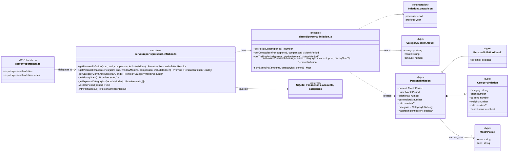
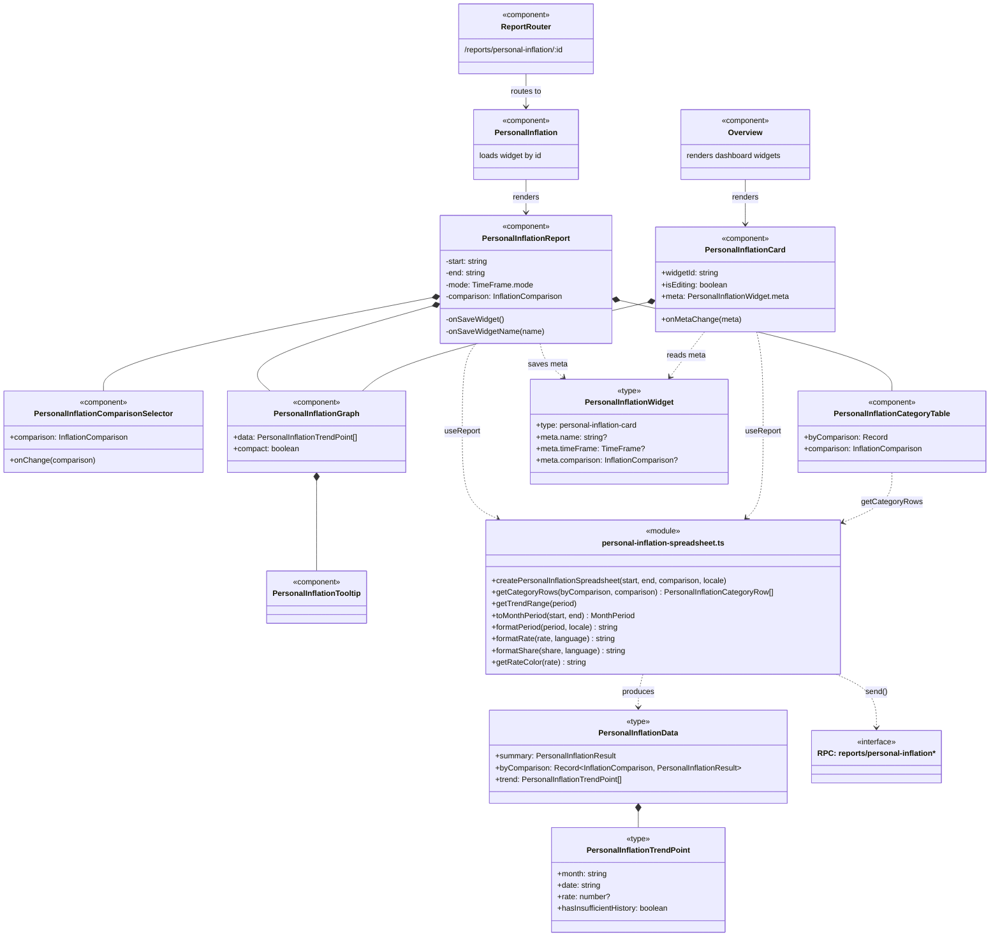
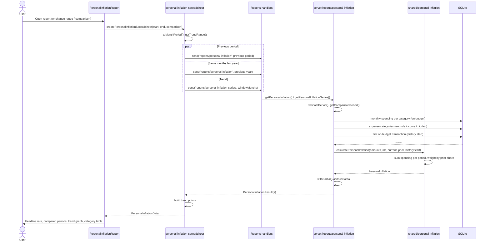
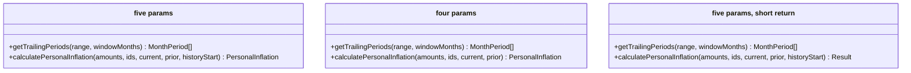

```mermaid
classDiagram
    class A["alone"] {
        +calculatePersonalInflation(amounts, ids, current, prior, historyStart) PersonalInflation
    }
    class B["after a plain line"] {
        +getPeriodLength(period) number
        +calculatePersonalInflation(amounts, ids, current, prior, historyStart) PersonalInflation
    }
    class C["after the array line"] {
        +getTrailingPeriods(range, windowMonths) MonthPeriod[]
        +getPeriodLength(period) number
    }
    class D["array as generic"] {
        +getTrailingPeriods(range, windowMonths) Array~MonthPeriod~
        +calculatePersonalInflation(amounts, ids, current, prior, historyStart) PersonalInflation
    }
```

<!-- Generated by SpecStory, Markdown v2.1.0 -->

# 2026-10-28 14:21:21Z

<!-- Claude Code Session 82b3560b-76e2-4b6b-94cb-f2265f0ff0cf (2026-10-28 14:21:21Z) -->

_**User (2026-10-28 14:21:21Z)**_

<ide_opened_file>The user opened the file c:\Users\reese\SE\actual-budget\packages\desktop-client\src\components\reports\spreadsheets\net-worth-spreadsheet.ts in the IDE. This may or may not be related to the current task.</ide_opened_file>

I want to add a feature that tracks user's personal rate of inflation for individual categories. This should track how much more, or less, a user is spending in a category relative to a prior period using the spending information that is already tracked monthly. Unlike a national CPI figure, a personal inflation rate uses a user's own category weights and actual spending history: if groceries represent 20% of a budget and grocery spending rose 12% year over year, that category contributes differently to the user's real cost-of-living than it would for someone with a 5% grocery weight. For now, just create the ability to calculate and track this number and we'll display it in the app later.

---

_**Agent (claude-opus-5-5 2026-10-28 14:21:26Z)**_

I'll start by looking at how existing reports pull monthly category spending.

_**Agent (claude-opus-5-5 2026-10-28 14:21:47Z)**_

<tool-use data-tool-type="search" data-tool-name="Glob"><details>
<summary>Tool use: **Glob**</summary>
 pattern `packages/desktop-client/src/components/reports/spreadsheets/*`

```text
Ripgrep search timed out after 20 seconds. The search may have matched files but did not complete in time. Try searching a more specific path or pattern.
```
</details></tool-use>

_**Agent (claude-opus-5-5 2026-10-28 14:21:27Z)**_

<tool-use data-tool-type="read" data-tool-name="Read"><details>
<summary>Tool use: **Read**</summary>
 `c:\Users\reese\SE\actual-budget\packages\desktop-client\src\components\reports\spreadsheets\net-worth-spreadsheet.ts`

```text
1	import { send } from '@actual-app/core/platform/client/connection';
2	import * as monthUtils from '@actual-app/core/shared/months';
3	import { q } from '@actual-app/core/shared/query';
4	import type {
5	  AccountEntity,
6	  RuleConditionEntity,
7	  TransactionEntity,
8	} from '@actual-app/core/types/models';
9	import * as d from 'date-fns';
10	import type { Locale } from 'date-fns';
11	import { keyBy } from 'es-toolkit';
12	
13	import { getIntervalFormat } from '#components/reports/ReportOptions';
14	import type { useSpreadsheet } from '#hooks/useSpreadsheet';
15	import { aqlQuery } from '#queries/aqlQuery';
16	
17	import { includeSubcategoriesInConditions } from './subcategories';
18	
19	type Balance = {
20	  date: string;
21	  amount: number;
22	};
23	
24	type AccountBalanceData = {
25	  id: string;
26	  name: string;
27	  balances: Record<string, Balance>;
28	  starting: number;
29	};
30	
31	type TransferLeg = Pick<
32	  TransactionEntity,
33	  'id' | 'account' | 'amount' | 'date'
34	> & {
35	  transfer_id: string;
36	};
37	
38	type IntervalRange = {
39	  startDate: string;
40	  endDate: string;
41	  interval: string;
42	  firstDayOfWeekIdx: string;
43	};
44	
45	export function createSpreadsheet(
46	  start: string,
47	  end: string,
48	  accounts: AccountEntity[],
49	  conditions: RuleConditionEntity[] = [],
50	  conditionsOp: 'and' | 'or' = 'and',
51	  locale: Locale,
52	  interval: string = 'Monthly',
53	  firstDayOfWeekIdx: string = '0',
54	  dateFormat?: string,
55	) {
56	  return async (
57	    spreadsheet: ReturnType<typeof useSpreadsheet>,
58	    setData: (data: ReturnType<typeof recalculate>) => void,
59	  ) => {
60	    const reportConditions = await includeSubcategoriesInConditions(conditions);
61	    const { filters } = await send('make-filters-from-conditions', {
62	      conditions: reportConditions.filter(cond => !cond.customName),
63	    });
64	    const conditionsOpKey = conditionsOp === 'or' ? '$or' : '$and';
65	
66	    // Go back exactly one interval before the selected range start
67	    // to get the correct starting balance for the first period
68	    const rangeStart = d.parseISO(monthUtils.firstDayOfMonth(start));
69	    let startDate: string;
70	    if (interval === 'Daily') {
71	      startDate = monthUtils.dayFromDate(d.subDays(rangeStart, 1));
72	    } else if (interval === 'Weekly') {
73	      startDate = monthUtils.weekFromDate(
74	        d.subDays(rangeStart, 1),
75	        firstDayOfWeekIdx,
76	      );
77	    } else {
78	      // Monthly or yearly
79	      startDate = monthUtils.firstDayOfMonth(monthUtils.prevMonth(start));
80	    }
81	
82	    // If the earliest transaction is on or after the first day of the start
83	    // month, the prior period lookback would be empty (all zeros). Skip it to
84	    // avoid rendering an empty data point.
85	    const earliestTransaction = await send('get-earliest-transaction');
86	    if (
87	      earliestTransaction &&
88	      earliestTransaction.date >= monthUtils.firstDayOfMonth(start)
89	    ) {
90	      if (interval === 'Daily') {
91	        startDate = earliestTransaction.date;
92	      } else if (interval === 'Weekly') {
93	        startDate = monthUtils.weekFromDate(
94	          earliestTransaction.date,
95	          firstDayOfWeekIdx,
96	        );
97	      } else {
98	        // Monthly or Yearly
99	        startDate = monthUtils.firstDayOfMonth(start);
100	      }
101	    }
102	
103	    // Start with the provided end-of-month date, then adjust for current context
104	    let endDate = monthUtils.lastDayOfMonth(end);
105	
106	    if (interval === 'Daily') {
107	      const today = monthUtils.currentDay();
108	      if (monthUtils.isAfter(endDate, today)) {
109	        endDate = today;
110	      }
111	    } else if (interval === 'Weekly') {
112	      // Include the ongoing (current) week up to today instead of clamping to the
113	      // start of the current week. This ensures the current week appears in the
114	      // report even if the week hasn't finished yet.
115	      const today = monthUtils.currentDay();
116	      if (monthUtils.isAfter(endDate, today)) {
117	        endDate = today;
118	      }
119	    }
120	
121	    const accountIds = accounts.map(account => account.id);
122	    const transferLegsPromise =
123	      accountIds.length === 0
124	        ? Promise.resolve<TransferLeg[]>([])
125	        : aqlQuery(
126	            q('transactions')
127	              .filter({
128	                [conditionsOpKey]: filters,
129	              })
130	              .filter({
131	                account: { $oneof: accountIds },
132	                transfer_id: { $ne: null },
133	                date: { $lte: endDate },
134	              })
135	              .select(['id', 'account', 'amount', 'date', 'transfer_id']),
136	          ).then(({ data }: { data: TransferLeg[] }) => data);
137	
138	    const accountDataPromise = Promise.all(
139	      accounts.map(async acct => {
140	        const [starting, balances]: [number, Balance[]] = await Promise.all([
141	          aqlQuery(
142	            q('transactions')
143	              .filter({
144	                [conditionsOpKey]: filters,
145	                account: acct.id,
146	                date: { $lt: startDate },
147	              })
148	              .calculate({ $sum: '$amount' }),
149	          ).then(({ data }) => data),
150	
151	          aqlQuery(
152	            q('transactions')
153	              .filter({
154	                [conditionsOpKey]: filters,
155	              })
156	              .filter({
157	                account: acct.id,
158	                $and: [
159	                  { date: { $gte: startDate } },
160	                  { date: { $lte: endDate } },
161	                ],
162	              })
163	              .groupBy(
164	                interval === 'Yearly'
165	                  ? { $year: '$date' }
166	                  : interval === 'Daily' || interval === 'Weekly'
167	                    ? 'date'
168	                    : { $month: '$date' },
169	              )
170	              .select([
171	                {
172	                  date:
173	                    interval === 'Yearly'
174	                      ? { $year: '$date' }
175	                      : interval === 'Daily' || interval === 'Weekly'
176	                        ? 'date'
177	                        : { $month: '$date' },
178	                },
179	                { amount: { $sum: '$amount' } },
180	              ]),
181	          ).then(({ data }) => data),
182	        ]);
183	
184	        // For weekly intervals, transform dates to week format and properly aggregate
185	        let processedBalances: Record<string, Balance>;
186	        if (interval === 'Weekly') {
187	          // Group transactions by week and sum their amounts
188	          const weeklyBalances: Record<string, number> = {};
189	          balances.forEach(b => {
190	            const weekDate = monthUtils.weekFromDate(b.date, firstDayOfWeekIdx);
191	            weeklyBalances[weekDate] =
192	              (weeklyBalances[weekDate] || 0) + b.amount;
193	          });
194	
195	          // Convert back to Balance format
196	          processedBalances = {};
197	          Object.entries(weeklyBalances).forEach(([date, amount]) => {
198	            processedBalances[date] = { date, amount };
199	          });
200	        } else {
201	          processedBalances = keyBy(balances, b => b.date);
202	        }
203	
204	        return {
205	          id: acct.id,
206	          name: acct.name,
207	          balances: processedBalances,
208	          starting,
209	        };
210	      }),
211	    );
212	    const [data, transferLegs] = await Promise.all([
213	      accountDataPromise,
214	      transferLegsPromise,
215	    ]);
216	
217	    const loadedTransferIds = new Set(transferLegs.map(leg => leg.id));
218	    const missingCounterpartIds = [
219	      ...new Set(
220	        transferLegs
221	          .map(leg => leg.transfer_id)
222	          .filter(id => !loadedTransferIds.has(id)),
223	      ),
224	    ];
225	
226	    let allTransferLegs = transferLegs;
227	    if (missingCounterpartIds.length > 0) {
228	      const counterpartLegs: TransferLeg[] = await aqlQuery(
229	        q('transactions')
230	          .filter({
231	            [conditionsOpKey]: filters,
232	          })
233	          .filter({
234	            id: { $oneof: missingCounterpartIds },
235	            account: { $oneof: accountIds },
236	            transfer_id: { $ne: null },
237	          })
238	          .select(['id', 'account', 'amount', 'date', 'transfer_id']),
239	      ).then(({ data }: { data: TransferLeg[] }) => data);
240	      allTransferLegs = [...transferLegs, ...counterpartLegs];
241	    }
242	
243	    // Prevent paired internal transfers from changing net worth between their
244	    // two posting dates.
245	    alignInternalTransferDates(data, allTransferLegs, {
246	      startDate,
247	      endDate,
248	      interval,
249	      firstDayOfWeekIdx,
250	    });
251	
252	    setData(
253	      recalculate(
254	        data,
255	        startDate,
256	        endDate,
257	        locale,
258	        interval,
259	        firstDayOfWeekIdx,
260	        dateFormat,
261	      ),
262	    );
263	  };
264	}
265	
266	function alignInternalTransferDates(
267	  data: AccountBalanceData[],
268	  transferLegs: TransferLeg[],
269	  range: IntervalRange,
270	) {
271	  const accountsById = new Map(data.map(account => [account.id, account]));
272	  const transfersById = new Map(transferLegs.map(leg => [leg.id, leg]));
273	  const processed = new Set<string>();
274	
275	  transferLegs.forEach(leg => {
276	    if (processed.has(leg.id)) {
277	      return;
278	    }
279	
280	    const counterpart = transfersById.get(leg.transfer_id);
281	    if (
282	      !counterpart ||
283	      counterpart.transfer_id !== leg.id ||
284	      counterpart.account === leg.account ||
285	      counterpart.amount + leg.amount !== 0 ||
286	      !accountsById.has(leg.account) ||
287	      !accountsById.has(counterpart.account)
288	    ) {
289	      return;
290	    }
291	
292	    processed.add(leg.id);
293	    processed.add(counterpart.id);
294	
295	    if (leg.date === counterpart.date) {
296	      return;
297	    }
298	
299	    const [earlier, later] =
300	      leg.date < counterpart.date ? [leg, counterpart] : [counterpart, leg];
301	
302	    const account = accountsById.get(earlier.account);
303	    if (account) {
304	      moveTransferLeg(account, earlier, later.date, range);
305	    }
306	  });
307	}
308	
309	function moveTransferLeg(
310	  account: AccountBalanceData,
311	  leg: TransferLeg,
312	  laterDate: string,
313	  range: IntervalRange,
314	) {
315	  const { startDate, endDate, interval, firstDayOfWeekIdx } = range;
316	  if (laterDate < startDate) {
317	    return;
318	  }
319	
320	  if (leg.date < startDate) {
321	    account.starting -= leg.amount;
322	  } else {
323	    if (leg.date > endDate) {
324	      return;
325	    }
326	    const originalKey = getIntervalKey(leg.date, interval, firstDayOfWeekIdx);
327	    const originalBalance = account.balances[originalKey];
328	    if (!originalBalance) {
329	      return;
330	    }
331	    originalBalance.amount -= leg.amount;
332	  }
333	
334	  if (laterDate > endDate) {
335	    return;
336	  }
337	
338	  const intervalKey = getIntervalKey(laterDate, interval, firstDayOfWeekIdx);
339	  const balance = account.balances[intervalKey];
340	  if (balance) {
341	    balance.amount += leg.amount;
342	  } else {
343	    account.balances[intervalKey] = { date: intervalKey, amount: leg.amount };
344	  }
345	}
346	
347	function getIntervalKey(
348	  date: string,
349	  interval: string,
350	  firstDayOfWeekIdx: string,
351	) {
352	  if (interval === 'Daily') {
353	    return date;
354	  }
355	  if (interval === 'Weekly') {
356	    return monthUtils.weekFromDate(date, firstDayOfWeekIdx);
357	  }
358	  if (interval === 'Yearly') {
359	    return date.slice(0, 4);
360	  }
361	  return monthUtils.getMonth(date);
362	}
363	
364	function recalculate(
365	  data: AccountBalanceData[],
366	  startDate: string,
367	  endDate: string,
368	  locale: Locale,
369	  interval: string = 'Monthly',
370	  firstDayOfWeekIdx: string = '0',
371	  dateFormat?: string,
372	) {
373	  // Get intervals using the same pattern as other working spreadsheets
374	  const intervals =
375	    interval === 'Weekly'
376	      ? monthUtils.weekRangeInclusive(startDate, endDate, firstDayOfWeekIdx)
377	      : interval === 'Daily'
378	        ? monthUtils.dayRangeInclusive(startDate, endDate)
379	        : interval === 'Yearly'
380	          ? monthUtils.yearRangeInclusive(startDate, endDate)
381	          : monthUtils.rangeInclusive(
382	              monthUtils.getMonth(startDate),
383	              monthUtils.getMonth(endDate),
384	            );
385	
386	  const accountBalances = data.map(account => {
387	    let balance = account.starting;
388	    return intervals.map(intervalItem => {
389	      if (account.balances[intervalItem]) {
390	        balance += account.balances[intervalItem].amount;
391	      }
392	      return balance;
393	    });
394	  });
395	
396	  const priorPeriodNetWorth = data.reduce(
397	    (sum, account) => sum + account.starting,
398	    0,
399	  );
400	
401	  let hasNegative = false;
402	  let startNetWorth = 0;
403	  let endNetWorth = 0;
404	  let lowestNetWorth: number | null = null;
405	  let highestNetWorth: number | null = null;
406	
407	  const graphData = intervals.reduce<
408	    Array<{
409	      x: string;
410	      y: number;
411	      assets: number;
412	      debt: number;
413	      change: number;
414	      networth: number;
415	      date: string;
416	    }>
417	  >((arr, intervalItem, idx) => {
418	    let debt = 0;
419	    let assets = 0;
420	    let total = 0;
421	    const last = arr.length === 0 ? null : arr[arr.length - 1];
422	
423	    const balances: Record<string, number> = {};
424	    accountBalances.forEach((acctBalances, i) => {
425	      const balance = acctBalances[idx];
426	      balances[data[i].id] = balance;
427	
428	      if (balance < 0) {
429	        debt += -balance;
430	      } else {
431	        assets += balance;
432	      }
433	      total += balance;
434	    });
435	
436	    if (total < 0) {
437	      hasNegative = true;
438	    }
439	
440	    // Parse dates based on interval type - following the working pattern
441	    let x: Date;
442	    if (interval === 'Daily' || interval === 'Weekly') {
443	      x = d.parseISO(intervalItem);
444	    } else if (interval === 'Yearly') {
445	      x = d.parseISO(intervalItem + '-01-01');
446	    } else {
447	      x = d.parseISO(intervalItem + '-01');
448	    }
449	
450	    const change = last ? total - last.y : total - priorPeriodNetWorth;
451	
452	    if (arr.length === 0) {
453	      startNetWorth = total;
454	    }
455	    endNetWorth = total;
456	
457	    // Use standardized format from ReportOptions, following the user's date
458	    // format preference for the day-level intervals.
459	    const displayFormat = getIntervalFormat(interval, dateFormat) || "MMM ''yy";
460	
461	    const tooltipFormat =
462	      interval === 'Daily'
463	        ? 'MMMM d, yyyy'
464	        : interval === 'Weekly'
465	          ? 'MMM d, yyyy'
466	          : interval === 'Yearly'
467	            ? 'yyyy'
468	            : 'MMMM yyyy';
469	
470	    const graphPoint = {
471	      x: d.format(x, displayFormat, { locale }),
472	      y: total,
473	      assets,
474	      debt: -debt,
475	      change,
476	      networth: total,
477	      date: d.format(x, tooltipFormat, { locale }),
478	      ...balances,
479	    };
480	
481	    arr.push(graphPoint);
482	
483	    // Track min/max for the current point only
484	    if (lowestNetWorth === null || graphPoint.y < lowestNetWorth) {
485	      lowestNetWorth = graphPoint.y;
486	    }
487	    if (highestNetWorth === null || graphPoint.y > highestNetWorth) {
488	      highestNetWorth = graphPoint.y;
489	    }
490	
491	    return arr;
492	  }, []);
493	
494	  const hasBalance = accountBalances.map(balances =>
495	    balances.some(b => b !== 0),
496	  );
497	
498	  const totalChange = endNetWorth - startNetWorth;
499	  // Divide by the absolute starting value so the sign always follows the
500	  // change (a decrease is negative even when net worth started below zero).
501	  let totalChangePercent: number | null;
502	  if (totalChange === 0) {
503	    totalChangePercent = 0;
504	  } else if (startNetWorth === 0) {
505	    // Any change from a zero starting point has no meaningful percentage
506	    totalChangePercent = null;
507	  } else {
508	    totalChangePercent = (totalChange / Math.abs(startNetWorth)) * 100;
509	  }
510	
511	  return {
512	    graphData: {
513	      data: graphData,
514	      hasNegative,
515	      start: startDate,
516	      end: endDate,
517	    },
518	    netWorth: endNetWorth,
519	    totalChange,
520	    totalChangePercent,
521	    lowestNetWorth,
522	    highestNetWorth,
523	    accounts: data
524	      .filter((_, i) => hasBalance[i])
525	      .map(d => ({ id: d.id, name: d.name })),
526	  };
527	}
528
```
</details></tool-use>

_**Agent (claude-opus-5-5 2026-10-28 14:21:59Z)**_

<tool-use data-tool-type="unknown" data-tool-name="Agent"><details>
<summary>Tool use: **Agent**</summary>
Find monthly category spending sources

```text
Async agent launched successfully. (This tool result is internal metadata — never quote or paste any part of it, including the agentId below, into a user-facing reply.)
agentId: acff2bd731505308f (internal ID - do not mention to user. Use SendMessage with to: 'acff2bd731505308f', summary: '<5-10 word recap>' to continue this agent.)
The agent is working in the background. You will be notified automatically when it completes. You know nothing about its results until that notification arrives — do not report, assume, or predict them; continue other work or respond to the user in the meantime.
Do not duplicate this agent's work — avoid working with the same files or topics it is using.
output_file: C:\Users\reese\AppData\Local\Temp\claude\c--Users-reese-SE-actual-budget\82b3560b-76e2-4b6b-94cb-f2265f0ff0cf\tasks\acff2bd731505308f.output
Do NOT Read or tail this file via the shell tool — it is the full subagent JSONL transcript and reading it will overflow your context. If the user asks for progress, say the agent is still running; you'll get a completion notification.
```
</details></tool-use>

_**Agent - sidechain (2026-10-28 14:21:59Z)**_

In the Actual Budget monorepo at c:\Users\reese\SE\actual-budget, I'm planning a "personal inflation rate" calculation: per category, compare spending in a period vs a prior period (e.g. YoY), and a weighted aggregate using each category's share of total spending. Nothing should be displayed yet; I just need the calculation + a way to fetch data. Search breadth: medium. Note: Glob over packages/desktop-client times out; use narrower paths.

Please report (with file paths and line numbers, short code excerpts):
1. How monthly per-category spending is already tracked/exposed. In loot-core, the budget sheets (`budget<YYYYMM>` sheets with `sum-amount-<catId>` cells, probably in packages/loot-core/src/server/budget/ — base.ts, envelope.ts, etc.) — how are they computed and how does the client read them (e.g. `send('get-cell')`, `envelopeBudget`/`trackingBudget` bindings in packages/loot-core/src/client/queries or desktop-client spreadsheet bindings)? Is there a server handler that returns spent amounts for a range of months per category?
2. Existing report spreadsheets in packages/desktop-client/src/components/reports/spreadsheets/ that aggregate spending by category and month (e.g. spending-spreadsheet.ts, custom-spreadsheet.ts, summary-spreadsheet, budget analysis). How they query (aqlQuery with groupBy category & $month), how they exclude transfers/off-budget/income/hidden categories, and how they handle category groups (is_income).
3. Their unit tests: list test files in that spreadsheets dir and in packages/loot-core/src/shared/ (e.g. months.test.ts), and show the mocking pattern used for spreadsheet tests (do they mock aqlQuery/send?).
4. Any existing pure-math helper modules in loot-core/src/shared (e.g. util.ts, arithmetic) and how amounts are stored (integer cents?) and months formatted (monthUtils in loot-core/src/shared/months.ts — functions like subMonths, rangeInclusive, prevMonth, addMonths).
5. Any server-side "handlers"/API methods pattern for adding a new loot-core RPC (e.g. packages/loot-core/src/server/main.ts handler registration, types/handlers.d.ts), in case we put the calc server-side.

_**Agent (claude-opus-5-5 2026-10-28 14:22:01Z)**_

I've started an exploration agent to map where monthly category spending lives and how existing reports query it. I'll write the plan once it reports back.

_**Agent - sidechain (claude-opus-5-5 2026-10-28 14:22:02Z)**_

I'll start with parallel searches across the key areas.

_**Agent - sidechain (claude-opus-5-5 2026-10-28 14:22:04Z)**_

<tool-use data-tool-type="shell" data-tool-name="Bash"><details>
<summary>Tool use: **Bash**</summary>
List key directories

`cd /c/Users/reese/SE/actual-budget; ls packages/loot-core/src/server/budget/ packages/desktop-client/src/components/reports/spreadsheets/ packages/loot-core/src/shared/; ls packages/loot-core/src/client 2>/dev/null; ls packages/loot-core/src/types 2>/dev/null; ls packages/loot-core/src/server | head -80`

```text
PreToolUse:Bash hook error: ["$CLAUDE_PROJECT_DIR/scripts/agent-hooks/git-guard.sh"]: Blocked: the agent hooks require 'jq', which was not found on PATH. Install jq (https://jqlang.org) and retry. (scripts/agent-hooks/git-guard.sh)
```
</details></tool-use>

_**Agent - sidechain (claude-opus-5-5 2026-10-28 14:22:07Z)**_

Bash is blocked by a hook, so I'll use Glob, Grep and Read.

_**Agent - sidechain (claude-opus-5-5 2026-10-28 14:22:07Z)**_

<tool-use data-tool-type="search" data-tool-name="Glob"><details>
<summary>Tool use: **Glob**</summary>
 path `c:\Users\reese\SE\actual-budget\packages\desktop-client\src\components\reports\spreadsheets` pattern `*`

```text
packages\desktop-client\src\components\reports\spreadsheets\budgetDataQuery.test.ts
packages\desktop-client\src\components\reports\spreadsheets\budgetMonthCell.ts
packages\desktop-client\src\components\reports\spreadsheets\calculateLegend.ts
packages\desktop-client\src\components\reports\spreadsheets\crossover-spreadsheet.ts
packages\desktop-client\src\components\reports\spreadsheets\filterHiddenItems.ts
packages\desktop-client\src\components\reports\spreadsheets\makeQuery.ts
packages\desktop-client\src\components\reports\spreadsheets\sortData.ts
packages\desktop-client\src\components\reports\spreadsheets\spending-spreadsheet.test.ts
packages\desktop-client\src\components\reports\spreadsheets\budget-analysis-export.test.ts
packages\desktop-client\src\components\reports\spreadsheets\budget-analysis-export.ts
packages\desktop-client\src\components\reports\spreadsheets\budgetDataQuery.ts
packages\desktop-client\src\components\reports\spreadsheets\calendar-spreadsheet.ts
packages\desktop-client\src\components\reports\spreadsheets\cash-flow-spreadsheet.ts
packages\desktop-client\src\components\reports\spreadsheets\fetchSpreadsheetQueryData.ts
packages\desktop-client\src\components\reports\spreadsheets\filterEmptyRows.ts
packages\desktop-client\src\components\reports\spreadsheets\grouped-spreadsheet.ts
packages\desktop-client\src\components\reports\spreadsheets\recalculate.ts
packages\desktop-client\src\components\reports\spreadsheets\spending-spreadsheet.ts
packages\desktop-client\src\components\reports\spreadsheets\subcategories.test.ts
packages\desktop-client\src\components\reports\spreadsheets\subcategories.ts
packages\desktop-client\src\components\reports\spreadsheets\summary-spreadsheet.ts
packages\desktop-client\src\components\reports\spreadsheets\trimIntervals.ts
packages\desktop-client\src\components\reports\spreadsheets\age-of-money-spreadsheet.test.ts
packages\desktop-client\src\components\reports\spreadsheets\age-of-money-spreadsheet.ts
packages\desktop-client\src\components\reports\spreadsheets\budget-analysis-spreadsheet.test.ts
packages\desktop-client\src\components\reports\spreadsheets\budget-analysis-spreadsheet.ts
packages\desktop-client\src\components\reports\spreadsheets\custom-spreadsheet.ts
packages\desktop-client\src\components\reports\spreadsheets\sankey-spreadsheet.test.ts
packages\desktop-client\src\components\reports\spreadsheets\sankey-spreadsheet.ts
packages\desktop-client\src\components\reports\spreadsheets\net-worth-spreadsheet.ts
packages\desktop-client\src\components\reports\spreadsheets\net-worth-spreadsheet.test.ts
```
</details></tool-use>

_**Agent - sidechain (claude-opus-5-5 2026-10-28 14:22:08Z)**_

<tool-use data-tool-type="search" data-tool-name="Glob"><details>
<summary>Tool use: **Glob**</summary>
 path `c:\Users\reese\SE\actual-budget\packages\loot-core\src\server\budget` pattern `*`

```text
packages\loot-core\src\server\budget\actions.test.ts
packages\loot-core\src\server\budget\base.test.ts
packages\loot-core\src\server\budget\category-template-context.test.ts
packages\loot-core\src\server\budget\category-template-context.ts
packages\loot-core\src\server\budget\cleanup-groups.ts
packages\loot-core\src\server\budget\cleanup-template-notes.test.ts
packages\loot-core\src\server\budget\cleanup-template-notes.ts
packages\loot-core\src\server\budget\cleanup-template.pegjs
packages\loot-core\src\server\budget\goal-template.pegjs
packages\loot-core\src\server\budget\schedule-template.test.ts
packages\loot-core\src\server\budget\schedule-template.ts
packages\loot-core\src\server\budget\sort-categories.test.ts
packages\loot-core\src\server\budget\sort-categories.ts
packages\loot-core\src\server\budget\statements.ts
packages\loot-core\src\server\budget\tracking.ts
packages\loot-core\src\server\budget\util.ts
packages\loot-core\src\server\budget\actions.ts
packages\loot-core\src\server\budget\app.ts
packages\loot-core\src\server\budget\base.ts
packages\loot-core\src\server\budget\subcategories.test.ts
packages\loot-core\src\server\budget\cleanup-template.test.ts
packages\loot-core\src\server\budget\cleanup-template.ts
packages\loot-core\src\server\budget\envelope.ts
packages\loot-core\src\server\budget\goal-template.test.ts
packages\loot-core\src\server\budget\goal-template.ts
packages\loot-core\src\server\budget\template-notes.test.ts
packages\loot-core\src\server\budget\template-notes.ts
packages\loot-core\src\server\budget\template-notification.ts
```
</details></tool-use>

_**Agent - sidechain (claude-opus-5-5 2026-10-28 14:22:09Z)**_

<tool-use data-tool-type="search" data-tool-name="Glob"><details>
<summary>Tool use: **Glob**</summary>
 path `c:\Users\reese\SE\actual-budget\packages\loot-core\src\shared` pattern `*`

```text
packages\loot-core\src\shared\__mocks__\platform.ts
packages\loot-core\src\shared\arithmetic.test.ts
packages\loot-core\src\shared\__snapshots__\months.test.ts.snap
packages\loot-core\src\shared\arithmetic.ts
packages\loot-core\src\shared\async.test.ts
packages\loot-core\src\shared\async.ts
packages\loot-core\src\shared\constants.ts
packages\loot-core\src\shared\currencies.test.ts
packages\loot-core\src\shared\dashboard.ts
packages\loot-core\src\shared\environment.browser.ts
packages\loot-core\src\shared\environment.ts
packages\loot-core\src\shared\errors.test.ts
packages\loot-core\src\shared\locale.ts
packages\loot-core\src\shared\location-utils.test.ts
packages\loot-core\src\shared\location-utils.ts
packages\loot-core\src\shared\memoize.ts
packages\loot-core\src\shared\merge.test.ts
packages\loot-core\src\shared\merge.ts
packages\loot-core\src\shared\normalisation.test.ts
packages\loot-core\src\shared\normalisation.ts
packages\loot-core\src\shared\retry.ts
packages\loot-core\src\shared\rules.test.ts
packages\loot-core\src\shared\rules.ts
packages\loot-core\src\shared\test-helpers.ts
packages\loot-core\src\shared\transfer.test.ts
packages\loot-core\src\shared\transfer.ts
packages\loot-core\src\shared\user.ts
packages\loot-core\src\shared\util.test.ts
packages\loot-core\src\shared\categories.test.ts
packages\loot-core\src\shared\categories.ts
packages\loot-core\src\shared\currencies.ts
packages\loot-core\src\shared\errors.ts
packages\loot-core\src\shared\formulas\customFunctions.ts
packages\loot-core\src\shared\months.test.ts
packages\loot-core\src\shared\months.ts
packages\loot-core\src\shared\platform.api.ts
packages\loot-core\src\shared\platform.electron.ts
packages\loot-core\src\shared\platform.ts
packages\loot-core\src\shared\query.ts
packages\loot-core\src\shared\schedules.test.ts
packages\loot-core\src\shared\schedules.ts
packages\loot-core\src\shared\tags.test.ts
packages\loot-core\src\shared\tags.ts
packages\loot-core\src\shared\transactions.test.ts
packages\loot-core\src\shared\transactions.ts
packages\loot-core\src\shared\util.ts
```
</details></tool-use>

_**Agent - sidechain (claude-opus-5-5 2026-10-28 14:22:11Z)**_

<tool-use data-tool-type="read" data-tool-name="Read"><details>
<summary>Tool use: **Read**</summary>
 `c:\Users\reese\SE\actual-budget\packages\loot-core\src\server\budget\base.ts`

```text
1	import { aqlQuery } from '#server/aql';
2	import * as db from '#server/db';
3	import * as sheet from '#server/sheet';
4	import { resolveName } from '#server/spreadsheet/util';
5	// @ts-strict-ignore
6	import * as monthUtils from '#shared/months';
7	import { q } from '#shared/query';
8	import { getChangedValues } from '#shared/util';
9	import type { CategoryGroupEntity } from '#types/models';
10	
11	import * as budgetActions from './actions';
12	import * as envelopeBudget from './envelope';
13	import * as trackingBudget from './tracking';
14	import { sumAmounts as sumCellAmounts } from './util';
15	
16	export function getBudgetType() {
17	  const meta = sheet.get().meta();
18	  return meta.budgetType || 'envelope';
19	}
20	
21	export function getBudgetRange(start: string, end: string) {
22	  start = monthUtils.getMonth(start);
23	  end = monthUtils.getMonth(end);
24	
25	  // The start date should never be after the end date. If that
26	  // happened, the month range might be a valid range and weird
27	  // things happen
28	  if (start > end) {
29	    start = end;
30	  }
31	
32	  // Budgets should exist 3 months before the earliest needed date
33	  // (either the oldest transaction or the current month if no
34	  // transactions yet), and a year from the current date. There's no
35	  // need to ever have budgets outside that range.
36	  start = monthUtils.subMonths(start, 3);
37	  end = monthUtils.addMonths(end, 12);
38	
39	  return { start, end, range: monthUtils.rangeInclusive(start, end) };
40	}
41	
42	// Computes the spend total for every category in every month within the
43	// given day range using a single grouped query. This is used to seed the
44	// `sum-amount` cells on a cold build so we avoid running one
45	// `SELECT SUM(amount)` query per category per month (which scales as
46	// categories × months and dominates load time for budgets with many years
47	// of data). The filters must match the per-cell query in `createCategory`
48	// exactly so balances stay identical.
49	function getSumAmountsByMonth(
50	  rangeStart: number,
51	  rangeEnd: number,
52	): Map<string, number> {
53	  const rows = db.runQuery<{ month: number; category: string; amount: number }>(
54	    `SELECT t.category AS category,
55	            t.date / 100 AS month,
56	            SUM(t.amount) AS amount
57	       FROM v_transactions_internal_alive t
58	       LEFT JOIN accounts a ON a.id = t.account
59	      WHERE t.date >= ${rangeStart} AND t.date <= ${rangeEnd}
60	        AND t.category IS NOT NULL
61	        AND a.offbudget = 0
62	      GROUP BY t.category, t.date / 100`,
63	    [],
64	    true,
65	  );
66	
67	  const sums = new Map<string, number>();
68	  for (const row of rows) {
69	    sums.set(`${row.month}-${row.category}`, row.amount || 0);
70	  }
71	  return sums;
72	}
73	
74	export function createCategory(
75	  cat,
76	  sheetName,
77	  prevSheetName,
78	  start,
79	  end,
80	  childIds: string[] = [],
81	) {
82	  sheet.get().createDynamic(sheetName, 'sum-amount-' + cat.id, {
83	    initialValue: 0,
84	    run: () => {
85	      // Making this sync is faster!
86	      const rows = db.runQuery<{ amount: number }>(
87	        `SELECT SUM(amount) as amount FROM v_transactions_internal_alive t
88	           LEFT JOIN accounts a ON a.id = t.account
89	         WHERE t.date >= ${start} AND t.date <= ${end}
90	           AND category = '${cat.id}' AND a.offbudget = 0`,
91	        [],
92	        true,
93	      );
94	      const row = rows[0];
95	      const amount = row ? row.amount : 0;
96	      return amount || 0;
97	    },
98	  });
99	
100	  if (getBudgetType() === 'envelope') {
101	    envelopeBudget.createCategory(cat, sheetName, prevSheetName);
102	  } else {
103	    void trackingBudget.createCategory(cat, sheetName, prevSheetName);
104	  }
105	
106	  // Display-only: what the category holds plus everything its
107	  // subcategories hold. It doesn't feed any totals, since a subcategory's
108	  // budget is already taken out of its parent's own budget.
109	  if (!cat.is_income) {
110	    sheet.get().createDynamic(sheetName, `parent-total-budget-${cat.id}`, {
111	      initialValue: 0,
112	      dependencies: [cat.id, ...childIds].map(id => `budget-${id}`),
113	      run: sumCellAmounts,
114	    });
115	  }
116	}
117	
118	// Keeps each parent's parent-total-budget cell in sync when a
119	// subcategory is created, deleted or moved to a different parent.
120	function handleCategoryParentChange(months, oldValue, newValue) {
121	  const oldParent =
122	    oldValue && oldValue.tombstone === 0 ? oldValue.parent_id : null;
123	  const newParent = newValue.tombstone === 0 ? newValue.parent_id : null;
124	  if (oldParent === newParent) {
125	    return;
126	  }
127	
128	  months.forEach(month => {
129	    const sheetName = monthUtils.sheetForMonth(month);
130	    const dep = [`budget-${newValue.id}`];
131	    if (oldParent) {
132	      sheet
133	        .get()
134	        .removeDependencies(sheetName, `parent-total-budget-${oldParent}`, dep);
135	    }
136	    if (newParent) {
137	      sheet
138	        .get()
139	        .addDependencies(sheetName, `parent-total-budget-${newParent}`, dep);
140	    }
141	  });
142	}
143	
144	function handleAccountChange(months, oldValue, newValue) {
145	  if (!oldValue || oldValue.offbudget !== newValue.offbudget) {
146	    const rows = db.runQuery<Pick<db.DbTransaction, 'category'>>(
147	      `
148	        SELECT DISTINCT(category) as category FROM transactions
149	        WHERE acct = ?
150	      `,
151	      [newValue.id],
152	      true,
153	    );
154	
155	    months.forEach(month => {
156	      const sheetName = monthUtils.sheetForMonth(month);
157	
158	      rows.forEach(row => {
159	        sheet
160	          .get()
161	          .recompute(resolveName(sheetName, 'sum-amount-' + row.category));
162	      });
163	    });
164	  }
165	}
166	
167	function handleTransactionChange(transaction, changedFields) {
168	  if (
169	    (changedFields.has('date') ||
170	      changedFields.has('acct') ||
171	      changedFields.has('amount') ||
172	      changedFields.has('category') ||
173	      changedFields.has('tombstone') ||
174	      changedFields.has('isParent')) &&
175	    transaction.date &&
176	    transaction.category
177	  ) {
178	    const month = monthUtils.monthFromDate(db.fromDateRepr(transaction.date));
179	    const sheetName = monthUtils.sheetForMonth(month);
180	
181	    sheet
182	      .get()
183	      .recompute(resolveName(sheetName, 'sum-amount-' + transaction.category));
184	  }
185	}
186	
187	function handleCategoryMappingChange(months, oldValue, newValue) {
188	  months.forEach(month => {
189	    const sheetName = monthUtils.sheetForMonth(month);
190	    if (oldValue) {
191	      sheet
192	        .get()
193	        .recompute(resolveName(sheetName, 'sum-amount-' + oldValue.transferId));
194	    }
195	    sheet
196	      .get()
197	      .recompute(resolveName(sheetName, 'sum-amount-' + newValue.transferId));
198	  });
199	}
200	
201	function handleBudgetMonthChange(budget) {
202	  const sheetName = monthUtils.sheetForMonth(budget.id);
203	  sheet.get().set(`${sheetName}!buffered`, budget.buffered);
204	}
205	
206	function handleBudgetChange(budget) {
207	  if (budget.category) {
208	    const sheetName = monthUtils.sheetForMonth(budget.month.toString());
209	    sheet
210	      .get()
211	      .set(`${sheetName}!budget-${budget.category}`, budget.amount || 0);
212	    sheet
213	      .get()
214	      .set(
215	        `${sheetName}!carryover-${budget.category}`,
216	        budget.carryover === 1 ? true : false,
217	      );
218	    sheet.get().set(`${sheetName}!goal-${budget.category}`, budget.goal);
219	    sheet
220	      .get()
221	      .set(`${sheetName}!long-goal-${budget.category}`, budget.long_goal);
222	  }
223	}
224	
225	export function triggerBudgetChanges(oldValues, newValues) {
226	  const { createdMonths = new Set() } = sheet.get().meta();
227	  const budgetType = getBudgetType();
228	  sheet.startTransaction();
229	
230	  try {
231	    newValues.forEach((items, table) => {
232	      const old = oldValues.get(table);
233	
234	      items.forEach(newValue => {
235	        const oldValue = old && old.get(newValue.id);
236	
237	        if (table === 'zero_budget_months') {
238	          handleBudgetMonthChange(newValue);
239	        } else if (table === 'zero_budgets' || table === 'reflect_budgets') {
240	          handleBudgetChange(newValue);
241	        } else if (table === 'transactions') {
242	          const changed = new Set(
243	            Object.keys(getChangedValues(oldValue || {}, newValue) || {}),
244	          );
245	
246	          if (oldValue) {
247	            handleTransactionChange(oldValue, changed);
248	          }
249	          handleTransactionChange(newValue, changed);
250	        } else if (table === 'category_mapping') {
251	          handleCategoryMappingChange(createdMonths, oldValue, newValue);
252	        } else if (table === 'categories') {
253	          if (budgetType === 'envelope') {
254	            envelopeBudget.handleCategoryChange(
255	              createdMonths,
256	              oldValue,
257	              newValue,
258	            );
259	          } else {
260	            trackingBudget.handleCategoryChange(
261	              createdMonths,
262	              oldValue,
263	              newValue,
264	            );
265	          }
266	          handleCategoryParentChange(createdMonths, oldValue, newValue);
267	        } else if (table === 'category_groups') {
268	          if (budgetType === 'envelope') {
269	            envelopeBudget.handleCategoryGroupChange(
270	              createdMonths,
271	              oldValue,
272	              newValue,
273	            );
274	          } else {
275	            trackingBudget.handleCategoryGroupChange(
276	              createdMonths,
277	              oldValue,
278	              newValue,
279	            );
280	          }
281	        } else if (table === 'accounts') {
282	          handleAccountChange(createdMonths, oldValue, newValue);
283	        }
284	      });
285	    });
286	  } finally {
287	    sheet.endTransaction();
288	  }
289	}
290	
291	export async function doTransfer(categoryIds, transferId) {
292	  const { createdMonths: months } = sheet.get().meta();
293	
294	  [...months].forEach(month => {
295	    const totalValue = categoryIds
296	      .map(id => {
297	        return budgetActions.getBudget({ month, category: id });
298	      })
299	      .reduce((total, value) => total + value, 0);
300	
301	    const transferValue = budgetActions.getBudget({
302	      month,
303	      category: transferId,
304	    });
305	
306	    void budgetActions.setBudget({
307	      month,
308	      category: transferId,
309	      amount: totalValue + transferValue,
310	    });
311	  });
312	}
313	
314	export async function createBudget(months) {
315	  const { data: groups }: { data: CategoryGroupEntity[] } = await aqlQuery(
316	    q('category_groups').select('*'),
317	  );
318	  const categories = groups.flatMap(group => group.categories);
319	
320	  const childIdsByParent = new Map<string, string[]>();
321	  for (const cat of categories) {
322	    if (cat.parent_id) {
323	      const childIds = childIdsByParent.get(cat.parent_id) ?? [];
324	      childIds.push(cat.id);
325	      childIdsByParent.set(cat.parent_id, childIds);
326	    }
327	  }
328	
329	  sheet.startTransaction();
330	  const meta = sheet.get().meta();
331	  meta.createdMonths = meta.createdMonths || new Set();
332	
333	  const budgetType = getBudgetType();
334	
335	  if (budgetType === 'envelope') {
336	    envelopeBudget.createBudget(meta, categories, months);
337	  }
338	
339	  // Only months that don't already exist need to be created and seeded.
340	  const monthsToCreate = months.filter(month => !meta.createdMonths.has(month));
341	
342	  // Spend totals for every category in the months being created, computed
343	  // once via a single grouped query and used to seed the `sum-amount` cells so
344	  // they don't each run their own query. Scoped to the uncached month span so
345	  // extending the budget horizon doesn't rescan the entire transaction
346	  // history, and loaded lazily so warm loads never touch the database here.
347	  let sumAmounts: Map<string, number> | null = null;
348	  const getSumAmounts = () => {
349	    if (!sumAmounts) {
350	      // `monthsToCreate` isn't guaranteed to be sorted, so find the span
351	      // explicitly ('YYYY-MM' strings compare chronologically).
352	      let firstMonth = monthsToCreate[0];
353	      let lastMonth = monthsToCreate[0];
354	      for (const month of monthsToCreate) {
355	        if (month < firstMonth) {
356	          firstMonth = month;
357	        }
358	        if (month > lastMonth) {
359	          lastMonth = month;
360	        }
361	      }
362	      sumAmounts = getSumAmountsByMonth(
363	        monthUtils.bounds(firstMonth).start,
364	        monthUtils.bounds(lastMonth).end,
365	      );
366	    }
367	    return sumAmounts;
368	  };
369	  const seededCells: string[] = [];
370	
371	  monthsToCreate.forEach(month => {
372	    const prevMonth = monthUtils.prevMonth(month);
373	    const { start, end } = monthUtils.bounds(month);
374	    const sheetName = monthUtils.sheetForMonth(month);
375	    const prevSheetName = monthUtils.sheetForMonth(prevMonth);
376	    const dbMonth = parseInt(month.replace('-', ''));
377	
378	    categories.forEach(cat => {
379	      // Seed the spend total before creating the dynamic cell so the cell
380	      // skips its per-category query. Only happens on a cold build, when
381	      // the value hasn't been restored from cache.
382	      const sumCell = `sum-amount-${cat.id}`;
383	      if (sheet.get().getCellValueLoose(sheetName, sumCell) == null) {
384	        const name = resolveName(sheetName, sumCell);
385	        sheet
386	          .get()
387	          .load(name, getSumAmounts().get(`${dbMonth}-${cat.id}`) || 0);
388	        seededCells.push(name);
389	      }
390	      createCategory(
391	        cat,
392	        sheetName,
393	        prevSheetName,
394	        start,
395	        end,
396	        childIdsByParent.get(cat.id),
397	      );
398	    });
399	    groups.forEach(group => {
400	      if (budgetType === 'envelope') {
401	        envelopeBudget.createCategoryGroup(group, sheetName);
402	      } else {
403	        trackingBudget.createCategoryGroup(group, sheetName);
404	      }
405	    });
406	
407	    if (budgetType === 'envelope') {
408	      envelopeBudget.createSummary(
409	        groups,
410	        categories,
411	        prevSheetName,
412	        sheetName,
413	      );
414	    } else {
415	      trackingBudget.createSummary(groups, sheetName);
416	    }
417	
418	    meta.createdMonths.add(month);
419	  });
420	
421	  sheet.get().setMeta(meta);
422	  sheet.endTransaction();
423	
424	  // Persist the seeded spend totals to the cache. Because they were loaded
425	  // directly (rather than recomputed) they aren't part of the computation
426	  // queue that normally gets cached, so without this a warm load would have
427	  // to recompute them. The cells already hold their final values here.
428	  if (seededCells.length > 0) {
429	    sheet.get().saveCachedCells(seededCells);
430	  }
431	
432	  // Wait for the spreadsheet to finish computing. Normally this won't
433	  // do anything (as values are cached) but on first run this need to
434	  // show the loading screen while it initially sets up.
435	  await sheet.waitOnSpreadsheet();
436	}
437	
438	export async function createAllBudgets() {
439	  const earliestTransaction = await db.first<db.DbTransaction>(
440	    'SELECT * FROM transactions WHERE isChild=0 AND date IS NOT NULL ORDER BY date ASC LIMIT 1',
441	  );
442	  const earliestDate =
443	    earliestTransaction && db.fromDateRepr(earliestTransaction.date);
444	  const currentMonth = monthUtils.currentMonth();
445	
446	  // Get the range based off of the earliest transaction and the
447	  // current month. If no transactions currently exist the current
448	  // month is also used as the starting month
449	  const { start, end, range } = getBudgetRange(
450	    earliestDate || currentMonth,
451	    currentMonth,
452	  );
453	
454	  const meta = sheet.get().meta();
455	  const createdMonths = meta.createdMonths || new Set();
456	  const newMonths = range.filter(m => !createdMonths.has(m));
457	
458	  if (newMonths.length > 0) {
459	    await createBudget(range);
460	  }
461	
462	  return { start, end };
463	}
464	
465	export async function setType(type) {
466	  const meta = sheet.get().meta();
467	  if (type === meta.budgetType) {
468	    return;
469	  }
470	
471	  meta.budgetType = type;
472	  meta.createdMonths = new Set();
473	
474	  // Go through and force all the cells to be recomputed
475	  const nodes = sheet.get().getNodes();
476	  db.transaction(() => {
477	    for (const name of nodes.keys()) {
478	      const [sheetName, cellName] = name.split('!');
479	      if (sheetName.match(/^budget\d+/)) {
480	        sheet.get().deleteCell(sheetName, cellName);
481	      }
482	    }
483	  });
484	
485	  sheet.get().startCacheBarrier();
486	  void sheet.loadUserBudgets(db);
487	  const bounds = await createAllBudgets();
488	  sheet.get().endCacheBarrier();
489	
490	  return bounds;
491	}
492
```
</details></tool-use>

_**Agent - sidechain (claude-opus-5-5 2026-10-28 14:22:11Z)**_

<tool-use data-tool-type="read" data-tool-name="Read"><details>
<summary>Tool use: **Read**</summary>
 `c:\Users\reese\SE\actual-budget\packages\desktop-client\src\components\reports\spreadsheets\spending-spreadsheet.ts`

```text
1	import { send } from '@actual-app/core/platform/client/connection';
2	import * as monthUtils from '@actual-app/core/shared/months';
3	import { q } from '@actual-app/core/shared/query';
4	import type {
5	  CategoryEntity,
6	  CategoryGroupEntity,
7	  RuleConditionEntity,
8	  SpendingAverageRange,
9	  SpendingEntity,
10	  SpendingMonthEntity,
11	} from '@actual-app/core/types/models';
12	// @ts-strict-ignore
13	import { keyBy } from 'es-toolkit';
14	
15	import { resolveSpendingAverageRange } from '#components/reports/spendingAverageRange';
16	import { fromDateRepr } from '#components/reports/util';
17	import type { useSpreadsheet } from '#hooks/useSpreadsheet';
18	import { aqlQuery } from '#queries/aqlQuery';
19	
20	import {
21	  filterCategoriesByConditions,
22	  isSupportedCategoryCondition,
23	} from './budgetDataQuery';
24	import { makeQuery } from './makeQuery';
25	import { includeSubcategoriesInConditions } from './subcategories';
26	
27	type createSpendingSpreadsheetProps = {
28	  conditions?: RuleConditionEntity[];
29	  conditionsOp?: 'and' | 'or';
30	  compare?: string;
31	  compareTo?: string;
32	  averageRange?: SpendingAverageRange;
33	  budgetType?: 'envelope' | 'tracking';
34	};
35	
36	export function getSpendingBudgetFilters({
37	  categories,
38	  categoryGroups,
39	  conditions,
40	  conditionsOp,
41	}: {
42	  categories: CategoryEntity[];
43	  categoryGroups: CategoryGroupEntity[];
44	  conditions: RuleConditionEntity[];
45	  conditionsOp?: 'and' | 'or';
46	}) {
47	  const budgetConditions = conditions.filter(
48	    cond =>
49	      !cond.customName &&
50	      (cond.field === 'category' || cond.field === 'category_group'),
51	  );
52	
53	  if (budgetConditions.length === 0) {
54	    return [];
55	  }
56	
57	  if (!budgetConditions.every(isSupportedCategoryCondition)) {
58	    return [];
59	  }
60	
61	  const matchingCategoryIds = filterCategoriesByConditions(
62	    categories,
63	    categoryGroups,
64	    budgetConditions,
65	    conditionsOp ?? 'and',
66	  ).map(category => category.id);
67	
68	  return [{ category: { $oneof: matchingCategoryIds } }];
69	}
70	
71	export function createSpendingSpreadsheet({
72	  conditions = [],
73	  conditionsOp,
74	  compare,
75	  compareTo,
76	  averageRange,
77	  budgetType = 'envelope',
78	}: createSpendingSpreadsheetProps) {
79	  const compareMonth = compare ?? monthUtils.currentMonth();
80	  const compareToMonth = compareTo ?? monthUtils.subMonths(compareMonth, 1);
81	  const endDate = monthUtils.getMonthEnd(compareMonth + '-01');
82	  const startDateTo = compareToMonth + '-01';
83	  const endDateTo = monthUtils.getMonthEnd(compareToMonth + '-01');
84	  const interval = 'Daily';
85	  const compareInterval = monthUtils.dayRangeInclusive(
86	    compareMonth + '-01',
87	    endDate,
88	  );
89	
90	  return async (
91	    spreadsheet: ReturnType<typeof useSpreadsheet>,
92	    setData: (data: SpendingEntity) => void,
93	  ) => {
94	    const earliestTrans =
95	      averageRange?.mode === 'all-time'
96	        ? await send('get-earliest-transaction')
97	        : null;
98	    const earliestMonth = earliestTrans
99	      ? monthUtils.monthFromDate(fromDateRepr(earliestTrans.date))
100	      : null;
101	    const resolvedAverageRange = resolveSpendingAverageRange({
102	      averageRange,
103	      compare: compareMonth,
104	      earliestMonth,
105	    });
106	    const averageMonths = new Set(resolvedAverageRange.months);
107	    const startDate = (resolvedAverageRange.startMonth ?? compareMonth) + '-01';
108	
109	    const reportConditions = await includeSubcategoriesInConditions(conditions);
110	    const { filters } = await send('make-filters-from-conditions', {
111	      conditions: reportConditions.filter(cond => !cond.customName),
112	    });
113	
114	    const conditionsOpKey = conditionsOp === 'or' ? '$or' : '$and';
115	
116	    const [assets, debts] = await Promise.all([
117	      aqlQuery(
118	        makeQuery(
119	          'assets',
120	          startDate,
121	          endDate,
122	          interval,
123	          conditionsOpKey,
124	          filters,
125	        ),
126	      ).then(({ data }) => data),
127	      aqlQuery(
128	        makeQuery(
129	          'debts',
130	          startDate,
131	          endDate,
132	          interval,
133	          conditionsOpKey,
134	          filters,
135	        ),
136	      ).then(({ data }) => data),
137	    ]);
138	
139	    const [assetsTo, debtsTo] = await Promise.all([
140	      aqlQuery(
141	        makeQuery(
142	          'assets',
143	          startDateTo,
144	          endDateTo,
145	          interval,
146	          conditionsOpKey,
147	          filters,
148	        ),
149	      ).then(({ data }) => data),
150	      aqlQuery(
151	        makeQuery(
152	          'debts',
153	          startDateTo,
154	          endDateTo,
155	          interval,
156	          conditionsOpKey,
157	          filters,
158	        ),
159	      ).then(({ data }) => data),
160	    ]);
161	
162	    const overlapAssets =
163	      endDateTo < startDate || startDateTo > endDate ? assetsTo : [];
164	    const overlapDebts =
165	      endDateTo < startDate || startDateTo > endDate ? debtsTo : [];
166	
167	    const combineAssets = [...assets, ...overlapAssets];
168	    const combineDebts = [...debts, ...overlapDebts];
169	    const totalsByDate = new Map<
170	      string,
171	      { perIntervalAssets: number; perIntervalDebts: number }
172	    >();
173	
174	    combineAssets
175	      .filter(e => !e.categoryIncome && !e.accountOffBudget)
176	      .forEach(asset => {
177	        const totals = totalsByDate.get(asset.date) ?? {
178	          perIntervalAssets: 0,
179	          perIntervalDebts: 0,
180	        };
181	        totals.perIntervalAssets += asset.amount;
182	        totalsByDate.set(asset.date, totals);
183	      });
184	
185	    combineDebts
186	      .filter(e => !e.categoryIncome && !e.accountOffBudget)
187	      .forEach(debt => {
188	        const totals = totalsByDate.get(debt.date) ?? {
189	          perIntervalAssets: 0,
190	          perIntervalDebts: 0,
191	        };
192	        totals.perIntervalDebts += debt.amount;
193	        totalsByDate.set(debt.date, totals);
194	      });
195	
196	    const budgetMonth = parseInt(compareMonth.replace('-', ''));
197	    const budgetTable =
198	      budgetType === 'tracking' ? 'reflect_budgets' : 'zero_budgets';
199	    const hasBudgetConditions = reportConditions.some(
200	      cond =>
201	        !cond.customName &&
202	        (cond.field === 'category' || cond.field === 'category_group'),
203	    );
204	    const budgetFilters = hasBudgetConditions
205	      ? await send('get-categories').then(({ list, grouped }) =>
206	          getSpendingBudgetFilters({
207	            categories: list,
208	            categoryGroups: grouped,
209	            conditions: reportConditions,
210	            conditionsOp,
211	          }),
212	        )
213	      : [];
214	    const [budgets] = await Promise.all([
215	      aqlQuery(
216	        q(budgetTable)
217	          .filter({
218	            $and: [{ month: { $eq: budgetMonth } }, ...budgetFilters],
219	          })
220	          .groupBy([{ $id: '$category' }])
221	          .select([
222	            { category: { $id: '$category' } },
223	            { amount: { $sum: '$amount' } },
224	          ]),
225	      ).then(({ data }) => data),
226	    ]);
227	
228	    const dailyBudget =
229	      budgets &&
230	      budgets.reduce((a, v) => a + v.amount, 0) / compareInterval.length;
231	
232	    const intervals = monthUtils.dayRangeInclusive(startDate, endDate);
233	    if (endDateTo < startDate || startDateTo > endDate) {
234	      intervals.push(...monthUtils.dayRangeInclusive(startDateTo, endDateTo));
235	    }
236	
237	    const days = [...Array(29).keys()]
238	      .filter(f => f > 0)
239	      .map(n => n.toString().padStart(2, '0'));
240	
241	    let totalAssets = 0;
242	    let totalDebts = 0;
243	    let totalBudget = 0;
244	
245	    const months = monthUtils.rangeInclusive(startDate, endDate).map(month => {
246	      return { month, perMonthAssets: 0, perMonthDebts: 0 };
247	    });
248	
249	    if (endDateTo < startDate || startDateTo > endDate) {
250	      months.unshift({
251	        month: compareToMonth,
252	        perMonthAssets: 0,
253	        perMonthDebts: 0,
254	      });
255	    }
256	
257	    const intervalData = days.map(day => {
258	      let averageSum = 0;
259	      let monthCount = 0;
260	      const dayData = months.map(month => {
261	        const data = intervals.reduce((arr, intervalItem) => {
262	          const offsetDay =
263	            Number(intervalItem.substring(8, 10)) >= 28
264	              ? '28'
265	              : intervalItem.substring(8, 10);
266	          let perIntervalAssets = 0;
267	          let perIntervalDebts = 0;
268	
269	          if (
270	            month.month === monthUtils.getMonth(intervalItem) &&
271	            day === offsetDay
272	          ) {
273	            const totals = totalsByDate.get(intervalItem);
274	            perIntervalAssets += totals?.perIntervalAssets ?? 0;
275	            perIntervalDebts += totals?.perIntervalDebts ?? 0;
276	
277	            totalAssets += perIntervalAssets;
278	            totalDebts += perIntervalDebts;
279	
280	            let cumulativeAssets = 0;
281	            let cumulativeDebts = 0;
282	
283	            if (month.month === compareMonth) {
284	              totalBudget -= dailyBudget;
285	            }
286	
287	            months.map(m => {
288	              if (m.month === month.month) {
289	                cumulativeAssets = m.perMonthAssets += perIntervalAssets;
290	                cumulativeDebts = m.perMonthDebts += perIntervalDebts;
291	              }
292	              return null;
293	            });
294	
295	            if (averageMonths.has(month.month)) {
296	              if (day === '28') {
297	                if (monthUtils.getMonthEnd(intervalItem) === intervalItem) {
298	                  averageSum += cumulativeAssets + cumulativeDebts;
299	                  monthCount += 1;
300	                }
301	              } else {
302	                averageSum += cumulativeAssets + cumulativeDebts;
303	                monthCount += 1;
304	              }
305	            }
306	
307	            arr.push({
308	              date: intervalItem,
309	              totalDebts: perIntervalDebts,
310	              totalAssets: perIntervalAssets,
311	              totalTotals: perIntervalDebts + perIntervalAssets,
312	              cumulative:
313	                intervalItem <= monthUtils.currentDay()
314	                  ? cumulativeDebts + cumulativeAssets
315	                  : null,
316	            });
317	          }
318	
319	          return arr;
320	        }, []);
321	        const maxCumulative = data.reduce((a, b) =>
322	          b.cumulative === null ? a : b,
323	        ).cumulative;
324	
325	        const totalDaily = data.reduce((a, v) => a + v.totalTotals, 0);
326	
327	        return {
328	          date: data[0].date,
329	          cumulative: maxCumulative,
330	          daily: totalDaily,
331	          month: month.month,
332	        };
333	      });
334	      const indexedData: SpendingMonthEntity = keyBy(dayData, d => d.month);
335	      return {
336	        months: indexedData,
337	        day,
338	        average: monthCount === 0 ? 0 : Math.round(averageSum / monthCount),
339	        compare: dayData.filter(c => c.month === compareMonth)[0].cumulative,
340	        compareTo: dayData.filter(c => c.month === compareToMonth)[0]
341	          .cumulative,
342	        budget: totalBudget,
343	      };
344	    });
345	
346	    setData({
347	      intervalData,
348	      averageRange: resolvedAverageRange,
349	      startDate,
350	      endDate,
351	      totalDebts,
352	      totalAssets,
353	      totalTotals: totalAssets + totalDebts,
354	    });
355	  };
356	}
357
```
</details></tool-use>

_**Agent - sidechain (claude-opus-5-5 2026-10-28 14:22:12Z)**_

<tool-use data-tool-type="read" data-tool-name="Read"><details>
<summary>Tool use: **Read**</summary>
 `c:\Users\reese\SE\actual-budget\packages\desktop-client\src\components\reports\spreadsheets\spending-spreadsheet.test.ts`

```text
1	import type {
2	  CategoryEntity,
3	  CategoryGroupEntity,
4	  RuleConditionEntity,
5	} from '@actual-app/core/types/models';
6	import { describe, expect, it } from 'vitest';
7	
8	import { getSpendingBudgetFilters } from './spending-spreadsheet';
9	
10	const categoryGroups = [
11	  { id: 'group-bills', name: 'Bills' },
12	  { id: 'group-fun', name: 'Fun Money' },
13	] satisfies CategoryGroupEntity[];
14	
15	const categories = [
16	  { id: 'cat-rent', name: 'Rent', group: 'group-bills' },
17	  { id: 'cat-electric', name: 'Electric', group: 'group-bills' },
18	  { id: 'cat-dining', name: 'Dining Out', group: 'group-fun' },
19	] satisfies CategoryEntity[];
20	
21	describe('getSpendingBudgetFilters', () => {
22	  it('filters budget categories by category group', () => {
23	    const result = getSpendingBudgetFilters({
24	      categories,
25	      categoryGroups,
26	      conditions: [
27	        {
28	          field: 'category_group',
29	          op: 'is',
30	          value: 'group-bills',
31	        },
32	      ] satisfies RuleConditionEntity[],
33	    });
34	
35	    expect(result).toEqual([
36	      { category: { $oneof: ['cat-rent', 'cat-electric'] } },
37	    ]);
38	  });
39	
40	  it('does not filter budgets when no category condition is present', () => {
41	    const result = getSpendingBudgetFilters({
42	      categories,
43	      categoryGroups,
44	      conditions: [
45	        {
46	          field: 'account',
47	          op: 'is',
48	          value: 'account-checking',
49	        },
50	      ] satisfies RuleConditionEntity[],
51	    });
52	
53	    expect(result).toEqual([]);
54	  });
55	
56	  it('filters budget categories by direct category IDs', () => {
57	    const result = getSpendingBudgetFilters({
58	      categories,
59	      categoryGroups,
60	      conditions: [
61	        {
62	          field: 'category',
63	          op: 'oneOf',
64	          value: ['cat-rent', 'cat-dining'],
65	        },
66	      ] satisfies RuleConditionEntity[],
67	    });
68	
69	    expect(result).toEqual([
70	      { category: { $oneof: ['cat-rent', 'cat-dining'] } },
71	    ]);
72	  });
73	});
74
```
</details></tool-use>

_**Agent - sidechain (claude-opus-5-5 2026-10-28 14:22:17Z)**_

<tool-use data-tool-type="read" data-tool-name="Read"><details>
<summary>Tool use: **Read**</summary>
 `c:\Users\reese\SE\actual-budget\packages\desktop-client\src\components\reports\spreadsheets\makeQuery.ts`

```text
1	import { q } from '@actual-app/core/shared/query';
2	
3	import { ReportOptions } from '#components/reports/ReportOptions';
4	
5	export function makeQuery(
6	  name: string,
7	  startDate: string,
8	  endDate: string,
9	  interval: string,
10	  conditionsOpKey: string,
11	  filters: unknown[],
12	) {
13	  const intervalGroup =
14	    interval === 'Monthly'
15	      ? { $month: '$date' }
16	      : interval === 'Yearly'
17	        ? { $year: '$date' }
18	        : { $day: '$date' };
19	  const intervalFilter =
20	    interval === 'Weekly'
21	      ? '$day'
22	      : '$' + ReportOptions.intervalMap.get(interval)?.toLowerCase() || 'month';
23	
24	  const query = q('transactions')
25	    //Apply filters and split by "Group By"
26	    .filter({
27	      [conditionsOpKey]: filters,
28	    })
29	    //Apply month range filters
30	    .filter({
31	      $and: [
32	        { date: { $transform: intervalFilter, $gte: startDate } },
33	        { date: { $transform: intervalFilter, $lte: endDate } },
34	      ],
35	    })
36	    //Show assets or debts
37	    .filter(
38	      name === 'assets' ? { amount: { $gt: 0 } } : { amount: { $lt: 0 } },
39	    );
40	
41	  return query
42	    .groupBy([
43	      intervalGroup,
44	      { $id: '$account' },
45	      { $id: '$payee' },
46	      { $id: '$category' },
47	      { $id: '$payee.transfer_acct.id' },
48	    ])
49	    .select([
50	      { date: intervalGroup },
51	      { category: { $id: '$category.id' } },
52	      { categoryHidden: { $id: '$category.hidden' } },
53	      { categoryIncome: { $id: '$category.is_income' } },
54	      { categoryGroup: { $id: '$category.group.id' } },
55	      { categoryGroupHidden: { $id: '$category.group.hidden' } },
56	      { account: { $id: '$account.id' } },
57	      { accountOffBudget: { $id: '$account.offbudget' } },
58	      { payee: { $id: '$payee.id' } },
59	      { transferAccount: { $id: '$payee.transfer_acct.id' } },
60	      { amount: { $sum: '$amount' } },
61	    ]);
62	}
63
```
</details></tool-use>

_**Agent - sidechain (claude-opus-5-5 2026-10-28 14:22:17Z)**_

<tool-use data-tool-type="read" data-tool-name="Read"><details>
<summary>Tool use: **Read**</summary>
 `c:\Users\reese\SE\actual-budget\packages\desktop-client\src\components\reports\spreadsheets\budget-analysis-spreadsheet.ts`

```text
1	// @ts-strict-ignore
2	import { send } from '@actual-app/core/platform/client/connection';
3	import * as monthUtils from '@actual-app/core/shared/months';
4	import type {
5	  CategoryEntity,
6	  RuleConditionEntity,
7	} from '@actual-app/core/types/models';
8	
9	import type { useSpreadsheet } from '#hooks/useSpreadsheet';
10	
11	import type { BudgetMonthCell } from './budgetMonthCell';
12	import { expandSubcategoryConditions } from './subcategories';
13	
14	type BudgetAnalysisIntervalData = {
15	  date: string;
16	  budgeted: number;
17	  spent: number;
18	  balance: number;
19	  overspendingAdjustment: number;
20	};
21	
22	type BudgetAnalysisData = {
23	  intervalData: BudgetAnalysisIntervalData[];
24	  startDate: string;
25	  endDate: string;
26	  totalBudgeted: number;
27	  totalSpent: number;
28	  totalOverspendingAdjustment: number;
29	  finalOverspendingAdjustment: number;
30	};
31	
32	type createBudgetAnalysisSpreadsheetProps = {
33	  conditions?: RuleConditionEntity[];
34	  conditionsOp?: 'and' | 'or';
35	  startDate: string;
36	  endDate: string;
37	  showHiddenCategories?: boolean;
38	};
39	
40	export function isBaseCategory(
41	  cat: CategoryEntity,
42	  showHiddenCategories: boolean,
43	): boolean {
44	  return !cat.is_income && (showHiddenCategories || !cat.hidden);
45	}
46	
47	/**
48	 * Last month the date pickers offer.
49	 *
50	 * The range runs through December of next year so the report can be used for
51	 * planning ahead, but it never cuts off existing data: if a transaction is
52	 * dated even further out, that month stays selectable.
53	 */
54	export function getLastSelectableMonth(
55	  currentMonth: string,
56	  latestMonth: string,
57	): string {
58	  const futureMonth = `${Number(currentMonth.slice(0, 4)) + 1}-12`;
59	  return latestMonth > futureMonth ? latestMonth : futureMonth;
60	}
61	
62	export type MonthCategoryTotals = {
63	  budgeted: number;
64	  spent: number;
65	  /**
66	   * Sum of category balances that roll into the next month: positive balances
67	   * always roll over, negative ones only when the category has carryover
68	   * ("rollover overspending") enabled.
69	   */
70	  carryoverToNextMonth: number;
71	  /**
72	   * Sum of negative balances for categories without carryover enabled. These
73	   * are zeroed out at the month boundary and surface as next month's
74	   * overspending adjustment instead of reducing the running balance.
75	   */
76	  overspendingThisMonth: number;
77	  /**
78	   * Whether the month returned any budget data at all. Months in the future
79	   * that have never been budgeted come back with every cell empty; there is
80	   * nothing to carry over from them, so the running balance must pass through
81	   * untouched rather than being reset to zero.
82	   */
83	  hasBudgetData: boolean;
84	};
85	
86	/**
87	 * Reduce a month's raw budget cells down to the totals the report needs.
88	 */
89	export function summarizeMonthCategories(
90	  monthData: BudgetMonthCell[],
91	  categoriesToInclude: CategoryEntity[],
92	): MonthCategoryTotals {
93	  let budgeted = 0;
94	  let spent = 0;
95	  let carryoverToNextMonth = 0;
96	  let overspendingThisMonth = 0;
97	  let hasBudgetData = false;
98	
99	  for (const cat of categoriesToInclude) {
100	    // Find the budget, spent, balance, and carryover flag for this category
101	    const budgetCell = monthData.find((cell: BudgetMonthCell) =>
102	      cell.name.endsWith(`budget-${cat.id}`),
103	    );
104	    const spentCell = monthData.find((cell: BudgetMonthCell) =>
105	      cell.name.endsWith(`sum-amount-${cat.id}`),
106	    );
107	    const balanceCell = monthData.find((cell: BudgetMonthCell) =>
108	      cell.name.endsWith(`leftover-${cat.id}`),
109	    );
110	    const carryoverCell = monthData.find((cell: BudgetMonthCell) =>
111	      cell.name.endsWith(`carryover-${cat.id}`),
112	    );
113	
114	    const catBudgeted = (budgetCell?.value as number) || 0;
115	    const catSpent = (spentCell?.value as number) || 0;
116	    const catBalance = (balanceCell?.value as number) || 0;
117	    const hasCarryover = Boolean(carryoverCell?.value);
118	
119	    // Detect by value, not by cell presence: `envelope-budget-month` builds
120	    // its response from the category list, so it emits a cell for every
121	    // category in every month and fills missing sheet values with 0. Every
122	    // month therefore has all its cells, and presence tells us nothing.
123	    // A zero here is unambiguous: `leftover` already folds in the previous
124	    // month's balance, so a month with a real balance carrying in cannot
125	    // report zero across all three.
126	    if (catBudgeted !== 0 || catSpent !== 0 || catBalance !== 0) {
127	      hasBudgetData = true;
128	    }
129	
130	    budgeted += catBudgeted;
131	    spent += catSpent;
132	
133	    // Add to next month's carryover if:
134	    // - Balance is positive (always carries over), OR
135	    // - Balance is negative AND carryover is enabled
136	    if (catBalance > 0 || (catBalance < 0 && hasCarryover)) {
137	      carryoverToNextMonth += catBalance;
138	    } else if (catBalance < 0 && !hasCarryover) {
139	      // If balance is negative and carryover is NOT enabled,
140	      // this will be zeroed out and becomes next month's overspending adjustment
141	      overspendingThisMonth += catBalance; // Keep as negative
142	    }
143	  }
144	
145	  return {
146	    budgeted,
147	    spent,
148	    carryoverToNextMonth,
149	    overspendingThisMonth,
150	    hasBudgetData,
151	  };
152	}
153	
154	/**
155	 * The balance that seeds the following month.
156	 *
157	 * Months with budget data hand off only what actually carries over, so
158	 * overspending in a category without carryover enabled is reset rather than
159	 * dragged forward. Months with no data at all (typically future months that
160	 * have never been budgeted) have nothing to carry over and must leave the
161	 * running balance untouched.
162	 */
163	export function getNextRunningBalance({
164	  hasBudgetData,
165	  carryoverToNextMonth,
166	  runningBalance,
167	}: {
168	  hasBudgetData: boolean;
169	  carryoverToNextMonth: number;
170	  runningBalance: number;
171	}): number {
172	  return hasBudgetData ? carryoverToNextMonth : runningBalance;
173	}
174	
175	export function createBudgetAnalysisSpreadsheet({
176	  conditions = [],
177	  conditionsOp = 'and',
178	  startDate,
179	  endDate,
180	  showHiddenCategories = false,
181	}: createBudgetAnalysisSpreadsheetProps) {
182	  return async (
183	    spreadsheet: ReturnType<typeof useSpreadsheet>,
184	    setData: (data: BudgetAnalysisData) => void,
185	  ) => {
186	    // Get all categories
187	    const { list: allCategories, grouped: allCategoryGroups } =
188	      await send('get-categories');
189	
190	    // Build a UUID → name map for category groups so text-based operators
191	    // (contains, doesNotContain, matches) can match against the group name.
192	    const groupNameById = new Map<string, string>(
193	      allCategoryGroups.map(
194	        (g: { id: string; name: string }) => [g.id, g.name] as const,
195	      ),
196	    );
197	
198	    // Filter categories based on conditions (supports both 'category' and 'category_group' fields)
199	    const relevantConditions = expandSubcategoryConditions(
200	      conditions,
201	      allCategoryGroups,
202	    ).filter(
203	      cond =>
204	        !cond.customName &&
205	        (cond.field === 'category' || cond.field === 'category_group'),
206	    );
207	
208	    // Base set: expense categories only; hidden categories are included when
209	    // showHiddenCategories is true so historic data is not misrepresented.
210	    const baseCategories = allCategories.filter((cat: CategoryEntity) =>
211	      isBaseCategory(cat, showHiddenCategories),
212	    );
213	
214	    let categoriesToInclude: CategoryEntity[];
215	    if (relevantConditions.length > 0) {
216	      // Evaluate each condition to get sets of matching categories.
217	      // category_group conditions are expanded to their member categories via cat.group.
218	      const conditionResults = relevantConditions.map(cond => {
219	        const getKey = (cat: CategoryEntity) =>
220	          cond.field === 'category_group' ? cat.group : cat.id;
221	        const matchesRegex =
222	          cond.op === 'matches' &&
223	          typeof cond.value === 'string' &&
224	          cond.value.length <= 256
225	            ? (() => {
226	                try {
227	                  return new RegExp(cond.value, 'i');
228	                } catch {
229	                  return null;
230	                }
231	              })()
232	            : null;
233	        return baseCategories.filter((cat: CategoryEntity) => {
234	          const key = getKey(cat);
235	          // For text-based operators, compare against the human-readable name
236	          // rather than the UUID. For category_group, resolve UUID → name via
237	          // the map; for category, use the category's own name directly.
238	          const textValue =
239	            cond.field === 'category_group'
240	              ? (groupNameById.get(key) ?? key)
241	              : cat.name;
242	          if (cond.op === 'is') {
243	            return cond.value === key;
244	          } else if (cond.op === 'isNot') {
245	            return cond.value !== key;
246	          } else if (cond.op === 'oneOf') {
247	            return Array.isArray(cond.value) && cond.value.includes(key);
248	          } else if (cond.op === 'notOneOf') {
249	            return Array.isArray(cond.value) && !cond.value.includes(key);
250	          } else if (cond.op === 'contains') {
251	            return (
252	              typeof cond.value === 'string' &&
253	              textValue.toLowerCase().includes(cond.value.toLowerCase())
254	            );
255	          } else if (cond.op === 'doesNotContain') {
256	            return (
257	              typeof cond.value === 'string' &&
258	              !textValue.toLowerCase().includes(cond.value.toLowerCase())
259	            );
260	          } else if (cond.op === 'matches') {
261	            return matchesRegex?.test(textValue) ?? false;
262	          }
263	          return false;
264	        });
265	      });
266	
267	      // Combine results based on conditionsOp
268	      if (conditionsOp === 'or') {
269	        // OR: Union of all matching categories
270	        const categoryIds = new Set(conditionResults.flat().map(cat => cat.id));
271	        categoriesToInclude = baseCategories.filter(cat =>
272	          categoryIds.has(cat.id),
273	        );
274	      } else {
275	        // AND: Intersection of all matching categories
276	        if (conditionResults.length === 0) {
277	          categoriesToInclude = [];
278	        } else {
279	          const firstSet = new Set(conditionResults[0].map(cat => cat.id));
280	          for (let i = 1; i < conditionResults.length; i++) {
281	            const currentIds = new Set(conditionResults[i].map(cat => cat.id));
282	            // Keep only categories that are in both sets
283	            for (const id of firstSet) {
284	              if (!currentIds.has(id)) {
285	                firstSet.delete(id);
286	              }
287	            }
288	          }
289	          categoriesToInclude = baseCategories.filter(cat =>
290	            firstSet.has(cat.id),
291	          );
292	        }
293	      }
294	    } else {
295	      // No category or category group filter — include all expense categories
296	      categoriesToInclude = baseCategories;
297	    }
298	
299	    // Get monthly intervals (Budget Analysis only supports monthly)
300	    const intervals = monthUtils.rangeInclusive(
301	      monthUtils.getMonth(startDate),
302	      monthUtils.getMonth(endDate),
303	    );
304	
305	    const intervalData: BudgetAnalysisIntervalData[] = [];
306	
307	    // Track running balance that respects carryover flags
308	    // Get the balance from the month before the start period to initialize properly
309	    const monthBeforeStart = monthUtils.subMonths(
310	      monthUtils.getMonth(startDate),
311	      1,
312	    );
313	    const prevMonthData = await send('envelope-budget-month', {
314	      month: monthBeforeStart,
315	    });
316	
317	    // Calculate the carryover from the previous month
318	    let runningBalance = summarizeMonthCategories(
319	      prevMonthData,
320	      categoriesToInclude,
321	    ).carryoverToNextMonth;
322	
323	    // Track totals across all months
324	    let totalBudgeted = 0;
325	    let totalSpent = 0;
326	    let totalOverspendingAdjustment = 0;
327	
328	    // Track overspending from previous month to apply in next month
329	    let overspendingFromPrevMonth = 0;
330	
331	    // Process each month
332	    for (const month of intervals) {
333	      // Get budget values from the server for this month
334	      // This uses the same calculations as the budget page
335	      const monthData = await send('envelope-budget-month', { month });
336	
337	      const {
338	        budgeted,
339	        spent,
340	        carryoverToNextMonth,
341	        overspendingThisMonth,
342	        hasBudgetData,
343	      } = summarizeMonthCategories(monthData, categoriesToInclude);
344	
345	      // Apply overspending adjustment from previous month (negative value)
346	      const overspendingAdjustment = overspendingFromPrevMonth;
347	
348	      // This month's balance = budgeted + spent + running balance + overspending adjustment
349	      const monthBalance = budgeted + spent + runningBalance;
350	
351	      // Update totals
352	      totalBudgeted += budgeted;
353	      totalSpent += spent;
354	      totalOverspendingAdjustment += Math.abs(overspendingAdjustment);
355	
356	      intervalData.push({
357	        date: month,
358	        budgeted,
359	        spent,
360	        balance: monthBalance,
361	        overspendingAdjustment: Math.abs(overspendingAdjustment),
362	      });
363	
364	      runningBalance = getNextRunningBalance({
365	        hasBudgetData,
366	        carryoverToNextMonth,
367	        runningBalance,
368	      });
369	      // Save this month's overspending to apply in next month
370	      overspendingFromPrevMonth = overspendingThisMonth;
371	    }
372	
373	    setData({
374	      intervalData,
375	      startDate,
376	      endDate,
377	      totalBudgeted,
378	      totalSpent,
379	      totalOverspendingAdjustment,
380	      finalOverspendingAdjustment: overspendingFromPrevMonth,
381	    });
382	  };
383	}
384
```
</details></tool-use>

_**Agent - sidechain (claude-opus-5-5 2026-10-28 14:22:18Z)**_

<tool-use data-tool-type="read" data-tool-name="Read"><details>
<summary>Tool use: **Read**</summary>
 `c:\Users\reese\SE\actual-budget\packages\desktop-client\src\components\reports\spreadsheets\budget-analysis-spreadsheet.test.ts`

```text
1	import { rangeInclusive } from '@actual-app/core/shared/months';
2	import type { CategoryEntity } from '@actual-app/core/types/models';
3	
4	import {
5	  getLastSelectableMonth,
6	  getNextRunningBalance,
7	  isBaseCategory,
8	  summarizeMonthCategories,
9	} from './budget-analysis-spreadsheet';
10	import type { BudgetMonthCell } from './budgetMonthCell';
11	
12	const makeCategory = (
13	  overrides: Partial<CategoryEntity> & Pick<CategoryEntity, 'id' | 'name'>,
14	): CategoryEntity => ({
15	  is_income: false,
16	  hidden: false,
17	  group: 'group1',
18	  ...overrides,
19	});
20	
21	const visibleExpense = makeCategory({ id: 'c1', name: 'Groceries' });
22	const hiddenExpense = makeCategory({
23	  id: 'c2',
24	  name: 'Car Fund',
25	  hidden: true,
26	});
27	const incomeCategory = makeCategory({
28	  id: 'c3',
29	  name: 'Salary',
30	  is_income: true,
31	});
32	const hiddenIncome = makeCategory({
33	  id: 'c4',
34	  name: 'Hidden Income',
35	  is_income: true,
36	  hidden: true,
37	});
38	
39	const all = [visibleExpense, hiddenExpense, incomeCategory, hiddenIncome];
40	
41	function filterBaseCategories(
42	  categories: CategoryEntity[],
43	  showHiddenCategories: boolean,
44	): CategoryEntity[] {
45	  return categories.filter(cat => isBaseCategory(cat, showHiddenCategories));
46	}
47	
48	describe('createBudgetAnalysisSpreadsheet', () => {
49	  describe('hidden category filtering', () => {
50	    it('excludes hidden categories when showHiddenCategories is false', () => {
51	      const result = filterBaseCategories(all, false);
52	      expect(result).toContain(visibleExpense);
53	      expect(result).not.toContain(hiddenExpense);
54	    });
55	
56	    it('includes hidden expense categories when showHiddenCategories is true', () => {
57	      const result = filterBaseCategories(all, true);
58	      expect(result).toContain(visibleExpense);
59	      expect(result).toContain(hiddenExpense);
60	    });
61	
62	    it('always excludes income categories regardless of showHiddenCategories', () => {
63	      const resultFalse = filterBaseCategories(all, false);
64	      const resultTrue = filterBaseCategories(all, true);
65	      expect(resultFalse).not.toContain(incomeCategory);
66	      expect(resultFalse).not.toContain(hiddenIncome);
67	      expect(resultTrue).not.toContain(incomeCategory);
68	      expect(resultTrue).not.toContain(hiddenIncome);
69	    });
70	
71	    it('returns only visible expense categories by default', () => {
72	      const result = filterBaseCategories(all, false);
73	      expect(result).toHaveLength(1);
74	      expect(result[0]).toBe(visibleExpense);
75	    });
76	
77	    it('returns all expense categories when flag is true', () => {
78	      const result = filterBaseCategories(all, true);
79	      expect(result).toHaveLength(2);
80	      expect(result).toContain(visibleExpense);
81	      expect(result).toContain(hiddenExpense);
82	    });
83	  });
84	
85	  describe('getLastSelectableMonth', () => {
86	    it('extends the range to December of next year', () => {
87	      expect(getLastSelectableMonth('2026-06', '2026-06')).toBe('2027-12');
88	    });
89	
90	    it('ends in December regardless of the current month', () => {
91	      for (const month of ['2024-01', '2024-06', '2024-12']) {
92	        expect(getLastSelectableMonth(month, month)).toBe('2025-12');
93	      }
94	    });
95	
96	    it('keeps a later transaction month selectable', () => {
97	      // A transaction dated past December of next year must not be cut off.
98	      expect(getLastSelectableMonth('2026-08', '2028-03')).toBe('2028-03');
99	    });
100	
101	    it('prefers December of next year when the latest transaction is earlier', () => {
102	      expect(getLastSelectableMonth('2026-08', '2026-11')).toBe('2027-12');
103	    });
104	
105	    it('keeps the boundary month itself', () => {
106	      expect(getLastSelectableMonth('2026-08', '2027-12')).toBe('2027-12');
107	    });
108	
109	    it('produces a range that spans from the earliest month to the endpoint', () => {
110	      const range = rangeInclusive(
111	        '2026-06',
112	        getLastSelectableMonth('2026-06', '2026-06'),
113	      );
114	
115	      expect(range[0]).toBe('2026-06');
116	      expect(range[range.length - 1]).toBe('2027-12');
117	    });
118	
119	    it('lists future months before the current month once reversed', () => {
120	      const last = getLastSelectableMonth('2026-06', '2026-06');
121	      const allMonths = rangeInclusive('2026-06', last).reverse();
122	
123	      expect(allMonths[0]).toBe(last);
124	      expect(allMonths[allMonths.length - 1]).toBe('2026-06');
125	    });
126	  });
127	
128	  describe('summarizeMonthCategories', () => {
129	    const cells = (
130	      values: Record<string, number | boolean>,
131	    ): BudgetMonthCell[] =>
132	      Object.entries(values).map(([name, value]) => ({
133	        name: `budget202601!${name}`,
134	        value,
135	      })) as BudgetMonthCell[];
136	
137	    it('reports no budget data when every cell is empty', () => {
138	      const result = summarizeMonthCategories([], [visibleExpense]);
139	
140	      expect(result).toEqual({
141	        budgeted: 0,
142	        spent: 0,
143	        carryoverToNextMonth: 0,
144	        overspendingThisMonth: 0,
145	        hasBudgetData: false,
146	      });
147	    });
148	
149	    it('reports no budget data for a never-budgeted month', () => {
150	      // `envelope-budget-month` emits a cell for every category in every
151	      // month, so an untouched future month arrives as present-but-zero
152	      // cells rather than as missing ones. Presence alone cannot distinguish
153	      // it from a real month.
154	      const result = summarizeMonthCategories(
155	        cells({
156	          'budget-c1': 0,
157	          'sum-amount-c1': 0,
158	          'leftover-c1': 0,
159	          'carryover-c1': false,
160	        }),
161	        [visibleExpense],
162	      );
163	
164	      expect(result.hasBudgetData).toBe(false);
165	    });
166	
167	    it('carries a positive balance to the next month', () => {
168	      const result = summarizeMonthCategories(
169	        cells({
170	          'budget-c1': 10000,
171	          'sum-amount-c1': -4000,
172	          'leftover-c1': 6000,
173	          'carryover-c1': false,
174	        }),
175	        [visibleExpense],
176	      );
177	
178	      expect(result.carryoverToNextMonth).toBe(6000);
179	      expect(result.overspendingThisMonth).toBe(0);
180	      expect(result.hasBudgetData).toBe(true);
181	    });
182	
183	    it('treats an overspend without carryover as an overspending adjustment', () => {
184	      const result = summarizeMonthCategories(
185	        cells({
186	          'budget-c1': 0,
187	          'sum-amount-c1': -10000,
188	          'leftover-c1': -10000,
189	          'carryover-c1': false,
190	        }),
191	        [visibleExpense],
192	      );
193	
194	      expect(result.carryoverToNextMonth).toBe(0);
195	      expect(result.overspendingThisMonth).toBe(-10000);
196	      expect(result.hasBudgetData).toBe(true);
197	    });
198	
199	    it('carries a negative balance forward when carryover is enabled', () => {
200	      const result = summarizeMonthCategories(
201	        cells({
202	          'budget-c1': 0,
203	          'sum-amount-c1': -10000,
204	          'leftover-c1': -10000,
205	          'carryover-c1': true,
206	        }),
207	        [visibleExpense],
208	      );
209	
210	      expect(result.carryoverToNextMonth).toBe(-10000);
211	      expect(result.overspendingThisMonth).toBe(0);
212	    });
213	
214	    it('only counts the categories it is given', () => {
215	      const result = summarizeMonthCategories(
216	        cells({
217	          'budget-c1': 10000,
218	          'leftover-c1': 10000,
219	          'budget-c2': 5000,
220	          'leftover-c2': 5000,
221	        }),
222	        [visibleExpense],
223	      );
224	
225	      expect(result.budgeted).toBe(10000);
226	      expect(result.carryoverToNextMonth).toBe(10000);
227	    });
228	  });
229	
230	  describe('getNextRunningBalance', () => {
231	    it('hands off only what carries over when the month has data', () => {
232	      expect(
233	        getNextRunningBalance({
234	          hasBudgetData: true,
235	          carryoverToNextMonth: 6000,
236	          runningBalance: 20000,
237	        }),
238	      ).toBe(6000);
239	    });
240	
241	    it('resets a non-carryover overspend instead of dragging it forward', () => {
242	      // The overspend surfaces as next month's overspending adjustment, so it
243	      // must not also reduce the running balance.
244	      expect(
245	        getNextRunningBalance({
246	          hasBudgetData: true,
247	          carryoverToNextMonth: 0,
248	          runningBalance: 20000,
249	        }),
250	      ).toBe(0);
251	    });
252	
253	    it('passes the running balance through months with no budget data', () => {
254	      expect(
255	        getNextRunningBalance({
256	          hasBudgetData: false,
257	          carryoverToNextMonth: 0,
258	          runningBalance: 20000,
259	        }),
260	      ).toBe(20000);
261	    });
262	
263	    it('preserves a balance across a run of empty future months', () => {
264	      let runningBalance = 15000;
265	      for (let i = 0; i < 6; i++) {
266	        runningBalance = getNextRunningBalance({
267	          hasBudgetData: false,
268	          carryoverToNextMonth: 0,
269	          runningBalance,
270	        });
271	      }
272	
273	      expect(runningBalance).toBe(15000);
274	    });
275	
276	    it('does not carry a non-carryover overspend into later empty months', () => {
277	      // Overspend of -10000 in a category without carryover enabled.
278	      let runningBalance = getNextRunningBalance({
279	        hasBudgetData: true,
280	        carryoverToNextMonth: 0,
281	        runningBalance: 0,
282	      });
283	
284	      for (let i = 0; i < 3; i++) {
285	        runningBalance = getNextRunningBalance({
286	          hasBudgetData: false,
287	          carryoverToNextMonth: 0,
288	          runningBalance,
289	        });
290	      }
291	
292	      expect(runningBalance).toBe(0);
293	    });
294	  });
295	});
296
```
</details></tool-use>

_**Agent - sidechain (claude-opus-5-5 2026-10-28 14:22:21Z)**_

Now checking the server handlers for envelope-budget-month and the handler registration pattern.

_**Agent - sidechain (claude-opus-5-5 2026-10-28 14:22:24Z)**_

<tool-use data-tool-type="search" data-tool-name="Grep"><details>
<summary>Tool use: **Grep**</summary>
 path `c:\Users\reese\SE\actual-budget\packages\loot-core\src` pattern `envelope-budget-month|tracking-budget-month|'get-cell'|get-cell-names|'get-categories'`

```text
packages\loot-core\src\mocks\budget.ts:869:  const allGroups = (await runHandler(handlers['get-categories'])).grouped;
packages\loot-core\src\server\api.ts:711:  const result = await handlers['get-categories']({ hidden });
packages\loot-core\src\server\budget\app.ts:48:  'get-categories': typeof getCategories;
packages\loot-core\src\server\budget\app.ts:50:  'envelope-budget-month': typeof envelopeBudgetMonth;
packages\loot-core\src\server\budget\app.ts:51:  'tracking-budget-month': typeof trackingBudgetMonth;
packages\loot-core\src\server\budget\app.ts:148:app.method('get-categories', getCategories);
packages\loot-core\src\server\budget\app.ts:150:app.method('envelope-budget-month', envelopeBudgetMonth);
packages\loot-core\src\server\budget\app.ts:151:app.method('tracking-budget-month', trackingBudgetMonth);
packages\loot-core\src\server\spreadsheet\app.ts:8:  'get-cell': typeof getCell;
packages\loot-core\src\server\spreadsheet\app.ts:9:  'get-cell-names': typeof getCellNames;
packages\loot-core\src\server\spreadsheet\app.ts:15:app.method('get-cell', getCell);
packages\loot-core\src\server\spreadsheet\app.ts:16:app.method('get-cell-names', getCellNames);
```
</details></tool-use>

_**Agent - sidechain (claude-opus-5-5 2026-10-28 14:22:23Z)**_

<tool-use data-tool-type="read" data-tool-name="Read"><details>
<summary>Tool use: **Read**</summary>
 `c:\Users\reese\SE\actual-budget\packages\desktop-client\src\components\reports\spreadsheets\custom-spreadsheet.ts`

```text
1	import { send } from '@actual-app/core/platform/client/connection';
2	import * as monthUtils from '@actual-app/core/shared/months';
3	import type {
4	  AccountEntity,
5	  balanceTypeOpType,
6	  CategoryEntity,
7	  CategoryGroupEntity,
8	  DataEntity,
9	  GroupedEntity,
10	  IntervalEntity,
11	  PayeeEntity,
12	  RuleConditionEntity,
13	  sortByOpType,
14	} from '@actual-app/core/types/models';
15	import type { SyncedPrefs } from '@actual-app/core/types/prefs';
16	import * as d from 'date-fns';
17	
18	import {
19	  categoryLists,
20	  getIntervalFormat,
21	  groupBySelections,
22	  ReportOptions,
23	} from '#components/reports/ReportOptions';
24	import type {
25	  QueryDataEntity,
26	  UncategorizedEntity,
27	} from '#components/reports/ReportOptions';
28	import type { useSpreadsheet } from '#hooks/useSpreadsheet';
29	
30	import { calculateLegend } from './calculateLegend';
31	import { fetchSpreadsheetQueryData } from './fetchSpreadsheetQueryData';
32	import { filterEmptyRows } from './filterEmptyRows';
33	import { filterHiddenItems } from './filterHiddenItems';
34	import { recalculate } from './recalculate';
35	import { sortData } from './sortData';
36	import {
37	  expandSubcategoryConditions,
38	  getNestedSubcategoryIds,
39	  getRolledUpCategoryIds,
40	  getSubcategoryIdsByParent,
41	} from './subcategories';
42	import {
43	  determineIntervalRange,
44	  trimIntervalDataToRange,
45	  trimIntervalsToRange,
46	} from './trimIntervals';
47	
48	export type createCustomSpreadsheetProps = {
49	  startDate: string;
50	  endDate: string;
51	  interval: string;
52	  categories: { list: CategoryEntity[]; grouped: CategoryGroupEntity[] };
53	  budgetType?: SyncedPrefs['budgetType'];
54	  conditions: RuleConditionEntity[];
55	  conditionsOp: string;
56	  showEmpty: boolean;
57	  showOffBudget: boolean;
58	  showHiddenCategories: boolean;
59	  showUncategorized: boolean;
60	  trimIntervals: boolean;
61	  groupBy?: string;
62	  balanceTypeOp?: balanceTypeOpType;
63	  sortByOp?: sortByOpType;
64	  payees?: PayeeEntity[];
65	  accounts?: AccountEntity[];
66	  graphType?: string;
67	  firstDayOfWeekIdx?: SyncedPrefs['firstDayOfWeekIdx'];
68	  dateFormat?: SyncedPrefs['dateFormat'];
69	};
70	
71	export function createCustomSpreadsheet({
72	  startDate,
73	  endDate,
74	  interval,
75	  categories,
76	  budgetType = 'envelope',
77	  conditions = [],
78	  conditionsOp,
79	  showEmpty,
80	  showOffBudget,
81	  showHiddenCategories,
82	  showUncategorized,
83	  trimIntervals,
84	  groupBy = '',
85	  balanceTypeOp = 'totalDebts',
86	  sortByOp = 'desc',
87	  payees = [],
88	  accounts = [],
89	  graphType,
90	  firstDayOfWeekIdx,
91	  dateFormat,
92	}: createCustomSpreadsheetProps) {
93	  const [categoryList, categoryGroup] = categoryLists(categories);
94	
95	  const [groupByList, groupByLabel]: [
96	    groupByList: UncategorizedEntity[],
97	    groupByLabel: 'category' | 'categoryGroup' | 'payee' | 'account',
98	  ] = groupBySelections(groupBy, categoryList, categoryGroup, payees, accounts);
99	
100	  // By category, a parent's row includes its subcategories, which then get
101	  // no row of their own. Every amount lands in exactly one row, so the
102	  // graphs and totals built from these rows never count a subcategory
103	  // twice.
104	  const subcategoryIdsByParent =
105	    groupByLabel === 'category'
106	      ? getSubcategoryIdsByParent(categories.grouped)
107	      : new Map<string, string[]>();
108	  const nestedSubcategoryIds = getNestedSubcategoryIds(subcategoryIdsByParent);
109	  const rowItems = groupByList.filter(
110	    item => !nestedSubcategoryIds.has(item.id),
111	  );
112	
113	  return async (
114	    spreadsheet: ReturnType<typeof useSpreadsheet>,
115	    setData: (data: DataEntity) => void,
116	  ) => {
117	    if (groupByList.length === 0) {
118	      setData({
119	        data: [],
120	        intervalData: [],
121	        legend: [],
122	        startDate,
123	        endDate,
124	        totalAssets: 0,
125	        totalDebts: 0,
126	        netAssets: 0,
127	        netDebts: 0,
128	        totalTotals: 0,
129	        totalBudgeted: 0,
130	      });
131	      return;
132	    }
133	
134	    const reportConditions = expandSubcategoryConditions(
135	      conditions,
136	      categories.grouped,
137	    );
138	    const { filters } = await send('make-filters-from-conditions', {
139	      conditions: reportConditions.filter(cond => !cond.customName),
140	    });
```
</details></tool-use>

_**Agent - sidechain (claude-opus-5-5 2026-10-28 14:22:26Z)**_

<tool-use data-tool-type="read" data-tool-name="Read"><details>
<summary>Tool use: **Read**</summary>
 `c:\Users\reese\SE\actual-budget\packages\loot-core\src\server\budget\app.ts`

```text
1	import { createApp } from '#server/app';
2	import { aqlQuery } from '#server/aql';
3	import * as db from '#server/db';
4	import { APIError } from '#server/errors';
5	import { categoryGroupModel, categoryModel } from '#server/models';
6	import { mutator } from '#server/mutators';
7	import * as sheet from '#server/sheet';
8	import { resolveName } from '#server/spreadsheet/util';
9	import { batchMessages } from '#server/sync';
10	import { undoable } from '#server/undo';
11	import * as monthUtils from '#shared/months';
12	import { q } from '#shared/query';
13	import type { CategoryEntity, CategoryGroupEntity } from '#types/models';
14	
15	import * as actions from './actions';
16	import * as budget from './base';
17	import * as cleanupGroupActions from './cleanup-groups';
18	import * as cleanupActions from './cleanup-template';
19	import { storeNoteCleanups } from './cleanup-template-notes';
20	import * as goalActions from './goal-template';
21	import { sortCategories } from './sort-categories';
22	import * as goalNoteActions from './template-notes';
23	
24	export type BudgetHandlers = {
25	  'budget/budget-amount': typeof actions.setCategoryBudget;
26	  'budget/copy-previous-month': typeof actions.copyPreviousMonth;
27	  'budget/copy-single-month': typeof actions.copySinglePreviousMonth;
28	  'budget/set-zero': typeof actions.setZero;
29	  'budget/set-3month-avg': typeof actions.set3MonthAvg;
30	  'budget/set-6month-avg': typeof actions.set6MonthAvg;
31	  'budget/set-12month-avg': typeof actions.set12MonthAvg;
32	  'budget/set-n-month-avg': typeof actions.setNMonthAvg;
33	  'budget/check-templates': typeof goalActions.runCheckTemplates;
34	  'budget/apply-goal-template': typeof goalActions.applyTemplate;
35	  'budget/apply-multiple-templates': typeof goalActions.applyMultipleCategoryTemplates;
36	  'budget/overwrite-goal-template': typeof goalActions.overwriteTemplate;
37	  'budget/apply-single-template': typeof goalActions.applySingleCategoryTemplate;
38	  'budget/cleanup-goal-template': typeof cleanupActions.cleanupTemplate;
39	  'budget/hold-for-next-month': typeof actions.holdForNextMonth;
40	  'budget/reset-hold': typeof actions.resetHold;
41	  'budget/cover-overspending': typeof actions.coverOverspending;
42	  'budget/transfer-available': typeof actions.transferAvailable;
43	  'budget/cover-overbudgeted': typeof actions.coverOverbudgeted;
44	  'budget/transfer-category': typeof actions.transferCategory;
45	  'budget/copy-until-year-end': typeof actions.copyUntilYearEnd;
46	  'budget/set-carryover': typeof actions.setCategoryCarryover;
47	  'budget/reset-income-carryover': typeof actions.resetIncomeCarryover;
48	  'get-categories': typeof getCategories;
49	  'get-budget-bounds': typeof getBudgetBounds;
50	  'envelope-budget-month': typeof envelopeBudgetMonth;
51	  'tracking-budget-month': typeof trackingBudgetMonth;
52	  'category-create': typeof createCategory;
53	  'category-update': typeof updateCategory;
54	  'category-move': typeof moveCategory;
55	  'categories-sort': typeof sortCategories;
56	  'category-delete': typeof deleteCategory;
57	  'get-category-groups': typeof getCategoryGroups;
58	  'category-group-create': typeof createCategoryGroup;
59	  'category-group-update': typeof updateCategoryGroup;
60	  'category-group-move': typeof moveCategoryGroup;
61	  'category-group-delete': typeof deleteCategoryGroup;
62	  'must-category-transfer': typeof isCategoryTransferRequired;
63	  'budget/get-category-automations': typeof goalActions.getTemplatesForCategory;
64	  'budget/set-category-automations': typeof goalActions.storeTemplates;
65	  'budget/dry-run-category-template': typeof goalActions.dryRunCategoryTemplate;
66	  'budget/store-note-templates': typeof goalNoteActions.storeNoteTemplates;
67	  'budget/store-note-cleanups': typeof storeNoteCleanups;
68	  'budget/render-note-templates': typeof goalNoteActions.unparse;
69	  'budget/create-cleanup-group': typeof cleanupGroupActions.createCleanupGroup;
70	};
71	
72	export const app = createApp<BudgetHandlers>();
73	
74	app.method(
75	  'budget/budget-amount',
76	  mutator(undoable(actions.setCategoryBudget)),
77	);
78	app.method(
79	  'budget/copy-previous-month',
80	  mutator(undoable(actions.copyPreviousMonth)),
81	);
82	app.method(
83	  'budget/copy-single-month',
84	  mutator(undoable(actions.copySinglePreviousMonth)),
85	);
86	app.method('budget/set-zero', mutator(undoable(actions.setZero)));
87	app.method('budget/set-3month-avg', mutator(undoable(actions.set3MonthAvg)));
88	app.method('budget/set-6month-avg', mutator(undoable(actions.set6MonthAvg)));
89	app.method('budget/set-12month-avg', mutator(undoable(actions.set12MonthAvg)));
90	app.method('budget/set-n-month-avg', mutator(undoable(actions.setNMonthAvg)));
91	app.method(
92	  'budget/check-templates',
93	  mutator(undoable(goalActions.runCheckTemplates)),
94	);
95	app.method(
96	  'budget/apply-goal-template',
97	  mutator(undoable(goalActions.applyTemplate)),
98	);
99	app.method(
100	  'budget/apply-multiple-templates',
101	  mutator(undoable(goalActions.applyMultipleCategoryTemplates)),
102	);
103	app.method(
104	  'budget/overwrite-goal-template',
105	  mutator(undoable(goalActions.overwriteTemplate)),
106	);
107	app.method(
108	  'budget/apply-single-template',
109	  mutator(undoable(goalActions.applySingleCategoryTemplate)),
110	);
111	app.method(
112	  'budget/cleanup-goal-template',
113	  mutator(undoable(cleanupActions.cleanupTemplate)),
114	);
115	app.method(
116	  'budget/hold-for-next-month',
117	  mutator(undoable(actions.holdForNextMonth)),
118	);
119	app.method('budget/reset-hold', mutator(undoable(actions.resetHold)));
120	app.method(
121	  'budget/cover-overspending',
122	  mutator(undoable(actions.coverOverspending)),
123	);
124	app.method(
125	  'budget/transfer-available',
126	  mutator(undoable(actions.transferAvailable)),
127	);
128	app.method(
129	  'budget/cover-overbudgeted',
130	  mutator(undoable(actions.coverOverbudgeted)),
131	);
132	app.method(
133	  'budget/transfer-category',
134	  mutator(undoable(actions.transferCategory)),
135	);
136	app.method(
137	  'budget/copy-until-year-end',
138	  mutator(undoable(actions.copyUntilYearEnd)),
139	);
140	app.method(
141	  'budget/set-carryover',
142	  mutator(undoable(actions.setCategoryCarryover)),
143	);
144	app.method(
145	  'budget/reset-income-carryover',
146	  mutator(undoable(actions.resetIncomeCarryover)),
147	);
148	app.method('get-categories', getCategories);
149	app.method('get-budget-bounds', getBudgetBounds);
150	app.method('envelope-budget-month', envelopeBudgetMonth);
151	app.method('tracking-budget-month', trackingBudgetMonth);
152	app.method('category-create', mutator(undoable(createCategory)));
153	app.method('category-update', mutator(undoable(updateCategory)));
154	app.method('category-move', mutator(undoable(moveCategory)));
155	app.method('categories-sort', mutator(undoable(sortCategories)));
156	app.method('category-delete', mutator(undoable(deleteCategory)));
157	app.method('get-category-groups', getCategoryGroups);
158	app.method('category-group-create', mutator(undoable(createCategoryGroup)));
159	app.method('category-group-update', mutator(undoable(updateCategoryGroup)));
160	app.method('category-group-move', mutator(undoable(moveCategoryGroup)));
161	app.method('category-group-delete', mutator(undoable(deleteCategoryGroup)));
162	app.method('must-category-transfer', isCategoryTransferRequired);
163	
164	app.method(
165	  'budget/get-category-automations',
166	  goalActions.getTemplatesForCategory,
167	);
168	app.method(
169	  'budget/set-category-automations',
170	  mutator(undoable(goalActions.storeTemplates)),
171	);
172	app.method(
173	  'budget/dry-run-category-template',
174	  goalActions.dryRunCategoryTemplate,
175	);
176	app.method(
177	  'budget/store-note-templates',
178	  mutator(goalNoteActions.storeNoteTemplates),
179	);
180	app.method('budget/store-note-cleanups', mutator(storeNoteCleanups));
181	app.method('budget/render-note-templates', goalNoteActions.unparse);
182	app.method(
183	  'budget/create-cleanup-group',
184	  mutator(undoable(cleanupGroupActions.createCleanupGroup)),
185	);
186	
187	// Server must return AQL entities not the raw DB data
188	async function getCategories({ hidden }: { hidden?: boolean } = {}) {
189	  const categoryGroups = await getCategoryGroups({ hidden });
190	  let list: CategoryEntity[];
191	  if (hidden === true) {
192	    // A hidden category can live in a visible group, so when the caller
193	    // explicitly asks for hidden categories the flat list must look beyond
194	    // the (already hidden-filtered) groups returned above.
195	    const { data }: { data: CategoryEntity[] } = await aqlQuery(
196	      q('categories').filter({ hidden: true }).select('*'),
197	    );
198	    list = data;
199	  } else {
200	    list = categoryGroups.flatMap(g => g.categories ?? []);
201	  }
202	  return {
203	    grouped: categoryGroups,
204	    list,
205	  };
206	}
207	
208	async function getBudgetBounds() {
209	  return await budget.createAllBudgets();
210	}
211	
212	async function envelopeBudgetMonth({ month }: { month: string }) {
213	  const groups = await db.getCategoriesGrouped();
214	  const sheetName = monthUtils.sheetForMonth(month);
215	
216	  function value(name: string) {
217	    const v = sheet.getCellValue(sheetName, name);
218	    return { value: v === '' ? 0 : v, name: resolveName(sheetName, name) };
219	  }
220	
221	  let values = [
222	    value('available-funds'),
223	    value('last-month-overspent'),
224	    value('buffered'),
225	    value('total-budgeted'),
226	    value('to-budget'),
227	
228	    value('from-last-month'),
229	    value('total-income'),
230	    value('total-spent'),
231	    value('total-leftover'),
232	  ];
233	
234	  for (const group of groups) {
235	    const categories = group.categories ?? [];
236	
237	    if (group.is_income) {
238	      values.push(value('total-income'));
239	
240	      for (const cat of categories) {
241	        values.push(value(`sum-amount-${cat.id}`));
242	      }
243	    } else {
244	      values = values.concat([
245	        value(`group-budget-${group.id}`),
246	        value(`group-sum-amount-${group.id}`),
247	        value(`group-leftover-${group.id}`),
248	      ]);
249	
250	      for (const cat of categories) {
251	        values = values.concat([
252	          value(`budget-${cat.id}`),
253	          value(`sum-amount-${cat.id}`),
254	          value(`leftover-${cat.id}`),
255	          value(`carryover-${cat.id}`),
256	          value(`goal-${cat.id}`),
257	          value(`long-goal-${cat.id}`),
258	        ]);
259	      }
260	    }
261	  }
262	
263	  return values;
264	}
265	
266	async function trackingBudgetMonth({ month }: { month: string }) {
267	  const groups = await db.getCategoriesGrouped();
268	  const sheetName = monthUtils.sheetForMonth(month);
269	
270	  function value(name: string) {
271	    const v = sheet.getCellValue(sheetName, name);
272	    return { value: v === '' ? 0 : v, name: resolveName(sheetName, name) };
273	  }
274	
275	  let values = [
276	    value('total-budgeted'),
277	    value('total-budget-income'),
278	    value('total-saved'),
279	    value('total-income'),
280	    value('total-spent'),
281	    value('real-saved'),
282	    value('total-leftover'),
283	  ];
284	
285	  for (const group of groups) {
286	    values = values.concat([
287	      value(`group-budget-${group.id}`),
288	      value(`group-sum-amount-${group.id}`),
289	      value(`group-leftover-${group.id}`),
290	    ]);
291	
292	    const categories = group.categories ?? [];
293	
294	    for (const cat of categories) {
295	      values = values.concat([
296	        value(`budget-${cat.id}`),
297	        value(`sum-amount-${cat.id}`),
298	        value(`leftover-${cat.id}`),
299	        value(`goal-${cat.id}`),
300	        value(`long-goal-${cat.id}`),
301	      ]);
302	
303	      if (!group.is_income) {
304	        values.push(value(`carryover-${cat.id}`));
305	      }
306	    }
307	  }
308	
309	  return values;
310	}
311	
312	async function createCategory({
313	  name,
314	  groupId,
315	  isIncome,
316	  hidden,
317	  parentId,
318	}: {
319	  name: string;
320	  groupId: CategoryGroupEntity['id'];
321	  isIncome?: boolean;
322	  hidden?: boolean;
323	  parentId?: CategoryEntity['id'] | null;
324	}): Promise<CategoryEntity['id']> {
325	  if (!groupId) {
326	    throw APIError('Creating a category: groupId is required');
327	  }
328	
329	  return await db.insertCategory({
330	    name: name.trim(),
331	    cat_group: groupId,
332	    is_income: isIncome ? 1 : 0,
333	    hidden: hidden ? 1 : 0,
334	    parent_id: parentId ?? null,
335	  });
336	}
337	
338	async function updateCategory(category: CategoryEntity): Promise<void> {
339	  const dbCategory = categoryModel.toDb({
340	    ...category,
341	    name: category.name.trim(),
342	  });
343	  // toDb drops null fields, but a null parent is how a subcategory is
344	  // turned back into a regular category, so it has to be sent.
345	  if (category.parent_id === null) {
346	    dbCategory.parent_id = null;
347	  }
348	
349	  try {
350	    await db.updateCategory(dbCategory);
351	  } catch (e) {
352	    if (
353	      e instanceof Error &&
354	      e.message.toLowerCase().includes('unique constraint')
355	    ) {
356	      throw new Error(
357	        `A category with the name "${category.name}" already exists.`,
358	        { cause: e },
359	      );
360	    }
361	    throw e;
362	  }
363	}
364	
365	async function moveCategory({
366	  id,
367	  groupId,
368	  targetId,
369	}: {
370	  id: CategoryEntity['id'];
371	  groupId: CategoryGroupEntity['id'];
372	  targetId: CategoryEntity['id'] | null;
373	}): Promise<void> {
374	  await batchMessages(async () => {
375	    await db.moveCategory(id, groupId, targetId);
376	  });
377	}
378	
379	async function deleteCategory({
380	  id,
381	  transferId,
382	}: {
383	  id: CategoryEntity['id'];
384	  transferId?: CategoryEntity['id'] | null;
385	}): Promise<void> {
386	  await batchMessages(async () => {
387	    const row = await db.first<Pick<db.DbCategory, 'is_income' | 'parent_id'>>(
388	      'SELECT is_income, parent_id FROM categories WHERE id = ?',
389	      [id],
390	    );
391	    if (!row) {
392	      throw new Error(`Category with id ${id} not found.`);
393	    }
394	
395	    // A subcategory's money came from its parent, so give it back unless
396	    // the caller picked somewhere else for it to go.
397	    const targetId = transferId || row.parent_id || null;
398	
399	    const transfer =
400	      targetId &&
401	      (await db.first<Pick<db.DbCategory, 'is_income'>>(
402	        'SELECT is_income FROM categories WHERE id = ?',
403	        [targetId],
404	      ));
405	
406	    if (targetId && !transfer) {
407	      throw new Error(`Transfer category with id ${targetId} not found.`);
408	    } else if (
409	      targetId &&
410	      row &&
411	      transfer &&
412	      row.is_income !== transfer.is_income
413	    ) {
414	      throw new Error('Cannot transfer between income and expense categories.');
415	    }
416	
417	    // Update spreadsheet values if it's an expense category
418	    // TODO: We should do this for income too if it's a tracking budget
419	    if (row.is_income === 0) {
420	      if (targetId) {
421	        await budget.doTransfer([id], targetId);
422	      }
423	    }
424	
425	    await db.deleteCategory({ id }, targetId);
426	  });
427	}
428	
429	// Server must return AQL entities not the raw DB data
430	async function getCategoryGroups({ hidden }: { hidden?: boolean } = {}) {
431	  const baseQuery = q('category_groups').select('*');
432	  const query = hidden === undefined ? baseQuery : baseQuery.filter({ hidden });
433	  const { data: categoryGroups }: { data: CategoryGroupEntity[] } =
434	    await aqlQuery(query);
435	  if (hidden === undefined) {
436	    return categoryGroups;
437	  }
438	  return categoryGroups.map(g => ({
439	    ...g,
440	    categories: g.categories?.filter(c => Boolean(c.hidden) === hidden),
441	  }));
442	}
443	
444	async function createCategoryGroup({
445	  name,
446	  isIncome,
447	  hidden,
448	}: {
449	  name: CategoryGroupEntity['name'];
450	  isIncome?: CategoryGroupEntity['is_income'];
451	  hidden?: CategoryGroupEntity['hidden'];
452	}): Promise<CategoryGroupEntity['id']> {
453	  return await db.insertCategoryGroup({
454	    name,
455	    is_income: isIncome ? 1 : 0,
456	    hidden: hidden ? 1 : 0,
457	  });
458	}
459	
460	async function updateCategoryGroup(group: CategoryGroupEntity) {
461	  await db.updateCategoryGroup(categoryGroupModel.toDb(group));
462	}
463	
464	async function moveCategoryGroup({
465	  id,
466	  targetId,
467	}: {
468	  id: CategoryGroupEntity['id'];
469	  targetId: CategoryGroupEntity['id'] | null;
470	}): Promise<void> {
471	  await batchMessages(async () => {
472	    await db.moveCategoryGroup(id, targetId);
473	  });
474	}
475	
476	async function deleteCategoryGroup({
477	  id,
478	  transferId,
479	}: {
480	  id: CategoryGroupEntity['id'];
481	  transferId?: CategoryGroupEntity['id'] | null;
482	}): Promise<void> {
483	  const groupCategories = await db.all<Pick<CategoryEntity, 'id'>>(
484	    'SELECT id FROM categories WHERE cat_group = ? AND tombstone = 0',
485	    [id],
486	  );
487	
488	  await batchMessages(async () => {
489	    if (transferId) {
490	      await budget.doTransfer(
491	        groupCategories.map(c => c.id),
492	        transferId,
493	      );
494	    }
495	    await db.deleteCategoryGroup({ id }, transferId);
496	  });
497	}
498	
499	async function isCategoryTransferRequired({
500	  id,
501	}: {
502	  id: CategoryEntity['id'];
503	}) {
504	  const res = db.runQuery<{ count: number }>(
505	    `SELECT count(t.id) as count FROM transactions t
506	       LEFT JOIN category_mapping cm ON cm.id = t.category
507	       WHERE cm.transferId = ? AND t.tombstone = 0`,
508	    [id],
509	    true,
510	  );
511	
512	  // If there are transactions with this category, return early since
513	  // we already know it needs to be tranferred
514	  if (res[0].count !== 0) {
515	    return true;
516	  }
517	
518	  // If there are any non-zero budget values, also force the user to
519	  // transfer the category.
520	  return [...(sheet.get().meta().createdMonths as Set<string>)].some(month => {
521	    const sheetName = monthUtils.sheetForMonth(month);
522	    const value = sheet.get().getCellValue(sheetName, 'budget-' + id);
523	
524	    return value != null && value !== 0;
525	  });
526	}
527
```
</details></tool-use>

_**Agent - sidechain (claude-opus-5-5 2026-10-28 14:22:27Z)**_

<tool-use data-tool-type="read" data-tool-name="Read"><details>
<summary>Tool use: **Read**</summary>
 `c:\Users\reese\SE\actual-budget\packages\desktop-client\src\components\reports\spreadsheets\fetchSpreadsheetQueryData.ts`

```text
1	import type {
2	  balanceTypeOpType,
3	  CategoryEntity,
4	  CategoryGroupEntity,
5	  RuleConditionEntity,
6	} from '@actual-app/core/types/models';
7	import type { SyncedPrefs } from '@actual-app/core/types/prefs';
8	
9	import type { QueryDataEntity } from '#components/reports/ReportOptions';
10	import { aqlQuery } from '#queries/aqlQuery';
11	
12	import { fetchBudgetData } from './budgetDataQuery';
13	import { makeQuery } from './makeQuery';
14	import { hideSubcategoriesOfHiddenParents } from './subcategories';
15	
16	type FetchSpreadsheetQueryDataProps = {
17	  balanceTypeOp: balanceTypeOpType | undefined;
18	  startDate: string;
19	  endDate: string;
20	  interval: string;
21	  categories: CategoryEntity[];
22	  categoryGroups: CategoryGroupEntity[];
23	  conditions: RuleConditionEntity[];
24	  conditionsOp: string;
25	  conditionsOpKey: string;
26	  filters: unknown[];
27	  budgetType?: SyncedPrefs['budgetType'];
28	};
29	
30	type QueryData = { assets: QueryDataEntity[]; debts: QueryDataEntity[] };
31	
32	export async function fetchSpreadsheetQueryData(
33	  props: FetchSpreadsheetQueryDataProps,
34	): Promise<QueryData> {
35	  const { assets, debts } = await fetchRows(props);
36	
37	  return {
38	    assets: hideSubcategoriesOfHiddenParents(assets, props.categoryGroups),
39	    debts: hideSubcategoriesOfHiddenParents(debts, props.categoryGroups),
40	  };
41	}
42	
43	async function fetchRows({
44	  balanceTypeOp,
45	  startDate,
46	  endDate,
47	  interval,
48	  categories,
49	  categoryGroups,
50	  conditions,
51	  conditionsOp,
52	  conditionsOpKey,
53	  filters,
54	  budgetType,
55	}: FetchSpreadsheetQueryDataProps): Promise<QueryData> {
56	  if (balanceTypeOp === 'totalBudgeted') {
57	    return fetchBudgetData({
58	      startDate,
59	      endDate,
60	      interval,
61	      categories,
62	      categoryGroups,
63	      conditions,
64	      conditionsOp: conditionsOp === 'or' ? 'or' : 'and',
65	      budgetType,
66	    });
67	  }
68	
69	  const [assets, debts] = await Promise.all([
70	    aqlQuery(
71	      makeQuery(
72	        'assets',
73	        startDate,
74	        endDate,
75	        interval,
76	        conditionsOpKey,
77	        filters,
78	      ),
79	    ).then(({ data }) => data),
80	    aqlQuery(
81	      makeQuery(
82	        'debts',
83	        startDate,
84	        endDate,
85	        interval,
86	        conditionsOpKey,
87	        filters,
88	      ),
89	    ).then(({ data }) => data),
90	  ]);
91	
92	  return { assets, debts };
93	}
94
```
</details></tool-use>

_**Agent - sidechain (claude-opus-5-5 2026-10-28 14:22:27Z)**_

<tool-use data-tool-type="read" data-tool-name="Read"><details>
<summary>Tool use: **Read**</summary>
 `c:\Users\reese\SE\actual-budget\packages\desktop-client\src\components\reports\spreadsheets\filterHiddenItems.ts`

```text
1	import type {
2	  QueryDataEntity,
3	  UncategorizedEntity,
4	} from '#components/reports/ReportOptions';
5	
6	export function filterHiddenItems(
7	  item: UncategorizedEntity,
8	  data: QueryDataEntity[],
9	  showOffBudget?: boolean,
10	  showHiddenCategories?: boolean,
11	  showUncategorized?: boolean,
12	  groupByCategory?: boolean,
13	) {
14	  const showHide = data
15	    .filter(
16	      e =>
17	        showHiddenCategories ||
18	        (e.categoryHidden === false && e.categoryGroupHidden === false),
19	    )
20	    .filter(e => showOffBudget || e.accountOffBudget === false)
21	    .filter(
22	      e =>
23	        showUncategorized || e.category !== null || e.accountOffBudget === true,
24	    );
25	
26	  return showHide.filter(query => {
27	    if (!groupByCategory) return true;
28	
29	    const hasCategory = !!query.category;
30	    const isOffBudget = query.accountOffBudget;
31	    const isTransfer = !!query.transferAccount;
32	
33	    if (hasCategory && !isOffBudget) {
34	      return item.uncategorized_id == null;
35	    }
36	
37	    switch (item.uncategorized_id) {
38	      case 'off_budget':
39	        return isOffBudget;
40	      case 'transfer':
41	        return isTransfer && !isOffBudget;
42	      case 'other':
43	        return !isOffBudget && !isTransfer;
44	      case 'all':
45	        return true;
46	      default:
47	        return false;
48	    }
49	  });
50	}
51
```
</details></tool-use>

_**Agent - sidechain (claude-opus-5-5 2026-10-28 14:22:30Z)**_

Now months/util, bindings, handler registration and mocking patterns, in parallel.

_**Agent - sidechain (claude-opus-5-5 2026-10-28 14:22:33Z)**_

<tool-use data-tool-type="search" data-tool-name="Grep"><details>
<summary>Tool use: **Grep**</summary>
 path `c:\Users\reese\SE\actual-budget\packages\loot-core\src\shared\months.ts` pattern `^export (function|const) (subMonths|addMonths|prevMonth|nextMonth|rangeInclusive|range|getMonth|monthFromDate|sheetForMonth|bounds|currentMonth|subYears|addYears|getYear|getMonthEnd|differenceInCalendarMonths|isBefore|isAfter|yearFromDate|getYearStart|getYearEnd)\b`

```text
85:export function yearFromDate(date: DateLike): string {
86-  return d.format(_parse(date), 'yyyy');
87-}
88-
89:export function monthFromDate(date: DateLike): string {
90-  return d.format(_parse(date), 'yyyy-MM');
91-}
92-
--
135:export function currentMonth(): string {
136-  if (global.IS_TESTING || Platform.isPlaywright) {
137-    return global.currentMonth || '2017-01';
138-  } else {
--
181:export function nextMonth(month: DateLike): string {
182-  return d.format(d.addMonths(_parse(month), 1), 'yyyy-MM');
183-}
184-
--
193:export function prevMonth(month: DateLike): string {
194-  return d.format(d.subMonths(_parse(month), 1), 'yyyy-MM');
195-}
196-
197:export function addYears(year: DateLike, n: number): string {
198-  return d.format(d.addYears(_parse(year), n), 'yyyy');
199-}
200-
201:export function addMonths(month: DateLike, n: number): string {
202-  return d.format(d.addMonths(_parse(month), n), 'yyyy-MM');
203-}
204-
--
209:export function differenceInCalendarMonths(
210-  month1: DateLike,
211-  month2: DateLike,
212-): number {
--
223:export function subMonths(month: string | Date, n: number) {
224-  return d.format(d.subMonths(_parse(month), n), 'yyyy-MM');
225-}
226-
--
231:export function subYears(year: string | Date, n: number) {
232-  return d.format(d.subYears(_parse(year), n), 'yyyy');
233-}
234-
--
243:export function isBefore(month1: DateLike, month2: DateLike): boolean {
244-  return d.isBefore(_parse(month1), _parse(month2));
245-}
246-
247:export function isAfter(month1: DateLike, month2: DateLike): boolean {
248-  return d.isAfter(_parse(month1), _parse(month2));
249-}
250-
--
261:export function bounds(month: DateLike): { start: number; end: number } {
262-  return {
263-    start: parseInt(d.format(d.startOfMonth(_parse(month)), 'yyyyMMdd')),
264-    end: parseInt(d.format(d.endOfMonth(_parse(month)), 'yyyyMMdd')),
--
341:export function range(start: DateLike, end: DateLike): string[] {
342-  return _range(start, end);
343-}
344-
345:export function rangeInclusive(start: DateLike, end: DateLike): string[] {
346-  return _range(start, end, true);
347-}
348-
--
385:export function getYear(month: string): string {
386-  return month.slice(0, 4);
387-}
388-
389:export function getMonth(day: string): string {
390-  return day.slice(0, 7);
391-}
392-
--
397:export function getMonthEnd(day: string): string {
398-  return subDays(nextMonth(day.slice(0, 7)) + '-01', 1);
399-}
400-
--
412:export function getYearStart(month: string): string {
413-  return getYear(month) + '-01';
414-}
415-
416:export function getYearEnd(month: string): string {
417-  return getYear(month) + '-12';
418-}
419-
--
434:export function sheetForMonth(month: string): string {
435-  return 'budget' + month.replace('-', '');
436-}
437-
```
</details></tool-use>

_**Agent - sidechain (claude-opus-5-5 2026-10-28 14:22:34Z)**_

<tool-use data-tool-type="search" data-tool-name="Grep"><details>
<summary>Tool use: **Grep**</summary>
 path `c:\Users\reese\SE\actual-budget\packages\loot-core\src\shared\util.ts` pattern `^export (function|const|type) `

```text
7:export function last<T>(arr: Array<T>) {
11:export function getChangedValues<T extends { id?: string }>(obj1: T, obj2: T) {
34:export function hasFieldsChanged<T extends object>(
50:export type Diff<T extends { id: string }> = {
56:export function applyChanges<T extends { id: string }>(
90:export function partitionByField<T, K extends keyof T>(data: T[], field: K) {
104:export function groupBy<T, K extends keyof T>(data: T[], field: K) {
128:export function diffItems<T extends { id: string }>(
156:export function groupById<T extends { id: string }>(
170:export function setIn(
190:export function getIn(map, keys) {
202:export function fastSetMerge<T>(set1: Set<T>, set2: Set<T>) {
213:export function titleFirst(str: string | null | undefined) {
220:export function reapplyThousandSeparators(amountText: string) {
246:export function appendDecimals(
273:export type NumberFormats = (typeof NUMBER_FORMATS)[number];
279:export const numberFormats: Array<{
303:export function parseNumberFormat({
316:export function setNumberFormat(config: typeof numberFormatConfig) {
320:export function getNumberFormat({
407:export type Amount = number;
412:export type CurrencyAmount = string;
417:export type IntegerAmount = number;
426:export const MAX_SAFE_NUMBER = 2 ** 51 - 1;
429:export function safeNumber(value: number) {
443:export function toRelaxedNumber(currencyAmount: CurrencyAmount): Amount {
447:export function integerToCurrency(
458:export function integerToCurrencyWithDecimal(
485:export function amountToCurrencyInteger(amount: number, code: string): number {
489:export function amountToCurrency(amount: Amount): CurrencyAmount {
493:export function amountToCurrencyNoDecimal(amount: Amount): CurrencyAmount {
500:export function currencyToAmount(currencyAmount: string): Amount | null {
524:export function currencyToInteger(
531:export function stringToInteger(str: string): number | null {
541:export function amountToInteger(
549:export function integerToAmount(
561:export function looselyParseAmount(amount: string) {
603:export function sortByKey<T>(arr: T[], key: keyof T): T[] {
616:export function tsToRelativeTime(
636:export function applyFindReplace(
```
</details></tool-use>

_**Agent - sidechain (claude-opus-5-5 2026-10-28 14:22:36Z)**_

<tool-use data-tool-type="search" data-tool-name="Grep"><details>
<summary>Tool use: **Grep**</summary>
 path `c:\Users\reese\SE\actual-budget\packages\desktop-client\src\components\reports` pattern `vi\.mock\(`

```text
packages\desktop-client\src\components\reports\GoalTransactions.test.tsx:25:vi.mock(
packages\desktop-client\src\components\reports\GoalTransactions.test.tsx-26-  '@actual-app/core/platform/client/connection',
packages\desktop-client\src\components\reports\GoalTransactions.test.tsx-27-  () => import('#mocks/connection'),
packages\desktop-client\src\components\reports\GoalTransactions.test.tsx-28-);
packages\desktop-client\src\components\reports\GoalTransactions.test.tsx:29:vi.mock('@actual-app/components/hooks/useResponsive', () => ({
packages\desktop-client\src\components\reports\GoalTransactions.test.tsx-30-  useResponsive: vi.fn(),
packages\desktop-client\src\components\reports\GoalTransactions.test.tsx-31-}));
packages\desktop-client\src\components\reports\GoalTransactions.test.tsx:32:vi.mock('#hooks/useDateFormat', () => ({
packages\desktop-client\src\components\reports\GoalTransactions.test.tsx-33-  useDateFormat: () => 'MM/dd/yyyy',
packages\desktop-client\src\components\reports\GoalTransactions.test.tsx-34-}));
packages\desktop-client\src\components\reports\GoalTransactions.test.tsx:35:vi.mock('#hooks/useTransactions', () => ({
packages\desktop-client\src\components\reports\GoalTransactions.test.tsx-36-  useTransactions: vi.fn(),
packages\desktop-client\src\components\reports\GoalTransactions.test.tsx-37-}));
packages\desktop-client\src\components\reports\GoalTransactions.test.tsx:38:vi.mock('#hooks/useAccounts', () => ({
packages\desktop-client\src\components\reports\GoalTransactions.test.tsx-39-  useAccounts: () => ({ data: ACCOUNTS }),
packages\desktop-client\src\components\reports\GoalTransactions.test.tsx-40-}));
packages\desktop-client\src\components\reports\GoalTransactions.test.tsx:41:vi.mock('#hooks/usePayees', () => ({
packages\desktop-client\src\components\reports\GoalTransactions.test.tsx-42-  usePayeesById: () => ({
packages\desktop-client\src\components\reports\GoalTransactions.test.tsx-43-    data: Object.fromEntries(PAYEES.map(payee => [payee.id, payee])),
packages\desktop-client\src\components\reports\GoalTransactions.test.tsx-44-  }),
packages\desktop-client\src\components\reports\GoalTransactions.test.tsx-45-}));
packages\desktop-client\src\components\reports\GoalTransactions.test.tsx:46:vi.mock('#hooks/useCategories', () => ({
packages\desktop-client\src\components\reports\GoalTransactions.test.tsx-47-  useCategoriesById: () => ({
packages\desktop-client\src\components\reports\GoalTransactions.test.tsx-48-    data: {
packages\desktop-client\src\components\reports\GoalTransactions.test.tsx-49-      list: Object.fromEntries(
packages\desktop-client\src\components\reports\GoalTransactions.test.tsx-50-        CATEGORIES.map(category => [category.id, category]),
--
packages\desktop-client\src\components\reports\graphs\tableGraph\ReportTableRow.test.tsx:11:vi.mock('#components/reports/graphs/showActivity', () => ({
packages\desktop-client\src\components\reports\graphs\tableGraph\ReportTableRow.test.tsx-12-  showActivity: vi.fn(),
packages\desktop-client\src\components\reports\graphs\tableGraph\ReportTableRow.test.tsx-13-}));
packages\desktop-client\src\components\reports\graphs\tableGraph\ReportTableRow.test.tsx:14:vi.mock('#hooks/useCategories', () => ({
packages\desktop-client\src\components\reports\graphs\tableGraph\ReportTableRow.test.tsx-15-  useCategories: () => ({ data: { grouped: [], list: [] } }),
packages\desktop-client\src\components\reports\graphs\tableGraph\ReportTableRow.test.tsx-16-}));
packages\desktop-client\src\components\reports\graphs\tableGraph\ReportTableRow.test.tsx:17:vi.mock('#hooks/useAccounts', () => ({ useAccounts: () => ({ data: [] }) }));
packages\desktop-client\src\components\reports\graphs\tableGraph\ReportTableRow.test.tsx:18:vi.mock('#hooks/useNavigate', () => ({ useNavigate: () => vi.fn() }));
packages\desktop-client\src\components\reports\graphs\tableGraph\ReportTableRow.test.tsx-19-
packages\desktop-client\src\components\reports\graphs\tableGraph\ReportTableRow.test.tsx-20-const amounts = {
packages\desktop-client\src\components\reports\graphs\tableGraph\ReportTableRow.test.tsx-21-  totalAssets: 11100,
packages\desktop-client\src\components\reports\graphs\tableGraph\ReportTableRow.test.tsx-22-  totalDebts: -22200,
--
packages\desktop-client\src\components\reports\reports\GoalCard.test.tsx:25:vi.mock(
packages\desktop-client\src\components\reports\reports\GoalCard.test.tsx-26-  '@actual-app/core/platform/client/connection',
packages\desktop-client\src\components\reports\reports\GoalCard.test.tsx-27-  () => import('#mocks/connection'),
packages\desktop-client\src\components\reports\reports\GoalCard.test.tsx-28-);
packages\desktop-client\src\components\reports\reports\GoalCard.test.tsx:29:vi.mock('#hooks/useNavigate');
packages\desktop-client\src\components\reports\reports\GoalCard.test.tsx-30-// The summary spreadsheet queries the backend; stub it so tests can control
packages\desktop-client\src\components\reports\reports\GoalCard.test.tsx-31-// the computed total directly through `useReport`.
packages\desktop-client\src\components\reports\reports\GoalCard.test.tsx:32:vi.mock('#components/reports/spreadsheets/summary-spreadsheet', () => ({
packages\desktop-client\src\components\reports\reports\GoalCard.test.tsx-33-  summarySpreadsheet: vi.fn(() => async () => undefined),
packages\desktop-client\src\components\reports\reports\GoalCard.test.tsx-34-}));
packages\desktop-client\src\components\reports\reports\GoalCard.test.tsx:35:vi.mock('#components/reports/useReport', () => ({
packages\desktop-client\src\components\reports\reports\GoalCard.test.tsx-36-  useReport: vi.fn(() => null),
packages\desktop-client\src\components\reports\reports\GoalCard.test.tsx-37-}));
packages\desktop-client\src\components\reports\reports\GoalCard.test.tsx-38-// jsdom has no IntersectionObserver; treat the card as always on screen so
packages\desktop-client\src\components\reports\reports\GoalCard.test.tsx-39-// ReportCard renders its children.
packages\desktop-client\src\components\reports\reports\GoalCard.test.tsx:40:vi.mock('#hooks/useIsInViewport', () => ({
packages\desktop-client\src\components\reports\reports\GoalCard.test.tsx-41-  useIsInViewport: () => true,
packages\desktop-client\src\components\reports\reports\GoalCard.test.tsx-42-}));
packages\desktop-client\src\components\reports\reports\GoalCard.test.tsx-43-
packages\desktop-client\src\components\reports\reports\GoalCard.test.tsx-44-const WIDGET_ID = 'goal-widget-1';
--
packages\desktop-client\src\components\reports\reports\GoalReport.test.tsx:32:vi.mock(
packages\desktop-client\src\components\reports\reports\GoalReport.test.tsx-33-  '@actual-app/core/platform/client/connection',
packages\desktop-client\src\components\reports\reports\GoalReport.test.tsx-34-  () => import('#mocks/connection'),
packages\desktop-client\src\components\reports\reports\GoalReport.test.tsx-35-);
packages\desktop-client\src\components\reports\reports\GoalReport.test.tsx:36:vi.mock('#hooks/useNavigate');
packages\desktop-client\src\components\reports\reports\GoalReport.test.tsx-37-// The summary spreadsheet queries the backend; stub it so tests can control
packages\desktop-client\src\components\reports\reports\GoalReport.test.tsx-38-// the computed total directly through `useReport`.
packages\desktop-client\src\components\reports\reports\GoalReport.test.tsx:39:vi.mock('#components/reports/spreadsheets/summary-spreadsheet', () => ({
packages\desktop-client\src\components\reports\reports\GoalReport.test.tsx-40-  summarySpreadsheet: vi.fn(() => async () => undefined),
packages\desktop-client\src\components\reports\reports\GoalReport.test.tsx-41-}));
packages\desktop-client\src\components\reports\reports\GoalReport.test.tsx:42:vi.mock('#components/reports/useReport', () => ({
packages\desktop-client\src\components\reports\reports\GoalReport.test.tsx-43-  useReport: vi.fn(() => null),
packages\desktop-client\src\components\reports\reports\GoalReport.test.tsx-44-}));
packages\desktop-client\src\components\reports\reports\GoalReport.test.tsx-45-// The real list needs the full transaction table setup; its query is covered
packages\desktop-client\src\components\reports\reports\GoalReport.test.tsx-46-// in GoalTransactions.test.ts. This stub shows what the report passes in.
packages\desktop-client\src\components\reports\reports\GoalReport.test.tsx:47:vi.mock('#components/reports/GoalTransactions', () => ({
packages\desktop-client\src\components\reports\reports\GoalReport.test.tsx-48-  GoalTransactions: (props: {
packages\desktop-client\src\components\reports\reports\GoalReport.test.tsx-49-    start: string;
packages\desktop-client\src\components\reports\reports\GoalReport.test.tsx-50-    end: string;
packages\desktop-client\src\components\reports\reports\GoalReport.test.tsx-51-    conditions: RuleConditionEntity[];
--
packages\desktop-client\src\components\reports\reports\GoalReport.test.tsx:60:vi.mock('#hooks/useSyncedPref', () => ({
packages\desktop-client\src\components\reports\reports\GoalReport.test.tsx-61-  useSyncedPref: () => [undefined, vi.fn()],
packages\desktop-client\src\components\reports\reports\GoalReport.test.tsx-62-}));
packages\desktop-client\src\components\reports\reports\GoalReport.test.tsx:63:vi.mock('@actual-app/components/hooks/useResponsive', () => ({
packages\desktop-client\src\components\reports\reports\GoalReport.test.tsx-64-  useResponsive: vi.fn(),
packages\desktop-client\src\components\reports\reports\GoalReport.test.tsx-65-}));
packages\desktop-client\src\components\reports\reports\GoalReport.test.tsx-66-
packages\desktop-client\src\components\reports\reports\GoalReport.test.tsx-67-// The real Header pulls in the filter menus and date pickers, which are
--
packages\desktop-client\src\components\reports\reports\GoalReport.test.tsx:82:vi.mock('#components/reports/Header', () => ({
packages\desktop-client\src\components\reports\reports\GoalReport.test.tsx-83-  Header: ({
packages\desktop-client\src\components\reports\reports\GoalReport.test.tsx-84-    start,
packages\desktop-client\src\components\reports\reports\GoalReport.test.tsx-85-    end,
packages\desktop-client\src\components\reports\reports\GoalReport.test.tsx-86-    mode,
--
packages\desktop-client\src\components\reports\spreadsheets\net-worth-spreadsheet.test.ts:11:vi.mock(
packages\desktop-client\src\components\reports\spreadsheets\net-worth-spreadsheet.test.ts-12-  '@actual-app/core/platform/client/connection',
packages\desktop-client\src\components\reports\spreadsheets\net-worth-spreadsheet.test.ts-13-  () => import('#mocks/connection'),
packages\desktop-client\src\components\reports\spreadsheets\net-worth-spreadsheet.test.ts-14-);
packages\desktop-client\src\components\reports\spreadsheets\net-worth-spreadsheet.test.ts-15-
--
packages\desktop-client\src\components\reports\spreadsheets\sankey-spreadsheet.test.ts:38:vi.mock('i18next', () => ({
packages\desktop-client\src\components\reports\spreadsheets\sankey-spreadsheet.test.ts-39-  t: (key: string, params?: Record<string, string>) => {
packages\desktop-client\src\components\reports\spreadsheets\sankey-spreadsheet.test.ts-40-    if (params && params.month) {
packages\desktop-client\src\components\reports\spreadsheets\sankey-spreadsheet.test.ts-41-      return `translated: ${key} (${params.month})`;
packages\desktop-client\src\components\reports\spreadsheets\sankey-spreadsheet.test.ts-42-    }
--
packages\desktop-client\src\components\reports\spreadsheets\subcategories.test.ts:26:vi.mock('@actual-app/core/platform/client/connection', () => ({
packages\desktop-client\src\components\reports\spreadsheets\subcategories.test.ts-27-  send: vi.fn(),
packages\desktop-client\src\components\reports\spreadsheets\subcategories.test.ts-28-}));
packages\desktop-client\src\components\reports\spreadsheets\subcategories.test.ts:29:vi.mock('#queries/aqlQuery', () => ({ aqlQuery: vi.fn() }));
packages\desktop-client\src\components\reports\spreadsheets\subcategories.test.ts-30-// Lets the aqlQuery mock tell the assets query from the debts one.
packages\desktop-client\src\components\reports\spreadsheets\subcategories.test.ts:31:vi.mock('./makeQuery', () => ({ makeQuery: (type: string) => type }));
packages\desktop-client\src\components\reports\spreadsheets\subcategories.test.ts-32-
packages\desktop-client\src\components\reports\spreadsheets\subcategories.test.ts-33-const food = { id: 'food', name: 'Food', group: 'g-food', sort_order: 1 };
packages\desktop-client\src\components\reports\spreadsheets\subcategories.test.ts-34-const restaurants = {
packages\desktop-client\src\components\reports\spreadsheets\subcategories.test.ts-35-  id: 'restaurants',
```
</details></tool-use>

_**Agent - sidechain (claude-opus-5-5 2026-10-28 14:22:39Z)**_

<tool-use data-tool-type="read" data-tool-name="Read"><details>
<summary>Tool use: **Read**</summary>
 `c:\Users\reese\SE\actual-budget\packages\desktop-client\src\components\reports\spreadsheets\net-worth-spreadsheet.test.ts`

```text
1	import {
2	  clearServer,
3	  initServer,
4	} from '@actual-app/core/platform/client/connection';
5	import type { AccountEntity } from '@actual-app/core/types/models';
6	import { enUS } from 'date-fns/locale';
7	import { afterEach, describe, expect, it, vi } from 'vitest';
8	
9	import { createSpreadsheet } from './net-worth-spreadsheet';
10	
11	vi.mock(
12	  '@actual-app/core/platform/client/connection',
13	  () => import('#mocks/connection'),
14	);
15	
16	type SpreadsheetData = Parameters<
17	  Parameters<ReturnType<typeof createSpreadsheet>>[1]
18	>[0];
19	
20	type LinkedTransfer = {
21	  id: string;
22	  account: string;
23	  amount: number;
24	  date: string;
25	  transfer_id: string;
26	};
27	
28	type AccountQueryResult = number | Array<{ date: string; amount: number }>;
29	
30	const accounts = [
31	  createAccount('checking', 'Checking'),
32	  createAccount('savings', 'Savings'),
33	] satisfies AccountEntity[];
34	
35	function createAccount(id: string, name: string): AccountEntity {
36	  return {
37	    id,
38	    name,
39	    offbudget: 0,
40	    closed: 0,
41	    sort_order: 0,
42	    last_reconciled: null,
43	    tombstone: 0,
44	    account_group_id: null,
45	    account_id: null,
46	    bank: null,
47	    bankName: null,
48	    bankId: null,
49	    mask: null,
50	    official_name: null,
51	    balance_current: null,
52	    balance_available: null,
53	    balance_limit: null,
54	    account_sync_source: null,
55	    last_sync: null,
56	    bank_sync_status: null,
57	  };
58	}
59	
60	async function runReport({
61	  accounts,
62	  accountQueryResults,
63	  linkedTransfers = [],
64	  start = '2026-07',
65	  end = '2026-08',
66	  interval = 'Monthly',
67	  earliestTransactionDate = '2026-07-01',
68	}: {
69	  accounts: AccountEntity[];
70	  accountQueryResults: AccountQueryResult[];
```
</details></tool-use>

_**Agent - sidechain (claude-opus-5-5 2026-10-28 14:22:40Z)**_

<tool-use data-tool-type="read" data-tool-name="Read"><details>
<summary>Tool use: **Read**</summary>
 `c:\Users\reese\SE\actual-budget\packages\desktop-client\src\components\reports\spreadsheets\subcategories.test.ts`

```text
1	import { send } from '@actual-app/core/platform/client/connection';
2	import type {
3	  CategoryEntity,
4	  CategoryGroupEntity,
5	  DataEntity,
6	  GroupedEntity,
7	  RuleConditionEntity,
8	} from '@actual-app/core/types/models';
9	import { beforeEach, describe, expect, it, vi } from 'vitest';
10	
11	import type { QueryDataEntity } from '#components/reports/ReportOptions';
12	import type { useSpreadsheet } from '#hooks/useSpreadsheet';
13	import { aqlQuery } from '#queries/aqlQuery';
14	
15	import { createBudgetAnalysisSpreadsheet } from './budget-analysis-spreadsheet';
16	import { createCustomSpreadsheet } from './custom-spreadsheet';
17	import { createGroupedSpreadsheet } from './grouped-spreadsheet';
18	import {
19	  expandSubcategoryConditions,
20	  getNestedSubcategoryIds,
21	  getRolledUpCategoryIds,
22	  getSubcategoryIdsByParent,
23	  hideSubcategoriesOfHiddenParents,
24	} from './subcategories';
25
```
</details></tool-use>

_**Agent - sidechain (claude-opus-5-5 2026-10-28 14:22:41Z)**_

<tool-use data-tool-type="search" data-tool-name="Grep"><details>
<summary>Tool use: **Grep**</summary>
 path `c:\Users\reese\SE\actual-budget\packages\desktop-client\src\components\reports\spreadsheets\subcategories.test.ts` pattern `aqlQuery|send\b`

```text
1:import { send } from '@actual-app/core/platform/client/connection';
13:import { aqlQuery } from '#queries/aqlQuery';
27:  send: vi.fn(),
29:vi.mock('#queries/aqlQuery', () => ({ aqlQuery: vi.fn() }));
30:// Lets the aqlQuery mock tell the assets query from the debts one.
198:    vi.mocked(send).mockImplementation((async (name: string) =>
201:        : undefined) as typeof send);
202:    vi.mocked(aqlQuery).mockImplementation((async (type: unknown) => ({
204:    })) as typeof aqlQuery);
245:    vi.mocked(send).mockImplementation((async (name: string) => {
257:    }) as typeof send);
299:    vi.mocked(aqlQuery).mockImplementation((async (type: unknown) => ({
302:    })) as typeof aqlQuery);
323:    vi.mocked(send).mockImplementation((async (name: string) => {
331:    }) as typeof send);
332:    vi.mocked(aqlQuery).mockImplementation((async (type: unknown) => ({
334:    })) as typeof aqlQuery);
441:    vi.mocked(send).mockImplementation((async (name: string) =>
444:        : undefined) as typeof send);
445:    vi.mocked(aqlQuery).mockImplementation((async (_type: unknown) => ({
447:    })) as typeof aqlQuery);
453:    expect(send).toHaveBeenCalledWith('make-filters-from-conditions', {
461:    vi.mocked(send).mockImplementation((async (name: string) => {
471:    }) as typeof send);
487:    vi.mocked(send).mockImplementation((async (name: string) => {
496:    }) as typeof send);
```
</details></tool-use>

_**Agent - sidechain (claude-opus-5-5 2026-10-28 14:22:44Z)**_

<tool-use data-tool-type="read" data-tool-name="Read"><details>
<summary>Tool use: **Read**</summary>
 `c:\Users\reese\SE\actual-budget\packages\desktop-client\src\components\reports\spreadsheets\subcategories.test.ts`

```text
190	      ['groceries', true],
191	      ['rent', false],
192	    ]);
193	  });
194	});
195	
196	describe('reports with subcategories', () => {
197	  beforeEach(() => {
198	    vi.mocked(send).mockImplementation((async (name: string) =>
199	      name === 'make-filters-from-conditions'
200	        ? { filters: [] }
201	        : undefined) as typeof send);
202	    vi.mocked(aqlQuery).mockImplementation((async (type: unknown) => ({
203	      data: type === 'debts' ? spending : [],
204	    })) as typeof aqlQuery);
205	  });
206	
207	  it('rolls subcategories into their parent without counting them twice', async () => {
208	    const [foodGroup] = await runGrouped(makeCategories());
209	
210	    // The group counts every transaction exactly once.
211	    expect(foodGroup.totalDebts).toBe(-9000);
212	
213	    // Only the parent is a top-level row, and it includes its children.
214	    expect(foodGroup.categories?.map(c => c.id)).toEqual(['food']);
215	    const foodRow = byId(foodGroup.categories, 'food');
216	    expect(foodRow?.totalDebts).toBe(-9000);
217	
218	    // Adding up the top-level rows gives the group total again.
219	    const topLevelSum = (foodGroup.categories ?? []).reduce(
220	      (sum, c) => sum + c.totalDebts,
221	      0,
222	    );
223	    expect(topLevelSum).toBe(foodGroup.totalDebts);
224	
225	    // Under the parent: each subcategory, then what the parent spent itself.
226	    expect(
227	      foodRow?.subcategories?.map(c => [
228	        c.name,
229	        c.totalDebts,
230	        !!c.isUnallocated,
231	      ]),
232	    ).toEqual([
233	      ['Restaurants', -3000, false],
234	      ['Groceries', -5000, false],
235	      ['Not in a subcategory', -1000, true],
236	    ]);
237	    const shownUnderParent = (foodRow?.subcategories ?? []).reduce(
238	      (sum, c) => sum + c.totalDebts,
239	      0,
240	    );
241	    expect(shownUnderParent).toBe(foodRow?.totalDebts);
242	  });
243	
244	  it('labels what a parent kept as unallocated when showing budgets', async () => {
245	    vi.mocked(send).mockImplementation((async (name: string) => {
246	      if (name === 'make-filters-from-conditions') {
247	        return { filters: [] };
248	      }
249	      // Food holds 400 in all: it passed 150 + 200 to its subcategories
250	      // and kept 50 itself.
251	      return [
252	        { name: 'budget202609!budget-food', value: 5000 },
253	        { name: 'budget202609!budget-restaurants', value: 15000 },
254	        { name: 'budget202609!budget-groceries', value: 20000 },
255	        { name: 'budget202609!budget-rent', value: 100000 },
256	      ];
257	    }) as typeof send);
258	
259	    const [foodGroup] = await runGrouped(makeCategories(), 'totalBudgeted');
260	    const foodRow = byId(foodGroup.categories, 'food');
261	
262	    expect(foodGroup.totalBudgeted).toBe(40000);
263	    expect(foodRow?.totalBudgeted).toBe(40000);
264	    expect(foodRow?.subcategories?.map(c => [c.name, c.totalBudgeted])).toEqual(
```
</details></tool-use>

_**Agent - sidechain (claude-opus-5-5 2026-10-28 14:22:46Z)**_

<tool-use data-tool-type="search" data-tool-name="Grep"><details>
<summary>Tool use: **Grep**</summary>
 path `c:\Users\reese\SE\actual-budget\packages\loot-core\src` pattern `app\.combine|BudgetHandlers|createApp|export type Handlers`

```text
No matches found
```
</details></tool-use>

_**Agent - sidechain (claude-opus-5-5 2026-10-28 14:22:47Z)**_

<tool-use data-tool-type="search" data-tool-name="Grep"><details>
<summary>Tool use: **Grep**</summary>
 path `c:\Users\reese\SE\actual-budget\packages\desktop-client\src\spreadsheet\bindings.ts` pattern `sum-amount|envelopeBudget|trackingBudget`

```text
170:export const envelopeBudget = {
184:  groupSumAmount: envelopeParametrizedField('group-sum-amount'),
192:  catSumAmount: envelopeParametrizedField('sum-amount'),
199:export const trackingBudget = {
209:  groupSumAmount: trackingParametrizedField('group-sum-amount'),
217:  catSumAmount: trackingParametrizedField('sum-amount'),
```
</details></tool-use>

_**Agent - sidechain (claude-opus-5-5 2026-10-28 14:22:49Z)**_

<tool-use data-tool-type="search" data-tool-name="Glob"><details>
<summary>Tool use: **Glob**</summary>
 path `c:\Users\reese\SE\actual-budget\packages\loot-core\src\server` pattern `{main.ts,app.ts,main-app.ts}`

```text
packages\loot-core\src\server\admin\app.ts
packages\loot-core\src\server\app.ts
packages\loot-core\src\server\auth\app.ts
packages\loot-core\src\server\encryption\app.ts
packages\loot-core\src\server\filters\app.ts
packages\loot-core\src\server\forecast\app.ts
packages\loot-core\src\server\formulas\app.ts
packages\loot-core\src\server\main-app.ts
packages\loot-core\src\server\notes\app.ts
packages\loot-core\src\server\payees\app.ts
packages\loot-core\src\server\reports\app.ts
packages\loot-core\src\server\rules\app.ts
packages\loot-core\src\server\spreadsheet\app.ts
packages\loot-core\src\server\sync\app.ts
packages\loot-core\src\server\tools\app.ts
packages\loot-core\src\server\transactions\app.ts
packages\loot-core\src\server\budget\app.ts
packages\loot-core\src\server\account-groups\app.ts
packages\loot-core\src\server\accounts\app.ts
packages\loot-core\src\server\budgetfiles\app.ts
packages\loot-core\src\server\dashboard\app.ts
packages\loot-core\src\server\main.ts
packages\loot-core\src\server\preferences\app.ts
packages\loot-core\src\server\schedules\app.ts
packages\loot-core\src\server\tags\app.ts
```
</details></tool-use>

_**Agent - sidechain (claude-opus-5-5 2026-10-28 14:22:50Z)**_

<tool-use data-tool-type="search" data-tool-name="Glob"><details>
<summary>Tool use: **Glob**</summary>
 path `c:\Users\reese\SE\actual-budget\packages\loot-core\src\types` pattern `handlers*`

```text
packages\loot-core\src\types\handlers.ts
```
</details></tool-use>

_**Agent - sidechain (claude-opus-5-5 2026-10-28 14:22:50Z)**_

<tool-use data-tool-type="read" data-tool-name="Read"><details>
<summary>Tool use: **Read**</summary>
 `c:\Users\reese\SE\actual-budget\packages\desktop-client\src\spreadsheet\bindings.ts`

```text
120	}
121	
122	export function categoryBalanceCleared(
123	  categoryId: CategoryEntity['id'],
124	  month: string,
125	) {
126	  return {
127	    name: categoryParametrizedField('balanceCleared')(categoryId),
128	    query: q('transactions')
129	      .filter({
130	        category: categoryId,
131	        date: { $transform: '$month', $eq: month },
132	        cleared: true,
133	      })
134	      .options({ splits: 'inline' })
135	      .calculate({ $sum: '$amount' }),
136	  } satisfies Binding<'category', 'balanceCleared'>;
137	}
138	
139	export function categoryBalanceUncleared(
140	  categoryId: CategoryEntity['id'],
141	  month: string,
142	) {
143	  return {
144	    name: categoryParametrizedField('balanceUncleared')(categoryId),
145	    query: q('transactions')
146	      .filter({
147	        category: categoryId,
148	        date: { $transform: '$month', $eq: month },
149	        cleared: false,
150	      })
151	      .options({ splits: 'inline' })
152	      .calculate({ $sum: '$amount' }),
153	  } satisfies Binding<'category', 'balanceUncleared'>;
154	}
155	
156	export function uncategorizedBalance<SheetName extends SheetNames>() {
157	  return {
158	    name: 'uncategorized-balance',
159	    query: uncategorizedTransactions().calculate({ $sum: '$amount' }),
160	  } satisfies Binding<SheetName, 'uncategorized-balance'>;
161	}
162	
163	export function uncategorizedCount<SheetName extends SheetNames>() {
164	  return {
165	    name: 'uncategorized-amount',
166	    query: uncategorizedTransactions().calculate({ $count: '$id' }),
167	  } satisfies Binding<SheetName, 'uncategorized-amount'>;
168	}
169	
170	export const envelopeBudget = {
171	  incomeAvailable: 'available-funds',
172	  lastMonthOverspent: 'last-month-overspent',
173	  forNextMonth: 'buffered-selected',
174	  totalBudgeted: 'total-budgeted',
175	  toBudget: 'to-budget',
176	
177	  fromLastMonth: 'from-last-month',
178	  manualBuffered: 'buffered',
179	  autoBuffered: 'buffered-auto',
180	  totalIncome: 'total-income',
181	  totalSpent: 'total-spent',
182	  totalBalance: 'total-leftover',
183	
184	  groupSumAmount: envelopeParametrizedField('group-sum-amount'),
185	  groupIncomeReceived: 'total-income',
186	
187	  groupBudgeted: envelopeParametrizedField('group-budget'),
188	  groupBalance: envelopeParametrizedField('group-leftover'),
189	
190	  catBudgeted: envelopeParametrizedField('budget'),
191	  catParentTotal: envelopeParametrizedField('parent-total-budget'),
192	  catSumAmount: envelopeParametrizedField('sum-amount'),
193	  catBalance: envelopeParametrizedField('leftover'),
194	  catCarryover: envelopeParametrizedField('carryover'),
195	  catGoal: envelopeParametrizedField('goal'),
196	  catLongGoal: envelopeParametrizedField('long-goal'),
197	} satisfies BudgetType<'envelope-budget'>;
198	
199	export const trackingBudget = {
200	  totalBudgetedExpense: 'total-budgeted',
201	  totalBudgetedIncome: 'total-budget-income',
202	  totalBudgetedSaved: 'total-saved',
203	
204	  totalIncome: 'total-income',
205	  totalSpent: 'total-spent',
206	  totalSaved: 'real-saved',
207	
208	  totalLeftover: 'total-leftover',
209	  groupSumAmount: trackingParametrizedField('group-sum-amount'),
210	  groupIncomeReceived: 'total-income',
211	
212	  groupBudgeted: trackingParametrizedField('group-budget'),
213	  groupBalance: trackingParametrizedField('group-leftover'),
214	
215	  catBudgeted: trackingParametrizedField('budget'),
216	  catParentTotal: trackingParametrizedField('parent-total-budget'),
217	  catSumAmount: trackingParametrizedField('sum-amount'),
218	  catBalance: trackingParametrizedField('leftover'),
219	  catCarryover: trackingParametrizedField('carryover'),
220	  catGoal: trackingParametrizedField('goal'),
221	  catLongGoal: trackingParametrizedField('long-goal'),
222	} satisfies BudgetType<'tracking-budget'>;
223
```
</details></tool-use>

_**Agent - sidechain (claude-opus-5-5 2026-10-28 14:23:00Z)**_

<tool-use data-tool-type="read" data-tool-name="Read"><details>
<summary>Tool use: **Read**</summary>
 `c:\Users\reese\SE\actual-budget\packages\loot-core\src\types\handlers.ts`

```text
1	import type { AccountGroupsHandlers } from '#server/account-groups/app';
2	import type { AccountHandlers } from '#server/accounts/app';
3	import type { AdminHandlers } from '#server/admin/app';
4	import type { AuthHandlers } from '#server/auth/app';
5	import type { BudgetHandlers } from '#server/budget/app';
6	import type { BudgetFileHandlers } from '#server/budgetfiles/app';
7	import type { DashboardHandlers } from '#server/dashboard/app';
8	import type { EncryptionHandlers } from '#server/encryption/app';
9	import type { FiltersHandlers } from '#server/filters/app';
10	import type { ForecastHandlers } from '#server/forecast/app';
11	import type { FormulasHandlers } from '#server/formulas/app';
12	import type { NotesHandlers } from '#server/notes/app';
13	import type { PayeesHandlers } from '#server/payees/app';
14	import type { PreferencesHandlers } from '#server/preferences/app';
15	import type { ReportsHandlers } from '#server/reports/app';
16	import type { RulesHandlers } from '#server/rules/app';
17	import type { SchedulesHandlers } from '#server/schedules/app';
18	import type { SpreadsheetHandlers } from '#server/spreadsheet/app';
19	import type { SyncHandlers } from '#server/sync/app';
20	import type { TagsHandlers } from '#server/tags/app';
21	import type { ToolsHandlers } from '#server/tools/app';
22	import type { TransactionHandlers } from '#server/transactions/app';
23	
24	import type { ApiHandlers } from './api-handlers';
25	import type { ServerHandlers } from './server-handlers';
26	
27	export type Handlers = {} & ServerHandlers &
28	  ApiHandlers &
29	  BudgetHandlers &
30	  DashboardHandlers &
31	  FiltersHandlers &
32	  FormulasHandlers &
33	  ForecastHandlers &
34	  NotesHandlers &
35	  PreferencesHandlers &
36	  ReportsHandlers &
37	  RulesHandlers &
38	  SchedulesHandlers &
39	  TransactionHandlers &
40	  AdminHandlers &
41	  ToolsHandlers &
42	  AccountHandlers &
43	  AccountGroupsHandlers &
44	  PayeesHandlers &
45	  SpreadsheetHandlers &
46	  SyncHandlers &
47	  BudgetFileHandlers &
48	  EncryptionHandlers &
49	  TagsHandlers &
50	  AuthHandlers;
51	
52	export type HandlerFunctions = Handlers[keyof Handlers];
53
```
</details></tool-use>

_**Agent - sidechain (claude-opus-5-5 2026-10-28 14:23:00Z)**_

<tool-use data-tool-type="search" data-tool-name="Grep"><details>
<summary>Tool use: **Grep**</summary>
 path `c:\Users\reese\SE\actual-budget\packages\loot-core\src\server\main.ts` pattern `combine|import \{ app as`

```text
11:import { app as accountGroupsApp } from './account-groups/app';
12:import { app as accountsApp } from './accounts/app';
13:import { app as adminApp } from './admin/app';
16:import { app as authApp } from './auth/app';
17:import { app as budgetApp } from './budget/app';
18:import { app as budgetFilesApp } from './budgetfiles/app';
19:import { app as dashboardApp } from './dashboard/app';
22:import { app as encryptionApp } from './encryption/app';
24:import { app as filtersApp } from './filters/app';
25:import { app as forecastApp } from './forecast/app';
26:import { app as formulasApp } from './formulas/app';
29:import { app as notesApp } from './notes/app';
30:import { app as payeesApp } from './payees/app';
32:import { app as preferencesApp } from './preferences/app';
34:import { app as reportsApp } from './reports/app';
35:import { app as rulesApp } from './rules/app';
36:import { app as schedulesApp } from './schedules/app';
38:import { app as spreadsheetApp } from './spreadsheet/app';
40:import { app as syncApp } from './sync/app';
41:import { app as tagsApp } from './tags/app';
42:import { app as toolsApp } from './tools/app';
43:import { app as transactionsApp } from './transactions/app';
132:app.combine(
```
</details></tool-use>

_**Agent - sidechain (claude-opus-5-5 2026-10-28 14:23:01Z)**_

<tool-use data-tool-type="read" data-tool-name="Read"><details>
<summary>Tool use: **Read**</summary>
 `c:\Users\reese\SE\actual-budget\packages\loot-core\src\server\reports\app.ts`

```text
1	import { v4 as uuidv4 } from 'uuid';
2	
3	import { createApp } from '#server/app';
4	import { aqlQuery } from '#server/aql';
5	import * as db from '#server/db';
6	import { ValidationError } from '#server/errors';
7	import { requiredFields } from '#server/models';
8	import { mutator } from '#server/mutators';
9	import { undoable } from '#server/undo';
10	import { q } from '#shared/query';
11	import type { CustomReportData, CustomReportEntity } from '#types/models';
12	
13	export const reportModel = {
14	  validate(
15	    report: Omit<CustomReportEntity, 'tombstone'>,
16	    { update }: { update?: boolean } = {},
17	  ) {
18	    requiredFields('Report', report, ['conditionsOp'], update);
19	
20	    if (!update || 'conditionsOp' in report) {
21	      if (!['and', 'or'].includes(report.conditionsOp)) {
22	        throw new ValidationError(
23	          'Invalid filter conditionsOp: ' + report.conditionsOp,
24	        );
25	      }
26	    }
27	
28	    return report;
29	  },
30	
31	  toJS(row: CustomReportData): CustomReportEntity {
32	    return {
33	      id: row.id,
34	      name: row.name ?? '',
35	      startDate: row.start_date,
36	      endDate: row.end_date,
37	      isDateStatic: row.date_static === 1,
38	      dateRange: row.date_range,
39	      mode: row.mode,
40	      groupBy: row.group_by,
41	      sortBy: row.sort_by,
42	      interval: row.interval,
43	      balanceType: row.balance_type,
44	      showEmpty: row.show_empty === 1,
45	      showOffBudget: row.show_offbudget === 1,
46	      showHiddenCategories: row.show_hidden === 1,
47	      showUncategorized: row.show_uncategorized === 1,
48	      trimIntervals: row.trim_intervals === 1,
49	      showTrendLines: row.show_trend_lines === 1,
50	      includeCurrentInterval: row.include_current === 1,
```
</details></tool-use>

_**Agent - sidechain (claude-opus-5-5 2026-10-28 14:23:06Z)**_

<tool-use data-tool-type="read" data-tool-name="Read"><details>
<summary>Tool use: **Read**</summary>
 `c:\Users\reese\SE\actual-budget\packages\loot-core\src\server\main.ts`

```text
125	  }
126	};
127	
128	handlers = installAPI(handlers) as Handlers;
129	
130	// A hack for now until we clean up everything
131	app.handlers = handlers;
132	app.combine(
133	  authApp,
134	  schedulesApp,
135	  budgetApp,
136	  dashboardApp,
137	  notesApp,
138	  preferencesApp,
139	  toolsApp,
140	  filtersApp,
141	  formulasApp,
142	  forecastApp,
143	  reportsApp,
144	  rulesApp,
145	  adminApp,
146	  transactionsApp,
147	  accountsApp,
148	  accountGroupsApp,
149	  payeesApp,
150	  spreadsheetApp,
151	  syncApp,
152	  budgetFilesApp,
153	  encryptionApp,
154	  tagsApp,
155	);
156	
157	export function getDefaultDocumentDir() {
158	  return fs.join(process.env.ACTUAL_DOCUMENT_DIR, 'Actual');
159	}
```
</details></tool-use>

_**Agent - sidechain (claude-opus-5-5 2026-10-28 14:23:07Z)**_

<tool-use data-tool-type="read" data-tool-name="Read"><details>
<summary>Tool use: **Read**</summary>
 `c:\Users\reese\SE\actual-budget\packages\loot-core\src\shared\util.ts`

```text
400	}
401	
402	// Number utilities
403	
404	/**
405	 * The exact amount.
406	 */
407	export type Amount = number;
408	/**
409	 * The exact amount that is formatted based on the configured number format.
410	 * For example, 123.45 would be '123.45' or '123,45'.
411	 */
412	export type CurrencyAmount = string;
413	/**
414	 * The amount with the decimal point removed.
415	 * For example, 123.45 would be 12345.
416	 */
417	export type IntegerAmount = number;
418	
419	// We dont use `Number.MAX_SAFE_NUMBER` and such here because those
420	// numbers are so large that it's not safe to convert them to floats
421	// (i.e. N / 100). For example, `9007199254740987 / 100 ===
422	// 90071992547409.88`. While the internal arithemetic would be correct
423	// because we always do that on numbers, the app would potentially
424	// display wrong numbers. Instead of `2**53` we use `2**51` which
425	// gives division more room to be correct
426	export const MAX_SAFE_NUMBER = 2 ** 51 - 1;
427	const MIN_SAFE_NUMBER = -MAX_SAFE_NUMBER;
428	
429	export function safeNumber(value: number) {
430	  if (!Number.isInteger(value)) {
431	    throw new Error(
432	      'safeNumber: number is not an integer: ' + JSON.stringify(value),
433	    );
434	  }
435	  if (value > MAX_SAFE_NUMBER || value < MIN_SAFE_NUMBER) {
436	    throw new Error(
437	      "safeNumber: can't safely perform arithmetic with number: " + value,
438	    );
439	  }
440	  return value;
441	}
442	
443	export function toRelaxedNumber(currencyAmount: CurrencyAmount): Amount {
444	  return integerToAmount(currencyToInteger(currencyAmount) || 0);
445	}
446	
447	export function integerToCurrency(
448	  integerAmount: IntegerAmount,
449	  formatter = getNumberFormat().formatter,
450	  decimalPlaces: number = 2,
451	) {
452	  const divisor = Math.pow(10, decimalPlaces);
453	  const amount = safeNumber(integerAmount) / divisor;
454	
455	  return formatter.format(amount);
456	}
457	
458	export function integerToCurrencyWithDecimal(
459	  integerAmount: IntegerAmount,
460	  currencyCode?: string,
461	) {
462	  if (currencyCode !== undefined) {
463	    const dp = getDecimalPlaces(currencyCode);
464	    return integerToCurrency(
465	      integerAmount,
466	      getNumberFormat({ ...numberFormatConfig, decimalPlaces: dp }).formatter,
467	      dp,
468	    );
469	  }
470	
471	  // If decimal digits exist, keep them. Otherwise format them as usual.
472	  if (integerAmount % 100 !== 0) {
473	    return integerToCurrency(
474	      integerAmount,
475	      getNumberFormat({
476	        ...numberFormatConfig,
477	        hideFraction: false,
478	      }).formatter,
479	    );
480	  }
481	
482	  return integerToCurrency(integerAmount);
483	}
484	
485	export function amountToCurrencyInteger(amount: number, code: string): number {
486	  return amountToInteger(amount, getDecimalPlaces(code));
487	}
488	
489	export function amountToCurrency(amount: Amount): CurrencyAmount {
490	  return getNumberFormat().formatter.format(amount);
491	}
492	
493	export function amountToCurrencyNoDecimal(amount: Amount): CurrencyAmount {
494	  return getNumberFormat({
495	    ...numberFormatConfig,
496	    hideFraction: true,
497	  }).formatter.format(amount);
498	}
499	
500	export function currencyToAmount(currencyAmount: string): Amount | null {
501	  currencyAmount = currencyAmount.replace(/\u2212/g, '-');
502	
503	  let integer, fraction;
504	
505	  // match the last dot or comma in the string
506	  const match = currencyAmount.match(/[,.](?=[^.,]*$)/);
507	
508	  if (
509	    !match ||
510	    (match[0] === getNumberFormat().thousandsSeparator &&
511	      match.index + 4 <= currencyAmount.length)
512	  ) {
513	    fraction = null;
514	    integer = currencyAmount.replace(/[^\d-]/g, '');
515	  } else {
516	    integer = currencyAmount.slice(0, match.index).replace(/[^\d-]/g, '');
517	    fraction = currencyAmount.slice(match.index + 1);
518	  }
519	
520	  const amount = parseFloat(integer + '.' + fraction);
521	  return isNaN(amount) ? null : amount;
522	}
523	
524	export function currencyToInteger(
525	  currencyAmount: CurrencyAmount,
526	): IntegerAmount | null {
527	  const amount = currencyToAmount(currencyAmount);
528	  return amount == null ? null : amountToInteger(amount);
529	}
530	
531	export function stringToInteger(str: string): number | null {
532	  const amount = parseInt(
533	    str.replace(/\u2212/g, '-').replace(/[^-0-9.,]/g, ''),
534	  );
535	  if (!isNaN(amount)) {
536	    return amount;
537	  }
538	  return null;
539	}
540	
541	export function amountToInteger(
542	  amount: Amount,
543	  decimalPlaces: number = 2,
544	): IntegerAmount {
545	  const multiplier = Math.pow(10, decimalPlaces);
546	  return Math.round(amount * multiplier);
547	}
548	
549	export function integerToAmount(
550	  integerAmount: IntegerAmount,
551	  decimalPlaces: number = 2,
552	): Amount {
553	  const divisor = Math.pow(10, decimalPlaces);
554	  return integerAmount / divisor;
555	}
556	
557	// This is used when the input format could be anything (from
558	// financial files and we don't want to parse based on the user's
559	// number format, because the user could be importing from many
```
</details></tool-use>

_**Agent - sidechain (claude-opus-5-5 2026-10-28 14:23:08Z)**_

<tool-use data-tool-type="read" data-tool-name="Read"><details>
<summary>Tool use: **Read**</summary>
 `c:\Users\reese\SE\actual-budget\packages\desktop-client\src\components\reports\spreadsheets\summary-spreadsheet.ts`

```text
1	import { send } from '@actual-app/core/platform/client/connection';
2	import * as monthUtils from '@actual-app/core/shared/months';
3	import { q } from '@actual-app/core/shared/query';
4	import type {
5	  RuleConditionEntity,
6	  SummaryContent,
7	} from '@actual-app/core/types/models';
8	import * as d from 'date-fns';
9	import type { Locale } from 'date-fns';
10	
11	import type { useSpreadsheet } from '#hooks/useSpreadsheet';
12	import { aqlQuery } from '#queries/aqlQuery';
13	
14	import { includeSubcategoriesInConditions } from './subcategories';
15	
16	export function summarySpreadsheet(
17	  start: string,
18	  end: string,
19	  conditions: RuleConditionEntity[] = [],
20	  conditionsOp: 'and' | 'or' = 'and',
21	  summaryContent: SummaryContent,
22	  locale: Locale,
23	  requiredConditions: RuleConditionEntity[] = [],
24	) {
25	  return async (
26	    spreadsheet: ReturnType<typeof useSpreadsheet>,
27	    setData: (data: {
28	      total: number;
29	      divisor: number;
30	      dividend: number;
31	      fromRange: string;
32	      toRange: string;
33	    }) => void,
34	  ) => {
35	    let filters: unknown[] = [];
36	    try {
37	      const reportConditions =
38	        await includeSubcategoriesInConditions(conditions);
39	      const response = await send('make-filters-from-conditions', {
40	        conditions: reportConditions.filter(cond => !cond.customName),
41	      });
42	      filters = response.filters;
43	    } catch (error) {
44	      console.error('Error fetching filters:', error);
45	    }
46	    const conditionsOpKey = conditionsOp === 'or' ? '$or' : '$and';
47	
48	    // Required conditions are always ANDed, regardless of conditionsOp.
49	    let requiredFilters: unknown[] = [];
50	    if (requiredConditions.length > 0) {
51	      try {
52	        const response = await send('make-filters-from-conditions', {
53	          conditions: requiredConditions,
54	        });
55	        requiredFilters = response.filters;
56	      } catch (error) {
57	        console.error('Error fetching required filters:', error);
58	      }
59	    }
60	
61	    let startDay: Date;
62	    let endDay: Date;
63	    try {
64	      const bounds = getSummaryDateBounds(start, end);
65	      startDay = d.parse(bounds.startDate, 'yyyy-MM-dd', new Date());
66	      endDay = d.parse(bounds.endDate, 'yyyy-MM-dd', new Date());
67	    } catch (error) {
68	      console.error('Error parsing dates:', error);
69	      throw new Error('Invalid date format provided');
70	    }
71	
72	    if (!d.isValid(startDay) || !d.isValid(endDay)) {
73	      throw new Error('Invalid date values provided');
74	    }
75	
76	    if (d.isAfter(startDay, endDay)) {
77	      throw new Error('Start date must be before or equal to end date.');
78	    }
79	
80	    const getOneDatePerMonth = (start: Date, end: Date) => {
81	      const months = [];
82	      let currentDate = d.startOfMonth(start);
83	
84	      while (!d.isSameMonth(currentDate, end)) {
85	        months.push(currentDate);
86	        currentDate = d.addMonths(currentDate, 1);
87	      }
88	      months.push(end);
89	
90	      return months;
91	    };
92	
93	    const makeRootQuery = () => {
94	      let rootQuery = q('transactions');
95	      if (requiredFilters.length > 0) {
96	        rootQuery = rootQuery.filter({ $and: requiredFilters });
97	      }
98	      return rootQuery
99	        .filter({
100	          $and: [
101	            {
102	              date: {
103	                $gte: d.format(startDay, 'yyyy-MM-dd'),
104	              },
105	            },
106	            {
107	              date: {
108	                $lte: d.format(endDay, 'yyyy-MM-dd'),
109	              },
110	            },
111	          ],
112	        })
113	        .filter({
114	          [conditionsOpKey]: filters,
115	        })
116	        .select([
117	          'date',
118	          { amount: { $sum: '$amount' } },
119	          { count: { $count: '*' } },
120	        ]);
```
</details></tool-use>

_**Agent - sidechain (claude-opus-5-5 2026-10-28 14:23:11Z)**_

A few last checks: averaging helpers in actions.ts, arithmetic.ts, the `#mocks/connection` helper, and how cells are read via `get-cell`.

_**Agent - sidechain (claude-opus-5-5 2026-10-28 14:23:13Z)**_

<tool-use data-tool-type="search" data-tool-name="Grep"><details>
<summary>Tool use: **Grep**</summary>
 path `c:\Users\reese\SE\actual-budget\packages\loot-core\src\server\budget\actions.ts` pattern `sum-amount|function setNMonthAvg|function getSheetValue`

```text
14:export async function getSheetValue(
425:export async function setNMonthAvg(args: {
490:      'sum-amount-' + categoryId,
```
</details></tool-use>

_**Agent - sidechain (claude-opus-5-5 2026-10-28 14:23:14Z)**_

<tool-use data-tool-type="search" data-tool-name="Grep"><details>
<summary>Tool use: **Grep**</summary>
 path `c:\Users\reese\SE\actual-budget\packages\loot-core\src\shared\arithmetic.ts` pattern `^export`

```text
151:export function evalArithmetic(
```
</details></tool-use>

_**Agent - sidechain (claude-opus-5-5 2026-10-28 14:23:15Z)**_

<tool-use data-tool-type="search" data-tool-name="Glob"><details>
<summary>Tool use: **Glob**</summary>
 path `c:\Users\reese\SE\actual-budget\packages\desktop-client\src\mocks` pattern `connection*`

```text
packages\desktop-client\src\mocks\connection.ts
```
</details></tool-use>

_**Agent - sidechain (claude-opus-5-5 2026-10-28 14:23:15Z)**_

<tool-use data-tool-type="read" data-tool-name="Read"><details>
<summary>Tool use: **Read**</summary>
 `c:\Users\reese\SE\actual-budget\packages\loot-core\src\server\spreadsheet\app.ts`

```text
1	import { createApp } from '#server/app';
2	import * as sheet from '#server/sheet';
3	import type { QueryState } from '#shared/query';
4	
5	import { resolveName, unresolveName } from './util';
6	
7	export type SpreadsheetHandlers = {
8	  'get-cell': typeof getCell;
9	  'get-cell-names': typeof getCellNames;
10	  'create-query': typeof createQuery;
11	};
12	
13	// Expose functions to the client
14	export const app = createApp<SpreadsheetHandlers>();
15	app.method('get-cell', getCell);
16	app.method('get-cell-names', getCellNames);
17	app.method('create-query', createQuery);
18	
19	async function getCell({
20	  sheetName,
21	  name,
22	}: {
23	  sheetName: string;
24	  name: string;
25	}) {
26	  const node = sheet.get()._getNode(resolveName(sheetName, name));
27	  return { name: node.name, value: node.value };
28	}
29	
30	async function getCellNames({ sheetName }: { sheetName: string }) {
31	  const names = [];
32	  for (const name of sheet.get().getNodes().keys()) {
33	    const { sheet: nodeSheet, name: nodeName } = unresolveName(name);
34	    if (nodeSheet === sheetName) {
35	      names.push(nodeName);
36	    }
37	  }
38	  return names;
39	}
40	
41	async function createQuery({
42	  sheetName,
43	  name,
44	  query,
45	}: {
46	  sheetName: string;
47	  name: string;
48	  query: QueryState;
49	}) {
50	  // Always run it regardless of cache. We don't know anything has changed
51	  // between the cache value being saved and now
52	  sheet.get().createQuery(sheetName, name, query);
53	  return 'ok';
54	}
55
```
</details></tool-use>

_**Agent - sidechain (claude-opus-5-5 2026-10-28 14:23:17Z)**_

<tool-use data-tool-type="read" data-tool-name="Read"><details>
<summary>Tool use: **Read**</summary>
 `c:\Users\reese\SE\actual-budget\packages\loot-core\src\server\budget\actions.ts`

```text
10	import { integerToCurrency, safeNumber } from '#shared/util';
11	import type { IntegerAmount } from '#shared/util';
12	import type { CategoryEntity } from '#types/models';
13	
14	export async function getSheetValue(
15	  sheetName: string,
16	  cell: string,
17	): Promise<number> {
18	  const node = sheet.getCell(sheetName, cell);
19	  return safeNumber(typeof node.value === 'number' ? node.value : 0);
20	}
21	
22	export async function getSheetBoolean(
23	  sheetName: string,
24	  cell: string,
25	): Promise<boolean> {
26	  const node = sheet.getCell(sheetName, cell);
27	  return typeof node.value === 'boolean' ? node.value : false;
28	}
29	
30	// We want to only allow the positive movement of money back and
31	// forth. buffered should never be allowed to go into the negative,
32	// and you shouldn't be allowed to pull non-existent money from
33	// leftover.
34	function calcBufferedAmount(
```
</details></tool-use>

_**Agent - sidechain (claude-opus-5-5 2026-10-28 14:23:18Z)**_

<tool-use data-tool-type="read" data-tool-name="Read"><details>
<summary>Tool use: **Read**</summary>
 `c:\Users\reese\SE\actual-budget\packages\loot-core\src\server\budget\actions.ts`

```text
420	}
421	
422	// Budgets a single category, so a subcategory's average comes out of its
423	// parent. The bulk averages write every category (parents included) and
424	// go through budgetNMonthAvg directly.
425	export async function setNMonthAvg(args: {
426	  month: string;
427	  N: number;
428	  category: string;
429	}): Promise<void> {
430	  await budgetNMonthAvg({ ...args, fromParent: true });
431	}
432	
433	async function budgetNMonthAvg({
434	  month,
435	  N,
436	  category,
437	  fromParent = false,
438	}: {
439	  month: string;
440	  N: number;
441	  category: string;
442	  fromParent?: boolean;
443	}): Promise<void> {
444	  const categoryFromDb = await db.first<Pick<db.DbViewCategory, 'is_income'>>(
445	    'SELECT is_income FROM v_categories WHERE id = ?',
446	    [category],
447	  );
448	
449	  let avg = await getCategoryAverage({
450	    month,
451	    maxMonths: N,
452	    categoryId: category,
453	  });
454	
455	  await batchMessages(async () => {
456	    if (categoryFromDb.is_income === 0) {
457	      avg *= -1;
458	    }
459	
460	    if (fromParent) {
461	      await setCategoryBudget({ category, month, amount: avg });
462	    } else {
463	      void setBudget({ category, month, amount: avg });
464	    }
465	  });
466	}
467	
468	export async function getCategoryAverage({
469	  month,
470	  maxMonths,
471	  categoryId,
472	}: {
473	  month: string;
474	  maxMonths: number;
475	  categoryId: string;
476	}): Promise<number> {
477	  const months = await getAverageMonths({
478	    month,
479	    maxMonths,
480	    categoryId,
481	  });
482	  if (months.length === 0) {
483	    return 0;
484	  }
485	
486	  let sumAmount = 0;
487	  for (const prevMonth of months) {
488	    sumAmount += await getSheetValue(
489	      monthUtils.sheetForMonth(prevMonth),
490	      'sum-amount-' + categoryId,
491	    );
492	  }
493	  return Math.round(sumAmount / months.length);
494	}
495	
496	async function getAverageMonths({
497	  month,
498	  maxMonths,
499	  categoryId,
500	}: {
501	  month: string;
502	  maxMonths: number;
503	  categoryId: string;
504	}): Promise<string[]> {
505	  const firstMonth = getAverageStartMonth(month);
506	  const firstActivityMonth = await getFirstActivityMonth({
507	    categoryId,
508	    endMonth: firstMonth,
509	  });
```
</details></tool-use>

_**Agent - sidechain (claude-opus-5-5 2026-10-28 14:23:19Z)**_

<tool-use data-tool-type="read" data-tool-name="Read"><details>
<summary>Tool use: **Read**</summary>
 `c:\Users\reese\SE\actual-budget\packages\desktop-client\src\mocks\connection.ts`

```text
1	// Minimal connection mock used by desktop-client component tests.
2	//
3	// This mirrors `@actual-app/core`'s test-only mock implementation so that
4	// `useSpreadsheet()` and other code paths can call `send()` and receive a
5	// promise with a stable shape.
6	
7	type Listener = (args: unknown) => void;
8	type Handler = (args: unknown) => unknown | Promise<unknown>;
9	
10	let listeners = new Map<string, Array<Listener>>();
11	let serverHandler:
12	  | null
13	  | ((msg: { name: string; args: unknown; catchErrors: boolean }) => unknown) =
14	  null;
15	
16	export const initServer = (handlers: Record<string, Handler>) => {
17	  serverHandler = msg => {
18	    const { name, args, catchErrors } = msg;
19	    if (handlers[name]) {
20	      return Promise.resolve().then(() => {
21	        const promise = Promise.resolve(handlers[name](args));
22	
23	        if (catchErrors) {
24	          return promise.then(
25	            data => ({ data }),
26	            error => ({ error }),
27	          );
28	        }
29	
30	        return promise;
31	      });
32	    }
33	  };
34	};
35	
36	export const clearServer = async () => {
37	  serverHandler = null;
38	  listeners = new Map();
39	};
40	
41	export const serverPush = (name: string, args: unknown) => {
42	  void Promise.resolve().then(() => {
43	    const listens = listeners.get(name);
44	    if (listens) {
45	      listens.forEach(listener => {
46	        listener(args);
47	      });
48	    }
49	  });
50	};
51	
52	export const send = async (
53	  name: string,
54	  args: unknown,
55	  { catchErrors = false } = {},
56	) => {
57	  if (serverHandler) {
58	    return serverHandler({ name, args, catchErrors });
59	  } else {
60	    throw new Error('`send` called with no mock server installed');
61	  }
62	};
63	
64	export const sendCatch = (name: string, args: unknown) => {
65	  return send(name, args, { catchErrors: true });
66	};
67	
68	export const listen = (name: string, cb: Listener) => {
69	  if (!listeners.get(name)) {
70	    listeners.set(name, []);
71	  }
72	
73	  listeners.get(name)!.push(cb);
74	
75	  return () => {
76	    const arr = listeners.get(name) ?? [];
77	    listeners.set(
78	      name,
79	      arr.filter(cb_ => cb_ !== cb),
80	    );
81	  };
82	};
83
```
</details></tool-use>

_**Agent - sidechain (claude-opus-5-5 2026-10-28 14:24:00Z)**_

I've mapped all five areas. The short version: no existing handler returns per-category spending over a range of months, so a calculation fed by one grouped query (or one new RPC) is the cleanest fit.

## 1. How monthly per-category spending is tracked

**Server side, `c:\Users\reese\SE\actual-budget\packages\loot-core\src\server\budget\base.ts`**
- `createCategory` (lines 74-98) creates a `sum-amount-<catId>` cell on each `budgetYYYYMM` sheet. Its query is:
  ```sql
  SELECT SUM(amount) as amount FROM v_transactions_internal_alive t
    LEFT JOIN accounts a ON a.id = t.account
  WHERE t.date >= ${start} AND t.date <= ${end}
    AND category = '${cat.id}' AND a.offbudget = 0
  ```
  It includes on-budget accounts only, and both income and expense categories. Spending comes out negative. Dates are `YYYYMMDD` integers.
- `getSumAmountsByMonth` (lines 49-72) already does a grouped query by `t.category` and `t.date / 100` (which gives `YYYYMM`). It's private and only seeds the cells during `createBudget` (lines 347-388). It's the obvious thing to reuse in a server-side calculation.
- Cells are recomputed on changes by `triggerBudgetChanges` (lines 225-289), which covers transactions, accounts switching on/off budget, and category mapping.
- Budget sheets only exist from 3 months before the earliest transaction to 12 months after the current month (`getBudgetRange`, lines 21-40).

**Reading the cells**
- `c:\Users\reese\SE\actual-budget\packages\loot-core\src\server\budget\app.ts`:
  - `envelope-budget-month` (lines 212-264) and `tracking-budget-month` (lines 266-310) take `{ month }` and return a `{name, value}[]` list for one month. That list includes `sum-amount-<id>` for every category and `group-sum-amount-<groupId>` for groups.
  - In the envelope version, income groups only get `sum-amount`.
- `c:\Users\reese\SE\actual-budget\packages\loot-core\src\server\spreadsheet\app.ts` lines 19-28: `get-cell({sheetName, name})` returns a single cell.
- Server helpers: `getSheetValue` (`actions.ts` lines 14-20) and `getCategoryAverage` (`actions.ts` lines 468-494) loop over months reading `sum-amount-` + id. That's the closest existing pattern to a multi-month read per category.
- Client bindings in `c:\Users\reese\SE\actual-budget\packages\desktop-client\src\spreadsheet\bindings.ts`: `envelopeBudget.catSumAmount` (line 192), `trackingBudget.catSumAmount` (line 217), and `groupSumAmount` (lines 184 and 209).

**No existing handler returns spent amounts per category for a range of months.** `budget-analysis-spreadsheet.ts` gets around this by calling `send('envelope-budget-month', { month })` once per month (lines 313 and 335).

## 2. Report spreadsheets that aggregate spending

All in `c:\Users\reese\SE\actual-budget\packages\desktop-client\src\components\reports\spreadsheets\`:

- **`makeQuery.ts` (lines 5-62)** is the shared AQL builder. It uses `q('transactions')` and splits rows into `assets` (amount > 0) and `debts` (amount < 0). It groups by `{ $month: '$date' }` (or `$year`/`$day`) plus account, payee, category and `payee.transfer_acct.id`. Each row carries flags you can filter on: `categoryHidden`, `categoryIncome`, `categoryGroup`, `categoryGroupHidden`, `accountOffBudget`, `transferAccount`, and `amount: { $sum: '$amount' }`.
- **`spending-spreadsheet.ts`** runs `makeQuery` for both periods (lines 116-160). It excludes income and off-budget rows with `.filter(e => !e.categoryIncome && !e.accountOffBudget)` (lines 175 and 186).
- **`filterHiddenItems.ts` (lines 6-50)** drops hidden categories and groups, off-budget rows and uncategorized rows. It also treats transfers as rows where `!!query.transferAccount`.
- **`fetchSpreadsheetQueryData.ts` (lines 32-93)** is used by `custom-spreadsheet.ts`. It calls `makeQuery` (or `fetchBudgetData` for budgeted amounts), then `hideSubcategoriesOfHiddenParents`.
- **`custom-spreadsheet.ts`**: lines 100-111 roll subcategories into their parent so nothing is counted twice; see `subcategories.ts` for `getSubcategoryIdsByParent` and `getNestedSubcategoryIds`.
- **`budget-analysis-spreadsheet.ts`**:
  - `isBaseCategory` (lines 40-45) is `!cat.is_income && (showHiddenCategories || !cat.hidden)`.
  - It gets categories with `send('get-categories')`, which returns `{ list, grouped }`.
  - It reads `sum-amount-${cat.id}` out of the month cells (lines 104-106).
- **`summary-spreadsheet.ts`** uses a raw `q('transactions')` filtered by date and `$sum`. It doesn't group by category.
- **How income is detected:** the category flag `is_income` (or `categoryIncome` on `makeQuery` rows) is what's used. Group-level `is_income` only shows up in `envelopeBudgetMonth` (`app.ts` line 237).

## 3. Tests and mocking patterns

**Tests in the spreadsheets dir:** `budgetDataQuery.test.ts`, `spending-spreadsheet.test.ts`, `budget-analysis-export.test.ts`, `subcategories.test.ts`, `age-of-money-spreadsheet.test.ts`, `budget-analysis-spreadsheet.test.ts`, `sankey-spreadsheet.test.ts`, `net-worth-spreadsheet.test.ts`.

**Tests in `c:\Users\reese\SE\actual-budget\packages\loot-core\src\shared\`:** `arithmetic.test.ts`, `async.test.ts`, `categories.test.ts`, `currencies.test.ts`, `errors.test.ts`, `location-utils.test.ts`, `merge.test.ts`, `months.test.ts` (with a snapshot in `__snapshots__/months.test.ts.snap`), `normalisation.test.ts`, `rules.test.ts`, `schedules.test.ts`, `tags.test.ts`, `transactions.test.ts`, `transfer.test.ts`, `util.test.ts`.

There are three mocking patterns:
1. **Pure functions, no mocks.** `spending-spreadsheet.test.ts` tests the exported `getSpendingBudgetFilters`. `budget-analysis-spreadsheet.test.ts` tests `isBaseCategory`, `summarizeMonthCategories` and `getNextRunningBalance`, building fake cells like `{ name: 'budget202601!sum-amount-c1', value: -4000 }` (lines 129-135).
2. **Mocking `send` and `aqlQuery` with `vi.fn()`** (`subcategories.test.ts` lines 26-31 and 197-205):
   ```ts
   vi.mock('@actual-app/core/platform/client/connection', () => ({ send: vi.fn() }));
   vi.mock('#queries/aqlQuery', () => ({ aqlQuery: vi.fn() }));
   vi.mock('./makeQuery', () => ({ makeQuery: (type: string) => type }));
   ...
   vi.mocked(aqlQuery).mockImplementation((async (type: unknown) => ({
     data: type === 'debts' ? spending : [],
   })) as typeof aqlQuery);
   ```
3. **A mock server via `initServer`.** `net-worth-spreadsheet.test.ts` lines 1-14 use `vi.mock('@actual-app/core/platform/client/connection', () => import('#mocks/connection'))` and then `initServer({...handlers})`. The mock itself is `c:\Users\reese\SE\actual-budget\packages\desktop-client\src\mocks\connection.ts`.

## 4. Math helpers, amount storage and month formats

**Amounts are integers in minor units (cents).** `c:\Users\reese\SE\actual-budget\packages\loot-core\src\shared\util.ts` defines:
- `IntegerAmount` (line 417)
- `MAX_SAFE_NUMBER = 2 ** 51 - 1` (line 426)
- `safeNumber` (line 429)
- `integerToAmount` and `amountToInteger` (lines 541-555, with a `decimalPlaces` parameter)
- `integerToCurrency` (line 447)
- `groupBy` (line 104) and `groupById` (line 156)

Spending is negative, so flip the sign for ratios. Averages use `Math.round` (`actions.ts` line 493).

**`arithmetic.ts` is not a general math helper.** It only exports `evalArithmetic` (line 151), which parses expressions. There's no existing ratio or percentage helper, so a new pure module (for example `shared/inflation.ts` plus a test) would fit the codebase.

**Months are `'YYYY-MM'` strings**, handled in `c:\Users\reese\SE\actual-budget\packages\loot-core\src\shared\months.ts`:

| Function | Line |
|---|---|
| `monthFromDate` | 89 |
| `currentMonth` (returns `global.currentMonth` or `'2017-01'` under test) | 135 |
| `nextMonth` | 181 |
| `prevMonth` | 193 |
| `addYears` | 197 |
| `addMonths` | 201 |
| `differenceInCalendarMonths` | 209 |
| `subMonths` | 223 |
| `subYears` | 231 |
| `isBefore` / `isAfter` | 243 / 247 |
| `bounds` (returns `{start, end}` as `YYYYMMDD` ints) | 261 |
| `range` (excludes end) / `rangeInclusive` | 341 / 345 |
| `getYear` / `getMonth` | 385 / 389 |
| `getMonthEnd` | 397 |
| `getYearStart` / `getYearEnd` | 412 / 416 |
| `sheetForMonth` (returns `'budget' + YYYYMM`) | 434 |

For year-over-year, `subMonths(m, 12)` gives the matching prior-year month.

**Three date formats are in play:**
- The DB stores dates as `YYYYMMDD` integers.
- AQL compares against `'YYYY-MM-DD'` strings, or months via `$transform: '$month'`.
- Budget tables store the month as the integer `YYYYMM`.

## 5. Adding a loot-core RPC

1. Declare the type and register the method in a domain app. For example, `c:\Users\reese\SE\actual-budget\packages\loot-core\src\server\budget\app.ts`:
   ```ts
   export type BudgetHandlers = { ... 'envelope-budget-month': typeof envelopeBudgetMonth; ... };  // lines 24-70
   export const app = createApp<BudgetHandlers>();                                                  // line 72
   app.method('envelope-budget-month', envelopeBudgetMonth);                                        // line 150
   ```
   Read-only handlers are registered directly. Writes get wrapped as `mutator(undoable(fn))`.
2. `c:\Users\reese\SE\actual-budget\packages\loot-core\src\types\handlers.ts` (lines 27-50) combines every `*Handlers` type into `Handlers`. That's what types `send(...)` on the client.
3. `c:\Users\reese\SE\actual-budget\packages\loot-core\src\server\main.ts` (lines 132-155) registers each app with `app.combine(authApp, schedulesApp, budgetApp, ..., reportsApp, ...)`.

There's also `c:\Users\reese\SE\actual-budget\packages\loot-core\src\server\reports\app.ts` (`ReportsHandlers`), which could hold something like a `reports/category-spending-by-month` handler.

If you add a new handler to an existing app (budget or reports), only that app's file changes. A brand-new app needs edits in all three places.

**A suggested approach:**
- Put the calculation in a pure function in `loot-core/src/shared/`, tested the same way as `months.test.ts`.
- For data, either:
  - add a server handler that reuses the `getSumAmountsByMonth` query with a month-range argument (this matches the budget page's `sum-amount` numbers), or
  - build a client-side spreadsheet on `makeQuery(..., 'Monthly', ...)` with the `categoryIncome`, `accountOffBudget`, `transferAccount` and hidden filters, tested with mocks as in `subcategories.test.ts`.

One thing to know: the Bash tool was blocked by a hook in this session (`scripts/agent-hooks/git-guard.sh` needs `jq`, which isn't on PATH), so I used only Glob, Grep and Read.

---

_**User (2026-10-28 14:24:00Z)**_

<task-notification>
<task-id>acff2bd731505308f</task-id>
<tool-use-id>toolu_017vqi5pkFMVe5RkirsXWpmB</tool-use-id>
<output-file>C:\Users\reese\AppData\Local\Temp\claude\c--Users-reese-SE-actual-budget\82b3560b-76e2-4b6b-94cb-f2265f0ff0cf\tasks\acff2bd731505308f.output</output-file>
<status>completed</status>
<summary>Agent "Find monthly category spending sources" finished</summary>
<note>A task-notification fires each time this agent stops with no live background children of its own. The user can send it another message and resume it, so the same task-id may notify more than once.</note>
<result>I've mapped all five areas. The short version: no existing handler returns per-category spending over a range of months, so a calculation fed by one grouped query (or one new RPC) is the cleanest fit.

## 1. How monthly per-category spending is tracked

**Server side, `c:\Users\reese\SE\actual-budget\packages\loot-core\src\server\budget\base.ts`**
- `createCategory` (lines 74-98) creates a `sum-amount-&lt;catId&gt;` cell on each `budgetYYYYMM` sheet. Its query is:
  ```sql
  SELECT SUM(amount) as amount FROM v_transactions_internal_alive t
    LEFT JOIN accounts a ON a.id = t.account
  WHERE t.date &gt;= ${start} AND t.date &lt;= ${end}
    AND category = '${cat.id}' AND a.offbudget = 0
  ```
  It includes on-budget accounts only, and both income and expense categories. Spending comes out negative. Dates are `YYYYMMDD` integers.
- `getSumAmountsByMonth` (lines 49-72) already does a grouped query by `t.category` and `t.date / 100` (which gives `YYYYMM`). It's private and only seeds the cells during `createBudget` (lines 347-388). It's the obvious thing to reuse in a server-side calculation.
- Cells are recomputed on changes by `triggerBudgetChanges` (lines 225-289), which covers transactions, accounts switching on/off budget, and category mapping.
- Budget sheets only exist from 3 months before the earliest transaction to 12 months after the current month (`getBudgetRange`, lines 21-40).

**Reading the cells**
- `c:\Users\reese\SE\actual-budget\packages\loot-core\src\server\budget\app.ts`:
  - `envelope-budget-month` (lines 212-264) and `tracking-budget-month` (lines 266-310) take `{ month }` and return a `{name, value}[]` list for one month. That list includes `sum-amount-&lt;id&gt;` for every category and `group-sum-amount-&lt;groupId&gt;` for groups.
  - In the envelope version, income groups only get `sum-amount`.
- `c:\Users\reese\SE\actual-budget\packages\loot-core\src\server\spreadsheet\app.ts` lines 19-28: `get-cell({sheetName, name})` returns a single cell.
- Server helpers: `getSheetValue` (`actions.ts` lines 14-20) and `getCategoryAverage` (`actions.ts` lines 468-494) loop over months reading `sum-amount-` + id. That's the closest existing pattern to a multi-month read per category.
- Client bindings in `c:\Users\reese\SE\actual-budget\packages\desktop-client\src\spreadsheet\bindings.ts`: `envelopeBudget.catSumAmount` (line 192), `trackingBudget.catSumAmount` (line 217), and `groupSumAmount` (lines 184 and 209).

**No existing handler returns spent amounts per category for a range of months.** `budget-analysis-spreadsheet.ts` gets around this by calling `send('envelope-budget-month', { month })` once per month (lines 313 and 335).

## 2. Report spreadsheets that aggregate spending

All in `c:\Users\reese\SE\actual-budget\packages\desktop-client\src\components\reports\spreadsheets\`:

- **`makeQuery.ts` (lines 5-62)** is the shared AQL builder. It uses `q('transactions')` and splits rows into `assets` (amount &gt; 0) and `debts` (amount &lt; 0). It groups by `{ $month: '$date' }` (or `$year`/`$day`) plus account, payee, category and `payee.transfer_acct.id`. Each row carries flags you can filter on: `categoryHidden`, `categoryIncome`, `categoryGroup`, `categoryGroupHidden`, `accountOffBudget`, `transferAccount`, and `amount: { $sum: '$amount' }`.
- **`spending-spreadsheet.ts`** runs `makeQuery` for both periods (lines 116-160). It excludes income and off-budget rows with `.filter(e =&gt; !e.categoryIncome &amp;&amp; !e.accountOffBudget)` (lines 175 and 186).
- **`filterHiddenItems.ts` (lines 6-50)** drops hidden categories and groups, off-budget rows and uncategorized rows. It also treats transfers as rows where `!!query.transferAccount`.
- **`fetchSpreadsheetQueryData.ts` (lines 32-93)** is used by `custom-spreadsheet.ts`. It calls `makeQuery` (or `fetchBudgetData` for budgeted amounts), then `hideSubcategoriesOfHiddenParents`.
- **`custom-spreadsheet.ts`**: lines 100-111 roll subcategories into their parent so nothing is counted twice; see `subcategories.ts` for `getSubcategoryIdsByParent` and `getNestedSubcategoryIds`.
- **`budget-analysis-spreadsheet.ts`**:
  - `isBaseCategory` (lines 40-45) is `!cat.is_income &amp;&amp; (showHiddenCategories || !cat.hidden)`.
  - It gets categories with `send('get-categories')`, which returns `{ list, grouped }`.
  - It reads `sum-amount-${cat.id}` out of the month cells (lines 104-106).
- **`summary-spreadsheet.ts`** uses a raw `q('transactions')` filtered by date and `$sum`. It doesn't group by category.
- **How income is detected:** the category flag `is_income` (or `categoryIncome` on `makeQuery` rows) is what's used. Group-level `is_income` only shows up in `envelopeBudgetMonth` (`app.ts` line 237).

## 3. Tests and mocking patterns

**Tests in the spreadsheets dir:** `budgetDataQuery.test.ts`, `spending-spreadsheet.test.ts`, `budget-analysis-export.test.ts`, `subcategories.test.ts`, `age-of-money-spreadsheet.test.ts`, `budget-analysis-spreadsheet.test.ts`, `sankey-spreadsheet.test.ts`, `net-worth-spreadsheet.test.ts`.

**Tests in `c:\Users\reese\SE\actual-budget\packages\loot-core\src\shared\`:** `arithmetic.test.ts`, `async.test.ts`, `categories.test.ts`, `currencies.test.ts`, `errors.test.ts`, `location-utils.test.ts`, `merge.test.ts`, `months.test.ts` (with a snapshot in `__snapshots__/months.test.ts.snap`), `normalisation.test.ts`, `rules.test.ts`, `schedules.test.ts`, `tags.test.ts`, `transactions.test.ts`, `transfer.test.ts`, `util.test.ts`.

There are three mocking patterns:
1. **Pure functions, no mocks.** `spending-spreadsheet.test.ts` tests the exported `getSpendingBudgetFilters`. `budget-analysis-spreadsheet.test.ts` tests `isBaseCategory`, `summarizeMonthCategories` and `getNextRunningBalance`, building fake cells like `{ name: 'budget202601!sum-amount-c1', value: -4000 }` (lines 129-135).
2. **Mocking `send` and `aqlQuery` with `vi.fn()`** (`subcategories.test.ts` lines 26-31 and 197-205):
   ```ts
   vi.mock('@actual-app/core/platform/client/connection', () =&gt; ({ send: vi.fn() }));
   vi.mock('#queries/aqlQuery', () =&gt; ({ aqlQuery: vi.fn() }));
   vi.mock('./makeQuery', () =&gt; ({ makeQuery: (type: string) =&gt; type }));
   ...
   vi.mocked(aqlQuery).mockImplementation((async (type: unknown) =&gt; ({
     data: type === 'debts' ? spending : [],
   })) as typeof aqlQuery);
   ```
3. **A mock server via `initServer`.** `net-worth-spreadsheet.test.ts` lines 1-14 use `vi.mock('@actual-app/core/platform/client/connection', () =&gt; import('#mocks/connection'))` and then `initServer({...handlers})`. The mock itself is `c:\Users\reese\SE\actual-budget\packages\desktop-client\src\mocks\connection.ts`.

## 4. Math helpers, amount storage and month formats

**Amounts are integers in minor units (cents).** `c:\Users\reese\SE\actual-budget\packages\loot-core\src\shared\util.ts` defines:
- `IntegerAmount` (line 417)
- `MAX_SAFE_NUMBER = 2 ** 51 - 1` (line 426)
- `safeNumber` (line 429)
- `integerToAmount` and `amountToInteger` (lines 541-555, with a `decimalPlaces` parameter)
- `integerToCurrency` (line 447)
- `groupBy` (line 104) and `groupById` (line 156)

Spending is negative, so flip the sign for ratios. Averages use `Math.round` (`actions.ts` line 493).

**`arithmetic.ts` is not a general math helper.** It only exports `evalArithmetic` (line 151), which parses expressions. There's no existing ratio or percentage helper, so a new pure module (for example `shared/inflation.ts` plus a test) would fit the codebase.

**Months are `'YYYY-MM'` strings**, handled in `c:\Users\reese\SE\actual-budget\packages\loot-core\src\shared\months.ts`:

| Function | Line |
|---|---|
| `monthFromDate` | 89 |
| `currentMonth` (returns `global.currentMonth` or `'2017-01'` under test) | 135 |
| `nextMonth` | 181 |
| `prevMonth` | 193 |
| `addYears` | 197 |
| `addMonths` | 201 |
| `differenceInCalendarMonths` | 209 |
| `subMonths` | 223 |
| `subYears` | 231 |
| `isBefore` / `isAfter` | 243 / 247 |
| `bounds` (returns `{start, end}` as `YYYYMMDD` ints) | 261 |
| `range` (excludes end) / `rangeInclusive` | 341 / 345 |
| `getYear` / `getMonth` | 385 / 389 |
| `getMonthEnd` | 397 |
| `getYearStart` / `getYearEnd` | 412 / 416 |
| `sheetForMonth` (returns `'budget' + YYYYMM`) | 434 |

For year-over-year, `subMonths(m, 12)` gives the matching prior-year month.

**Three date formats are in play:**
- The DB stores dates as `YYYYMMDD` integers.
- AQL compares against `'YYYY-MM-DD'` strings, or months via `$transform: '$month'`.
- Budget tables store the month as the integer `YYYYMM`.

## 5. Adding a loot-core RPC

1. Declare the type and register the method in a domain app. For example, `c:\Users\reese\SE\actual-budget\packages\loot-core\src\server\budget\app.ts`:
   ```ts
   export type BudgetHandlers = { ... 'envelope-budget-month': typeof envelopeBudgetMonth; ... };  // lines 24-70
   export const app = createApp&lt;BudgetHandlers&gt;();                                                  // line 72
   app.method('envelope-budget-month', envelopeBudgetMonth);                                        // line 150
   ```
   Read-only handlers are registered directly. Writes get wrapped as `mutator(undoable(fn))`.
2. `c:\Users\reese\SE\actual-budget\packages\loot-core\src\types\handlers.ts` (lines 27-50) combines every `*Handlers` type into `Handlers`. That's what types `send(...)` on the client.
3. `c:\Users\reese\SE\actual-budget\packages\loot-core\src\server\main.ts` (lines 132-155) registers each app with `app.combine(authApp, schedulesApp, budgetApp, ..., reportsApp, ...)`.

There's also `c:\Users\reese\SE\actual-budget\packages\loot-core\src\server\reports\app.ts` (`ReportsHandlers`), which could hold something like a `reports/category-spending-by-month` handler.

If you add a new handler to an existing app (budget or reports), only that app's file changes. A brand-new app needs edits in all three places.

**A suggested approach:**
- Put the calculation in a pure function in `loot-core/src/shared/`, tested the same way as `months.test.ts`.
- For data, either:
  - add a server handler that reuses the `getSumAmountsByMonth` query with a month-range argument (this matches the budget page's `sum-amount` numbers), or
  - build a client-side spreadsheet on `makeQuery(..., 'Monthly', ...)` with the `categoryIncome`, `accountOffBudget`, `transferAccount` and hidden filters, tested with mocks as in `subcategories.test.ts`.

One thing to know: the Bash tool was blocked by a hook in this session (`scripts/agent-hooks/git-guard.sh` needs `jq`, which isn't on PATH), so I used only Glob, Grep and Read.</result>
<usage><subagent_tokens>93637</subagent_tokens><tool_uses>40</tool_uses><duration_ms>121768</duration_ms></usage>
</task-notification>

---

_**Agent (claude-opus-5-5 2026-10-28 14:24:12Z)**_

<tool-use data-tool-type="read" data-tool-name="Read"><details>
<summary>Tool use: **Read**</summary>
 `c:\Users\reese\SE\actual-budget\packages\loot-core\src\server\budget\base.ts`

```text
40	}
41	
42	// Computes the spend total for every category in every month within the
43	// given day range using a single grouped query. This is used to seed the
44	// `sum-amount` cells on a cold build so we avoid running one
45	// `SELECT SUM(amount)` query per category per month (which scales as
46	// categories × months and dominates load time for budgets with many years
47	// of data). The filters must match the per-cell query in `createCategory`
48	// exactly so balances stay identical.
49	function getSumAmountsByMonth(
50	  rangeStart: number,
51	  rangeEnd: number,
52	): Map<string, number> {
53	  const rows = db.runQuery<{ month: number; category: string; amount: number }>(
54	    `SELECT t.category AS category,
55	            t.date / 100 AS month,
56	            SUM(t.amount) AS amount
57	       FROM v_transactions_internal_alive t
58	       LEFT JOIN accounts a ON a.id = t.account
59	      WHERE t.date >= ${rangeStart} AND t.date <= ${rangeEnd}
60	        AND t.category IS NOT NULL
61	        AND a.offbudget = 0
62	      GROUP BY t.category, t.date / 100`,
63	    [],
64	    true,
65	  );
66	
67	  const sums = new Map<string, number>();
68	  for (const row of rows) {
69	    sums.set(`${row.month}-${row.category}`, row.amount || 0);
70	  }
71	  return sums;
72	}
73	
74	export function createCategory(
75	  cat,
76	  sheetName,
77	  prevSheetName,
78	  start,
79	  end,
80	  childIds: string[] = [],
81	) {
82	  sheet.get().createDynamic(sheetName, 'sum-amount-' + cat.id, {
83	    initialValue: 0,
84	    run: () => {
85	      // Making this sync is faster!
86	      const rows = db.runQuery<{ amount: number }>(
87	        `SELECT SUM(amount) as amount FROM v_transactions_internal_alive t
88	           LEFT JOIN accounts a ON a.id = t.account
89	         WHERE t.date >= ${start} AND t.date <= ${end}
90	           AND category = '${cat.id}' AND a.offbudget = 0`,
91	        [],
92	        true,
93	      );
94	      const row = rows[0];
95	      const amount = row ? row.amount : 0;
96	      return amount || 0;
97	    },
98	  });
99
```
</details></tool-use>

_**Agent (claude-opus-5-5 2026-10-28 14:24:12Z)**_

<tool-use data-tool-type="read" data-tool-name="Read"><details>
<summary>Tool use: **Read**</summary>
 `c:\Users\reese\SE\actual-budget\packages\loot-core\src\server\reports\app.ts`

```text
1	import { v4 as uuidv4 } from 'uuid';
2	
3	import { createApp } from '#server/app';
4	import { aqlQuery } from '#server/aql';
5	import * as db from '#server/db';
6	import { ValidationError } from '#server/errors';
7	import { requiredFields } from '#server/models';
8	import { mutator } from '#server/mutators';
9	import { undoable } from '#server/undo';
10	import { q } from '#shared/query';
11	import type { CustomReportData, CustomReportEntity } from '#types/models';
12	
13	export const reportModel = {
14	  validate(
15	    report: Omit<CustomReportEntity, 'tombstone'>,
16	    { update }: { update?: boolean } = {},
17	  ) {
18	    requiredFields('Report', report, ['conditionsOp'], update);
19	
20	    if (!update || 'conditionsOp' in report) {
21	      if (!['and', 'or'].includes(report.conditionsOp)) {
22	        throw new ValidationError(
23	          'Invalid filter conditionsOp: ' + report.conditionsOp,
24	        );
25	      }
26	    }
27	
28	    return report;
29	  },
30	
31	  toJS(row: CustomReportData): CustomReportEntity {
32	    return {
33	      id: row.id,
34	      name: row.name ?? '',
35	      startDate: row.start_date,
36	      endDate: row.end_date,
37	      isDateStatic: row.date_static === 1,
38	      dateRange: row.date_range,
39	      mode: row.mode,
40	      groupBy: row.group_by,
41	      sortBy: row.sort_by,
42	      interval: row.interval,
43	      balanceType: row.balance_type,
44	      showEmpty: row.show_empty === 1,
45	      showOffBudget: row.show_offbudget === 1,
46	      showHiddenCategories: row.show_hidden === 1,
47	      showUncategorized: row.show_uncategorized === 1,
48	      trimIntervals: row.trim_intervals === 1,
49	      showTrendLines: row.show_trend_lines === 1,
50	      includeCurrentInterval: row.include_current === 1,
51	      graphType: row.graph_type,
52	      conditions: row.conditions ?? [],
53	      conditionsOp: row.conditions_op ?? 'and',
54	      metadata: row.metadata,
55	    };
56	  },
57	
58	  fromJS(report: CustomReportEntity): CustomReportData {
59	    return {
60	      id: report.id,
61	      name: report.name,
62	      start_date: report.startDate,
63	      end_date: report.endDate,
64	      date_static: report.isDateStatic ? 1 : 0,
65	      date_range: report.dateRange,
66	      mode: report.mode,
67	      group_by: report.groupBy,
68	      sort_by: report.sortBy ?? 'desc',
69	      interval: report.interval,
70	      balance_type: report.balanceType,
71	      show_empty: report.showEmpty ? 1 : 0,
72	      show_offbudget: report.showOffBudget ? 1 : 0,
73	      show_hidden: report.showHiddenCategories ? 1 : 0,
74	      show_uncategorized: report.showUncategorized ? 1 : 0,
75	      trim_intervals: report.trimIntervals ? 1 : 0,
76	      show_trend_lines: report.showTrendLines ? 1 : 0,
77	      include_current: report.includeCurrentInterval ? 1 : 0,
78	      graph_type: report.graphType,
79	      conditions: report.conditions,
80	      conditions_op: report.conditionsOp,
81	    };
82	  },
83	};
84	
85	// Sort reports by alphabetical order
86	function sort(reports: CustomReportEntity[]) {
87	  return reports.sort((a, b) =>
88	    a.name && b.name
89	      ? a.name.trim().localeCompare(b.name.trim(), undefined, {
90	          ignorePunctuation: true,
91	        })
92	      : 0,
93	  );
94	}
95	
96	async function getReports() {
97	  // Use aql because it auto deserialized json columns e.g. conditions
98	  const { data }: { data: CustomReportData[] } = await aqlQuery(
99	    q('custom_reports').select('*'),
100	  );
101	  return sort(data.map(r => reportModel.toJS(r)));
102	}
103	
104	async function reportNameExists(
105	  name: string,
106	  reportId: string,
107	  newItem: boolean,
108	) {
109	  const idForName = await db.first<Pick<db.DbCustomReport, 'id'>>(
110	    'SELECT id from custom_reports WHERE tombstone = 0 AND name = ?',
111	    [name],
112	  );
113	
114	  //no existing name found
115	  if (idForName === null) {
116	    return false;
117	  }
118	
119	  //for update/rename
120	  if (!newItem) {
121	    /*
122	    -if the found item is the same as the existing item
123	    then no name change was made.
124	    -if they are not the same then there is another
125	    item with that name already.
126	    */
127	    return idForName.id !== reportId;
128	  }
129	
130	  //default return: item was found but does not match current name
131	  return true;
132	}
133	
134	async function createReport(report: CustomReportEntity) {
135	  const reportId = uuidv4();
136	  const item: CustomReportEntity = {
137	    ...report,
138	    id: reportId,
139	  };
140	  if (!item.name) {
141	    throw new Error('Report name is required');
142	  }
143	
144	  const nameExists = await reportNameExists(item.name, item.id ?? '', true);
145	  if (nameExists) {
146	    throw new Error('There is already a report named ' + item.name);
147	  }
148	
149	  // Create the report here based on the info
150	  await db.insertWithSchema('custom_reports', reportModel.fromJS(item));
151	
152	  return reportId;
153	}
154	
155	async function updateReport(item: CustomReportEntity) {
156	  if (!item.name) {
157	    throw new Error('Report name is required');
158	  }
159	
160	  if (!item.id) {
161	    throw new Error('Report recall error');
162	  }
163	
164	  const nameExists = await reportNameExists(item.name, item.id, false);
165	  if (nameExists) {
166	    throw new Error('There is already a report named ' + item.name);
167	  }
168	
169	  await db.updateWithSchema('custom_reports', reportModel.fromJS(item));
170	}
171	
172	async function deleteReport(id: CustomReportEntity['id']) {
173	  await db.delete_('custom_reports', id);
174	}
175	
176	export type ReportsHandlers = {
177	  'report/get': typeof getReports;
178	  'report/create': typeof createReport;
179	  'report/update': typeof updateReport;
180	  'report/delete': typeof deleteReport;
181	};
182	
183	// Expose functions to the client
184	export const app = createApp<ReportsHandlers>();
185	
186	app.method('report/get', getReports);
187	app.method('report/create', mutator(undoable(createReport)));
188	app.method('report/update', mutator(undoable(updateReport)));
189	app.method('report/delete', mutator(undoable(deleteReport)));
190
```
</details></tool-use>

_**Agent (claude-opus-5-5 2026-10-28 14:24:17Z)**_

<tool-use data-tool-type="search" data-tool-name="Grep"><details>
<summary>Tool use: **Grep**</summary>
 path `c:\Users\reese\SE\actual-budget\packages\loot-core\src\server\budget` pattern `emptyDatabase|loadMappings`

```text
packages\loot-core\src\server\budget\base.test.ts:9:  return global.emptyDatabase()();
packages\loot-core\src\server\budget\actions.test.ts:19:  beforeEach(global.emptyDatabase());
packages\loot-core\src\server\budget\actions.test.ts:20:  afterEach(global.emptyDatabase());
packages\loot-core\src\server\budget\actions.test.ts:138:    await global.emptyDatabase()();
packages\loot-core\src\server\budget\actions.test.ts:146:    await global.emptyDatabase()();
packages\loot-core\src\server\budget\actions.test.ts:198:  beforeEach(global.emptyDatabase());
packages\loot-core\src\server\budget\actions.test.ts:199:  afterEach(global.emptyDatabase());
packages\loot-core\src\server\budget\sort-categories.test.ts:8:  beforeEach(global.emptyDatabase());
packages\loot-core\src\server\budget\sort-categories.test.ts:9:  afterEach(global.emptyDatabase());
packages\loot-core\src\server\budget\subcategories.test.ts:29:beforeEach(global.emptyDatabase());
```
</details></tool-use>

_**Agent (claude-opus-5-5 2026-10-28 14:24:19Z)**_

Now writing the plan.

_**Agent (claude-opus-5-5 2026-10-28 14:24:43Z)**_

<tool-use data-tool-type="write" data-tool-name="Write"><details>
<summary>Tool use: **Write**</summary>

```markdown
# Personal inflation rate (calculation only, no UI)

## Context
We want a "personal inflation rate": how much more or less the user spends per category compared with an earlier period, plus one overall rate that weights each category by its share of the user's own spending (unlike CPI's fixed national basket). The UI comes later. This change adds the math and a loot-core RPC that returns the numbers, so a future report or widget only needs to call `send(...)`.

The monthly per-category spend is already tracked. It's the `sum-amount-<catId>` budget-sheet cell, filled by `getSumAmountsByMonth` in [base.ts:49](packages/loot-core/src/server/budget/base.ts#L49): on-budget accounts only, grouped by category and `YYYYMM`, with spending stored as negative integer cents. We'll reuse that same query shape so our numbers match the budget page exactly. There's no existing handler that returns spending per category across a range of months.

"Tracking" means computing the rate on demand from history, including as a monthly time series. Nothing new is stored and no migration is needed: the value comes entirely from transactions, so a stored copy would only go stale.

## Method (Laspeyres-style, base-period weights)
For a current window `C` (N months ending at `month`) and a comparison window `P` (the same N months shifted back `offsetMonths`, default 12, which makes it year over year):
- `prior_i`, `current_i` = spending in category i, sign flipped to positive. Income categories, hidden categories (unless included) and categories with net refunds (spend ≤ 0) in `P` are excluded.
- `rate_i = (current_i − prior_i) / prior_i`. It's `null` when `prior_i = 0`: a new category has no rate.
- `weight_i = prior_i / Σ prior` over all eligible categories. Base-period weights stop a sudden spike from inflating its own weight.
- `contribution_i = weight_i × rate_i`. Overall `rate = Σ contribution_i`, which comes out to `(Σcurrent − Σprior) / Σprior` over categories that have a rate. Categories with no prior spending are listed with `rate: null` and don't count toward the overall rate.
- Defaults: `windowMonths = 12` and `offsetMonths = 12`, i.e. trailing 12 months vs the 12 months before them. This smooths out seasonality and one-off purchases. `windowMonths = 1` gives a single month compared year over year.

## Changes

### 1. Pure calculation: `packages/loot-core/src/shared/personal-inflation.ts` (new, strict TS)
- Types: `CategorySpending = { category: string; month: string /* YYYY-MM */; amount: IntegerAmount }`, `CategoryInflation = { id, prior, current, weight, rate: number | null, contribution: number | null }`, `PersonalInflation = { month, windowMonths, offsetMonths, prior, current, rate: number | null, categories: CategoryInflation[] }`.
- `function calculatePersonalInflation(spending, { month, windowMonths, offsetMonths, categoryIds })`: builds both windows with `monthUtils.subMonths` and `rangeInclusive` from [months.ts](packages/loot-core/src/shared/months.ts), adds up each category, and applies the method above. It returns rates as fractions (0.12 = 12%), matching how `totalChangePercent` is handled elsewhere.
- `function calculatePersonalInflationSeries(spending, { start, end, ... })`: runs the calculation above for each month in `rangeInclusive(start, end)`. This is the tracking-over-time view.
- No I/O, so both functions can be tested directly and reused on the client.

### 2. Data plus RPC: `packages/loot-core/src/server/reports/personal-inflation.ts` (new) and [reports/app.ts](packages/loot-core/src/server/reports/app.ts)
- `getCategorySpendingByMonth(startMonth, endMonth)` runs the same SQL as `getSumAmountsByMonth`: `v_transactions_internal_alive`, joined to accounts, with `offbudget = 0`, `category IS NOT NULL`, grouped by `t.category, t.date / 100`. It's bounded with `monthUtils.bounds` and converts `YYYYMM` back to `YYYY-MM`. I'll copy the query into this file rather than export the private budget helper, and leave a comment pointing back to `createCategory` so the filters stay in sync. That's a judgement call: exporting and generalising `getSumAmountsByMonth` would also work.
- The category list comes from `db.getCategories()`. It filters out `is_income`, and also `hidden` unless `includeHidden` is set. Subcategories roll up to their parent the same way `custom-spreadsheet.ts` handles nested categories, which avoids double counting. I'll check how `sum-amount` treats parents with `childIds` and match it.
- Handlers, both read-only and registered directly (not via mutator):
  - `'reports/personal-inflation': ({ month?, windowMonths?, offsetMonths?, includeHidden? }) => PersonalInflation`, where `month` defaults to `monthUtils.currentMonth()`.
  - `'reports/personal-inflation-series': ({ start, end, windowMonths?, offsetMonths?, includeHidden? }) => PersonalInflation[]`. This runs one query covering `start − window − offset` through `end`.
- Add both to `ReportsHandlers`. `handlers.ts` already includes `ReportsHandlers`, so `send()` is typed with no extra wiring.

### 3. Tests
- `packages/loot-core/src/shared/personal-inflation.test.ts`. Pure tests covering:
  - The weighting example from the request: groceries at a 20% weight rising 12% contributes 2.4 percentage points.
  - The overall rate equals Σcontributions.
  - A new category gets a `null` rate and is excluded.
  - A category that drops to zero gets −100%.
  - All-zero prior spending gives a `null` overall rate.
  - Refunds/negative net spend are excluded.
  - The window and offset settings, including `windowMonths = 1`.
  - The series length and its month keys.
- `packages/loot-core/src/server/reports/personal-inflation.test.ts`. This uses `global.emptyDatabase()` as in [actions.test.ts](packages/loot-core/src/server/budget/actions.test.ts), inserts accounts, categories and transactions, then checks that:
  - Off-budget accounts, income categories, uncategorized transactions and hidden categories are excluded.
  - Results line up with the budget `sum-amount` semantics.

### 4. Release note
Add `upcoming-release-notes/personal-inflation-calculation.md` (category `Enhancements`, using the writing-release-notes skill). The wording should make clear it's groundwork for a future report.

## Verification
- `yarn workspace @actual-app/core run test personal-inflation`
- `yarn typecheck` and `yarn lint:fix` from the repo root.
- Optionally, a manual sanity check: in `yarn start` with the demo budget, run `await window.$send('reports/personal-inflation', {})` in the devtools console and compare a category's `current`/`prior` against the Budget page's spent column.

```

```text
PreToolUse:Write hook error: ["$CLAUDE_PROJECT_DIR/scripts/agent-hooks/no-strict-ignore-new-file.sh"]: Blocked: the agent hooks require 'jq', which was not found on PATH. Install jq (https://jqlang.org) and retry. (scripts/agent-hooks/no-strict-ignore-new-file.sh)
```
</details></tool-use>

_**Agent (claude-opus-5-5 2026-10-28 14:24:58Z)**_

I couldn't save the plan file. A PreToolUse hook in this repo ([scripts/agent-hooks/no-strict-ignore-new-file.sh](scripts/agent-hooks/no-strict-ignore-new-file.sh)) blocks every file write when `jq` isn't on PATH. That will block the implementation edits too, so `jq` needs to be installed first, for example with `winget install jqlang.jq`, then restart VS Code so PATH updates. Here is the plan in the meantime.

## Plan: personal inflation rate (calculation only, no UI)

**What already exists.** Monthly spending per category is already tracked as the budget page's `sum-amount-<catId>` cells. The grouped query that fills them is `getSumAmountsByMonth` in [base.ts:49](packages/loot-core/src/server/budget/base.ts#L49). It covers on-budget accounts only, groups by category and month, and stores spending as negative cents. Nothing returns spending per category across a range of months, so this plan adds that.

**Method.** The current window (default: the last 12 months) is compared with the same window shifted back 12 months, which makes it year over year.
- **Category rate:** `(current − prior) / prior`. A category with no prior spending gets no rate (`null`).
- **Weight:** the category's share of total spending in the prior period. Using the earlier period's weights stops a sudden spike from inflating its own weight.
- **Contribution:** weight × rate. In your example, groceries at a 20% weight rising 12% adds 2.4 points.
- **Overall rate:** the sum of the contributions.
- **Excluded:** income categories and hidden categories (an option can include hidden ones). Rates are fractions, so 0.12 means 12%.

**"Tracking."** The rate is computed on demand from history, including as a month-by-month series. Nothing is stored and no database migration is needed. Since the number comes entirely from transactions, a stored copy would only go stale.

**Changes**
1. **Pure calculation:** a new `packages/loot-core/src/shared/personal-inflation.ts`.
   - `calculatePersonalInflation` takes monthly spending per category plus a month, window length and offset. It returns totals, the overall rate, and each category's weight, rate and contribution.
   - `calculatePersonalInflationSeries` runs that for each month in a range.
   - It builds on the existing month helpers in `shared/months.ts`.
2. **Data and requests the app can call:** a new `packages/loot-core/src/server/reports/personal-inflation.ts`.
   - It runs one grouped query with the same filters as `getSumAmountsByMonth`, so the numbers match the budget page.
   - Subcategories roll up into their parent so nothing is counted twice.
   - Two read-only requests, `reports/personal-inflation` and `reports/personal-inflation-series`, are registered in [reports/app.ts](packages/loot-core/src/server/reports/app.ts). Adding them to `ReportsHandlers` makes `send(...)` typed automatically.
3. **Tests**
   - Pure tests cover: the groceries example, the overall rate equalling the sum of contributions, new categories, a category dropping to zero, all-zero prior spending, refunds, window and offset settings, and the series.
   - Database tests (`global.emptyDatabase()`, as in `budget/actions.test.ts`) check the exclusions: off-budget accounts, income, uncategorized transactions and hidden categories.
4. **Release note:** one entry in `upcoming-release-notes/`, framed as groundwork for a future report.

**Verification:** run `yarn workspace @actual-app/core run test personal-inflation`, then `yarn typecheck` and `yarn lint:fix`. Optionally, call the request from the demo budget and compare a category against the Budget page's spent column.

Once `jq` is installed, tell me to continue and I'll save this plan and start on it. Say so if you'd rather have different defaults, such as single-month year-over-year instead of trailing 12 months.

---

_**User (2026-10-28 14:32:06Z)**_

I just want to make sure, will this calculation work for smaller, user-selected time windows? or just over 12 months

---

_**Agent (claude-opus-5-5 2026-10-28 14:32:21Z)**_

Yes. The 12-month window is only a default, and both sizes can be changed:

- **`windowMonths`**: how many months to measure, anywhere from 1 up.
- **`offsetMonths`**: how far back the comparison period sits.

For example:

| What the user picks | Settings | Compares |
|---|---|---|
| June vs last June | `month: '2026-06', windowMonths: 1, offsetMonths: 12` | Jun 2026 vs Jun 2025 |
| Last 3 months vs the 3 before | `month: '2026-09', windowMonths: 3, offsetMonths: 3` | Jul–Sep vs Apr–Jun |
| Q3 vs Q3 last year | `month: '2026-09', windowMonths: 3, offsetMonths: 12` | Jul–Sep 2026 vs Jul–Sep 2025 |

Two limits to know about:

1. **Whole months only.** The calculation uses the monthly spending totals the app already keeps, so a range like "Mar 15 – Apr 10" isn't possible. Supporting day-level ranges would mean querying transactions by date instead, which can be done but would no longer match the Budget page's spent figures exactly.
2. **The current month is partial.** If the window includes a month that isn't over yet, spending will look lower than it really is. I'd add a flag to the result that marks a partial month, so the later UI can warn about it or leave that month out.

Since you want users to pick the range, I'd change the request to take what a date picker naturally gives: `start`, `end`, and a comparison of either "previous period" or "same period last year". The function would then work out the window and offset itself. The month/window/offset version would stay underneath for the series calculation.

I'll fold both changes into the plan: the start/end form and the partial-month flag. Before I save the plan or edit anything, `jq` still has to be installed, because the repo's hook blocks all file writes without it.

---

_**User (2026-10-28 14:34:19Z)**_

<ide_opened_file>The user opened the file c:\Users\reese\SE\actual-budget\packages\desktop-client\src\components\reports\spreadsheets\net-worth-spreadsheet.ts in the IDE. This may or may not be related to the current task.</ide_opened_file>

I installed jq

---

_**Agent (claude-opus-5-5 2026-10-28 14:34:29Z)**_

<tool-use data-tool-type="unknown" data-tool-name="PowerShell"><details>
<summary>Tool use: **PowerShell**</summary>
Check jq is available and working tree state

```text
jq-1.8.2
?? .github/workflows/temp-update-vrt.yml
?? "ai-logs/sprint1/RaccoonSwarm/This PC - Shortcut.lnk"
```
</details></tool-use>

_**Agent (claude-opus-5-5 2026-10-28 14:34:33Z)**_

`jq` is working. This is a separate feature from the net-worth branch, so I'll start it on a new branch off `master`.

_**Agent (claude-opus-5-5 2026-10-28 14:34:48Z)**_

<tool-use data-tool-type="unknown" data-tool-name="PowerShell"><details>
<summary>Tool use: **PowerShell**</summary>
Create feature branch from master

```text
Switched to a new branch 'feat/personal-inflation'
```
</details></tool-use>

_**Agent (claude-opus-5-5 2026-10-28 14:34:48Z)**_

<tool-use data-tool-type="search" data-tool-name="Grep"><details>
<summary>Tool use: **Grep**</summary>
 path `./packages/loot-core/src/server/budget/base.ts` pattern `childIds|createCategory\(|parent_id`

```text
74:export function createCategory(
80:  childIds: string[] = [],
101:    envelopeBudget.createCategory(cat, sheetName, prevSheetName);
103:    void trackingBudget.createCategory(cat, sheetName, prevSheetName);
112:      dependencies: [cat.id, ...childIds].map(id => `budget-${id}`),
122:    oldValue && oldValue.tombstone === 0 ? oldValue.parent_id : null;
123:  const newParent = newValue.tombstone === 0 ? newValue.parent_id : null;
320:  const childIdsByParent = new Map<string, string[]>();
322:    if (cat.parent_id) {
323:      const childIds = childIdsByParent.get(cat.parent_id) ?? [];
324:      childIds.push(cat.id);
325:      childIdsByParent.set(cat.parent_id, childIds);
390:      createCategory(
396:        childIdsByParent.get(cat.id),
```
</details></tool-use>

_**Agent (claude-opus-5-5 2026-10-28 14:34:48Z)**_

<tool-use data-tool-type="search" data-tool-name="Grep"><details>
<summary>Tool use: **Grep**</summary>
 path `./packages/loot-core/src/server/db` pattern `^export (async )?function (getCategories|getCategoriesGrouped)`

```text
packages\loot-core\src\server\db\index.ts:317:export async function getCategories(
packages\loot-core\src\server\db\index.ts-318-  ids?: Array<DbCategory['id']>,
packages\loot-core\src\server\db\index.ts-319-): Promise<DbCategory[]> {
packages\loot-core\src\server\db\index.ts-320-  const whereIn = ids ? `c.id IN (${toSqlQueryParameters(ids)}) AND` : '';
packages\loot-core\src\server\db\index.ts-321-  const query = `SELECT c.* FROM categories c WHERE ${whereIn} c.tombstone = 0 ORDER BY c.sort_order, c.id`;
packages\loot-core\src\server\db\index.ts-322-  return ids
packages\loot-core\src\server\db\index.ts-323-    ? await all<DbCategory>(query, [...ids])
packages\loot-core\src\server\db\index.ts-324-    : await all<DbCategory>(query);
packages\loot-core\src\server\db\index.ts-325-}
packages\loot-core\src\server\db\index.ts-326-
packages\loot-core\src\server\db\index.ts:327:export async function getCategoriesGrouped(
packages\loot-core\src\server\db\index.ts-328-  ids?: Array<DbCategoryGroup['id']>,
packages\loot-core\src\server\db\index.ts-329-): Promise<
packages\loot-core\src\server\db\index.ts-330-  Array<
packages\loot-core\src\server\db\index.ts-331-    DbCategoryGroup & {
packages\loot-core\src\server\db\index.ts-332-      categories: DbCategory[];
packages\loot-core\src\server\db\index.ts-333-    }
packages\loot-core\src\server\db\index.ts-334-  >
packages\loot-core\src\server\db\index.ts-335-> {
packages\loot-core\src\server\db\index.ts-336-  const categoryGroupWhereIn = ids
packages\loot-core\src\server\db\index.ts-337-    ? `cg.id IN (${toSqlQueryParameters(ids)}) AND`
packages\loot-core\src\server\db\index.ts-338-    : '';
packages\loot-core\src\server\db\index.ts-339-  const categoryGroupQuery = `SELECT cg.* FROM category_groups cg WHERE ${categoryGroupWhereIn} cg.tombstone = 0
packages\loot-core\src\server\db\index.ts-340-                              ORDER BY cg.is_income, cg.sort_order, cg.id`;
packages\loot-core\src\server\db\index.ts-341-
packages\loot-core\src\server\db\index.ts-342-  const categoryWhereIn = ids
packages\loot-core\src\server\db\index.ts-343-    ? `c.cat_group IN (${toSqlQueryParameters(ids)}) AND`
packages\loot-core\src\server\db\index.ts-344-    : '';
packages\loot-core\src\server\db\index.ts-345-  const categoryQuery = `SELECT c.* FROM categories c WHERE ${categoryWhereIn} c.tombstone = 0
packages\loot-core\src\server\db\index.ts-346-                         ORDER BY c.sort_order, c.id`;
packages\loot-core\src\server\db\index.ts-347-
packages\loot-core\src\server\db\index.ts-348-  const groups = ids
packages\loot-core\src\server\db\index.ts-349-    ? await all<DbCategoryGroup>(categoryGroupQuery, [...ids])
packages\loot-core\src\server\db\index.ts-350-    : await all<DbCategoryGroup>(categoryGroupQuery);
packages\loot-core\src\server\db\index.ts-351-
packages\loot-core\src\server\db\index.ts-352-  const categories = ids
```
</details></tool-use>

_**Agent (claude-opus-5-5 2026-10-28 14:34:53Z)**_

<tool-use data-tool-type="read" data-tool-name="Read"><details>
<summary>Tool use: **Read**</summary>
 `./packages/loot-core/src/server/budget/base.ts`

```text
1	import { aqlQuery } from '#server/aql';
2	import * as db from '#server/db';
3	import * as sheet from '#server/sheet';
4	import { resolveName } from '#server/spreadsheet/util';
5	// @ts-strict-ignore
6	import * as monthUtils from '#shared/months';
7	import { q } from '#shared/query';
8	import { getChangedValues } from '#shared/util';
9	import type { CategoryGroupEntity } from '#types/models';
10	
11	import * as budgetActions from './actions';
12	import * as envelopeBudget from './envelope';
13	import * as trackingBudget from './tracking';
14	import { sumAmounts as sumCellAmounts } from './util';
15	
16	export function getBudgetType() {
17	  const meta = sheet.get().meta();
18	  return meta.budgetType || 'envelope';
19	}
20	
21	export function getBudgetRange(start: string, end: string) {
22	  start = monthUtils.getMonth(start);
23	  end = monthUtils.getMonth(end);
24	
25	  // The start date should never be after the end date. If that
26	  // happened, the month range might be a valid range and weird
27	  // things happen
28	  if (start > end) {
29	    start = end;
30	  }
31	
32	  // Budgets should exist 3 months before the earliest needed date
33	  // (either the oldest transaction or the current month if no
34	  // transactions yet), and a year from the current date. There's no
35	  // need to ever have budgets outside that range.
36	  start = monthUtils.subMonths(start, 3);
37	  end = monthUtils.addMonths(end, 12);
38	
39	  return { start, end, range: monthUtils.rangeInclusive(start, end) };
40	}
```
</details></tool-use>

_**Agent (claude-opus-5-5 2026-10-28 14:34:54Z)**_

<tool-use data-tool-type="read" data-tool-name="Read"><details>
<summary>Tool use: **Read**</summary>
 `./packages/loot-core/src/server/budget/actions.test.ts`

```text
1	// @ts-strict-ignore
2	import { afterEach, beforeEach, describe, expect, it } from 'vitest';
3	
4	import * as db from '#server/db';
5	import * as sheet from '#server/sheet';
6	
7	import {
8	  copyUntilYearEnd,
9	  coverOverbudgeted,
10	  getSheetValue,
11	  set3MonthAvg,
12	  setBudget,
13	  setCategoryCarryover,
14	  setNMonthAvg,
15	} from './actions';
16	import * as budget from './base';
17	
18	describe('copyUntilYearEnd', () => {
19	  beforeEach(global.emptyDatabase());
20	  afterEach(global.emptyDatabase());
21	
22	  async function setupDatabase() {
23	    await db.insertCategoryGroup({
24	      id: 'income-group',
25	      name: 'Income',
26	      is_income: 1,
27	    });
28	    await db.insertCategory({
29	      id: 'income-cat',
30	      name: 'Income',
31	      cat_group: 'income-group',
32	      is_income: 1,
33	    });
34	    await db.insertCategoryGroup({
35	      id: 'group1',
36	      name: 'group1',
37	      is_income: 0,
38	    });
39	    await db.insertCategory({
40	      id: 'cat1',
41	      name: 'cat1',
42	      cat_group: 'group1',
43	      is_income: 0,
44	    });
45	    await sheet.loadSpreadsheet(db);
46	    await budget.createBudget(['2024-01', '2024-02', '2024-03']);
47	  }
48	
49	  it('copies the current month budget to all future months in the same year', async () => {
50	    await setupDatabase();
51	
52	    await setBudget({ category: 'cat1', month: '2024-01', amount: 5000 });
53	    await setBudget({ category: 'cat1', month: '2024-02', amount: 1000 });
54	    await setBudget({ category: 'cat1', month: '2024-03', amount: 2000 });
55	    await sheet.waitOnSpreadsheet();
56	
57	    await copyUntilYearEnd({ month: '2024-01', category: 'cat1' });
58	    await sheet.waitOnSpreadsheet();
59	
60	    expect(await getSheetValue('budget202401', 'budget-cat1')).toBe(5000);
61	    expect(await getSheetValue('budget202402', 'budget-cat1')).toBe(5000);
62	    expect(await getSheetValue('budget202403', 'budget-cat1')).toBe(5000);
63	  });
64	
65	  it('overwrites future months including those with zero budgets', async () => {
66	    await setupDatabase();
67	
68	    await setBudget({ category: 'cat1', month: '2024-01', amount: 5000 });
69	    // 2024-02 intentionally left at 0
70	    await setBudget({ category: 'cat1', month: '2024-03', amount: 2000 });
71	    await sheet.waitOnSpreadsheet();
72	
73	    await copyUntilYearEnd({ month: '2024-01', category: 'cat1' });
74	    await sheet.waitOnSpreadsheet();
75	
76	    expect(await getSheetValue('budget202401', 'budget-cat1')).toBe(5000);
77	    expect(await getSheetValue('budget202402', 'budget-cat1')).toBe(5000);
78	    expect(await getSheetValue('budget202403', 'budget-cat1')).toBe(5000);
79	  });
80
```
</details></tool-use>

_**Agent (claude-opus-5-5 2026-10-28 14:34:55Z)**_

<tool-use data-tool-type="search" data-tool-name="Grep"><details>
<summary>Tool use: **Grep**</summary>
 path `./packages/loot-core/src/server/db` pattern `export type DbCategory = \{`

```text
packages\loot-core\src\server\db\types\index.ts:55:export type DbCategory = {
packages\loot-core\src\server\db\types\index.ts-56-  id: string;
packages\loot-core\src\server\db\types\index.ts-57-  name: string;
packages\loot-core\src\server\db\types\index.ts-58-  is_income: 1 | 0;
packages\loot-core\src\server\db\types\index.ts-59-  cat_group: DbCategoryGroup['id'];
packages\loot-core\src\server\db\types\index.ts-60-  parent_id?: DbCategory['id'] | null;
packages\loot-core\src\server\db\types\index.ts-61-  sort_order: number;
packages\loot-core\src\server\db\types\index.ts-62-  hidden: 1 | 0;
packages\loot-core\src\server\db\types\index.ts-63-  goal_def?: JsonString | null;
packages\loot-core\src\server\db\types\index.ts-64-  cleanup_def?: JsonString | null;
packages\loot-core\src\server\db\types\index.ts-65-  template_settings?: { source: 'notes' | 'ui' };
packages\loot-core\src\server\db\types\index.ts-66-  tombstone: 1 | 0;
packages\loot-core\src\server\db\types\index.ts-67-};
packages\loot-core\src\server\db\types\index.ts-68-
packages\loot-core\src\server\db\types\index.ts-69-export type DbCategoryGroup = {
```
</details></tool-use>

_**Agent (claude-opus-5-5 2026-10-28 14:34:59Z)**_

<tool-use data-tool-type="search" data-tool-name="Grep"><details>
<summary>Tool use: **Grep**</summary>
 path `./packages/loot-core/src/shared/months.ts` pattern `^export function (bounds|subMonths|addMonths|rangeInclusive|differenceInCalendarMonths|currentMonth|getMonth|monthFromDate|isAfter)\b`

```text
89:export function monthFromDate(date: DateLike): string {
90-  return d.format(_parse(date), 'yyyy-MM');
91-}
92-
93-export function isValidYearMonth(value: string): boolean {
94-  const match = /^(\d{4})-(\d{2})$/.exec(value);
95-  if (!match) return false;
--
135:export function currentMonth(): string {
136-  if (global.IS_TESTING || Platform.isPlaywright) {
137-    return global.currentMonth || '2017-01';
138-  } else {
139-    return d.format(new Date(), 'yyyy-MM');
140-  }
141-}
--
201:export function addMonths(month: DateLike, n: number): string {
202-  return d.format(d.addMonths(_parse(month), n), 'yyyy-MM');
203-}
204-
205-export function addWeeks(date: DateLike, n: number): string {
206-  return d.format(d.addWeeks(_parse(date), n), 'yyyy-MM-dd');
207-}
--
209:export function differenceInCalendarMonths(
210-  month1: DateLike,
211-  month2: DateLike,
212-): number {
213-  return d.differenceInCalendarMonths(_parse(month1), _parse(month2));
214-}
215-
--
223:export function subMonths(month: string | Date, n: number) {
224-  return d.format(d.subMonths(_parse(month), n), 'yyyy-MM');
225-}
226-
227-export function subWeeks(date: DateLike, n: number): string {
228-  return d.format(d.subWeeks(_parse(date), n), 'yyyy-MM-dd');
229-}
--
247:export function isAfter(month1: DateLike, month2: DateLike): boolean {
248-  return d.isAfter(_parse(month1), _parse(month2));
249-}
250-
251-export function isCurrentMonth(month: DateLike): boolean {
252-  return month === currentMonth();
253-}
--
261:export function bounds(month: DateLike): { start: number; end: number } {
262-  return {
263-    start: parseInt(d.format(d.startOfMonth(_parse(month)), 'yyyyMMdd')),
264-    end: parseInt(d.format(d.endOfMonth(_parse(month)), 'yyyyMMdd')),
265-  };
266-}
267-
--
345:export function rangeInclusive(start: DateLike, end: DateLike): string[] {
346-  return _range(start, end, true);
347-}
348-
349-export function _dayRange(
350-  start: DateLike,
351-  end: DateLike,
--
389:export function getMonth(day: string): string {
390-  return day.slice(0, 7);
391-}
392-
393-export function getDay(day: string): number {
394-  return Number(d.format(_parse(day), 'dd'));
395-}
```
</details></tool-use>

_**Agent (claude-opus-5-5 2026-10-28 14:35:00Z)**_

<tool-use data-tool-type="search" data-tool-name="Grep"><details>
<summary>Tool use: **Grep**</summary>
 path `./packages/loot-core/src/server` pattern `insertTransaction\(|insertAccount\(`

```text
packages\loot-core\src\server\api.test.ts:93:      await db.insertAccount({ id: 'acct1', name: 'Marcus' });
packages\loot-core\src\server\api.test.ts-94-      await handlers['api/account-update']({
packages\loot-core\src\server\api.test.ts-95-        id: 'acct1',
packages\loot-core\src\server\api.test.ts-96-        fields: { account_group_id: id },
packages\loot-core\src\server\api.test.ts-97-      });
packages\loot-core\src\server\api.test.ts-98-      const accounts = await handlers['api/accounts-get']();
packages\loot-core\src\server\api.test.ts-99-      expect(accounts[0]).toMatchObject({ id: 'acct1', account_group_id: id });
packages\loot-core\src\server\api.test.ts-100-
packages\loot-core\src\server\api.test.ts-101-      await handlers['api/account-group-delete']({ id });
--
packages\loot-core\src\server\api.test.ts:129:      await db.insertAccount({ id: 'acct1', name: 'Checking' });
packages\loot-core\src\server\api.test.ts-130-
packages\loot-core\src\server\api.test.ts-131-      handlers['get-budget-bounds'] = vi
packages\loot-core\src\server\api.test.ts-132-        .fn()
packages\loot-core\src\server\api.test.ts-133-        .mockResolvedValue({ start: '2026-01', end: '2026-12' });
packages\loot-core\src\server\api.test.ts-134-    });
packages\loot-core\src\server\api.test.ts-135-
packages\loot-core\src\server\api.test.ts-136-    afterEach(() => {
packages\loot-core\src\server\api.test.ts-137-      global.currentMonth = null;
--
packages\loot-core\src\server\api.test.ts:142:      await db.insertTransaction({
packages\loot-core\src\server\api.test.ts-143-        id: 'tx1',
packages\loot-core\src\server\api.test.ts-144-        date: '2026-03-15',
packages\loot-core\src\server\api.test.ts-145-        account: 'acct1',
packages\loot-core\src\server\api.test.ts-146-        amount: 5000,
packages\loot-core\src\server\api.test.ts-147-        category: 'income-cat',
packages\loot-core\src\server\api.test.ts-148-      });
packages\loot-core\src\server\api.test.ts-149-      await sheet.waitOnSpreadsheet();
packages\loot-core\src\server\api.test.ts-150-
--
packages\loot-core\src\server\api.test.ts:169:      await db.insertTransaction({
packages\loot-core\src\server\api.test.ts-170-        id: 'tx1',
packages\loot-core\src\server\api.test.ts-171-        date: '2026-03-15',
packages\loot-core\src\server\api.test.ts-172-        account: 'acct1',
packages\loot-core\src\server\api.test.ts-173-        amount: 5000,
packages\loot-core\src\server\api.test.ts-174-        category: 'income-cat',
packages\loot-core\src\server\api.test.ts-175-      });
packages\loot-core\src\server\api.test.ts-176-      await sheet.waitOnSpreadsheet();
packages\loot-core\src\server\api.test.ts-177-
--

[Showing results with pagination = limit: 40]
```
</details></tool-use>

_**Agent (claude-opus-5-5 2026-10-28 14:35:19Z)**_

<tool-use data-tool-type="search" data-tool-name="Grep"><details>
<summary>Tool use: **Grep**</summary>
 path `./packages/loot-core/src/server/db` pattern `export (async )?function (insertTransaction|insertAccount)|export type DbCategoryGroup = \{`

```text
packages\loot-core\src\server\db\index.ts:832:export async function insertAccount(account) {
packages\loot-core\src\server\db\index.ts-833-  const accounts = await all<DbAccount>(
packages\loot-core\src\server\db\index.ts-834-    'SELECT * FROM accounts WHERE offbudget = ? ORDER BY sort_order, name',
packages\loot-core\src\server\db\index.ts-835-    [account.offbudget ? 1 : 0],
packages\loot-core\src\server\db\index.ts-836-  );
packages\loot-core\src\server\db\index.ts-837-
packages\loot-core\src\server\db\index.ts-838-  // Don't pass a target in, it will default to appending at the end
packages\loot-core\src\server\db\index.ts-839-  const { sort_order } = shoveSortOrders(accounts);
packages\loot-core\src\server\db\index.ts-840-
packages\loot-core\src\server\db\index.ts-841-  account = accountModel.validate({ ...account, sort_order });
packages\loot-core\src\server\db\index.ts-842-  return insertWithUUID('accounts', account);
--
packages\loot-core\src\server\db\index.ts:896:export async function insertAccountGroup(
packages\loot-core\src\server\db\index.ts-897-  group: WithRequired<Partial<DbAccountGroup>, 'name'>,
packages\loot-core\src\server\db\index.ts-898-): Promise<DbAccountGroup['id']> {
packages\loot-core\src\server\db\index.ts-899-  // Don't allow duplicate group
packages\loot-core\src\server\db\index.ts-900-  const existingGroup = await first<Pick<DbAccountGroup, 'id' | 'name'>>(
packages\loot-core\src\server\db\index.ts-901-    `SELECT id, name FROM account_groups WHERE UPPER(name) = ? AND tombstone = 0 LIMIT 1`,
packages\loot-core\src\server\db\index.ts-902-    [group.name.toUpperCase()],
packages\loot-core\src\server\db\index.ts-903-  );
packages\loot-core\src\server\db\index.ts-904-  if (existingGroup) {
packages\loot-core\src\server\db\index.ts-905-    throw new Error(`An '${existingGroup.name}' account group already exists.`);
packages\loot-core\src\server\db\index.ts-906-  }
--
packages\loot-core\src\server\db\index.ts:995:export function insertTransaction(
packages\loot-core\src\server\db\index.ts-996-  transaction,
packages\loot-core\src\server\db\index.ts-997-): Promise<TransactionEntity['id']> {
packages\loot-core\src\server\db\index.ts-998-  return insertWithSchema('transactions', transaction);
packages\loot-core\src\server\db\index.ts-999-}
packages\loot-core\src\server\db\index.ts-1000-
packages\loot-core\src\server\db\index.ts-1001-export function updateTransaction(transaction) {
packages\loot-core\src\server\db\index.ts-1002-  return updateWithSchema('transactions', transaction);
packages\loot-core\src\server\db\index.ts-1003-}
packages\loot-core\src\server\db\index.ts-1004-
packages\loot-core\src\server\db\index.ts-1005-export async function deleteTransaction(transaction) {
--
packages\loot-core\src\server\db\types\index.ts:69:export type DbCategoryGroup = {
packages\loot-core\src\server\db\types\index.ts-70-  id: string;
packages\loot-core\src\server\db\types\index.ts-71-  name: string;
packages\loot-core\src\server\db\types\index.ts-72-  is_income: 1 | 0;
packages\loot-core\src\server\db\types\index.ts-73-  sort_order: number;
packages\loot-core\src\server\db\types\index.ts-74-  hidden: 1 | 0;
packages\loot-core\src\server\db\types\index.ts-75-  tombstone: 1 | 0;
packages\loot-core\src\server\db\types\index.ts-76-};
packages\loot-core\src\server\db\types\index.ts-77-
packages\loot-core\src\server\db\types\index.ts-78-export type DbCleanupGroup = {
packages\loot-core\src\server\db\types\index.ts-79-  id: string;
```
</details></tool-use>

_**Agent (claude-opus-5-5 2026-10-28 14:35:21Z)**_

I have enough context. Writing the pure calculation module first.

_**Agent (claude-opus-5-5 2026-10-28 14:42:58Z)**_

<tool-use data-tool-type="write" data-tool-name="Write"><details>
<summary>Tool use: **Write**</summary>

```typescript
import * as monthUtils from './months';

// Net amount for one category in one month, as stored on transactions
// (spending is negative).
export type CategoryMonthAmount = {
  category: string;
  month: string;
  amount: number;
};

// Inclusive range of months, both in `YYYY-MM` format.
export type MonthPeriod = {
  start: string;
  end: string;
};

export type InflationComparison = 'previous-period' | 'previous-year';

export type CategoryInflation = {
  category: string;
  prior: number;
  current: number;
  // Share of total prior-period spending, 0-1.
  weight: number;
  // Fractional change (0.12 = 12% more). `null` when there was no prior
  // spending to compare against.
  rate: number | null;
  // `weight * rate`; the category's share of the overall rate.
  contribution: number | null;
};

export type PersonalInflation = {
  current: MonthPeriod;
  prior: MonthPeriod;
  priorTotal: number;
  currentTotal: number;
  // Weighted overall change. `null` when there was no prior spending.
  rate: number | null;
  categories: CategoryInflation[];
};

export function getPeriodLength(period: MonthPeriod) {
  return monthUtils.differenceInCalendarMonths(period.end, period.start) + 1;
}

export function getComparisonPeriod(
  period: MonthPeriod,
  comparison: InflationComparison,
): MonthPeriod {
  const offset =
    comparison === 'previous-year' ? 12 : getPeriodLength(period);
  return {
    start: monthUtils.subMonths(period.start, offset),
    end: monthUtils.subMonths(period.end, offset),
  };
}

// Builds one window of `windowMonths` months ending at each month in
// `range`, used to track the rate over time.
export function getTrailingPeriods(
  range: MonthPeriod,
  windowMonths: number,
): MonthPeriod[] {
  return monthUtils.rangeInclusive(range.start, range.end).map(end => ({
    start: monthUtils.subMonths(end, windowMonths - 1),
    end,
  }));
}

function sumSpending(
  amounts: CategoryMonthAmount[],
  categoryIds: Set<string>,
  period: MonthPeriod,
) {
  const totals = new Map<string, number>();
  for (const { category, month, amount } of amounts) {
    if (
      categoryIds.has(category) &&
      month >= period.start &&
      month <= period.end
    ) {
      totals.set(category, (totals.get(category) ?? 0) + amount);
    }
  }

  // Flip to positive spending; a category whose refunds outweigh its
  // spending counts as no spending rather than negative spending.
  const spending = new Map<string, number>();
  for (const [category, amount] of totals) {
    spending.set(category, Math.max(0, -amount));
  }
  return spending;
}

// Personal inflation using the user's own spending as the basket. Each
// category's change is weighted by its share of prior-period spending
// (base-period weights, as with a Laspeyres index), so a 12% rise in a
// category that made up 20% of spending adds 2.4 points to the rate.
// Categories with no prior spending have no rate and don't contribute.
export function calculatePersonalInflation(
  amounts: CategoryMonthAmount[],
  categoryIds: string[],
  current: MonthPeriod,
  prior: MonthPeriod,
): PersonalInflation {
  const ids = new Set(categoryIds);
  const priorSpending = sumSpending(amounts, ids, prior);
  const currentSpending = sumSpending(amounts, ids, current);

  let priorTotal = 0;
  let currentTotal = 0;
  for (const id of categoryIds) {
    priorTotal += priorSpending.get(id) ?? 0;
    currentTotal += currentSpending.get(id) ?? 0;
  }

  let rate: number | null = null;
  const categories: CategoryInflation[] = [];
  for (const id of categoryIds) {
    const priorAmount = priorSpending.get(id) ?? 0;
    const currentAmount = currentSpending.get(id) ?? 0;
    if (priorAmount === 0 && currentAmount === 0) {
      continue;
    }

    const weight = priorTotal === 0 ? 0 : priorAmount / priorTotal;
    let categoryRate: number | null = null;
    let contribution: number | null = null;
    if (priorAmount > 0) {
      categoryRate = (currentAmount - priorAmount) / priorAmount;
      contribution = weight * categoryRate;
      rate = (rate ?? 0) + contribution;
    }

    categories.push({
      category: id,
      prior: priorAmount,
      current: currentAmount,
      weight,
      rate: categoryRate,
      contribution,
    });
  }

  return { current, prior, priorTotal, currentTotal, rate, categories };
}

```

```text
File created successfully at: C:\Users\reese\SE\actual-budget\packages\loot-core\src\shared\personal-inflation.ts (file state is current in your context — no need to Read it back)
```
</details></tool-use>

_**Agent (claude-opus-5-5 2026-10-28 14:43:01Z)**_

Now the server side: the query and the two request handlers.

_**Agent (claude-opus-5-5 2026-10-28 14:43:40Z)**_

<tool-use data-tool-type="write" data-tool-name="Write"><details>
<summary>Tool use: **Write**</summary>

```typescript
import * as db from '#server/db';
import { ValidationError } from '#server/errors';
import * as monthUtils from '#shared/months';
import {
  calculatePersonalInflation,
  getComparisonPeriod,
  getTrailingPeriods,
} from '#shared/personal-inflation';
import type {
  CategoryMonthAmount,
  InflationComparison,
  MonthPeriod,
  PersonalInflation,
} from '#shared/personal-inflation';

export type PersonalInflationResult = PersonalInflation & {
  // The current period includes a month that hasn't finished yet, so its
  // spending is likely understated.
  isPartial: boolean;
};

type PersonalInflationOptions = {
  comparison?: InflationComparison;
  includeHidden?: boolean;
};

// Spending per category per month. The filters match the budget's
// `sum-amount` cells (see `createCategory` in `server/budget/base.ts`) so
// these numbers line up with the spent column on the budget page.
async function getCategoryMonthAmounts(
  start: string,
  end: string,
): Promise<CategoryMonthAmount[]> {
  const rows = await db.all<{
    category: string;
    month: number;
    amount: number | null;
  }>(
    `SELECT t.category AS category,
            t.date / 100 AS month,
            SUM(t.amount) AS amount
       FROM v_transactions_internal_alive t
       LEFT JOIN accounts a ON a.id = t.account
      WHERE t.date >= ? AND t.date <= ?
        AND t.category IS NOT NULL
        AND a.offbudget = 0
      GROUP BY t.category, t.date / 100`,
    [monthUtils.bounds(start).start, monthUtils.bounds(end).end],
  );

  return rows.map(row => {
    const month = String(row.month);
    return {
      category: row.category,
      month: `${month.slice(0, 4)}-${month.slice(4)}`,
      amount: row.amount ?? 0,
    };
  });
}

// Expense categories to include in the basket. Income is never spending;
// hidden categories (or ones under a hidden group or parent) are left out
// unless asked for.
async function getExpenseCategoryIds(includeHidden: boolean) {
  const groups = await db.getCategoriesGrouped();
  const ids: string[] = [];
  for (const group of groups) {
    if (group.is_income || (!includeHidden && group.hidden)) {
      continue;
    }
    const hiddenIds = new Set(
      group.categories.filter(cat => cat.hidden).map(cat => cat.id),
    );
    for (const cat of group.categories) {
      const isHidden =
        hiddenIds.has(cat.id) ||
        (cat.parent_id != null && hiddenIds.has(cat.parent_id));
      if (!cat.is_income && (includeHidden || !isHidden)) {
        ids.push(cat.id);
      }
    }
  }
  return ids;
}

function validatePeriod({ start, end }: MonthPeriod) {
  if (!monthUtils.isValidYearMonth(start) || !monthUtils.isValidYearMonth(end)) {
    throw new ValidationError('Months must be in YYYY-MM format');
  }
  if (start > end) {
    throw new ValidationError('Start month must not be after end month');
  }
}

function withPartial(result: PersonalInflation): PersonalInflationResult {
  return {
    ...result,
    isPartial: result.current.end >= monthUtils.currentMonth(),
  };
}

export async function getPersonalInflation({
  start,
  end,
  comparison = 'previous-year',
  includeHidden = false,
}: MonthPeriod & PersonalInflationOptions): Promise<PersonalInflationResult> {
  const current = { start, end };
  validatePeriod(current);
  const prior = getComparisonPeriod(current, comparison);

  const [amounts, categoryIds] = await Promise.all([
    getCategoryMonthAmounts(prior.start, current.end),
    getExpenseCategoryIds(includeHidden),
  ]);

  return withPartial(
    calculatePersonalInflation(amounts, categoryIds, current, prior),
  );
}

// The rate for a trailing window of `windowMonths` ending at each month
// from `start` to `end`.
export async function getPersonalInflationSeries({
  start,
  end,
  windowMonths = 12,
  comparison = 'previous-year',
  includeHidden = false,
}: MonthPeriod &
  PersonalInflationOptions & {
    windowMonths?: number;
  }): Promise<PersonalInflationResult[]> {
  validatePeriod({ start, end });
  if (!Number.isInteger(windowMonths) || windowMonths < 1) {
    throw new ValidationError('windowMonths must be a positive integer');
  }

  const periods = getTrailingPeriods({ start, end }, windowMonths).map(
    current => ({
      current,
      prior: getComparisonPeriod(current, comparison),
    }),
  );

  const [amounts, categoryIds] = await Promise.all([
    getCategoryMonthAmounts(periods[0].prior.start, end),
    getExpenseCategoryIds(includeHidden),
  ]);

  return periods.map(({ current, prior }) =>
    withPartial(
      calculatePersonalInflation(amounts, categoryIds, current, prior),
    ),
  );
}

```

```text
File created successfully at: C:\Users\reese\SE\actual-budget\packages\loot-core\src\server\reports\personal-inflation.ts (file state is current in your context — no need to Read it back)
```
</details></tool-use>

_**Agent (claude-opus-5-5 2026-10-28 14:43:48Z)**_

<tool-use data-tool-type="write" data-tool-name="Edit"><details>
<summary>Tool use: **Edit**</summary>

```text
The file C:\Users\reese\SE\actual-budget\packages\loot-core\src\server\reports\app.ts has been updated successfully.
```
</details></tool-use>

_**Agent (claude-opus-5-5 2026-10-28 14:43:51Z)**_

<tool-use data-tool-type="write" data-tool-name="Edit"><details>
<summary>Tool use: **Edit**</summary>

```text
The file C:\Users\reese\SE\actual-budget\packages\loot-core\src\server\reports\app.ts has been updated successfully.
```
</details></tool-use>

_**Agent (claude-opus-5-5 2026-10-28 14:43:54Z)**_

<tool-use data-tool-type="write" data-tool-name="Edit"><details>
<summary>Tool use: **Edit**</summary>

```text
The file C:\Users\reese\SE\actual-budget\packages\loot-core\src\server\reports\app.ts has been updated successfully.
```
</details></tool-use>

_**Agent (claude-opus-5-5 2026-10-28 14:43:57Z)**_

Now the tests: pure math first, then the database-backed handler.

_**Agent (claude-opus-5-5 2026-10-28 14:44:22Z)**_

<tool-use data-tool-type="write" data-tool-name="Write"><details>
<summary>Tool use: **Write**</summary>

```typescript
import { describe, expect, it } from 'vitest';

import {
  calculatePersonalInflation,
  getComparisonPeriod,
  getPeriodLength,
  getTrailingPeriods,
} from './personal-inflation';
import type { CategoryMonthAmount } from './personal-inflation';

const yearNow = { start: '2025-01', end: '2025-12' };
const yearBefore = { start: '2024-01', end: '2024-12' };

function spend(
  category: string,
  month: string,
  amount: number,
): CategoryMonthAmount {
  // Spending is stored as negative amounts
  return { category, month, amount: -amount };
}

describe('getComparisonPeriod', () => {
  it('shifts back by the period length for previous-period', () => {
    expect(
      getComparisonPeriod({ start: '2025-07', end: '2025-09' }, 'previous-period'),
    ).toEqual({ start: '2025-04', end: '2025-06' });
    expect(
      getComparisonPeriod({ start: '2025-03', end: '2025-03' }, 'previous-period'),
    ).toEqual({ start: '2025-02', end: '2025-02' });
  });

  it('shifts back a year for previous-year', () => {
    expect(
      getComparisonPeriod({ start: '2025-07', end: '2025-09' }, 'previous-year'),
    ).toEqual({ start: '2024-07', end: '2024-09' });
  });
});

describe('getPeriodLength', () => {
  it('counts months inclusively', () => {
    expect(getPeriodLength({ start: '2025-01', end: '2025-01' })).toBe(1);
    expect(getPeriodLength({ start: '2024-11', end: '2025-02' })).toBe(4);
  });
});

describe('getTrailingPeriods', () => {
  it('builds one window ending at each month', () => {
    expect(getTrailingPeriods({ start: '2025-01', end: '2025-03' }, 3)).toEqual([
      { start: '2024-11', end: '2025-01' },
      { start: '2024-12', end: '2025-02' },
      { start: '2025-01', end: '2025-03' },
    ]);
  });
});

describe('calculatePersonalInflation', () => {
  it('weights each category by its share of prior spending', () => {
    // Groceries are 20% of spending and rise 12%; rent is 80% and flat
    const result = calculatePersonalInflation(
      [
        spend('groceries', '2024-06', 20000),
        spend('rent', '2024-06', 80000),
        spend('groceries', '2025-06', 22400),
        spend('rent', '2025-06', 80000),
      ],
      ['groceries', 'rent'],
      yearNow,
      yearBefore,
    );

    const groceries = result.categories.find(c => c.category === 'groceries');
    expect(groceries?.weight).toBeCloseTo(0.2);
    expect(groceries?.rate).toBeCloseTo(0.12);
    expect(groceries?.contribution).toBeCloseTo(0.024);
    expect(result.rate).toBeCloseTo(0.024);
    expect(result.priorTotal).toBe(100000);
    expect(result.currentTotal).toBe(102400);
  });

  it('gives the same category change less weight when it is a smaller share', () => {
    const result = calculatePersonalInflation(
      [
        spend('groceries', '2024-06', 5000),
        spend('rent', '2024-06', 95000),
        spend('groceries', '2025-06', 5600),
        spend('rent', '2025-06', 95000),
      ],
      ['groceries', 'rent'],
      yearNow,
      yearBefore,
    );
    expect(result.rate).toBeCloseTo(0.006);
  });

  it('sums the category contributions into the overall rate', () => {
    const result = calculatePersonalInflation(
      [
        spend('a', '2024-01', 30000),
        spend('b', '2024-02', 50000),
        spend('c', '2024-03', 20000),
        spend('a', '2025-01', 36000),
        spend('b', '2025-02', 45000),
        spend('c', '2025-03', 30000),
      ],
      ['a', 'b', 'c'],
      yearNow,
      yearBefore,
    );
    const total = result.categories.reduce(
      (sum, c) => sum + (c.contribution ?? 0),
      0,
    );
    expect(result.rate).toBeCloseTo(total);
    expect(result.rate).toBeCloseTo((111000 - 100000) / 100000);
  });

  it('sums every month in each period', () => {
    const result = calculatePersonalInflation(
      [
        spend('a', '2024-01', 1000),
        spend('a', '2024-12', 1000),
        spend('a', '2025-01', 1500),
        spend('a', '2025-12', 1500),
        // Outside both periods
        spend('a', '2023-12', 99999),
        spend('a', '2026-01', 99999),
      ],
      ['a'],
      yearNow,
      yearBefore,
    );
    expect(result.priorTotal).toBe(2000);
    expect(result.currentTotal).toBe(3000);
    expect(result.rate).toBeCloseTo(0.5);
  });

  it('gives new categories no rate and leaves them out of the overall rate', () => {
    const result = calculatePersonalInflation(
      [
        spend('a', '2024-05', 10000),
        spend('a', '2025-05', 11000),
        spend('new', '2025-05', 5000),
      ],
      ['a', 'new'],
      yearNow,
      yearBefore,
    );
    const newCategory = result.categories.find(c => c.category === 'new');
    expect(newCategory).toMatchObject({
      prior: 0,
      current: 5000,
      weight: 0,
      rate: null,
      contribution: null,
    });
    expect(result.rate).toBeCloseTo(0.1);
    expect(result.currentTotal).toBe(16000);
  });

  it('reports -100% for a category with no current spending', () => {
    const result = calculatePersonalInflation(
      [spend('a', '2024-05', 10000), spend('b', '2024-05', 10000)],
      ['a', 'b'],
      yearNow,
      yearBefore,
    );
    expect(result.categories.every(c => c.rate === -1)).toBe(true);
    expect(result.rate).toBeCloseTo(-1);
  });

  it('has no overall rate without prior spending', () => {
    const result = calculatePersonalInflation(
      [spend('a', '2025-05', 10000)],
      ['a'],
      yearNow,
      yearBefore,
    );
    expect(result.rate).toBeNull();

    const empty = calculatePersonalInflation([], ['a'], yearNow, yearBefore);
    expect(empty.rate).toBeNull();
    expect(empty.categories).toEqual([]);
  });

  it('treats a period where refunds outweigh spending as no spending', () => {
    const result = calculatePersonalInflation(
      [
        spend('a', '2024-05', 10000),
        // Net refund in the prior period
        spend('refunds', '2024-05', -2000),
        spend('a', '2025-05', 10000),
        spend('refunds', '2025-05', 1000),
      ],
      ['a', 'refunds'],
      yearNow,
      yearBefore,
    );
    expect(result.priorTotal).toBe(10000);
    expect(
      result.categories.find(c => c.category === 'refunds')?.rate,
    ).toBeNull();
    expect(result.rate).toBeCloseTo(0);
  });

  it('ignores categories that are not in the basket', () => {
    const result = calculatePersonalInflation(
      [
        spend('a', '2024-05', 10000),
        spend('a', '2025-05', 12000),
        spend('other', '2024-05', 50000),
        spend('other', '2025-05', 0),
      ],
      ['a'],
      yearNow,
      yearBefore,
    );
    expect(result.categories.map(c => c.category)).toEqual(['a']);
    expect(result.rate).toBeCloseTo(0.2);
  });

  it('works for a single month against the previous month', () => {
    const current = { start: '2025-03', end: '2025-03' };
    const result = calculatePersonalInflation(
      [
        spend('a', '2025-02', 10000),
        spend('a', '2025-03', 9000),
        spend('a', '2024-03', 50000),
      ],
      ['a'],
      current,
      getComparisonPeriod(current, 'previous-period'),
    );
    expect(result.prior).toEqual({ start: '2025-02', end: '2025-02' });
    expect(result.rate).toBeCloseTo(-0.1);
  });
});

```

```text
File created successfully at: C:\Users\reese\SE\actual-budget\packages\loot-core\src\shared\personal-inflation.test.ts (file state is current in your context — no need to Read it back)
```
</details></tool-use>

_**Agent (claude-opus-5-5 2026-10-28 14:44:45Z)**_

<tool-use data-tool-type="write" data-tool-name="Write"><details>
<summary>Tool use: **Write**</summary>

```typescript
import { afterEach, beforeEach, describe, expect, it } from 'vitest';

import * as db from '#server/db';

import {
  getPersonalInflation,
  getPersonalInflationSeries,
} from './personal-inflation';

beforeEach(global.emptyDatabase());
afterEach(() => {
  global.currentMonth = null;
});

async function setupDatabase() {
  await db.insertAccount({ id: 'checking', name: 'Checking' });
  await db.insertAccount({ id: 'brokerage', name: 'Brokerage', offbudget: 1 });

  await db.insertCategoryGroup({ id: 'income', name: 'Income', is_income: 1 });
  await db.insertCategory({
    id: 'salary',
    name: 'Salary',
    cat_group: 'income',
    is_income: 1,
  });

  await db.insertCategoryGroup({ id: 'bills', name: 'Bills', is_income: 0 });
  await db.insertCategory({ id: 'groceries', name: 'Groceries', cat_group: 'bills' });
  await db.insertCategory({ id: 'rent', name: 'Rent', cat_group: 'bills' });
  await db.insertCategory({
    id: 'old',
    name: 'Old',
    cat_group: 'bills',
    hidden: 1,
  });

  await db.insertCategoryGroup({
    id: 'archive',
    name: 'Archive',
    is_income: 0,
    hidden: 1,
  });
  await db.insertCategory({ id: 'archived', name: 'Archived', cat_group: 'archive' });
}

let nextId = 0;
function addTransaction(
  date: string,
  amount: number,
  category: string | null,
  account = 'checking',
) {
  return db.insertTransaction({
    id: `tx${nextId++}`,
    date,
    account,
    amount,
    category,
  });
}

describe('getPersonalInflation', () => {
  it('compares on-budget expense spending against the previous year', async () => {
    await setupDatabase();
    global.currentMonth = '2026-01';

    await addTransaction('2024-06-10', -20000, 'groceries');
    await addTransaction('2024-06-01', -80000, 'rent');
    await addTransaction('2025-06-10', -22400, 'groceries');
    await addTransaction('2025-06-01', -80000, 'rent');

    // None of these count towards spending
    await addTransaction('2024-06-15', 500000, 'salary');
    await addTransaction('2025-06-15', 900000, 'salary');
    await addTransaction('2025-06-20', -70000, 'groceries', 'brokerage');
    await addTransaction('2025-06-21', -5000, null);
    await addTransaction('2024-06-22', -1000, 'old');
    await addTransaction('2025-06-22', -9000, 'old');
    await addTransaction('2025-06-23', -9000, 'archived');

    const result = await getPersonalInflation({
      start: '2025-01',
      end: '2025-12',
    });

    expect(result.prior).toEqual({ start: '2024-01', end: '2024-12' });
    expect(result.priorTotal).toBe(100000);
    expect(result.currentTotal).toBe(102400);
    expect(result.rate).toBeCloseTo(0.024);
    expect(result.isPartial).toBe(false);
    expect(result.categories.map(c => c.category).sort()).toEqual([
      'groceries',
      'rent',
    ]);
  });

  it('includes hidden categories when asked', async () => {
    await setupDatabase();

    await addTransaction('2024-06-22', -1000, 'old');
    await addTransaction('2025-06-22', -3000, 'old');
    await addTransaction('2025-06-23', -9000, 'archived');

    const result = await getPersonalInflation({
      start: '2025-06',
      end: '2025-06',
      includeHidden: true,
    });

    expect(result.categories.map(c => c.category).sort()).toEqual([
      'archived',
      'old',
    ]);
    expect(result.rate).toBeCloseTo(2);
  });

  it('supports short windows against the previous period', async () => {
    await setupDatabase();

    await addTransaction('2025-04-05', -10000, 'groceries');
    await addTransaction('2025-06-30', -5000, 'groceries');
    await addTransaction('2025-07-01', -9000, 'groceries');
    await addTransaction('2025-09-30', -9000, 'groceries');

    const result = await getPersonalInflation({
      start: '2025-07',
      end: '2025-09',
      comparison: 'previous-period',
    });

    expect(result.prior).toEqual({ start: '2025-04', end: '2025-06' });
    expect(result.priorTotal).toBe(15000);
    expect(result.currentTotal).toBe(18000);
    expect(result.rate).toBeCloseTo(0.2);
  });

  it('flags periods that include the current month as partial', async () => {
    await setupDatabase();
    global.currentMonth = '2025-09';

    const result = await getPersonalInflation({
      start: '2025-07',
      end: '2025-09',
    });
    expect(result.isPartial).toBe(true);
  });

  it('rejects invalid periods', async () => {
    await setupDatabase();

    await expect(
      getPersonalInflation({ start: '2025-09', end: '2025-07' }),
    ).rejects.toThrow('Start month must not be after end month');
    await expect(
      getPersonalInflation({ start: '2025-9', end: '2025-10' }),
    ).rejects.toThrow('YYYY-MM');
  });
});

describe('getPersonalInflationSeries', () => {
  it('returns a trailing window for each month', async () => {
    await setupDatabase();

    await addTransaction('2024-01-10', -10000, 'groceries');
    await addTransaction('2024-02-10', -10000, 'groceries');
    await addTransaction('2025-01-10', -11000, 'groceries');
    await addTransaction('2025-02-10', -13000, 'groceries');

    const series = await getPersonalInflationSeries({
      start: '2025-01',
      end: '2025-02',
      windowMonths: 1,
    });

    expect(series.map(s => s.current)).toEqual([
      { start: '2025-01', end: '2025-01' },
      { start: '2025-02', end: '2025-02' },
    ]);
    expect(series[0].rate).toBeCloseTo(0.1);
    expect(series[1].rate).toBeCloseTo(0.3);
  });

  it('rejects a window shorter than one month', async () => {
    await setupDatabase();

    await expect(
      getPersonalInflationSeries({
        start: '2025-01',
        end: '2025-02',
        windowMonths: 0,
      }),
    ).rejects.toThrow('windowMonths');
  });
});

```

```text
File created successfully at: C:\Users\reese\SE\actual-budget\packages\loot-core\src\server\reports\personal-inflation.test.ts (file state is current in your context — no need to Read it back)
```
</details></tool-use>

_**Agent (claude-opus-5-5 2026-10-28 14:45:06Z)**_

<tool-use data-tool-type="unknown" data-tool-name="PowerShell"><details>
<summary>Tool use: **PowerShell**</summary>
Run the personal inflation tests

```text
Exit code 1
node.exe : ERROR: Task not found: "personal-inflation"
At C:\Users\reese\AppData\Roaming\npm\yarn.ps1:24 char:5
+     & "node$exe"  "$basedir/node_modules/corepack/dist/yarn.js" $args
+     ~~~~~~~~~~~~~~~~~~~~~~~~~~~~~~~~~~~~~~~~~~~~~~~~~~~~~~~~~~~~~~~~~
    + CategoryInfo          : NotSpecified: (ERROR: Task not...onal-inflation":String) [], RemoteException
    + FullyQualifiedErrorId : NativeCommandError
```
</details></tool-use>

_**Agent (claude-opus-5-5 2026-10-28 14:45:09Z)**_

<tool-use data-tool-type="search" data-tool-name="Grep"><details>
<summary>Tool use: **Grep**</summary>
 path `./packages/loot-core/package.json` pattern `"test`

```text
190:    "test": "npm-run-all -cp 'test:*'",
191:    "test:node": "ENV=node vitest --run",
192:    "test:web": "ENV=web vitest --run -c vitest.web.config.ts",
```
</details></tool-use>

_**Agent (claude-opus-5-5 2026-10-28 14:45:49Z)**_

<tool-use data-tool-type="shell" data-tool-name="Bash"><details>
<summary>Tool use: **Bash**</summary>
Run the personal inflation tests with vitest

`yarn workspace @actual-app/core exec vitest --run personal-inflation 2>&1 | tail -60`

```text
 RUN  v5.0.0 C:/Users/reese/SE/actual-budget/packages/loot-core

 ✓ src/shared/personal-inflation.test.ts (14 tests) 23ms
 ✓ src/server/reports/personal-inflation.test.ts (7 tests) 903ms

 Test Files  2 passed (2)
      Tests  21 passed (21)
   Start at  10:45:37
   Duration  11.76s (setup 82%, transform 13%, tests 4%, worker 1%)
```
</details></tool-use>

_**Agent (claude-opus-5-5 2026-10-28 14:45:51Z)**_

All 21 tests pass. Now typecheck and lint.

_**Agent (claude-opus-5-5 2026-10-28 14:48:26Z)**_

<tool-use data-tool-type="shell" data-tool-name="Bash"><details>
<summary>Tool use: **Bash**</summary>
Run repo-wide typecheck

`yarn typecheck 2>&1 | tail -30`

```text
plugins-service typecheck » skip - 7d72e72d9e5af9dfa737dcf25809c86147dd79e6
@actual-app/core typecheck ✓ done - 24.62s
@actual-app/api typecheck … queued
@actual-app/web typecheck … queued
@actual-app/api typecheck ➔ start
@actual-app/web typecheck ➔ start
@actual-app/api typecheck ✓ done - 15.76s
@actual-app/cli typecheck … queued
@actual-app/cli typecheck ➔ start
@actual-app/cli typecheck ✓ done - 2.58s
@actual-app/web typecheck ✓ done - 1m 6.42s
@actual-app/sync-server typecheck … queued
@actual-app/sync-server typecheck ➔ start
@actual-app/sync-server typecheck ✓ done - 21.40s
desktop-electron typecheck … queued
desktop-electron typecheck ➔ start
desktop-electron typecheck ✓ done - 8.53s

Summary
┈┈┈┈┈┈┈┈┈┈┈┈┈┈┈┈┈┈┈┈┈┈┈┈┈┈┈┈┈┈┈┈┈┈┈┈┈┈┈┈┈┈┈┈┈┈┈┈┈┈┈┈┈┈┈┈┈┈┈┈┈┈┈┈┈┈┈┈┈┈┈┈┈┈┈┈┈┈┈┈
@actual-app/web typecheck success, took 1m 6.42s, queued for 0.00s
@actual-app/sync-server typecheck success, took 21.40s, queued for 0.00s
@actual-app/api typecheck success, took 15.76s, queued for 0.00s
desktop-electron typecheck success, took 8.53s, queued for 0.00s
@actual-app/cli typecheck success, took 2.58s, queued for 0.00s
@actual-app/core typecheck success, took 24.62s, queued for 0.00s
success: 6, skipped: 4, pending: 0, aborted: 0, failed: 0
worker restarts: 0, max worker memory usage: 33.42 MB
┈┈┈┈┈┈┈┈┈┈┈┈┈┈┈┈┈┈┈┈┈┈┈┈┈┈┈┈┈┈┈┈┈┈┈┈┈┈┈┈┈┈┈┈┈┈┈┈┈┈┈┈┈┈┈┈┈┈┈┈┈┈┈┈┈┈┈┈┈┈┈┈┈┈┈┈┈┈┈┈
Took a total of 2m 9.15s to complete.
```
</details></tool-use>

_**Agent (claude-opus-5-5 2026-10-28 14:48:38Z)**_

<tool-use data-tool-type="shell" data-tool-name="Bash"><details>
<summary>Tool use: **Bash**</summary>
Lint and format-check the changed files

`yarn oxlint packages/loot-core/src/shared/personal-inflation.ts packages/loot-core/src/shared/personal-inflation.test.ts packages/loot-core/src/server/reports/ 2>&1 | tail -30; yarn oxfmt --check packages/loot-core/src/shared/personal-inflation.ts packages/loot-core/src/shared/personal-inflation.test.ts packages/loot-core/src/server/reports/ 2>&1 | tail -10`

```text
Checking formatting...

All matched files use the correct format.
Finished in 215ms on 6 files using 16 threads.
```
</details></tool-use>

_**Agent (claude-opus-5-5 2026-10-28 14:49:03Z)**_

<tool-use data-tool-type="shell" data-tool-name="Bash"><details>
<summary>Tool use: **Bash**</summary>
Confirm lint exit status

`yarn oxlint packages/loot-core/src/shared/personal-inflation.ts packages/loot-core/src/shared/personal-inflation.test.ts packages/loot-core/src/server/reports/; echo "exit=$?"`

```text
exit=0
```
</details></tool-use>

_**Agent (claude-opus-5-5 2026-10-28 14:49:05Z)**_

Lint is clean too. Last, the release note, using the repo's skill.

_**Agent (claude-opus-5-5 2026-10-28 14:49:05Z)**_

<tool-use data-tool-type="generic" data-tool-name="Skill"><details>
<summary>Tool use: **Skill**</summary>

**Input:**

- skill: `writing-release-notes`

</details></tool-use>

---

_**User (2026-10-28 14:49:05Z)**_

Base directory for this skill: c:\Users\reese\SE\actual-budget\.claude\skills\writing-release-notes

# Writing Release Notes for actualbudget/actual

Release notes are the user-facing changelog. Each code change adds one Markdown file to `upcoming-release-notes/`, and these get collected into the published changelog at the next release. The authoritative source is the **Writing Good Release Notes** section of `packages/docs/docs/contributing/index.md`. Read it if anything below is unclear.

## The file

Create `upcoming-release-notes/<slug>.md`, where `<slug>` is a **short, descriptive kebab-case slug** naming the change (e.g. `add-payee-autocomplete.md`, `fix-mobile-category-delete.md`). Do **not** use a PR number, since the PR link is resolved automatically at release time. (Numeric filenames like `1234.md` still work, but a slug is preferred.)

```markdown
---
category: Features
authors: [YourGitHubUsername]
---

Add payee autocomplete to the transaction entry form
```

- **`category`**: exactly one of `Features` (new feature), `Enhancements` (improvement to an existing feature), `Bugfix` (bug fix), or `Maintenance` (internal change with no user-visible effect).
- **`authors`**: array of the GitHub username(s) who did the work.

## Writing the entry

The body is the changelog line. It is read by everyday users, not developers.

- **One sentence.** Short and clear. No paragraphs, no bullet lists, no long prose.
- **Plain language, no technical detail.** Describe what changed for the user, not how it was built. Avoid file names, function names, internal component names, and implementation jargon. (Exception: `Maintenance` entries may be technical, since they are for internal changes.)
- **Phrase it as a command.** Start with a present-tense verb: "Add …", "Fix …", "Show …", not "Added …" or "Adds …".
- Generally match the PR title, but reword it if that reads more clearly to a user.

Good: `Fix incorrect balance when reconciling an account with future transactions`
Too technical: `Fix off-by-one in reconcileTransactions() when txn.date > today`


---

_**Agent (claude-opus-5-5 2026-10-28 14:49:10Z)**_

Nothing is visible to users yet, so this goes under `Maintenance`.

_**Agent (claude-opus-5-5 2026-10-28 14:49:13Z)**_

<tool-use data-tool-type="write" data-tool-name="Write"><details>
<summary>Tool use: **Write**</summary>

```markdown
---
category: Maintenance
authors: [RaccoonSwarm]
---

Add personal inflation rate calculation based on category spending, for use in a future report

```

```text
File created successfully at: C:\Users\reese\SE\actual-budget\upcoming-release-notes\personal-inflation-calculation.md (file state is current in your context — no need to Read it back)
```
</details></tool-use>

_**Agent (claude-opus-5-5 2026-10-28 14:49:24Z)**_

I've built the personal inflation calculation and two requests the app can call to get it. All 21 new tests pass, and typecheck, lint and formatting are clean. Nothing is displayed yet, and nothing is committed. The work is on a new branch, `feat/personal-inflation`, off `master`.

**How it works**
- A category's rate is `(current − prior) / prior`, using spending over the selected period.
- Each category is weighted by its share of spending in the earlier period. So groceries at 20% of spending rising 12% adds 2.4 points to the overall rate.
- The overall rate is the sum of those weighted contributions.
- The spending numbers are filtered the same way as the Budget page's spent column: on-budget accounts only, no income categories, no uncategorized transactions. Hidden categories are left out unless you ask for them.

**Using it from the app later**
```ts
// Any user-picked range of whole months: Jul–Sep vs Apr–Jun
await send('reports/personal-inflation', {
  start: '2025-07', end: '2025-09', comparison: 'previous-period',
});

// Tracking over time: a trailing 12-month rate for each month of 2025
await send('reports/personal-inflation-series', {
  start: '2025-01', end: '2025-12', windowMonths: 12,
});
```
`comparison` is either `'previous-period'` (the window just before) or `'previous-year'` (the same months a year earlier, which is the default). Each result includes the overall rate, both totals, every category's spending, weight, rate and contribution, and `isPartial` when the period includes the current, unfinished month.

**Choices you may want to change**
- **New categories:** a category with no spending in the earlier period gets no rate and doesn't count toward the overall rate. It still appears in the per-category list.
- **Refunds:** a category whose refunds outweigh its spending in a period counts as zero spending for that period, not negative spending.
- **Subcategories:** each one is measured on its own, the same as the budget's spent column. I didn't roll them up into their parent.
- **Release note:** I filed it as `Maintenance`, since there's nothing user-facing yet. Change it to `Features` when the report ships.

**Files**
- [personal-inflation.ts](packages/loot-core/src/shared/personal-inflation.ts) has the calculation, with tests in [personal-inflation.test.ts](packages/loot-core/src/shared/personal-inflation.test.ts).
- [reports/personal-inflation.ts](packages/loot-core/src/server/reports/personal-inflation.ts) does the spending query and checks the inputs, with database-backed tests in [reports/personal-inflation.test.ts](packages/loot-core/src/server/reports/personal-inflation.test.ts).
- [reports/app.ts](packages/loot-core/src/server/reports/app.ts) registers the two requests.
- [upcoming-release-notes/personal-inflation-calculation.md](upcoming-release-notes/personal-inflation-calculation.md) is the release note.

I haven't checked the numbers in the running app against the demo budget.

---

_**User (2026-10-28 14:59:29Z)**_

I now want to add a dashboard widget for this inflation rate and a corresponding reports page

---

_**Agent (claude-opus-5-5 2026-10-28 14:59:36Z)**_

This is UI work, and AGENTS.md recommends the `impeccable` design skill for it. It isn't installed in this checkout, so I'll follow the existing report and widget patterns closely instead. You can add the skill later with `npx impeccable install`. First I'll look at how the newest report, budget analysis, is wired in.

_**Agent (claude-opus-5-5 2026-10-28 14:59:38Z)**_

<tool-use data-tool-type="search" data-tool-name="Grep"><details>
<summary>Tool use: **Grep**</summary>
 path `./packages` pattern `budget-analysis-card`

```text
packages\loot-core\src\types\models\dashboard.ts:102:  'budget-analysis-card',
packages\loot-core\src\server\dashboard\app.ts:40:    'budget-analysis-card',
packages\loot-core\src\server\dashboard\app.test.ts:20:  'budget-analysis-card',
packages\desktop-client\src\components\reports\reports\BudgetAnalysis.tsx:131:    type: 'budget-analysis-card',
packages\desktop-client\src\components\reports\Overview.tsx:617:                                    name: 'budget-analysis-card' as const,
packages\desktop-client\src\components\reports\Overview.tsx:873:                        ) : widget.type === 'budget-analysis-card' &&
packages\api\dist\assets\browser-worker-DwGBCB9G.js.map:1:[Omitted long matching line]
packages\desktop-client\src\components\reports\getDashboardWidgetItems.ts:22:  | 'budget-analysis-card'
packages\desktop-client\src\components\reports\getDashboardWidgetItems.ts:92:      name: 'budget-analysis-card',
packages\api\dist\index.js.map:1:[Omitted long matching line]
```
</details></tool-use>

_**Agent (claude-opus-5-5 2026-10-28 14:59:40Z)**_

<tool-use data-tool-type="read" data-tool-name="Read"><details>
<summary>Tool use: **Read**</summary>
 `./packages/loot-core/src/types/models/dashboard.ts`

```text
1	import type { ForecastSource } from './forecast';
2	import type { CustomReportEntity } from './reports';
3	import type { RuleConditionEntity } from './rule';
4	
5	export type DashboardPageEntity = {
6	  id: string;
7	  name: string;
8	  tombstone: boolean;
9	};
10	
11	export type TimeFrame = {
12	  start: string;
13	  end: string;
14	  mode:
15	    | 'sliding-window'
16	    | 'static'
17	    | 'full'
18	    | 'lastMonth'
19	    | 'lastYear'
20	    | 'yearToDate'
21	    | 'priorYearToDate'
22	    | 'currentQuarter'
23	    | 'previousQuarter';
24	};
25	
26	type AbstractWidget<
27	  T extends string,
28	  Meta extends Record<string, unknown> | null = null,
29	> = {
30	  id: string;
31	  dashboard_page_id: string;
32	  type: T;
33	  x: number;
34	  y: number;
35	  width: number;
36	  height: number;
37	  meta: Meta;
38	  tombstone: boolean;
39	};
40	
41	export type NetWorthWidget = AbstractWidget<
42	  'net-worth-card',
43	  {
44	    name?: string;
45	    conditions?: RuleConditionEntity[];
46	    conditionsOp?: 'and' | 'or';
47	    timeFrame?: TimeFrame;
48	    interval?: 'Daily' | 'Weekly' | 'Monthly' | 'Yearly';
49	    mode?: 'trend' | 'stacked';
50	  } | null
51	>;
52	
53	export type CashFlowWidget = AbstractWidget<
54	  'cash-flow-card',
55	  {
56	    name?: string;
57	    conditions?: RuleConditionEntity[];
58	    conditionsOp?: 'and' | 'or';
59	    timeFrame?: TimeFrame;
60	    showBalance?: boolean;
61	  } | null
62	>;
63	
64	export type SpendingAverageRange =
65	  | {
66	      mode: 'last-n-months';
67	      months: 3 | 6 | 12;
68	    }
69	  | {
70	      mode: 'year-to-date';
71	    }
72	  | {
73	      mode: 'all-time';
74	    };
75	
76	export type SpendingWidget = AbstractWidget<
77	  'spending-card',
78	  {
79	    name?: string;
80	    conditions?: RuleConditionEntity[];
81	    conditionsOp?: 'and' | 'or';
82	    compare?: string;
83	    compareTo?: string;
84	    isLive?: boolean;
85	    mode?: 'single-month' | 'budget' | 'average';
86	    averageRange?: SpendingAverageRange;
87	  } | null
88	>;
89	
90	export type GoalCardWidget = AbstractWidget<
91	  'goal-card',
92	  {
93	    name?: string;
94	    targetAmount?: number; // integer amount (cents), like other Actual amounts
95	    linkedTag?: string; // tag name (without '#') whose transactions count toward the goal
96	    conditions?: RuleConditionEntity[];
97	    conditionsOp?: 'and' | 'or';
98	    timeFrame?: TimeFrame;
99	  } | null
100	>;
101	export type BudgetAnalysisWidget = AbstractWidget<
102	  'budget-analysis-card',
103	  {
104	    name?: string;
105	    conditions?: RuleConditionEntity[];
106	    conditionsOp?: 'and' | 'or';
107	    timeFrame?: TimeFrame;
108	    interval?: 'Daily' | 'Weekly' | 'Monthly' | 'Yearly';
109	    graphType?: 'Line' | 'Bar';
110	    showBalance?: boolean;
111	    balanceOnly?: boolean;
112	    showHiddenCategories?: boolean;
113	  } | null
114	>;
115	export type CustomReportWidget = AbstractWidget<
116	  'custom-report',
117	  { id: string }
118	>;
119	export type CrossoverWidget = AbstractWidget<
120	  'crossover-card',
121	  {
122	    name?: string;
123	    expenseCategoryIds?: string[];
124	    incomeAccountIds?: string[];
125	    timeFrame?: TimeFrame;
126	    safeWithdrawalRate?: number; // 0.04 default
127	    estimatedReturn?: number | null; // annual
128	    expectedContribution?: number | null; // monthly dollar amount
129	    projectionType?: 'hampel' | 'median' | 'mean'; // expense projection method
130	    showHiddenCategories?: boolean; // show hidden categories in selector
131	    expenseAdjustmentFactor?: number; // multiplier for expenses (default 1.0)
132	  } | null
133	>;
134	export type MarkdownWidget = AbstractWidget<
135	  'markdown-card',
136	  { content: string; text_align?: 'left' | 'right' | 'center' }
137	>;
138	
139	export type MonteCarloAllocationPreset =
140	  | 'equity-100'
141	  | 'equity-80'
142	  | 'equity-60'
143	  | 'equity-40'
144	  | 'cash'
145	  | 'custom-mix'
146	  | 'custom';
147	
148	export type MonteCarloWithdrawalStrategy =
149	  | 'proportional'
150	  | 'sequential'
151	  | 'best-performer'
152	  | 'target-mix';
153	
154	export type MonteCarloReturnModel =
155	  | 'normal'
156	  | 'historical-bootstrap'
157	  | 'historical-sequence';
158	
159	export type MonteCarloWithdrawalRuleType =
160	  | 'none'
161	  | 'guardrails'
162	  | 'ratcheting'
163	  | 'floor-ceiling'
164	  | 'boundaries';
165	
166	// Parameters for all rule types are kept side by side so switching between
167	// rules in the UI preserves each rule's settings
168	export type MonteCarloWithdrawalRuleMeta = {
169	  type: MonteCarloWithdrawalRuleType;
170	  // Guardrails (Guyton-Klinger)
171	  prosperityTriggerPct?: number; // rate fell this fraction below initial
172	  prosperityIncreasePct?: number;
173	  preservationTriggerPct?: number; // rate rose this fraction above initial
174	  preservationCutPct?: number;
175	  // Ratcheting (Kitces)
176	  balanceThresholdMultiple?: number; // e.g. 1.5x initial balance
177	  consecutiveYears?: number;
178	  ratchetIncreasePct?: number;
179	  // Floor & ceiling (Bengen)
180	  floorPct?: number; // fraction below the inflation-adjusted initial
181	  ceilingPct?: number; // fraction above the inflation-adjusted initial
182	  // Boundaries
183	  upperRateThreshold?: number; // absolute withdrawal rate, e.g. 0.06
184	  upperCutPct?: number;
185	  lowerRateThreshold?: number;
186	  lowerIncreasePct?: number;
187	};
188	
189	export type MonteCarloSpendingPhaseMeta = {
190	  id: string;
191	  name?: string;
192	  /**
193	   * Age the phase begins (inclusive). Null/absent = starts immediately;
194	   * only meaningful on the first phase.
195	   */
196	  fromAge?: number | null;
197	  /** Yearly spending in minor units, in today's money */
198	  annualWithdrawal?: number;
199	};
200	
201	export type MonteCarloPotMeta = {
202	  id: string;
203	  name?: string;
204	  startingBalance?: number; // integer minor units (cents)
205	  allocationPreset?: MonteCarloAllocationPreset;
206	  /**
207	   * Asset shares for the 'custom-mix' allocation, as decimal fractions
208	   * (0.85 = 85%). Relative shares - they are normalized to sum to 1
209	   */
210	  allocationStocks?: number;
211	  allocationBonds?: number;
212	  allocationCash?: number;
213	  expectedReturnMean?: number; // decimal fraction (0.06 = 6%)
214	  returnStdDev?: number; // decimal fraction
215	  /** Age from which the pot can fund withdrawals; null = immediately */
216	  accessAge?: number | null;
217	  /**
218	   * Account whose live balance supplies the starting balance;
219	   * null/undefined = manually entered balance
220	   */
221	  accountId?: string | null;
222	  /**
223	   * Flat tax model: effective tax rate on withdrawals from this pot as a
224	   * decimal fraction (0.15 = 15%)
225	   */
226	  withdrawalTaxRate?: number;
227	  /**
228	   * Bands tax model: share of a withdrawal that counts as taxable income
229	   * (pension ~0.75, tax-free account 0), as a decimal fraction
230	   */
231	  taxableFraction?: number;
232	  /** Fixed yearly fee in minor units, today's money */
233	  annualFeeFixed?: number;
234	  /** Whether the fixed fee rises with inflation */
235	  feeAdjustsWithInflation?: boolean;
236	  /** Yearly fee as a fraction of the end-of-year balance (0.0022 = 0.22%) */
237	  annualFeeRate?: number;
238	  /**
239	   * The plan's surplus pot: unspent money is saved into it each year and
240	   * it is drawn on before any other pot. At most one pot is flagged.
241	   */
242	  isSurplus?: boolean;
243	};
244	
245	/** One recurring yearly contribution into a pot over an age window */
246	export type MonteCarloContributionMeta = {
247	  id: string;
248	  name?: string;
249	  /** The pot the contribution is paid into */
250	  potId?: string;
251	  /** Age the contribution starts (inclusive); null/absent = starts now */
252	  fromAge?: number | null;
253	  /** Age the contribution stops (inclusive); null/absent = end of plan */
254	  toAge?: number | null;
255	  /** Yearly amount in minor units, in today's money */
256	  annualAmount?: number;
257	  /** Whether the amount rises with inflation */
258	  adjustsWithInflation?: boolean;
259	  /**
260	   * Income stream the contribution is paid out of; null/absent = money
261	   * from outside the plan
262	   */
263	  sourceIncomeStreamId?: string | null;
264	  /**
265	   * Whether an income-sourced contribution comes out of the stream's
266	   * gross before its tax is worked out (salary sacrifice)
267	   */
268	  beforeTax?: boolean;
269	};
270	
271	/**
272	 * One recurring yearly income received without drawing on the pots
273	 * (state pension, annuity, rental, part-time work) over an age window
274	 */
275	export type MonteCarloIncomeStreamMeta = {
276	  id: string;
277	  name?: string;
278	  /** Age the income starts (inclusive); null/absent = starts now */
279	  fromAge?: number | null;
280	  /** Age the income stops (inclusive); null/absent = end of plan */
281	  toAge?: number | null;
282	  /** Yearly gross amount in minor units, in today's money */
283	  annualAmount?: number;
284	  /** Whether the amount rises with inflation */
285	  adjustsWithInflation?: boolean;
286	  /** Flat tax model: effective tax rate on the income (0.2 = 20%) */
287	  taxRate?: number;
288	  /** Bands tax model: share of the income that counts as taxable */
289	  taxableFraction?: number;
290	};
291	
292	export type MonteCarloTaxModel = 'flat' | 'bands';
293	
294	/** One tax band: income from `from` upward taxed at `rate` */
295	export type MonteCarloTaxBandMeta = {
296	  id: string;
297	  /** Annual taxable income threshold in minor units, today's money */
298	  from?: number;
299	  /** Decimal fraction (0.2 = 20%) */
300	  rate?: number;
301	};
302	
303	export type MonteCarloWidget = AbstractWidget<
304	  'monte-carlo-card',
305	  {
306	    name?: string;
307	    pots?: MonteCarloPotMeta[];
308	    withdrawalStrategy?: MonteCarloWithdrawalStrategy;
309	    returnModel?: MonteCarloReturnModel;
310	    withdrawalRule?: MonteCarloWithdrawalRuleMeta;
311	    /** Minimum annual withdrawal in minor units; 0 or absent = no floor */
312	    minimumSpending?: number;
313	    spendingPhases?: MonteCarloSpendingPhaseMeta[];
314	    /** Recurring yearly contributions into pots */
315	    contributions?: MonteCarloContributionMeta[];
316	    /** Recurring yearly income that pays for spending before the pots */
317	    incomeStreams?: MonteCarloIncomeStreamMeta[];
318	    /** Mean yearly inflation as a decimal fraction; null = flat withdrawals */
319	    inflationMean?: number | null;
320	    /** Yearly inflation volatility as a decimal fraction; 0 = fixed rate */
321	    inflationStdDev?: number;
322	    /** How withdrawals are taxed; absent = 'flat' */
323	    taxModel?: MonteCarloTaxModel;
324	    /** Bands model: progressive tax bands over annual taxable income */
325	    taxBands?: MonteCarloTaxBandMeta[];
326	    currentAge?: number;
327	    /** Age the pot must last to; the horizon is targetAge - currentAge */
328	    targetAge?: number;
329	    simulationCount?: number;
330	  } | null
331	>;
332	
333	export type AgeOfMoneyGranularity = 'daily' | 'weekly' | 'monthly';
334	
335	export type AgeOfMoneyWidget = AbstractWidget<
336	  'age-of-money-card',
337	  {
338	    name?: string;
339	    conditions?: RuleConditionEntity[];
340	    conditionsOp?: 'and' | 'or';
341	    timeFrame?: TimeFrame;
342	    granularity?: AgeOfMoneyGranularity;
343	  } | null
344	>;
345	
346	type SpecializedWidget =
347	  | NetWorthWidget
348	  | CashFlowWidget
349	  | SpendingWidget
350	  | GoalCardWidget
351	  | BudgetAnalysisWidget
352	  | CrossoverWidget
353	  | MarkdownWidget
354	  | MonteCarloWidget
355	  | SummaryWidget
356	  | CalendarWidget
357	  | FormulaWidget
358	  | SankeyWidget
359	  | AgeOfMoneyWidget
360	  | BalanceForecastWidget;
361	export type DashboardWidgetEntity = SpecializedWidget | CustomReportWidget;
362	export type NewDashboardWidgetEntity = Omit<
363	  DashboardWidgetEntity,
364	  'id' | 'tombstone' | 'dashboard_page_id'
365	>;
366	// Exported/imported (json) widget definition
367	export type ExportImportCustomReportWidget = Omit<
368	  CustomReportWidget,
369	  'id' | 'meta' | 'tombstone'
370	> & {
371	  meta: Omit<CustomReportEntity, 'tombstone'>;
372	};
373	export type ExportImportDashboardWidget = Omit<
374	  ExportImportCustomReportWidget | SpecializedWidget,
375	  'tombstone'
376	>;
377	
378	export type ExportImportDashboard = {
379	  // Dashboard exports can be versioned; currently we support
380	  // only a single version, but lets account for multiple
381	  // future versions
382	  version: 1;
383	  widgets: ExportImportDashboardWidget[];
384	};
385	
386	export type SummaryWidget = AbstractWidget<
387	  'summary-card',
388	  {
389	    name?: string;
390	    conditions?: RuleConditionEntity[];
391	    conditionsOp?: 'and' | 'or';
392	    timeFrame?: TimeFrame;
393	    content?: string;
394	  } | null
395	>;
396	
397	export type BaseSummaryContent = {
398	  type: 'sum' | 'avgPerMonth' | 'avgPerYear' | 'avgPerTransact';
399	  fontSize?: number;
400	};
401	
402	export type PercentageSummaryContent = {
403	  type: 'percentage';
404	  divisorConditions: RuleConditionEntity[];
405	  divisorConditionsOp: 'and' | 'or';
406	  divisorAllTimeDateRange?: boolean;
407	  fontSize?: number;
408	};
409	
410	export type SummaryContent = BaseSummaryContent | PercentageSummaryContent;
411	
412	export type CalendarWidget = AbstractWidget<
413	  'calendar-card',
414	  {
415	    name?: string;
416	    conditions?: RuleConditionEntity[];
417	    conditionsOp?: 'and' | 'or';
418	    timeFrame?: TimeFrame;
419	  } | null
420	>;
421	
422	export type FormulaWidget = AbstractWidget<
423	  'formula-card',
424	  {
425	    name?: string;
426	    formula?: string;
427	    fontSize?: number;
428	    fontSizeMode?: 'dynamic' | 'static';
429	    staticFontSize?: number;
430	    showTitle?: boolean;
431	    colorFormula?: string;
432	    queriesVersion?: number;
433	    queries?: Record<
434	      string,
435	      {
436	        conditions?: RuleConditionEntity[];
437	        conditionsOp?: 'and' | 'or';
438	        timeFrame?: TimeFrame;
439	      }
440	    >;
441	  } | null
442	>;
443	
444	export type SankeyWidget = AbstractWidget<
445	  'sankey-card',
446	  {
447	    name?: string;
448	    conditions?: RuleConditionEntity[];
449	    conditionsOp?: 'and' | 'or';
450	    timeFrame?: TimeFrame;
451	    mode?: 'budgeted' | 'spent';
452	    topNcategories?: number;
453	    categorySort?: 'per-group' | 'global' | 'budget-order';
454	    showPercentages?: boolean;
455	    groupAccounts?: boolean;
456	    showTransfers?: boolean;
457	    layerFrom?: string;
458	    layerTo?: string;
459	  } | null
460	>;
461	
462	export type BalanceForecastWidget = AbstractWidget<
463	  'balance-forecast-card',
464	  {
465	    name?: string;
466	    startDate?: string;
467	    endDate?: string;
468	    accounts?: string[];
469	    conditions?: RuleConditionEntity[];
470	    conditionsOp?: 'and' | 'or';
471	    timeFrame?: TimeFrame;
472	    granularity?: 'Daily' | 'Monthly';
473	    source?: ForecastSource;
474	  } | null
475	>;
476
```
</details></tool-use>

_**Agent (claude-opus-5-5 2026-10-28 14:59:41Z)**_

<tool-use data-tool-type="read" data-tool-name="Read"><details>
<summary>Tool use: **Read**</summary>
 `./packages/loot-core/src/server/dashboard/app.ts`

```text
1	import { isMatch } from 'es-toolkit/compat';
2	import { v4 as uuidv4 } from 'uuid';
3	
4	import { captureException } from '#platform/exceptions';
5	import * as fs from '#platform/server/fs';
6	import { createApp } from '#server/app';
7	import { aqlQuery } from '#server/aql';
8	import * as db from '#server/db';
9	import { ValidationError } from '#server/errors';
10	import { requiredFields } from '#server/models';
11	import { mutator } from '#server/mutators';
12	import { reportModel } from '#server/reports/app';
13	import { batchMessages } from '#server/sync';
14	import { undoable } from '#server/undo';
15	import { DEFAULT_DASHBOARD_STATE } from '#shared/dashboard';
16	import { q } from '#shared/query';
17	import type {
18	  DashboardWidgetEntity,
19	  ExportImportCustomReportWidget,
20	  ExportImportDashboard,
21	  ExportImportDashboardWidget,
22	} from '#types/models';
23	import type { EverythingButIdOptional, WithOptional } from '#types/util';
24	
25	function isExportedCustomReportWidget(
26	  widget: ExportImportDashboardWidget,
27	): widget is ExportImportCustomReportWidget {
28	  return widget.type === 'custom-report';
29	}
30	
31	export function isWidgetType(
32	  type: string,
33	): type is DashboardWidgetEntity['type'] {
34	  return [
35	    'net-worth-card',
36	    'cash-flow-card',
37	    'spending-card',
38	    'goal-card',
39	    'crossover-card',
40	    'budget-analysis-card',
41	    'markdown-card',
42	    'summary-card',
43	    'calendar-card',
44	    'formula-card',
45	    'custom-report',
46	    'sankey-card',
47	    'balance-forecast-card',
48	    'age-of-money-card',
49	    'monte-carlo-card',
50	  ].includes(type);
51	}
52	
53	const exportModel = {
54	  validate(dashboard: ExportImportDashboard) {
55	    requiredFields('Dashboard', dashboard, ['version', 'widgets']);
56	
57	    if (!Array.isArray(dashboard.widgets)) {
58	      throw new ValidationError(
59	        'Invalid dashboard.widgets data type: it must be an array of widgets.',
60	      );
61	    }
62	
63	    dashboard.widgets.forEach((widget, idx) => {
64	      requiredFields(`Dashboard widget #${idx}`, widget, [
65	        'type',
66	        'x',
67	        'y',
68	        'width',
69	        'height',
70	        ...(isExportedCustomReportWidget(widget) ? ['meta' as const] : []),
```
</details></tool-use>

_**Agent (claude-opus-5-5 2026-10-28 14:59:41Z)**_

<tool-use data-tool-type="read" data-tool-name="Read"><details>
<summary>Tool use: **Read**</summary>
 `./packages/desktop-client/src/components/reports/getDashboardWidgetItems.ts`

```text
1	import { Menu } from '@actual-app/components/menu';
2	import type { MenuItem } from '@actual-app/components/menu';
3	
4	type CustomReportSummary = {
5	  id: string;
6	  name: string;
7	};
8	
9	type Translate = (key: string) => string;
10	
11	type GetDashboardWidgetItemsParams = {
12	  t: Translate;
13	  customReports: CustomReportSummary[];
14	  formulaMode: boolean;
15	  crossoverReportEnabled: boolean;
16	  budgetAnalysisReportEnabled: boolean;
17	  balanceForecastReportEnabled: boolean;
18	};
19	
20	type DashboardWidgetMenuName =
21	  | 'balance-forecast-card'
22	  | 'budget-analysis-card'
23	  | 'calendar-card'
24	  | 'cash-flow-card'
25	  | 'crossover-card'
26	  | 'custom-report'
27	  | 'formula-card'
28	  | 'markdown-card'
29	  | 'net-worth-card'
30	  | 'spending-card'
31	  | 'summary-card'
32	  | `custom-report-${string}`;
33	
34	function findItemIndex(
35	  items: MenuItem<DashboardWidgetMenuName>[],
36	  name: string,
37	) {
38	  const index = items.findIndex(
39	    item => item !== Menu.line && item.name === name,
40	  );
41	  return index === -1 ? items.length : index;
42	}
43	
44	export function getDashboardWidgetItems({
45	  t,
46	  customReports,
47	  formulaMode,
48	  crossoverReportEnabled,
49	  budgetAnalysisReportEnabled,
50	  balanceForecastReportEnabled,
51	}: GetDashboardWidgetItemsParams): MenuItem<DashboardWidgetMenuName>[] {
52	  const items: MenuItem<DashboardWidgetMenuName>[] = [
53	    {
54	      name: 'cash-flow-card',
55	      text: t('Cash flow graph'),
56	    },
57	    {
58	      name: 'net-worth-card',
59	      text: t('Net worth graph'),
60	    },
61	    {
62	      name: 'spending-card',
63	      text: t('Spending analysis'),
64	    },
65	    {
66	      name: 'markdown-card',
67	      text: t('Text widget'),
68	    },
69	    {
70	      name: 'summary-card',
71	      text: t('Summary card'),
72	    },
73	    {
74	      name: 'calendar-card',
75	      text: t('Calendar card'),
76	    },
77	    {
78	      name: 'custom-report',
79	      text: t('New custom report'),
80	    },
81	  ];
82	
83	  if (crossoverReportEnabled) {
84	    items.splice(2, 0, {
85	      name: 'crossover-card',
86	      text: t('Crossover point'),
87	    });
88	  }
89	
90	  if (budgetAnalysisReportEnabled) {
91	    items.splice(findItemIndex(items, 'markdown-card'), 0, {
92	      name: 'budget-analysis-card',
93	      text: t('Budget analysis'),
94	    });
95	  }
96	
97	  if (balanceForecastReportEnabled) {
98	    items.splice(findItemIndex(items, 'markdown-card'), 0, {
99	      name: 'balance-forecast-card',
100	      text: t('Balance forecast'),
101	    });
102	  }
103	
104	  if (formulaMode) {
105	    items.splice(findItemIndex(items, 'custom-report'), 0, {
106	      name: 'formula-card',
107	      text: t('Formula card'),
108	    });
109	  }
110	
111	  if (customReports.length) {
112	    items.push(Menu.line);
113	    items.push(
114	      ...customReports.map(report => ({
115	        name: `custom-report-${report.id}`,
116	        text: report.name,
117	      })),
118	    );
119	  }
120	
121	  return items;
122	}
123
```
</details></tool-use>

_**Agent (claude-opus-5-5 2026-10-28 14:59:44Z)**_

Age of money looks like the closest analogue: a simple report with a time frame and a single headline number. Tracing how it's wired in:

_**Agent (claude-opus-5-5 2026-10-28 14:59:50Z)**_

<tool-use data-tool-type="search" data-tool-name="Grep"><details>
<summary>Tool use: **Grep**</summary>
 path `./packages` pattern `age-of-money|AgeOfMoney|ageOfMoney`

```text
Found 12 files
packages\desktop-client\src\components\reports\reports\AgeOfMoney.tsx
packages\desktop-client\src\components\reports\graphs\AgeOfMoneyGraph.tsx
packages\loot-core\src\types\models\dashboard.ts
packages\loot-core\src\server\dashboard\app.ts
packages\loot-core\src\server\dashboard\app.test.ts
packages\docs\docs\releases.md
packages\docs\blog\2026-07-02-release-26-7-0.md
packages\desktop-client\src\components\reports\spreadsheets\age-of-money-spreadsheet.ts
packages\desktop-client\src\components\reports\spreadsheets\age-of-money-spreadsheet.test.ts
packages\desktop-client\src\components\reports\ReportRouter.tsx
packages\desktop-client\src\components\reports\Overview.tsx
packages\desktop-client\src\components\reports\reports\AgeOfMoneyCard.tsx
```
</details></tool-use>

_**Agent (claude-opus-5-5 2026-10-28 14:59:47Z)**_

<tool-use data-tool-type="search" data-tool-name="Grep"><details>
<summary>Tool use: **Grep**</summary>
 path `./packages/desktop-client/src/components/reports/Overview.tsx` pattern `age-of-money|AgeOfMoney|ageOfMoney`

```text
52-
53-import { NON_DRAGGABLE_AREA_CLASS_NAME } from './constants';
54-import { DashboardHeader } from './DashboardHeader';
55-import './overview.scss';
56-import { DashboardSelector } from './DashboardSelector';
57-import { LoadingIndicator } from './LoadingIndicator';
58:import { AgeOfMoneyCard } from './reports/AgeOfMoneyCard';
59-import { BalanceForecastCard } from './reports/BalanceForecastCard';
60-import { BudgetAnalysisCard } from './reports/BudgetAnalysisCard';
61-import { CalendarCard } from './reports/CalendarCard';
62-import { CashFlowCard } from './reports/CashFlowCard';
63-import { CrossoverCard } from './reports/CrossoverCard';
64-import { CustomReportListCards } from './reports/CustomReportListCards';
--
597-                            },
598-                            {
599-                              name: 'crossover-card' as const,
600-                              text: t('Crossover point'),
601-                            },
602-                            {
603:                              name: 'age-of-money-card' as const,
604-                              text: t('Age of Money'),
605-                            },
606-                            {
607-                              name: 'spending-card' as const,
608-                              text: t('Spending analysis'),
609-                            },
--
831-                            accounts={accounts}
832-                            meta={widget.meta}
833-                            onMetaChange={newMeta =>
834-                              onMetaChange(item, newMeta)
835-                            }
836-                          />
837:                        ) : widget.type === 'age-of-money-card' ? (
838:                          <AgeOfMoneyCard
839-                            widgetId={item.i}
840-                            isEditing={isEditing}
841-                            meta={widget.meta}
842-                            onMetaChange={newMeta =>
843-                              onMetaChange(item, newMeta)
844-                            }
```
</details></tool-use>

_**Agent (claude-opus-5-5 2026-10-28 14:59:52Z)**_

<tool-use data-tool-type="read" data-tool-name="Read"><details>
<summary>Tool use: **Read**</summary>
 `./packages/desktop-client/src/components/reports/Overview.tsx`

```text
380	        filePath,
381	        dashboardPageId: dashboard.id,
382	      },
383	      {
384	        onSettled: () => {
385	          setIsImporting(false);
386	        },
387	        onSuccess: () => {
388	          onDispatchSucessNotification(
389	            t(
390	              "Dashboard has been successfully imported. Don't like what you see? You can always press [ctrl+z](#undo) to undo.",
391	            ),
392	          );
393	        },
394	        onError: error => {
395	          const originalError = error.cause;
396	          if (originalError instanceof Error) {
397	            switch (originalError.cause) {
398	              case 'json-parse-error':
399	                dispatch(
400	                  addNotification({
401	                    notification: {
402	                      id: 'import',
403	                      type: 'error',
404	                      message: t('Failed parsing the imported JSON.'),
405	                    },
406	                  }),
407	                );
408	                break;
409	
410	              case 'validation-error':
411	                dispatch(
412	                  addNotification({
413	                    notification: {
414	                      id: 'import',
415	                      type: 'error',
416	                      message: error.message,
417	                    },
418	                  }),
419	                );
420	                break;
421	
422	              default:
423	                dispatch(
424	                  addNotification({
425	                    notification: {
426	                      id: 'import',
427	                      type: 'error',
428	                      message: t('Failed importing the dashboard file.'),
429	                    },
430	                  }),
431	                );
432	                break;
433	            }
434	          }
435	        },
436	      },
437	    );
438	  };
439	
440	  const updateDashboardWidgetMutation = useUpdateDashboardWidgetMutation();
441	
442	  const onMetaChange = (
443	    widget: { i: string },
444	    newMeta: DashboardWidgetEntity['meta'],
445	  ) => {
446	    updateDashboardWidgetMutation.mutate({
447	      widget: {
448	        id: widget.i,
449	        meta: newMeta,
450	      },
451	    });
452	  };
453	
454	  const deleteDashboardPageMutation = useDeleteDashboardPageMutation();
455	
456	  const onDeleteDashboard = async (id: string) => {
457	    deleteDashboardPageMutation.mutate(
458	      { id },
459	      {
460	        onSuccess: () => {
461	          const nextDashboard = dashboardPages.find(d => d.id !== id);
462	          // NOTE: This should hold since invariant dashboard_pages > 1
463	          if (nextDashboard) {
464	            void navigate(`/reports/${nextDashboard.id}`);
465	          }
466	        },
467	      },
468	    );
469	  };
470	
471	  const { data: accounts = [] } = useAccounts();
472	
473	  if (isLoading) {
474	    return <LoadingIndicator message={t('Loading reports...')} />;
475	  }
476	
477	  return (
478	    <Page
479	      header={
480	        isNarrowWidth ? (
481	          <View>
482	            <MobilePageHeader
483	              title={
484	                <View
485	                  style={{
486	                    overflow: 'hidden',
487	                    textOverflow: 'ellipsis',
488	                    whiteSpace: 'nowrap',
489	                  }}
490	                >
491	                  <Trans>Reports</Trans>: {dashboard.name}
492	                </View>
493	              }
494	            />
495	            <View
496	              style={{
497	                padding: '5px',
498	                borderBottom: '1px solid ' + theme.pillBorder,
499	                backgroundColor: theme.mobilePageBackground,
500	              }}
501	            >
502	              <DashboardSelector
503	                dashboards={dashboardPages}
504	                currentDashboard={dashboard}
505	              />
506	            </View>
507	          </View>
508	        ) : (
509	          <View
510	            style={{
511	              flexDirection: 'row',
512	              justifyContent: 'space-between',
513	              marginRight: 15,
514	              alignItems: 'center',
515	            }}
516	          >
517	            <DashboardHeader dashboard={dashboard} />
518	
519	            <View
520	              style={{
521	                flexDirection: 'row',
522	                justifyContent: 'space-between',
523	                gap: 5,
524	                alignItems: 'stretch',
525	              }}
526	            >
527	              {currentBreakpoint === 'desktop' && (
528	                <>
529	                  {/* Dashboard Selector */}
530	                  <DashboardSelector
531	                    dashboards={dashboardPages}
532	                    currentDashboard={dashboard}
533	                  />
534	
535	                  <View
536	                    style={{
537	                      height: 'auto',
538	                      borderLeft: `1.5px solid ${theme.pillBorderDark}`,
539	                      borderRadius: 0.75,
540	                      marginLeft: 7,
541	                      marginRight: 7,
542	                    }}
543	                  />
544	
545	                  <DialogTrigger>
546	                    <Button variant="primary" isDisabled={isImporting}>
547	                      <Trans>Add new widget</Trans>
548	                    </Button>
549	
550	                    <Popover>
551	                      <Dialog>
552	                        <Menu
553	                          slot="close"
554	                          onMenuSelect={item => {
555	                            if (item === 'custom-report') {
556	                              void navigate('/reports/custom');
557	                              return;
558	                            }
559	
560	                            function isExistingCustomReport(
561	                              name: string,
562	                            ): name is `custom-report-${string}` {
563	                              return name.startsWith('custom-report-');
564	                            }
565	                            if (isExistingCustomReport(item)) {
566	                              const [, reportId] = item.split('custom-report-');
567	                              onAddWidget<CustomReportWidget>('custom-report', {
568	                                id: reportId,
569	                              });
570	                              return;
571	                            }
572	
573	                            if (item === 'markdown-card') {
574	                              onAddWidget<MarkdownWidget>(item, {
575	                                content: `### ${t('Text Widget')}\n\n${t('Edit this widget to change the **markdown** content.')}`,
576	                              });
577	                              return;
578	                            }
579	
580	                            if (item === 'goal-card') {
581	                              onAddWidget<GoalCardWidget>(item, {
582	                                targetAmount: 0,
583	                              });
584	                              return;
585	                            }
586	
587	                            onAddWidget(item);
588	                          }}
589	                          items={[
590	                            {
591	                              name: 'cash-flow-card' as const,
592	                              text: t('Cash flow graph'),
593	                            },
594	                            {
595	                              name: 'net-worth-card' as const,
596	                              text: t('Net worth graph'),
597	                            },
598	                            {
599	                              name: 'crossover-card' as const,
600	                              text: t('Crossover point'),
601	                            },
602	                            {
603	                              name: 'age-of-money-card' as const,
604	                              text: t('Age of Money'),
605	                            },
606	                            {
607	                              name: 'spending-card' as const,
608	                              text: t('Spending analysis'),
609	                            },
610	                            {
611	                              name: 'goal-card' as const,
612	                              text: t('Personal goal'),
613	                            },
614	                            ...(budgetAnalysisReportEnabled
615	                              ? [
616	                                  {
617	                                    name: 'budget-analysis-card' as const,
618	                                    text: t('Budget analysis'),
619	                                  },
620	                                ]
621	                              : []),
622	                            ...(balanceForecastReportEnabled
623	                              ? [
624	                                  {
625	                                    name: 'balance-forecast-card' as const,
626	                                    text: t('Balance forecast'),
627	                                  },
628	                                ]
629	                              : []),
630	                            ...(monteCarloReportEnabled
631	                              ? [
632	                                  {
633	                                    name: 'monte-carlo-card' as const,
634	                                    text: t('Monte Carlo analysis'),
635	                                  },
636	                                ]
637	                              : []),
638	                            {
639	                              name: 'markdown-card' as const,
640	                              text: t('Text widget'),
641	                            },
642	                            {
643	                              name: 'summary-card' as const,
644	                              text: t('Summary card'),
645	                            },
646	                            {
647	                              name: 'calendar-card' as const,
648	                              text: t('Calendar card'),
649	                            },
650	                            ...(formulaMode
651	                              ? [
652	                                  {
653	                                    name: 'formula-card' as const,
654	                                    text: t('Formula card'),
655	                                  },
656	                                ]
657	                              : []),
658	                            ...(sankeyFeatureFlag
659	                              ? [
660	                                  {
661	                                    name: 'sankey-card' as const,
662	                                    text: t('Sankey card'),
663	                                  },
664	                                ]
665	                              : []),
666	                            {
667	                              name: 'custom-report' as const,
668	                              text: t('New custom report'),
669	                            },
670	                            ...(customReports.length
671	                              ? ([Menu.line] satisfies Array<typeof Menu.line>)
672	                              : []),
673	                            ...customReports.map(report => ({
674	                              name: `custom-report-${report.id}` as const,
675	                              text: report.name,
676	                            })),
677	                          ]}
678	                        />
679	                      </Dialog>
680	                    </Popover>
681	                  </DialogTrigger>
682	
683	                  {/* The Editing Button */}
684	                  {isEditing ? (
685	                    <Button
686	                      isDisabled={isImporting}
687	                      onPress={() => setIsEditing(false)}
688	                    >
689	                      <Trans>Finish editing dashboard</Trans>
690	                    </Button>
691	                  ) : (
692	                    <Button
693	                      isDisabled={isImporting}
694	                      onPress={() => setIsEditing(true)}
695	                    >
696	                      <Trans>Edit dashboard</Trans>
697	                    </Button>
698	                  )}
699	
700	                  {/* The Menu */}
701	                  <DialogTrigger>
702	                    <Button variant="bare" aria-label={t('Menu')}>
703	                      <SvgDotsHorizontalTriple
704	                        width={15}
705	                        height={15}
706	                        style={{ transform: 'rotateZ(90deg)' }}
707	                      />
708	                    </Button>
709	                    <Popover>
710	                      <Dialog>
711	                        <Menu
712	                          slot="close"
713	                          onMenuSelect={item => {
714	                            switch (item) {
715	                              case 'reset':
716	                                void onResetDashboard();
717	                                break;
718	                              case 'export':
719	                                onExport();
```
</details></tool-use>

_**Agent (claude-opus-5-5 2026-10-28 14:59:53Z)**_

<tool-use data-tool-type="read" data-tool-name="Read"><details>
<summary>Tool use: **Read**</summary>
 `./packages/desktop-client/src/components/reports/reports/AgeOfMoneyCard.tsx`

```text
1	import React, { useCallback, useEffect, useMemo, useState } from 'react';
2	import { Trans, useTranslation } from 'react-i18next';
3	
4	import { Block } from '@actual-app/components/block';
5	import { useResponsive } from '@actual-app/components/hooks/useResponsive';
6	import { styles } from '@actual-app/components/styles';
7	import { theme } from '@actual-app/components/theme';
8	import { View } from '@actual-app/components/view';
9	import { send } from '@actual-app/core/platform/client/connection';
10	import * as monthUtils from '@actual-app/core/shared/months';
11	import type { AgeOfMoneyWidget } from '@actual-app/core/types/models';
12	
13	import { PrivacyFilter } from '#components/PrivacyFilter';
14	import { DateRange } from '#components/reports/DateRange';
15	import { AgeOfMoneyGraph } from '#components/reports/graphs/AgeOfMoneyGraph';
16	import { LoadingIndicator } from '#components/reports/LoadingIndicator';
17	import { ReportCard } from '#components/reports/ReportCard';
18	import { ReportCardName } from '#components/reports/ReportCardName';
19	import { calculateTimeRange } from '#components/reports/reportRanges';
20	import { createAgeOfMoneySpreadsheet } from '#components/reports/spreadsheets/age-of-money-spreadsheet';
21	import { useReport } from '#components/reports/useReport';
22	
23	// Determine status color based on age
24	export function getAgeColor(age: number | null) {
25	  if (age === null) return theme.reportsNumberNeutral;
26	  if (age >= 30) return theme.reportsNumberPositive; // Green - good
27	  if (age >= 14) return theme.warningText; // Yellow - getting there
28	  return theme.reportsNumberNegative; // Red - needs work
29	}
30	
31	// Trend indicator
32	function getTrendIndicator(trend: 'up' | 'down' | 'stable') {
33	  switch (trend) {
34	    case 'up':
35	      return '↑';
36	    case 'down':
37	      return '↓';
38	    default:
39	      return '→';
40	  }
41	}
42	
43	type AgeOfMoneyCardProps = {
44	  widgetId: string;
45	  isEditing?: boolean;
46	  meta?: AgeOfMoneyWidget['meta'];
47	  onMetaChange: (newMeta: AgeOfMoneyWidget['meta']) => void;
48	};
49	
50	export function AgeOfMoneyCard({
51	  widgetId,
52	  isEditing,
53	  meta = {},
54	  onMetaChange,
55	}: AgeOfMoneyCardProps) {
56	  const { t } = useTranslation();
57	  const { isNarrowWidth } = useResponsive();
58	
59	  const [latestTransaction, setLatestTransaction] = useState<string>('');
60	  const [nameMenuOpen, setNameMenuOpen] = useState(false);
61	  const [isCardHovered, setIsCardHovered] = useState(false);
62	
63	  useEffect(() => {
64	    async function fetchLatestTransaction() {
65	      const latestTrans = await send('get-latest-transaction');
66	      setLatestTransaction(
67	        latestTrans ? latestTrans.date : monthUtils.currentDay(),
68	      );
69	    }
70	    void fetchLatestTransaction();
71	  }, []);
72	
73	  const [start, end] = calculateTimeRange(
74	    meta?.timeFrame,
75	    undefined,
76	    latestTransaction,
77	  );
78	
79	  const onCardHover = useCallback(() => setIsCardHovered(true), []);
80	  const onCardHoverEnd = useCallback(() => setIsCardHovered(false), []);
81	
82	  const params = useMemo(
83	    () =>
84	      createAgeOfMoneySpreadsheet({
85	        start,
86	        end,
87	        conditions: meta?.conditions,
88	        conditionsOp: meta?.conditionsOp,
89	        granularity: meta?.granularity ?? 'monthly',
90	      }),
91	    [start, end, meta?.conditions, meta?.conditionsOp, meta?.granularity],
92	  );
93	  const data = useReport('age_of_money', params);
94	
95	  return (
96	    <ReportCard
97	      widgetId={widgetId}
98	      isEditing={isEditing}
99	      disableClick={nameMenuOpen}
100	      to={`/reports/age-of-money/${widgetId}`}
101	      onRename={() => setNameMenuOpen(true)}
102	    >
103	      <View
104	        style={{ flex: 1 }}
105	        onPointerEnter={onCardHover}
106	        onPointerLeave={onCardHoverEnd}
107	      >
108	        <View style={{ flexDirection: 'row', padding: 20 }}>
109	          <View style={{ flex: 1 }}>
110	            <ReportCardName
111	              name={meta?.name || t('Age of Money')}
112	              isEditing={nameMenuOpen}
113	              onChange={newName => {
114	                onMetaChange({
115	                  ...meta,
116	                  name: newName,
117	                });
118	                setNameMenuOpen(false);
119	              }}
120	              onClose={() => setNameMenuOpen(false)}
121	            />
122	            <DateRange start={start} end={end} />
123	          </View>
124	          {data && (
125	            <View style={{ textAlign: 'right' }}>
126	              <Block
127	                style={{
128	                  ...styles.largeText,
129	                  fontWeight: 500,
130	                  marginBottom: 5,
131	                  color: getAgeColor(data.currentAge),
132	                }}
133	              >
134	                <PrivacyFilter activationFilters={[!isCardHovered]}>
135	                  {data.currentAge !== null
136	                    ? t('{{days}} days', { days: data.currentAge })
137	                    : t('N/A')}
138	                </PrivacyFilter>
139	              </Block>
140	              {data.currentAge !== null && (
141	                <Block
142	                  style={{
143	                    fontSize: 'var(--font-size-12)',
144	                    color: theme.pageTextSubdued,
145	                  }}
146	                >
147	                  {getTrendIndicator(data.trend)}{' '}
148	                  {data.trend === 'up'
149	                    ? t('Improving')
150	                    : data.trend === 'down'
151	                      ? t('Declining')
152	                      : t('Stable')}
153	                </Block>
154	              )}
155	              {data.insufficientData && (
156	                <Block
157	                  style={{
158	                    fontSize: 'var(--font-size-10)',
159	                    color: theme.warningText,
160	                    marginTop: 2,
161	                  }}
162	                >
163	                  <Trans>Incomplete data</Trans>
164	                </Block>
165	              )}
166	            </View>
167	          )}
168	        </View>
169	
170	        {data ? (
171	          <AgeOfMoneyGraph
172	            data={data.graphData}
173	            compact
174	            showTooltip={!isEditing && !isNarrowWidth}
175	            style={{ height: 'auto', flex: 1 }}
176	          />
177	        ) : (
178	          <LoadingIndicator />
179	        )}
180	      </View>
181	    </ReportCard>
182	  );
183	}
184
```
</details></tool-use>

_**Agent (claude-opus-5-5 2026-10-28 14:59:53Z)**_

<tool-use data-tool-type="read" data-tool-name="Read"><details>
<summary>Tool use: **Read**</summary>
 `./packages/desktop-client/src/components/reports/ReportRouter.tsx`

```text
1	import type { ReactNode } from 'react';
2	import { ErrorBoundary } from 'react-error-boundary';
3	import { Route, Routes, useLocation } from 'react-router';
4	
5	import { FeatureErrorFallback } from '#components/FeatureErrorFallback';
6	import { useFeatureFlag } from '#hooks/useFeatureFlag';
7	
8	import { AgeOfMoney } from './reports/AgeOfMoney';
9	import { BalanceForecast } from './reports/BalanceForecast';
10	import { BudgetAnalysis } from './reports/BudgetAnalysis';
11	import { Calendar } from './reports/Calendar';
12	import { CashFlow } from './reports/CashFlow';
13	import { Crossover } from './reports/Crossover';
14	import { CustomReport } from './reports/CustomReport';
15	import { Formula } from './reports/Formula';
16	import { GoalReport } from './reports/GoalReport';
17	import { MonteCarlo } from './reports/monte-carlo/MonteCarlo';
18	import { NetWorth } from './reports/NetWorth';
19	import { Sankey } from './reports/Sankey';
20	import { Spending } from './reports/Spending';
21	import { Summary } from './reports/Summary';
22	import { ReportsDashboardRouter } from './ReportsDashboardRouter';
23	import { useEscapeToReportsOverview } from './useEscapeToReportsOverview';
24	
25	function ReportBoundary({ children }: { children: ReactNode }) {
26	  const location = useLocation();
27	  useEscapeToReportsOverview();
28	
29	  return (
30	    <ErrorBoundary
31	      FallbackComponent={FeatureErrorFallback}
32	      resetKeys={[location.pathname]}
33	    >
34	      {children}
35	    </ErrorBoundary>
36	  );
37	}
38	
39	export function ReportRouter() {
40	  const balanceForecastReportEnabled = useFeatureFlag('balanceForecastReport');
41	  const budgetAnalysisReportEnabled = useFeatureFlag('budgetAnalysisReport');
42	  const sankeyReportEnabled = useFeatureFlag('sankeyReport');
43	  const monteCarloReportEnabled = useFeatureFlag('monteCarloReport');
44	
45	  return (
46	    <Routes>
47	      <Route path="/" element={<ReportsDashboardRouter />} />
48	      <Route path="/:dashboardId" element={<ReportsDashboardRouter />} />
49	      <Route
50	        path="/net-worth"
51	        element={
52	          <ReportBoundary>
53	            <NetWorth />
54	          </ReportBoundary>
55	        }
56	      />
57	      <Route
58	        path="/net-worth/:id"
59	        element={
60	          <ReportBoundary>
61	            <NetWorth />
62	          </ReportBoundary>
63	        }
64	      />
65	      <Route
66	        path="/crossover"
67	        element={
68	          <ReportBoundary>
69	            <Crossover />
70	          </ReportBoundary>
71	        }
72	      />
73	      <Route
74	        path="/crossover/:id"
75	        element={
76	          <ReportBoundary>
77	            <Crossover />
78	          </ReportBoundary>
79	        }
80	      />
81	      <Route
82	        path="/age-of-money"
83	        element={
84	          <ReportBoundary>
85	            <AgeOfMoney />
86	          </ReportBoundary>
87	        }
88	      />
89	      <Route
90	        path="/age-of-money/:id"
91	        element={
92	          <ReportBoundary>
93	            <AgeOfMoney />
94	          </ReportBoundary>
95	        }
96	      />
97	      <Route
98	        path="/cash-flow"
99	        element={
100	          <ReportBoundary>
101	            <CashFlow />
102	          </ReportBoundary>
103	        }
104	      />
105	      <Route
106	        path="/cash-flow/:id"
107	        element={
108	          <ReportBoundary>
109	            <CashFlow />
110	          </ReportBoundary>
111	        }
112	      />
113	      <Route
114	        path="/custom"
115	        element={
116	          <ReportBoundary>
117	            <CustomReport />
118	          </ReportBoundary>
119	        }
120	      />
121	      <Route
122	        path="/custom/:id"
123	        element={
124	          <ReportBoundary>
125	            <CustomReport />
126	          </ReportBoundary>
127	        }
128	      />
129	      <Route
130	        path="/spending"
131	        element={
132	          <ReportBoundary>
133	            <Spending />
134	          </ReportBoundary>
135	        }
136	      />
137	      <Route
138	        path="/spending/:id"
139	        element={
140	          <ReportBoundary>
141	            <Spending />
142	          </ReportBoundary>
143	        }
144	      />
145	      {budgetAnalysisReportEnabled && (
146	        <>
147	          <Route
148	            path="/budget-analysis"
149	            element={
150	              <ReportBoundary>
151	                <BudgetAnalysis />
152	              </ReportBoundary>
153	            }
154	          />
155	          <Route
156	            path="/budget-analysis/:id"
157	            element={
158	              <ReportBoundary>
159	                <BudgetAnalysis />
160	              </ReportBoundary>
161	            }
162	          />
163	        </>
164	      )}
165	      <Route
166	        path="/summary"
167	        element={
168	          <ReportBoundary>
169	            <Summary />
170	          </ReportBoundary>
171	        }
172	      />
173	      <Route
174	        path="/summary/:id"
175	        element={
176	          <ReportBoundary>
177	            <Summary />
178	          </ReportBoundary>
179	        }
180	      />
181	      <Route
182	        path="/goal"
183	        element={
184	          <ReportBoundary>
185	            <GoalReport />
186	          </ReportBoundary>
187	        }
188	      />
189	      <Route
190	        path="/goal/:id"
191	        element={
192	          <ReportBoundary>
193	            <GoalReport />
194	          </ReportBoundary>
195	        }
196	      />
197	      <Route
198	        path="/calendar"
199	        element={
200	          <ReportBoundary>
201	            <Calendar />
202	          </ReportBoundary>
203	        }
204	      />
205	      <Route
206	        path="/calendar/:id"
207	        element={
208	          <ReportBoundary>
209	            <Calendar />
210	          </ReportBoundary>
211	        }
212	      />
213	      <Route
214	        path="/formula"
215	        element={
216	          <ReportBoundary>
217	            <Formula />
218	          </ReportBoundary>
219	        }
220	      />
221	      <Route
222	        path="/formula/:id"
223	        element={
224	          <ReportBoundary>
225	            <Formula />
226	          </ReportBoundary>
227	        }
228	      />
229	      {balanceForecastReportEnabled && (
230	        <>
231	          <Route
232	            path="/forecast"
233	            element={
234	              <ReportBoundary>
235	                <BalanceForecast />
236	              </ReportBoundary>
237	            }
238	          />
239	          <Route
240	            path="/forecast/:id"
241	            element={
242	              <ReportBoundary>
243	                <BalanceForecast />
244	              </ReportBoundary>
245	            }
246	          />
247	        </>
248	      )}
249	      {monteCarloReportEnabled && (
250	        <>
251	          <Route
252	            path="/monte-carlo"
253	            element={
254	              <ReportBoundary>
255	                <MonteCarlo />
256	              </ReportBoundary>
257	            }
258	          />
259	          <Route
260	            path="/monte-carlo/:id"
261	            element={
262	              <ReportBoundary>
263	                <MonteCarlo />
264	              </ReportBoundary>
265	            }
266	          />
267	        </>
268	      )}
269	      {sankeyReportEnabled && (
270	        <>
271	          <Route
272	            path="/sankey"
273	            element={
274	              <ReportBoundary>
275	                <Sankey />
276	              </ReportBoundary>
277	            }
278	          />
279	          <Route
280	            path="/sankey/:id"
281	            element={
282	              <ReportBoundary>
283	                <Sankey />
284	              </ReportBoundary>
285	            }
286	          />
287	        </>
288	      )}
289	    </Routes>
290	  );
291	}
292
```
</details></tool-use>

_**Agent (claude-opus-5-5 2026-10-28 14:59:57Z)**_

Now the full report page, plus how feature flags and `useReport` are wired:

_**Agent (claude-opus-5-5 2026-10-28 14:59:57Z)**_

<tool-use data-tool-type="read" data-tool-name="Read"><details>
<summary>Tool use: **Read**</summary>
 `./packages/desktop-client/src/components/reports/reports/AgeOfMoney.tsx`

```text
1	import React, {
2	  useCallback,
3	  useEffect,
4	  useMemo,
5	  useRef,
6	  useState,
7	} from 'react';
8	import { Trans, useTranslation } from 'react-i18next';
9	import { useParams } from 'react-router';
10	
11	import { Button } from '@actual-app/components/button';
12	import { useResponsive } from '@actual-app/components/hooks/useResponsive';
13	import { SvgCalendar } from '@actual-app/components/icons/v1';
14	import { Menu } from '@actual-app/components/menu';
15	import { Paragraph } from '@actual-app/components/paragraph';
16	import { Popover } from '@actual-app/components/popover';
17	import { styles } from '@actual-app/components/styles';
18	import { theme } from '@actual-app/components/theme';
19	import { View } from '@actual-app/components/view';
20	import { send } from '@actual-app/core/platform/client/connection';
21	import * as monthUtils from '@actual-app/core/shared/months';
22	import type {
23	  AgeOfMoneyGranularity,
24	  AgeOfMoneyWidget,
25	  TimeFrame,
26	} from '@actual-app/core/types/models';
27	import * as d from 'date-fns';
28	
29	import { EditablePageHeaderTitle } from '#components/EditablePageHeaderTitle';
30	import { MobileBackButton } from '#components/mobile/MobileBackButton';
31	import { MobilePageHeader, Page, PageHeader } from '#components/Page';
32	import { PrivacyFilter } from '#components/PrivacyFilter';
33	import { AgeOfMoneyGraph } from '#components/reports/graphs/AgeOfMoneyGraph';
34	import { Header } from '#components/reports/Header';
35	import { LoadingIndicator } from '#components/reports/LoadingIndicator';
36	import { calculateTimeRange } from '#components/reports/reportRanges';
37	import { createAgeOfMoneySpreadsheet } from '#components/reports/spreadsheets/age-of-money-spreadsheet';
38	import { useReport } from '#components/reports/useReport';
39	import { fromDateRepr } from '#components/reports/util';
40	import { useDashboardWidget } from '#hooks/useDashboardWidget';
41	import { useLocale } from '#hooks/useLocale';
42	import { useNavigate } from '#hooks/useNavigate';
43	import { useRuleConditionFilters } from '#hooks/useRuleConditionFilters';
44	import { useSyncedPref } from '#hooks/useSyncedPref';
45	import { addNotification } from '#notifications/notificationsSlice';
46	import { useDispatch } from '#redux';
47	import { useUpdateDashboardWidgetMutation } from '#reports/mutations';
48	
49	import { getAgeColor } from './AgeOfMoneyCard';
50	
51	export function AgeOfMoney() {
52	  const params = useParams();
53	  const { data: widget, isLoading } = useDashboardWidget<AgeOfMoneyWidget>({
54	    id: params.id,
55	    type: 'age-of-money-card',
56	  });
57	
58	  if (isLoading) {
59	    return <LoadingIndicator />;
60	  }
61	
62	  return <AgeOfMoneyInner widget={widget} />;
63	}
64	
65	type AgeOfMoneyInnerProps = {
66	  widget?: AgeOfMoneyWidget;
67	};
68	
69	function AgeOfMoneyInner({ widget }: AgeOfMoneyInnerProps) {
70	  const locale = useLocale();
71	  const dispatch = useDispatch();
72	  const { t } = useTranslation();
73	
74	  const {
75	    conditions,
76	    conditionsOp,
77	    onApply: onApplyFilter,
78	    onDelete: onDeleteFilter,
79	    onUpdate: onUpdateFilter,
80	    onConditionsOpChange,
81	  } = useRuleConditionFilters(
82	    widget?.meta?.conditions,
83	    widget?.meta?.conditionsOp,
84	  );
85	
86	  const [allMonths, setAllMonths] = useState<Array<{
87	    name: string;
88	    pretty: string;
89	  }> | null>(null);
90	
91	  const [start, setStart] = useState(monthUtils.currentMonth());
92	  const [end, setEnd] = useState(monthUtils.currentMonth());
93	  const [mode, setMode] = useState<TimeFrame['mode']>('sliding-window');
94	  const [granularity, setGranularity] = useState<AgeOfMoneyGranularity>(
95	    widget?.meta?.granularity ?? 'monthly',
96	  );
97	
98	  const [latestTransaction, setLatestTransaction] = useState('');
99	  const [earliestTransaction, setEarliestTransaction] = useState('');
100	
101	  const [_firstDayOfWeekIdx] = useSyncedPref('firstDayOfWeekIdx');
102	  const firstDayOfWeekIdx = _firstDayOfWeekIdx || '0';
103	
104	  const reportParams = useMemo(
105	    () =>
106	      createAgeOfMoneySpreadsheet({
107	        start,
108	        end,
109	        conditions,
110	        conditionsOp,
111	        granularity,
112	      }),
113	    [start, end, conditions, conditionsOp, granularity],
114	  );
115	  const data = useReport('age_of_money', reportParams);
116	
117	  useEffect(() => {
118	    async function run() {
119	      const earliestTrans = await send('get-earliest-transaction');
120	      setEarliestTransaction(
121	        earliestTrans ? earliestTrans.date : monthUtils.currentDay(),
122	      );
123	
124	      const latestTrans = await send('get-latest-transaction');
125	      setLatestTransaction(
126	        latestTrans ? latestTrans.date : monthUtils.currentDay(),
127	      );
128	
129	      const currentMonth = monthUtils.currentMonth();
130	      let earliestMonth = earliestTrans
131	        ? monthUtils.monthFromDate(d.parseISO(fromDateRepr(earliestTrans.date)))
132	        : currentMonth;
133	      const latestTransactionMonth = latestTrans
134	        ? monthUtils.monthFromDate(d.parseISO(fromDateRepr(latestTrans.date)))
135	        : currentMonth;
136	
137	      const latestMonth =
138	        latestTransactionMonth > currentMonth
139	          ? latestTransactionMonth
140	          : currentMonth;
141	
142	      const yearAgo = monthUtils.subMonths(latestMonth, 12);
143	      if (earliestMonth > yearAgo) {
144	        earliestMonth = yearAgo;
145	      }
146	
147	      const months = monthUtils
148	        .rangeInclusive(earliestMonth, latestMonth)
149	        .map(month => ({
150	          name: month,
151	          pretty: monthUtils.format(month, 'MMMM, yyyy', locale),
152	        }))
153	        .reverse();
154	
155	      setAllMonths(months);
156	    }
157	    void run();
158	  }, [locale]);
159	
160	  useEffect(() => {
161	    if (latestTransaction) {
162	      const [initialStart, initialEnd, initialMode] = calculateTimeRange(
163	        widget?.meta?.timeFrame,
164	        undefined,
165	        latestTransaction,
166	      );
167	      setStart(initialStart);
168	      setEnd(initialEnd);
169	      setMode(initialMode);
170	    }
171	  }, [latestTransaction, widget?.meta?.timeFrame]);
172	
173	  function onChangeDates(
174	    newStart: string,
175	    newEnd: string,
176	    newMode: TimeFrame['mode'],
177	  ) {
178	    setStart(newStart);
179	    setEnd(newEnd);
180	    setMode(newMode);
181	  }
182	
183	  const updateDashboardWidgetMutation = useUpdateDashboardWidgetMutation();
184	
185	  const onSaveWidget = useCallback(async () => {
186	    if (!widget) {
187	      throw new Error('No widget that could be saved.');
188	    }
189	
190	    await updateDashboardWidgetMutation.mutateAsync({
191	      widget: {
192	        id: widget.id,
193	        meta: {
194	          ...(widget.meta ?? {}),
195	          conditions,
196	          conditionsOp,
197	          timeFrame: {
198	            start,
199	            end,
200	            mode,
201	          },
202	          granularity,
203	        },
204	      },
205	    });
206	    dispatch(
207	      addNotification({
208	        notification: {
209	          type: 'message',
210	          message: t('Dashboard widget successfully saved.'),
211	        },
212	      }),
213	    );
214	  }, [
215	    widget,
216	    updateDashboardWidgetMutation,
217	    conditions,
218	    conditionsOp,
219	    start,
220	    end,
221	    mode,
222	    granularity,
223	    dispatch,
224	    t,
225	  ]);
226	
227	  const navigate = useNavigate();
228	  const { isNarrowWidth } = useResponsive();
229	
230	  const title = widget?.meta?.name || t('Age of Money');
231	  const onSaveWidgetName = useCallback(
232	    async (newName: string) => {
233	      if (!widget) {
234	        throw new Error('No widget that could be saved.');
235	      }
236	
237	      const name = newName || t('Age of Money');
238	      await updateDashboardWidgetMutation.mutateAsync({
239	        widget: {
240	          id: widget.id,
241	          meta: {
242	            ...(widget.meta ?? {}),
243	            name,
244	          },
245	        },
246	      });
247	    },
248	    [widget, updateDashboardWidgetMutation, t],
249	  );
250	
251	  if (!allMonths || !data) {
252	    return <LoadingIndicator />;
253	  }
254	
255	  return (
256	    <Page
257	      header={
258	        isNarrowWidth ? (
259	          <MobilePageHeader
260	            title={title}
261	            leftContent={
262	              <MobileBackButton onPress={() => navigate('/reports')} />
263	            }
264	          />
265	        ) : (
266	          <PageHeader
267	            title={
268	              widget ? (
269	                <EditablePageHeaderTitle
270	                  title={title}
271	                  onSave={onSaveWidgetName}
272	                />
273	              ) : (
274	                title
275	              )
276	            }
277	          />
278	        )
279	      }
280	      padding={0}
281	    >
282	      <Header
283	        allMonths={allMonths}
284	        start={start}
285	        end={end}
286	        earliestTransaction={earliestTransaction}
287	        latestTransaction={latestTransaction}
288	        firstDayOfWeekIdx={firstDayOfWeekIdx}
289	        granularities={['month', 'day']}
290	        mode={mode}
291	        onChangeDates={onChangeDates}
292	        filters={conditions}
293	        onApply={onApplyFilter}
294	        onUpdateFilter={onUpdateFilter}
295	        onDeleteFilter={onDeleteFilter}
296	        conditionsOp={conditionsOp}
297	        onConditionsOpChange={onConditionsOpChange}
298	        inlineContent={
299	          <GranularitySelector
300	            granularity={granularity}
301	            onChange={setGranularity}
302	          />
303	        }
304	      >
305	        {widget && (
306	          <Button variant="primary" onPress={onSaveWidget}>
307	            <Trans>Save widget</Trans>
308	          </Button>
309	        )}
310	      </Header>
311	
312	      <View
313	        style={{
314	          backgroundColor: theme.tableBackground,
315	          padding: 20,
316	          paddingTop: 0,
317	          flex: '1 0 auto',
318	          overflowY: 'auto',
319	        }}
320	      >
321	        <View
322	          style={{
323	            textAlign: 'right',
324	            paddingTop: 20,
325	          }}
326	        >
327	          <View
328	            style={{
329	              ...styles.largeText,
330	              fontWeight: 400,
331	              marginBottom: 5,
332	              color: getAgeColor(data.currentAge),
333	            }}
334	          >
335	            <PrivacyFilter>
336	              {data.currentAge !== null
337	                ? t('{{days}} days', { days: data.currentAge })
338	                : t('N/A')}
339	            </PrivacyFilter>
340	          </View>
341	          <View style={{ color: theme.pageTextSubdued }}>
342	            {data.trend === 'up'
343	              ? t('↑ Improving')
344	              : data.trend === 'down'
345	                ? t('↓ Declining')
346	                : t('→ Stable')}
347	          </View>
348	          {data.insufficientData && (
349	            <View
350	              style={{
351	                color: theme.warningText,
352	                fontSize: 'var(--font-size-12)',
353	                marginTop: 5,
354	              }}
355	            >
356	              {t(
357	                'Note: Some expenses could not be matched to income (spending exceeded income in this period)',
358	              )}
359	            </View>
360	          )}
361	        </View>
362	
363	        <AgeOfMoneyGraph data={data.graphData} />
364	
365	        <View style={{ marginTop: 30, userSelect: 'none' }}>
366	          <Paragraph>
367	            <strong>
368	              <Trans>What is Age of Money?</Trans>
369	            </strong>
370	          </Paragraph>
371	          <Paragraph>
372	            <Trans>
373	              Age of Money shows how many days, on average, your money sits in
374	              your budget before you spend it. It measures the gap between when
375	              you earn money and when you spend it.
376	            </Trans>
377	          </Paragraph>
378	          <Paragraph>
379	            <Trans>
380	              A higher Age of Money means you're spending older money, which
381	              indicates you're living on last month's income rather than
382	              paycheck-to-paycheck. An age of 30 days or more is considered
383	              ideal—it means you're typically spending money you earned a month
384	              ago.
385	            </Trans>
386	          </Paragraph>
387	          <Paragraph>
388	            <strong>
389	              <Trans>How is it calculated?</Trans>
390	            </strong>
391	          </Paragraph>
392	          <Paragraph>
393	            <Trans>
394	              The calculation uses the FIFO (First In, First Out) method: when
395	              you spend money, it's considered to come from your oldest income
396	              first. The age is the difference in days between when you received
397	              that income and when you spent it. The displayed value is the
398	              average age of your last 10 expenses.
399	            </Trans>
400	          </Paragraph>
401	        </View>
402	      </View>
403	    </Page>
404	  );
405	}
406	
407	function GranularitySelector({
408	  granularity,
409	  onChange,
410	}: {
411	  granularity: AgeOfMoneyGranularity;
412	  onChange: (val: AgeOfMoneyGranularity) => void;
413	}) {
414	  const { t } = useTranslation();
415	
416	  const triggerRef = useRef<HTMLButtonElement | null>(null);
417	  const [isOpen, setIsOpen] = useState(false);
418	
419	  const options: Array<{ key: AgeOfMoneyGranularity; description: string }> = [
420	    { key: 'daily', description: t('Daily') },
421	    { key: 'weekly', description: t('Weekly') },
422	    { key: 'monthly', description: t('Monthly') },
423	  ];
424	
425	  const currentLabel =
426	    options.find(opt => opt.key === granularity)?.description ?? granularity;
427	
428	  return (
429	    <>
430	      <Button
431	        ref={triggerRef}
432	        variant="bare"
433	        onPress={() => setIsOpen(true)}
434	        aria-label={t('Change granularity')}
435	      >
436	        <SvgCalendar style={{ width: 12, height: 12 }} />
437	        <span style={{ marginLeft: 5 }}>{currentLabel}</span>
438	      </Button>
439	
440	      <Popover
441	        triggerRef={triggerRef}
442	        placement="bottom start"
443	        isOpen={isOpen}
444	        onOpenChange={() => setIsOpen(false)}
445	      >
446	        <Menu
447	          onMenuSelect={item => {
448	            onChange(item as AgeOfMoneyGranularity);
449	            setIsOpen(false);
450	          }}
451	          items={options.map(({ key, description }) => ({
452	            name: key,
453	            text: description,
454	          }))}
455	        />
456	      </Popover>
457	    </>
458	  );
459	}
460
```
</details></tool-use>

_**Agent (claude-opus-5-5 2026-10-28 14:59:59Z)**_

<tool-use data-tool-type="search" data-tool-name="Grep"><details>
<summary>Tool use: **Grep**</summary>
 path `./packages` pattern `budgetAnalysisReport`

```text
packages\loot-core\src\types\prefs.ts:9:  | 'budgetAnalysisReport'
packages\desktop-client\src\hooks\useFeatureFlag.ts:13:  budgetAnalysisReport: false,
packages\desktop-client\src\components\settings\Experimental.tsx:224:              flag="budgetAnalysisReport"
packages\desktop-client\src\components\reports\Overview.tsx:118:  const budgetAnalysisReportEnabled = useFeatureFlag('budgetAnalysisReport');
packages\desktop-client\src\components\reports\Overview.tsx:614:                            ...(budgetAnalysisReportEnabled
packages\desktop-client\src\components\reports\Overview.tsx:874:                          budgetAnalysisReportEnabled ? (
packages\desktop-client\src\components\reports\getDashboardWidgetItems.ts:16:  budgetAnalysisReportEnabled: boolean;
packages\desktop-client\src\components\reports\getDashboardWidgetItems.ts:49:  budgetAnalysisReportEnabled,
packages\desktop-client\src\components\reports\getDashboardWidgetItems.ts:90:  if (budgetAnalysisReportEnabled) {
packages\desktop-client\src\components\reports\getDashboardWidgetItems.test.ts:17:      budgetAnalysisReportEnabled: false,
packages\desktop-client\src\components\reports\getDashboardWidgetItems.test.ts:26:      budgetAnalysisReportEnabled: false,
packages\desktop-client\src\components\reports\getDashboardWidgetItems.test.ts:40:      budgetAnalysisReportEnabled: false,
packages\desktop-client\src\components\reports\ReportRouter.tsx:41:  const budgetAnalysisReportEnabled = useFeatureFlag('budgetAnalysisReport');
packages\desktop-client\src\components\reports\ReportRouter.tsx:145:      {budgetAnalysisReportEnabled && (
```
</details></tool-use>

_**Agent (claude-opus-5-5 2026-10-28 14:59:59Z)**_

<tool-use data-tool-type="search" data-tool-name="Grep"><details>
<summary>Tool use: **Grep**</summary>
 path `./packages/desktop-client/src` pattern `getDashboardWidgetItems`

```text
Found 2 files
packages\desktop-client\src\components\reports\getDashboardWidgetItems.ts
packages\desktop-client\src\components\reports\getDashboardWidgetItems.test.ts
```
</details></tool-use>

_**Agent (claude-opus-5-5 2026-10-28 15:00:12Z)**_

<think><details><summary>Thought Process</summary>
Found that the live menu is built inline in Overview.tsx, not via getDashboardWidgetItems.ts, so I'll add the new widget there behind an experimental feature flag like other new reports. Now checking the remaining plumbing.

</details></think>

_**Agent (claude-opus-5-5 2026-10-28 15:00:12Z)**_

<tool-use data-tool-type="read" data-tool-name="Read"><details>
<summary>Tool use: **Read**</summary>
 `./packages/desktop-client/src/components/reports/useReport.ts`

```text
1	import { useEffect, useState } from 'react';
2	
3	import { useSpreadsheet } from '#hooks/useSpreadsheet';
4	
5	export function useReport<T>(
6	  sheetName: string,
7	  getData: (
8	    spreadsheet: ReturnType<typeof useSpreadsheet>,
9	    setData: (results: T) => void,
10	  ) => Promise<void>,
11	): T | null {
12	  const spreadsheet = useSpreadsheet();
13	  const [results, setResults] = useState<T | null>(null);
14	
15	  useEffect(() => {
16	    let didCancel = false;
17	
18	    // Reset results whenever a new data function is provided so callers
19	    // can reliably show a loading state instead of stale/partial data.
20	    setResults(null);
21	
22	    void getData(spreadsheet, results => {
23	      if (!didCancel) {
24	        setResults(results);
25	      }
26	    });
27	
28	    return () => {
29	      didCancel = true;
30	    };
31	  }, [getData, spreadsheet]);
32	  return results;
33	}
34
```
</details></tool-use>

_**Agent (claude-opus-5-5 2026-10-28 15:00:12Z)**_

<tool-use data-tool-type="read" data-tool-name="Read"><details>
<summary>Tool use: **Read**</summary>
 `./packages/desktop-client/src/components/reports/graphs/AgeOfMoneyGraph.tsx`

```text
1	import { useId } from 'react';
2	import { Trans, useTranslation } from 'react-i18next';
3	
4	import type { CSSProperties } from '@actual-app/components/styles';
5	import { theme } from '@actual-app/components/theme';
6	import { css } from '@emotion/css';
7	import {
8	  Area,
9	  AreaChart,
10	  CartesianGrid,
11	  ReferenceLine,
12	  Tooltip,
13	  XAxis,
14	  YAxis,
15	} from 'recharts';
16	
17	import { useRechartsAnimation } from '#components/reports/chart-theme';
18	import { Container } from '#components/reports/Container';
19	import { usePrivacyMode } from '#hooks/usePrivacyMode';
20	
21	type PayloadItem = {
22	  payload: {
23	    date: string;
24	    ageOfMoney: number;
25	  };
26	};
27	
28	type CustomTooltipProps = {
29	  active?: boolean;
30	  payload?: PayloadItem[];
31	};
32	
33	function CustomTooltip({ active, payload }: CustomTooltipProps) {
34	  const { t } = useTranslation();
35	
36	  if (active && payload && payload.length) {
37	    return (
38	      <div
39	        className={css({
40	          zIndex: 1000,
41	          pointerEvents: 'none',
42	          borderRadius: 2,
43	          boxShadow: '0 1px 6px rgba(0, 0, 0, .20)',
44	          backgroundColor: theme.menuBackground,
45	          color: theme.menuItemText,
46	          padding: 10,
47	        })}
48	      >
49	        <div style={{ marginBottom: 5 }}>
50	          <strong>{payload[0].payload.date}</strong>
51	        </div>
52	        <div>
53	          {t('Age of Money: {{days}} days', {
54	            days: payload[0].payload.ageOfMoney,
55	          })}
56	        </div>
57	      </div>
58	    );
59	  }
60	  return null;
61	}
62	
63	type AgeOfMoneyGraphProps = {
64	  style?: CSSProperties;
65	  data: Array<{
66	    date: string;
67	    ageOfMoney: number;
68	  }>;
69	  compact?: boolean;
70	  showTooltip?: boolean;
71	};
72	
73	export function AgeOfMoneyGraph({
74	  style,
75	  data,
76	  compact = false,
77	  showTooltip = true,
78	}: AgeOfMoneyGraphProps) {
79	  const { t } = useTranslation();
80	  const animationProps = useRechartsAnimation();
81	  const privacyMode = usePrivacyMode();
82	  const id = useId();
83	  const gradientId = `aom-gradient-${id}`;
84	
85	  // Calculate the maximum value for Y axis scaling
86	  const maxAge = Math.max(...data.map(d => d.ageOfMoney), 30);
87	  const yAxisMax = Math.ceil(maxAge / 10) * 10 + 10;
88	
89	  // 30 days approximates "living on last month's income"
90	  // This value is used as a marked reference value on the graph.
91	  const targetReferenceAge = 30;
92	
93	  return (
94	    <Container
95	      style={{
96	        ...style,
97	        ...(compact && { height: 'auto' }),
98	      }}
99	    >
100	      {(width, height) =>
101	        data && data.length > 0 ? (
102	          <div>
103	            {!compact && <div style={{ marginTop: '15px' }} />}
104	            <AreaChart
105	              width={width}
106	              height={height}
107	              data={data}
108	              margin={{
109	                top: 10,
110	                right: 10,
111	                left: compact ? 0 : 10,
112	                bottom: 10,
113	              }}
114	            >
115	              <defs>
116	                <linearGradient id={gradientId} x1="0" y1="0" x2="0" y2="1">
117	                  <stop
118	                    offset="0%"
119	                    stopColor={theme.reportsChartFill}
120	                    stopOpacity={0.3}
121	                  />
122	                  <stop
123	                    offset="100%"
124	                    stopColor={theme.reportsChartFill}
125	                    stopOpacity={0.05}
126	                  />
127	                </linearGradient>
128	              </defs>
129	              {!compact && (
130	                <CartesianGrid strokeDasharray="3 3" vertical={false} />
131	              )}
132	              {!compact && (
133	                <XAxis
134	                  dataKey="date"
135	                  tick={{
136	                    fill: theme.reportsLabel,
137	                    fontSize: 'var(--font-size-12)',
138	                  }}
139	                  tickLine={{ stroke: theme.reportsLabel }}
140	                />
141	              )}
142	              {!compact && (
143	                <YAxis
144	                  tickFormatter={value => (privacyMode ? '•••' : `${value}d`)}
145	                  tick={{
146	                    fill: theme.reportsLabel,
147	                    fontSize: 'var(--font-size-12)',
148	                  }}
149	                  tickLine={{ stroke: theme.reportsLabel }}
150	                  domain={[0, yAxisMax]}
151	                />
152	              )}
153	              {showTooltip && (
154	                <Tooltip
155	                  content={<CustomTooltip />}
156	                  isAnimationActive={false}
157	                />
158	              )}
159	              {!compact && (
160	                <ReferenceLine
161	                  y={targetReferenceAge}
162	                  stroke={theme.reportsGreen}
163	                  strokeDasharray="5 5"
164	                  label={{
165	                    value: t('30 days'),
166	                    position: 'insideTopRight',
167	                    fill: theme.reportsGreen,
168	                    fontSize: 'var(--font-size-10)',
169	                  }}
170	                />
171	              )}
172	              <Area
173	                type="monotone"
174	                dataKey="ageOfMoney"
175	                stroke={theme.reportsChartFill}
176	                strokeWidth={2}
177	                fill={`url(#${gradientId})`}
178	                fillOpacity={1}
179	                dot={!compact && data.length <= 90}
180	                activeDot={{ r: 6, fill: theme.reportsChartFill }}
181	                {...animationProps}
182	              />
183	            </AreaChart>
184	          </div>
185	        ) : (
186	          <div
187	            style={{
188	              display: 'flex',
189	              alignItems: 'center',
190	              justifyContent: 'center',
191	              height: '100%',
192	              color: theme.pageTextSubdued,
193	            }}
194	          >
195	            <Trans>No data available</Trans>
196	          </div>
197	        )
198	      }
199	    </Container>
200	  );
201	}
202
```
</details></tool-use>

_**Agent (claude-opus-5-5 2026-10-28 15:00:13Z)**_

<tool-use data-tool-type="read" data-tool-name="Read"><details>
<summary>Tool use: **Read**</summary>
 `./packages/desktop-client/src/hooks/useFeatureFlag.ts`

```text
1	import type { FeatureFlag } from '@actual-app/core/types/prefs';
2	
3	import { useSyncedPref } from './useSyncedPref';
4	
5	const DEFAULT_FEATURE_FLAG_STATE: Record<FeatureFlag, boolean> = {
6	  newSidebarUI: false,
7	  goalTemplatesEnabled: false,
8	  goalTemplatesUIEnabled: false,
9	  actionTemplating: false,
10	  formulaMode: false,
11	  balanceForecastReport: false,
12	  customThemes: false,
13	  budgetAnalysisReport: false,
14	  enableBanking: false,
15	  sankeyReport: false,
16	  akahuBankSync: false,
17	  mobileCalculator: false,
18	  monteCarloReport: false,
19	};
20	
21	export function useFeatureFlag(name: FeatureFlag): boolean {
22	  const [value] = useSyncedPref(`flags.${name}`);
23	
24	  return value === undefined
25	    ? DEFAULT_FEATURE_FLAG_STATE[name] || false
26	    : String(value) === 'true';
27	}
28
```
</details></tool-use>

_**Agent (claude-opus-5-5 2026-10-28 15:00:14Z)**_

<tool-use data-tool-type="read" data-tool-name="Read"><details>
<summary>Tool use: **Read**</summary>
 `./packages/desktop-client/src/components/settings/Experimental.tsx`

```text
180	            )}
181	            <FeatureToggle
182	              flag="actionTemplating"
183	              feedbackLink="https://github.com/actualbudget/actual/issues/3606"
184	              note={
185	                <Trans>
186	                  Deprecated: this feature will be removed in a future release.
187	                  Use Excel formula mode (Rule formulae) instead.
188	                </Trans>
189	              }
190	            >
191	              <Trans>Rule action templating</Trans>
192	            </FeatureToggle>
193	            <FeatureToggle
194	              flag="formulaMode"
195	              feedbackLink="https://github.com/actualbudget/actual/issues/5949"
196	            >
197	              <Trans>Excel formula mode (Formula cards & Rule formulas)</Trans>
198	            </FeatureToggle>
199	            <FeatureToggle
200	              flag="mobileCalculator"
201	              feedbackLink="https://github.com/actualbudget/actual/issues/8255"
202	            >
203	              <Trans>Mobile calculator</Trans>
204	            </FeatureToggle>
205	            <FeatureToggle
206	              flag="newSidebarUI"
207	              feedbackLink="https://github.com/actualbudget/actual/issues/9007"
208	            >
209	              <Trans>Redesigned sidebar</Trans>
210	            </FeatureToggle>
211	            <FeatureToggle
212	              flag="sankeyReport"
213	              feedbackLink="https://github.com/actualbudget/actual/issues/1919"
214	            >
215	              <Trans>Sankey report</Trans>
216	            </FeatureToggle>
217	            <FeatureToggle
218	              flag="balanceForecastReport"
219	              feedbackLink="https://github.com/actualbudget/actual/issues/7669"
220	            >
221	              <Trans>Balance Forecast Report</Trans>
222	            </FeatureToggle>
223	            <FeatureToggle
224	              flag="budgetAnalysisReport"
225	              feedbackLink="https://github.com/actualbudget/actual/pull/6742"
226	            >
227	              <Trans>Budget Analysis Report</Trans>
228	            </FeatureToggle>
229	            <FeatureToggle
230	              flag="monteCarloReport"
231	              feedbackLink="https://github.com/actualbudget/actual/issues/8571"
232	            >
233	              <Trans>Monte Carlo Analysis Report</Trans>
234	            </FeatureToggle>
235	            <FeatureToggle
236	              flag="enableBanking"
237	              feedbackLink="https://github.com/actualbudget/actual/issues/7799"
238	            >
239	              <Trans>Enable Banking sync (EU banks)</Trans>
240	            </FeatureToggle>
241	            <FeatureToggle
242	              flag="akahuBankSync"
243	              feedbackLink="https://github.com/actualbudget/actual/issues/8020"
244	            >
245	              <Trans>Akahu Bank Sync (NZ banks)</Trans>
246	            </FeatureToggle>
247	            {showServerPrefs && (
248	              <ServerFeatureToggle
249	                prefName="flags.plugins"
250	                disableToggle
251	                feedbackLink="https://github.com/actualbudget/actual/issues/5950"
252	              >
253	                <Trans>Client-Side plugins (soon)</Trans>
254	              </ServerFeatureToggle>
255	            )}
256	          </View>
257	        ) : (
258	          <Link
259	            variant="text"
260	            onClick={() => setExpanded(true)}
261	            data-testid="experimental-settings"
262	            style={{
263	              flexShrink: 0,
264	              alignSelf: 'flex-start',
265	              color: theme.pageTextPositive,
266	            }}
267	          >
268	            <Trans>I understand the risks, show experimental features</Trans>
269	          </Link>
```
</details></tool-use>

_**Agent (claude-opus-5-5 2026-10-28 15:00:18Z)**_

<tool-use data-tool-type="read" data-tool-name="Read"><details>
<summary>Tool use: **Read**</summary>
 `./packages/loot-core/src/types/prefs.ts`

```text
1	export type FeatureFlag =
2	  | 'newSidebarUI'
3	  | 'goalTemplatesEnabled'
4	  | 'goalTemplatesUIEnabled'
5	  | 'actionTemplating'
6	  | 'formulaMode'
7	  | 'balanceForecastReport'
8	  | 'customThemes'
9	  | 'budgetAnalysisReport'
10	  | 'enableBanking'
11	  | 'sankeyReport'
12	  | 'akahuBankSync'
13	  | 'mobileCalculator'
14	  | 'monteCarloReport';
15	
16	/**
17	 * Cross-device preferences. These sync across devices when they are changed.
18	 */
19	export type SyncedPrefs = Partial<
20	  Record<
21	    | 'budgetType'
22	    | 'upcomingScheduledTransactionLength'
23	    | 'firstDayOfWeekIdx'
24	    | 'dateFormat'
25	    | 'numberFormat'
```
</details></tool-use>

_**Agent (claude-opus-5-5 2026-10-28 15:00:19Z)**_

<tool-use data-tool-type="search" data-tool-name="Grep"><details>
<summary>Tool use: **Grep**</summary>
 path `./packages/desktop-client/src/components/settings/Experimental.tsx` pattern `feedbackLink\??:`

```text
27:  feedbackLink?: string;
85:  feedbackLink?: string;
```
</details></tool-use>

_**Agent (claude-opus-5-5 2026-10-28 15:00:20Z)**_

<tool-use data-tool-type="read" data-tool-name="Read"><details>
<summary>Tool use: **Read**</summary>
 `./packages/desktop-client/src/components/reports/Overview.tsx`

```text
100	  }
101	
102	  if (isCustomReportWidget(widget) || widget.type === 'markdown-card') {
103	    return 2;
104	  }
105	
106	  return 3;
107	}
108	
109	type OverviewProps = {
110	  dashboard: DashboardPageEntity;
111	};
112	
113	export function Overview({ dashboard }: OverviewProps) {
114	  const { t } = useTranslation();
115	  const dispatch = useDispatch();
116	  const [_firstDayOfWeekIdx] = useSyncedPref('firstDayOfWeekIdx');
117	  const firstDayOfWeekIdx = _firstDayOfWeekIdx || '0';
118	  const budgetAnalysisReportEnabled = useFeatureFlag('budgetAnalysisReport');
119	  const balanceForecastReportEnabled = useFeatureFlag('balanceForecastReport');
120	  const monteCarloReportEnabled = useFeatureFlag('monteCarloReport');
121	
122	  const formulaMode = useFeatureFlag('formulaMode');
123	
124	  const [isImporting, setIsImporting] = useState(false);
125	  const [isEditing, setIsEditing] = useState(false);
126	  const { isNarrowWidth } = useResponsive();
127	  const currentBreakpoint: 'mobile' | 'desktop' = isNarrowWidth
128	    ? 'mobile'
129	    : 'desktop';
130	
131	  const { data: customReports = [], isPending: isCustomReportsLoading } =
132	    useReports();
133	
134	  const sankeyFeatureFlag = useFeatureFlag('sankeyReport');
135	
136	  const customReportMap = useMemo(
137	    () => new Map(customReports.map(report => [report.id, report])),
138	    [customReports],
139	  );
```
</details></tool-use>

_**Agent (claude-opus-5-5 2026-10-28 15:00:21Z)**_

<tool-use data-tool-type="read" data-tool-name="Read"><details>
<summary>Tool use: **Read**</summary>
 `./packages/desktop-client/src/components/reports/Overview.tsx`

```text
836	                          />
837	                        ) : widget.type === 'age-of-money-card' ? (
838	                          <AgeOfMoneyCard
839	                            widgetId={item.i}
840	                            isEditing={isEditing}
841	                            meta={widget.meta}
842	                            onMetaChange={newMeta =>
843	                              onMetaChange(item, newMeta)
844	                            }
845	                          />
846	                        ) : widget.type === 'cash-flow-card' ? (
847	                          <CashFlowCard
848	                            widgetId={item.i}
849	                            isEditing={isEditing}
850	                            meta={widget.meta}
851	                            onMetaChange={newMeta =>
852	                              onMetaChange(item, newMeta)
853	                            }
854	                          />
855	                        ) : widget.type === 'spending-card' ? (
856	                          <SpendingCard
857	                            widgetId={item.i}
858	                            isEditing={isEditing}
859	                            meta={widget.meta}
860	                            onMetaChange={newMeta =>
861	                              onMetaChange(item, newMeta)
862	                            }
863	                          />
864	                        ) : widget.type === 'goal-card' ? (
865	                          <GoalCard
866	                            widgetId={item.i}
867	                            isEditing={isEditing}
868	                            meta={widget.meta}
869	                            onMetaChange={newMeta =>
870	                              onMetaChange(item, newMeta)
871	                            }
872	                          />
873	                        ) : widget.type === 'budget-analysis-card' &&
874	                          budgetAnalysisReportEnabled ? (
875	                          <BudgetAnalysisCard
876	                            widgetId={item.i}
877	                            isEditing={isEditing}
878	                            meta={widget.meta}
879	                            onMetaChange={newMeta =>
880	                              onMetaChange(item, newMeta)
881	                            }
882	                          />
883	                        ) : widget.type === 'balance-forecast-card' &&
884	                          balanceForecastReportEnabled ? (
885	                          <BalanceForecastCard
886	                            widgetId={item.i}
887	                            isEditing={isEditing}
888	                            accounts={accounts}
889	                            meta={widget.meta}
890	                            onMetaChange={newMeta =>
891	                              onMetaChange(item, newMeta)
892	                            }
893	                          />
894	                        ) : widget.type === 'markdown-card' ? (
895	                          <MarkdownCard
896	                            widgetId={item.i}
897	                            isEditing={isEditing}
898	                            meta={widget.meta}
899	                            onMetaChange={newMeta =>
900	                              onMetaChange(item, newMeta)
901	                            }
902	                          />
903	                        ) : widget.type === 'custom-report' ? (
904	                          <CustomReportListCards
905	                            widgetId={item.i}
906	                            isEditing={isEditing}
907	                            report={customReportMap.get(widget.meta.id)}
908	                          />
909	                        ) : widget.type === 'summary-card' ? (
910	                          <SummaryCard
911	                            widgetId={item.i}
912	                            isEditing={isEditing}
913	                            meta={widget.meta}
914	                            onMetaChange={newMeta =>
915	                              onMetaChange(item, newMeta)
```
</details></tool-use>

_**Agent (claude-opus-5-5 2026-10-28 15:00:25Z)**_

<tool-use data-tool-type="search" data-tool-name="Grep"><details>
<summary>Tool use: **Grep**</summary>
 path `./packages/desktop-client/src/components/reports/reportRanges.ts` pattern `^export function calculateTimeRange|^export function getLiveRange|^export function getFullRange`

```text
205:export function getFullRange(start: string, end: string) {
206-  return [start, end, 'full'] as const;
207-}
208-
209-export function getLatestRange(offset: number) {
210-  const end = monthUtils.currentMonth();
211-  const start = monthUtils.subMonths(end, offset);
212-
213-  return [start, end, 'sliding-window'] as const;
214-}
215-
216-export function getNextRange(offset: number) {
217-  const start = monthUtils.currentMonth();
218-  const end = monthUtils.addMonths(start, offset);
219-
220-  return [start, end, 'static'] as const;
221-}
222-
223-export function getFullFutureRange(latestMonth?: string) {
224-  const start = monthUtils.currentMonth();
225-  const defaultEnd = monthUtils.addMonths(start, 24);
226-  const end =
227-    latestMonth && monthUtils.isAfter(latestMonth, start)
228-      ? latestMonth
229-      : defaultEnd;
230-
231-  return [start, end, 'static'] as const;
232-}
233-
234-// For month-granular consumers (e.g. formula queries): collapse day-shaped
235-// bounds so a live range keeps sliding by whole months rather than days.
236-export function asMonthSlidingTimeFrame(
237-  timeFrame: Partial<TimeFrame>,
238-): Partial<TimeFrame> {
239-  const { start, end, mode } = timeFrame;
240-  if (mode !== 'sliding-window' || !start || !end) {
241-    return timeFrame;
242-  }
243-  return {
244-    ...timeFrame,
245-    start: monthUtils.getMonth(start),
246-    end: monthUtils.getMonth(end),
247-  };
248-}
249-
250:export function calculateTimeRange(
251-  timeFrame?: Partial<TimeFrame>,
252-  defaultTimeFrame?: TimeFrame,
253-  latestTransaction?: string,
254-) {
255-  const start =
256-    timeFrame?.start ??
257-    defaultTimeFrame?.start ??
258-    monthUtils.subMonths(monthUtils.currentMonth(), 5);
259-  const end =
260-    timeFrame?.end ?? defaultTimeFrame?.end ?? monthUtils.currentMonth();
261-  const mode = timeFrame?.mode ?? defaultTimeFrame?.mode ?? 'sliding-window';
262-
263-  if (mode === 'full') {
264-    const latestTransactionMonth = latestTransaction
265-      ? monthUtils.monthFromDate(latestTransaction)
266-      : null;
267-    const currentMonth = monthUtils.currentMonth();
268-    const fullEnd =
269-      latestTransactionMonth &&
270-      monthUtils.isAfter(latestTransactionMonth, currentMonth)
271-        ? latestTransactionMonth
272-        : currentMonth;
273-    return getFullRange(start, fullEnd);
274-  }
275-  if (mode === 'sliding-window') {
276-    // Day-shaped ranges slide by days: same width, ending today.
277-    if (
278-      monthUtils.isValidYearMonthDay(start) &&
279-      monthUtils.isValidYearMonthDay(end)
280-    ) {
281-      const dayOffset = monthUtils.differenceInCalendarDays(end, start);
282-      const today = monthUtils.currentDay();
283-      return [
284-        monthUtils.subDays(today, Math.max(dayOffset, 0)),
285-        today,
286-        'sliding-window',
287-      ] as const;
288-    }
289-
290-    const offset = monthUtils.differenceInCalendarMonths(end, start);
291-
292-    if (start > end) {
293-      return [
294-        monthUtils.currentMonth(),
295-        monthUtils.subMonths(monthUtils.currentMonth(), -offset),
```
</details></tool-use>

_**Agent (claude-opus-5-5 2026-10-28 15:00:26Z)**_

<tool-use data-tool-type="search" data-tool-name="Grep"><details>
<summary>Tool use: **Grep**</summary>
 path `./packages/desktop-client/src/components/reports/Header.tsx` pattern `granularities|type HeaderProps|show[A-Z]\w*\??:`

```text
27-import { calculateTimeRange } from './reportRanges';
28-
29:type HeaderProps = {
30-  start: TimeFrame['start'];
31-  end: TimeFrame['end'];
32-  mode?: TimeFrame['mode'];
33-  show1Month?: boolean;
34:  showFutureRange?: boolean;
35-  hideModeToggle?: boolean;
36-  allMonths: Array<{ name: string }>;
--
45-  // Granularities the picker offers; defaults to month-only. In day mode the
46-  // picker emits `yyyy-MM-dd` start/end.
47:  granularities?: DateRangeGranularity[];
48-  children?: ReactNode;
49-  inlineContent?: ReactNode;
--
90-  onDeleteFilter,
91-  onConditionsOpChange,
92:  granularities,
93-  children,
94-  inlineContent,
--
148-            start={start}
149-            end={end}
150:            granularities={granularities}
151-            // allMonths is newest-first and may be empty before reports load.
152-            minDate={
```
</details></tool-use>

_**Agent (claude-opus-5-5 2026-10-28 15:00:29Z)**_

<tool-use data-tool-type="read" data-tool-name="Read"><details>
<summary>Tool use: **Read**</summary>
 `./packages/desktop-client/src/components/reports/Header.tsx`

```text
36	  allMonths: Array<{ name: string }>;
37	  earliestTransaction: string;
38	  latestTransaction: string;
39	  firstDayOfWeekIdx?: SyncedPrefs['firstDayOfWeekIdx'];
40	  onChangeDates: (
41	    start: TimeFrame['start'],
42	    end: TimeFrame['end'],
43	    mode: TimeFrame['mode'],
44	  ) => void;
45	  // Granularities the picker offers; defaults to month-only. In day mode the
46	  // picker emits `yyyy-MM-dd` start/end.
47	  granularities?: DateRangeGranularity[];
48	  children?: ReactNode;
49	  inlineContent?: ReactNode;
50	  // no separate category filter; use main filters instead
51	  filterExclude?: string[];
52	  filterInclude?: string[];
53	} & (
54	  | {
55	      filters: RuleConditionEntity[];
56	      onApply: (conditions: RuleConditionEntity) => void;
57	      onUpdateFilter: ComponentProps<typeof AppliedFilters>['onUpdate'];
58	      onDeleteFilter: ComponentProps<typeof AppliedFilters>['onDelete'];
59	      conditionsOp: 'and' | 'or';
60	      onConditionsOpChange: ComponentProps<
61	        typeof AppliedFilters
62	      >['onConditionsOpChange'];
63	    }
64	  | {
65	      filters?: never;
66	      onApply?: never;
67	      onUpdateFilter?: never;
68	      onDeleteFilter?: never;
69	      conditionsOp?: never;
70	      onConditionsOpChange?: never;
71	    }
72	);
73	
74	export function Header({
75	  start,
76	  end,
77	  mode,
78	  show1Month,
79	  showFutureRange,
80	  hideModeToggle,
81	  allMonths,
82	  earliestTransaction,
83	  latestTransaction,
84	  firstDayOfWeekIdx,
85	  onChangeDates,
86	  filters,
87	  conditionsOp,
88	  onApply,
89	  onUpdateFilter,
90	  onDeleteFilter,
91	  onConditionsOpChange,
92	  granularities,
93	  children,
94	  inlineContent,
95	  filterExclude,
96	  filterInclude,
97	}: HeaderProps) {
98	  const { t } = useTranslation();
99	  const { isNarrowWidth } = useResponsive();
100	  const language = useLanguage();
101	  const dateFormat = useDateFormat() || 'MM/dd/yyyy';
102	
103	  const presets: DateRangePreset[] = buildDateRangePresets({
104	    t,
105	    onSelectRange: range => onChangeDates(...range),
106	    earliestTransaction,
107	    latestTransaction,
108	    show1Month,
109	    showFutureRange,
110	    includeAllTime: allMonths.length > 0,
111	    firstDayOfWeekIdx,
112	  });
113	
114	  return (
115	    <View
116	      style={{
117	        padding: 20,
118	        paddingTop: 15,
119	        flexShrink: 0,
120	      }}
121	    >
122	      <View
123	        style={{
124	          display: 'grid',
125	          alignItems: isNarrowWidth ? 'flex-start' : 'center',
126	        }}
127	      >
128	        <SpaceBetween gap={isNarrowWidth ? 5 : undefined}>
129	          {mode && !hideModeToggle && (
130	            <Button
131	              variant={mode === 'static' ? 'normal' : 'primary'}
132	              onPress={() => {
133	                const newMode = mode === 'static' ? 'sliding-window' : 'static';
134	                const [newStart, newEnd] = calculateTimeRange({
135	                  start,
136	                  end,
137	                  mode: newMode,
138	                });
139	
140	                onChangeDates(newStart, newEnd, newMode);
141	              }}
142	            >
143	              {mode === 'static' ? t('Static') : t('Live')}
144	            </Button>
145	          )}
146	
147	          <DateRangePicker
148	            start={start}
149	            end={end}
150	            granularities={granularities}
151	            // allMonths is newest-first and may be empty before reports load.
152	            minDate={
153	              allMonths.length
154	                ? allMonths[allMonths.length - 1].name
155	                : monthUtils.currentMonth()
156	            }
157	            maxDate={
158	              showFutureRange
159	                ? undefined
160	                : allMonths.length
161	                  ? allMonths[0].name
162	                  : monthUtils.currentMonth()
163	            }
164	            firstDayOfWeek={getFirstDayOfWeek(firstDayOfWeekIdx)}
165	            locale={language}
166	            formatDayLabel={date => monthUtils.format(date, dateFormat)}
167	            labels={{
168	              selectBy: t('Select by'),
169	              quickSelect: t('Quick select'),
170	              month: t('Month'),
171	              day: t('Day'),
172	              previous: t('Previous'),
173	              next: t('Next'),
174	              previousMonth: t('Previous month'),
175	              nextMonth: t('Next month'),
176	              year: t('Year'),
177	              dateRange: t('Date range'),
178	            }}
179	            presets={presets}
180	            onChangeDates={(newStart, newEnd) =>
181	              onChangeDates(newStart, newEnd, 'static')
182	            }
183	          />
184	          {filters && (
185	            <FilterButton
186	              compact={isNarrowWidth}
187	              onApply={onApply}
188	              hover={false}
189	              exclude={filterExclude}
190	              include={filterInclude}
191	            />
192	          )}
193	          {inlineContent}
194	        </SpaceBetween>
195	
196	        {children && (
197	          <SpaceBetween
198	            gap={isNarrowWidth ? 5 : undefined}
199	            style={{
200	              gridColumn: 2,
201	              justifySelf: 'flex-end',
202	              alignSelf: 'flex-start',
203	            }}
204	          >
205	            {children}
```
</details></tool-use>

_**Agent (claude-opus-5-5 2026-10-28 15:00:33Z)**_

<tool-use data-tool-type="read" data-tool-name="Read"><details>
<summary>Tool use: **Read**</summary>
 `./packages/desktop-client/src/components/reports/reportRanges.ts`

```text
290	    const offset = monthUtils.differenceInCalendarMonths(end, start);
291	
292	    if (start > end) {
293	      return [
294	        monthUtils.currentMonth(),
295	        monthUtils.subMonths(monthUtils.currentMonth(), -offset),
296	        'sliding-window',
297	      ] as const;
298	    }
299	
300	    return getLatestRange(offset);
301	  }
302	  if (mode === 'lastMonth') {
303	    const lastMonth = monthUtils.subMonths(monthUtils.currentMonth(), 1);
304	    return [lastMonth, lastMonth, 'lastMonth'] as const;
305	  }
306	  if (mode === 'lastYear') {
307	    return [
308	      monthUtils.getYearStart(monthUtils.prevYear(monthUtils.currentMonth())),
309	      monthUtils.getYearEnd(monthUtils.prevYear(monthUtils.currentDate())),
310	      'lastYear',
311	    ] as const;
312	  }
313	  if (mode === 'yearToDate') {
314	    return [
315	      monthUtils.currentYear() + '-01',
316	      monthUtils.currentMonth(),
317	      'yearToDate',
318	    ] as const;
319	  }
320	  if (mode === 'priorYearToDate') {
321	    return [
322	      monthUtils.getYearStart(monthUtils.prevYear(monthUtils.currentMonth())),
323	      monthUtils.prevYear(monthUtils.currentDate(), 'yyyy-MM-dd'),
324	      'priorYearToDate',
325	    ] as const;
326	  }
327	  if (mode === 'currentQuarter') {
328	    const currentMonth = monthUtils.currentMonth();
329	    return [
```
</details></tool-use>

_**Agent (claude-opus-5-5 2026-10-28 15:00:53Z)**_

<think><details><summary>Thought Process</summary>
Sliding windows always end in the current unfinished month, and some presets return day-shaped dates, so I'll normalize dates to `YYYY-MM` on the client before calling the server. Next I'll check how other reports format money, percentages, and category names.

</details></think>

_**Agent (claude-opus-5-5 2026-10-28 15:00:54Z)**_

<tool-use data-tool-type="search" data-tool-name="Grep"><details>
<summary>Tool use: **Grep**</summary>
 path `./packages/desktop-client/src/components/reports/reports` pattern `FinancialText|useFormat\(|useCategories\(|signDisplay|toFixed\(1\)`

```text
packages\desktop-client\src\components\reports\reports\BalanceForecast.tsx:78:  const format = useFormat();
packages\desktop-client\src\components\reports\reports\BalanceForecastCard.tsx:56:  const format = useFormat();
packages\desktop-client\src\components\reports\reports\Calendar.tsx:34:import { FinancialText } from '#components/FinancialText';
packages\desktop-client\src\components\reports\reports\Calendar.tsx:99:  const format = useFormat();
packages\desktop-client\src\components\reports\reports\Calendar.tsx:123:    useCategories();
packages\desktop-client\src\components\reports\reports\Calendar.tsx:885:              <FinancialText>
packages\desktop-client\src\components\reports\reports\Calendar.tsx:887:              </FinancialText>
packages\desktop-client\src\components\reports\reports\Calendar.tsx:905:              <FinancialText>
packages\desktop-client\src\components\reports\reports\Calendar.tsx:907:              </FinancialText>
packages\desktop-client\src\components\reports\reports\CalendarCard.tsx:29:import { FinancialText } from '#components/FinancialText';
packages\desktop-client\src\components\reports\reports\CalendarCard.tsx:62:  const format = useFormat();
packages\desktop-client\src\components\reports\reports\CalendarCard.tsx:222:                                <FinancialText>
packages\desktop-client\src\components\reports\reports\CalendarCard.tsx:224:                                </FinancialText>
packages\desktop-client\src\components\reports\reports\CalendarCard.tsx:245:                                <FinancialText>
packages\desktop-client\src\components\reports\reports\CalendarCard.tsx:247:                                </FinancialText>
packages\desktop-client\src\components\reports\reports\CalendarCard.tsx:491:                  <FinancialText>
packages\desktop-client\src\components\reports\reports\CalendarCard.tsx:493:                  </FinancialText>
packages\desktop-client\src\components\reports\reports\CalendarCard.tsx:516:                  <FinancialText>
packages\desktop-client\src\components\reports\reports\CalendarCard.tsx:518:                  </FinancialText>
packages\desktop-client\src\components\reports\reports\CashFlowCard.tsx:12:import { FinancialText } from '#components/FinancialText';
packages\desktop-client\src\components\reports\reports\CashFlowCard.tsx:47:  const format = useFormat();
packages\desktop-client\src\components\reports\reports\CashFlowCard.tsx:81:      <FinancialText
packages\desktop-client\src\components\reports\reports\CashFlowCard.tsx:89:      </FinancialText>
packages\desktop-client\src\components\reports\reports\CashFlow.tsx:23:import { FinancialText } from '#components/FinancialText';
packages\desktop-client\src\components\reports\reports\CashFlow.tsx:74:  const format = useFormat();
packages\desktop-client\src\components\reports\reports\CashFlow.tsx:324:              <FinancialText style={{ fontWeight: 600 }}>
packages\desktop-client\src\components\reports\reports\CashFlow.tsx:328:              </FinancialText>
packages\desktop-client\src\components\reports\reports\CashFlow.tsx:340:              <FinancialText style={{ fontWeight: 600 }}>
packages\desktop-client\src\components\reports\reports\CashFlow.tsx:344:              </FinancialText>
packages\desktop-client\src\components\reports\reports\CashFlow.tsx:356:              <FinancialText style={{ fontWeight: 600 }}>
packages\desktop-client\src\components\reports\reports\CashFlow.tsx:360:              </FinancialText>
packages\desktop-client\src\components\reports\reports\BudgetAnalysisCard.tsx:11:import { FinancialText } from '#components/FinancialText';
packages\desktop-client\src\components\reports\reports\BudgetAnalysisCard.tsx:37:  const format = useFormat();
packages\desktop-client\src\components\reports\reports\BudgetAnalysisCard.tsx:119:                <FinancialText>
packages\desktop-client\src\components\reports\reports\BudgetAnalysisCard.tsx:123:                </FinancialText>
packages\desktop-client\src\components\reports\reports\BudgetAnalysis.tsx:26:import { FinancialText } from '#components/FinancialText';
packages\desktop-client\src\components\reports\reports\BudgetAnalysis.tsx:149:  const format = useFormat();
packages\desktop-client\src\components\reports\reports\BudgetAnalysis.tsx:514:                            <FinancialText style={{ fontWeight: 600 }}>
packages\desktop-client\src\components\reports\reports\BudgetAnalysis.tsx:518:                            </FinancialText>
packages\desktop-client\src\components\reports\reports\BudgetAnalysis.tsx:529:                            <FinancialText style={{ fontWeight: 600 }}>

[Showing results with pagination = limit: 40]
```
</details></tool-use>

_**Agent (claude-opus-5-5 2026-10-28 15:00:56Z)**_

<tool-use data-tool-type="read" data-tool-name="Read"><details>
<summary>Tool use: **Read**</summary>
 `./packages/desktop-client/src/components/reports/reports/CashFlowCard.tsx`

```text
1	import React, { useCallback, useEffect, useMemo, useState } from 'react';
2	import type { SVGAttributes } from 'react';
3	import { useTranslation } from 'react-i18next';
4	
5	import { theme } from '@actual-app/components/theme';
6	import { View } from '@actual-app/components/view';
7	import { send } from '@actual-app/core/platform/client/connection';
8	import * as monthUtils from '@actual-app/core/shared/months';
9	import type { CashFlowWidget } from '@actual-app/core/types/models';
10	import { Bar, BarChart, LabelList } from 'recharts';
11	
12	import { FinancialText } from '#components/FinancialText';
13	import { PrivacyFilter } from '#components/PrivacyFilter';
14	import { Change } from '#components/reports/Change';
15	import { useRechartsAnimation } from '#components/reports/chart-theme';
16	import { Container } from '#components/reports/Container';
17	import { DateRange } from '#components/reports/DateRange';
18	import { LoadingIndicator } from '#components/reports/LoadingIndicator';
19	import { ReportCard } from '#components/reports/ReportCard';
20	import { ReportCardName } from '#components/reports/ReportCardName';
21	import { calculateTimeRange } from '#components/reports/reportRanges';
22	import { simpleCashFlow } from '#components/reports/spreadsheets/cash-flow-spreadsheet';
23	import { useReport } from '#components/reports/useReport';
24	import { useFormat } from '#hooks/useFormat';
25	
26	import { defaultTimeFrame } from './CashFlow';
27	
28	type CustomLabelProps = {
29	  value?: number;
30	  name: string;
31	  position?: 'left' | 'right';
32	  x?: number;
33	  y?: number;
34	  width?: number;
35	  height?: number;
36	};
37	
38	function CustomLabel({
39	  value = 0,
40	  name,
41	  position = 'left',
42	  x = 0,
43	  y = 0,
44	  width: barWidth = 0,
45	  height: barHeight = 0,
46	}: CustomLabelProps) {
47	  const format = useFormat();
48	
49	  const valueLengthOffset = 20;
50	
51	  const yOffset = barHeight < 25 ? 105 : y;
52	
53	  const labelXOffsets = {
54	    right: 6,
55	    left: -valueLengthOffset + 1,
56	  };
57	
58	  const valueXOffsets = {
59	    right: 6,
60	    left: -valueLengthOffset + 2,
61	  };
62	
63	  const anchorValue: {
64	    right: SVGAttributes<SVGTextElement>['textAnchor'];
65	    left: SVGAttributes<SVGTextElement>['textAnchor'];
66	  } = {
67	    right: 'start',
68	    left: 'end',
69	  };
70	
71	  return (
72	    <>
73	      <text
74	        x={x + barWidth + labelXOffsets[position]}
75	        y={yOffset + 10}
76	        textAnchor={anchorValue[position]}
77	        fill={theme.tableText}
78	      >
79	        {name}
80	      </text>
81	      <FinancialText
82	        as="text"
83	        x={x + barWidth + valueXOffsets[position]}
84	        y={yOffset + 26}
85	        textAnchor={anchorValue[position]}
86	        fill={theme.tableText}
87	      >
88	        <PrivacyFilter>{format(value, 'financial')}</PrivacyFilter>
89	      </FinancialText>
90	    </>
91	  );
92	}
93	
94	type CashFlowCardProps = {
95	  widgetId: string;
96	  isEditing?: boolean;
97	  meta?: CashFlowWidget['meta'];
98	  onMetaChange: (newMeta: CashFlowWidget['meta']) => void;
99	};
100
```
</details></tool-use>

_**Agent (claude-opus-5-5 2026-10-28 15:00:57Z)**_

<tool-use data-tool-type="read" data-tool-name="Read"><details>
<summary>Tool use: **Read**</summary>
 `./packages/desktop-client/src/components/reports/reports/Calendar.tsx`

```text
95	
96	function CalendarInner({ widget, parameters }: CalendarInnerProps) {
97	  const locale = useLocale();
98	  const { t } = useTranslation();
99	  const format = useFormat();
100	
101	  const [start, setStart] = useState(
102	    monthUtils.dayFromDate(monthUtils.currentMonth()),
103	  );
104	  const [end, setEnd] = useState(monthUtils.currentDay());
105	  const [mode, setMode] = useState<TimeFrame['mode']>('full');
106	  const [query, setQuery] = useState<Query | undefined>(undefined);
107	  const [dirty, setDirty] = useState(false);
108	  const [latestTransaction, setLatestTransaction] = useState('');
109	
110	  const {
111	    transactions: transactionsGrouped,
112	    fetchNextPage: loadMoreTransactions,
113	  } = useTransactions({ query });
114	
115	  const allTransactions = useMemo(
116	    () => ungroupTransactions(transactionsGrouped as TransactionEntity[]),
117	    [transactionsGrouped],
118	  );
119	
120	  const { data: accounts = [] } = useAccounts();
121	  const { data: payees = [] } = usePayees();
122	  const { data: { grouped: categoryGroups } = { grouped: [] } } =
123	    useCategories();
124	
125	  const [_firstDayOfWeekIdx] = useSyncedPref('firstDayOfWeekIdx');
126	  const firstDayOfWeekIdx = _firstDayOfWeekIdx || '0';
127	  const {
128	    conditions,
129	    conditionsOp,
```
</details></tool-use>

_**Agent (claude-opus-5-5 2026-10-28 15:01:00Z)**_

<tool-use data-tool-type="search" data-tool-name="Grep"><details>
<summary>Tool use: **Grep**</summary>
 path `./packages/desktop-client/src/components/reports/reports/Calendar.tsx` pattern `import \{ useCategories \}|import \{ useLocale \}|import \{ useCategories`

```text
53:import { useCategories } from '#hooks/useCategories';
59:import { useLocale } from '#hooks/useLocale';
```
</details></tool-use>

_**Agent (claude-opus-5-5 2026-10-28 15:01:01Z)**_

<tool-use data-tool-type="search" data-tool-name="Grep"><details>
<summary>Tool use: **Grep**</summary>
 path `./packages/desktop-client/src/components/reports/reports/BudgetAnalysisCard.tsx` pattern `percent|%`

```text
No matches found
```
</details></tool-use>

_**Agent (claude-opus-5-5 2026-10-28 15:01:02Z)**_

<tool-use data-tool-type="search" data-tool-name="Grep"><details>
<summary>Tool use: **Grep**</summary>
 path `./packages/desktop-client/src` pattern `signDisplay|style: 'percent'`

```text
No matches found
```
</details></tool-use>

_**Agent (claude-opus-5-5 2026-10-28 15:01:07Z)**_

<tool-use data-tool-type="search" data-tool-name="Grep"><details>
<summary>Tool use: **Grep**</summary>
 path `./packages/desktop-client/src/components/reports/Header.tsx` pattern `^import`

```text
1:import type { ComponentProps, ReactNode } from 'react';
2:import { useTranslation } from 'react-i18next';
4:import { Button } from '@actual-app/components/button';
5:import { DateRangePicker } from '@actual-app/components/date-range-picker';
6:import type {
10:import { useResponsive } from '@actual-app/components/hooks/useResponsive';
11:import { SpaceBetween } from '@actual-app/components/space-between';
12:import { View } from '@actual-app/components/view';
13:import * as monthUtils from '@actual-app/core/shared/months';
14:import type {
18:import type { SyncedPrefs } from '@actual-app/core/types/prefs';
20:import { AppliedFilters } from '#components/filters/AppliedFilters';
21:import { FilterButton } from '#components/filters/FiltersMenu';
22:import { getFirstDayOfWeek } from '#components/select/getFirstDayOfWeek';
23:import { useDateFormat } from '#hooks/useDateFormat';
24:import { useLanguage } from '#hooks/useLocale';
26:import { buildDateRangePresets } from './dateRangePresets';
27:import { calculateTimeRange } from './reportRanges';
```
</details></tool-use>

_**Agent (claude-opus-5-5 2026-10-28 15:01:07Z)**_

<tool-use data-tool-type="read" data-tool-name="Read"><details>
<summary>Tool use: **Read**</summary>
 `./packages/desktop-client/src/components/reports/Change.tsx`

```text
1	import React from 'react';
2	import type { CSSProperties } from 'react';
3	
4	import { Block } from '@actual-app/components/block';
5	import { styles } from '@actual-app/components/styles';
6	import { theme } from '@actual-app/components/theme';
7	
8	import { FinancialText } from '#components/FinancialText';
9	import { useFormat } from '#hooks/useFormat';
10	
11	export function Change({
12	  amount,
13	  style,
14	}: {
15	  amount: number;
16	  style?: CSSProperties;
17	}) {
18	  const format = useFormat();
19	
20	  return (
21	    <FinancialText
22	      as={Block}
23	      style={{
24	        ...styles.smallText,
25	        color:
26	          amount === 0
27	            ? theme.reportsNumberNeutral
28	            : amount < 0
29	              ? theme.reportsNumberNegative
30	              : theme.reportsNumberPositive,
31	        ...style,
32	      }}
33	    >
34	      {format(amount, 'financial-with-sign')}
35	    </FinancialText>
36	  );
37	}
38
```
</details></tool-use>

_**Agent (claude-opus-5-5 2026-10-28 15:01:10Z)**_

<tool-use data-tool-type="read" data-tool-name="Read"><details>
<summary>Tool use: **Read**</summary>
 `./packages/loot-core/src/server/dashboard/app.test.ts`

```text
1	import { describe, expect, it } from 'vitest';
2	
3	import type { DashboardWidgetEntity } from '#types/models';
4	
5	import { isWidgetType } from './app';
6	
7	function allWidgetTypes<T extends DashboardWidgetEntity['type'][]>(
8	  ...types: T &
9	    (DashboardWidgetEntity['type'] extends T[number] ? unknown : never)
10	): T {
11	  return types;
12	}
13	
14	const ALL_WIDGET_TYPES = allWidgetTypes(
15	  'net-worth-card',
16	  'cash-flow-card',
17	  'spending-card',
18	  'goal-card',
19	  'crossover-card',
20	  'budget-analysis-card',
21	  'markdown-card',
22	  'summary-card',
23	  'calendar-card',
24	  'formula-card',
25	  'custom-report',
26	  'sankey-card',
27	  'balance-forecast-card',
28	  'age-of-money-card',
29	  'monte-carlo-card',
30	);
31	
32	describe('isWidgetType', () => {
33	  it('all known widget types should be recognized', () => {
34	    for (const type of ALL_WIDGET_TYPES) {
35	      expect(isWidgetType(type)).toBe(true);
36	    }
37	  });
38	
39	  it('unknown widget types should be rejected', () => {
40	    expect(isWidgetType('unknown-card')).toBe(false);
```
</details></tool-use>

_**Agent (claude-opus-5-5 2026-10-28 15:01:11Z)**_

<tool-use data-tool-type="read" data-tool-name="Read"><details>
<summary>Tool use: **Read**</summary>
 `./packages/desktop-client/src/components/reports/spreadsheets/age-of-money-spreadsheet.ts`

```text
1	import { send } from '@actual-app/core/platform/client/connection';
2	import * as monthUtils from '@actual-app/core/shared/months';
3	import { q } from '@actual-app/core/shared/query';
4	import type {
5	  AgeOfMoneyGranularity,
6	  RuleConditionEntity,
7	} from '@actual-app/core/types/models';
8	import * as d from 'date-fns';
9	
10	import { runAll } from '#components/reports/util';
11	import type { useSpreadsheet } from '#hooks/useSpreadsheet';
12	
13	import { includeSubcategoriesInConditions } from './subcategories';
14	
15	export type AgeOfMoneyData = {
16	  graphData: Array<{
17	    date: string; // Month label (e.g., "Jan 2024")
18	    ageOfMoney: number; // Days
19	  }>;
20	  currentAge: number | null; // Current AoM in days, null if no data
21	  trend: 'up' | 'down' | 'stable';
22	  insufficientData: boolean; // True if not enough income to cover expenses
23	};
24	
25	type IncomeBucket = {
26	  date: string;
27	  remainingAmount: number;
28	};
29	
30	export type Transaction = {
31	  id: string;
32	  date: string;
33	  amount: number;
34	};
35	
36	export type TransactionWithCategory = Transaction & {
37	  categoryIsIncome: boolean | null;
38	};
39	
40	/**
41	 * Classify transactions into income and expenses based on amount sign.
42	 * Income = positive amounts (including refunds - money entering your pool)
43	 * Expenses = negative amounts
44	 *
45	 * Note: We use amount-based classification for Age of Money because
46	 * refunds (positive amounts without income category) should still add
47	 * to the money pool. The categoryIsIncome field is preserved for
48	 * potential future use but not used for this classification.
49	 */
50	export function classifyTransactions(transactions: TransactionWithCategory[]): {
51	  income: Transaction[];
52	  expenses: Transaction[];
53	} {
54	  const income: Transaction[] = [];
55	  const expenses: Transaction[] = [];
56	
57	  for (const t of transactions) {
58	    if (t.amount > 0) {
59	      income.push({ id: t.id, date: t.date, amount: t.amount });
60	    } else {
```
</details></tool-use>

_**Agent (claude-opus-5-5 2026-10-28 15:01:18Z)**_

<think><details><summary>Thought Process</summary>
I've mapped out the plan: add a gated personal-inflation widget/report with a data loader, card, and detail page. Starting with a small loot-core change to move the result type into `shared` so the client can import it.

</details></think>

_**Agent (claude-opus-5-5 2026-10-28 15:01:21Z)**_

<tool-use data-tool-type="write" data-tool-name="Edit"><details>
<summary>Tool use: **Edit**</summary>

```text
The file C:\Users\reese\SE\actual-budget\packages\loot-core\src\shared\personal-inflation.ts has been updated successfully.
```
</details></tool-use>

_**Agent (claude-opus-5-5 2026-10-28 15:01:25Z)**_

<tool-use data-tool-type="write" data-tool-name="Edit"><details>
<summary>Tool use: **Edit**</summary>

```text
The file C:\Users\reese\SE\actual-budget\packages\loot-core\src\server\reports\personal-inflation.ts has been updated successfully.
```
</details></tool-use>

_**Agent (claude-opus-5-5 2026-10-28 15:01:28Z)**_

<tool-use data-tool-type="write" data-tool-name="Edit"><details>
<summary>Tool use: **Edit**</summary>

```text
The file C:\Users\reese\SE\actual-budget\packages\loot-core\src\types\models\dashboard.ts has been updated successfully. (file state is current in your context — no need to Read it back)
```
</details></tool-use>

_**Agent (claude-opus-5-5 2026-10-28 15:01:31Z)**_

<tool-use data-tool-type="write" data-tool-name="Edit"><details>
<summary>Tool use: **Edit**</summary>

```text
The file C:\Users\reese\SE\actual-budget\packages\loot-core\src\types\models\dashboard.ts has been updated successfully. (file state is current in your context — no need to Read it back)
```
</details></tool-use>

_**Agent (claude-opus-5-5 2026-10-28 15:01:34Z)**_

<tool-use data-tool-type="write" data-tool-name="Edit"><details>
<summary>Tool use: **Edit**</summary>

```text
The file C:\Users\reese\SE\actual-budget\packages\loot-core\src\server\dashboard\app.ts has been updated successfully.
```
</details></tool-use>

_**Agent (claude-opus-5-5 2026-10-28 15:01:37Z)**_

<tool-use data-tool-type="write" data-tool-name="Edit"><details>
<summary>Tool use: **Edit**</summary>

```text
The file C:\Users\reese\SE\actual-budget\packages\loot-core\src\server\dashboard\app.test.ts has been updated successfully.
```
</details></tool-use>

_**Agent (claude-opus-5-5 2026-10-28 15:01:40Z)**_

<tool-use data-tool-type="write" data-tool-name="Edit"><details>
<summary>Tool use: **Edit**</summary>

```text
The file C:\Users\reese\SE\actual-budget\packages\loot-core\src\types\prefs.ts has been updated successfully.
```
</details></tool-use>

_**Agent (claude-opus-5-5 2026-10-28 15:01:44Z)**_

<tool-use data-tool-type="write" data-tool-name="Edit"><details>
<summary>Tool use: **Edit**</summary>

```text
The file C:\Users\reese\SE\actual-budget\packages\desktop-client\src\hooks\useFeatureFlag.ts has been updated successfully. (file state is current in your context — no need to Read it back)
```
</details></tool-use>

_**Agent (claude-opus-5-5 2026-10-28 15:01:48Z)**_

<tool-use data-tool-type="write" data-tool-name="Edit"><details>
<summary>Tool use: **Edit**</summary>

```text
The file C:\Users\reese\SE\actual-budget\packages\desktop-client\src\components\settings\Experimental.tsx has been updated successfully.
```
</details></tool-use>

_**Agent (claude-opus-5-5 2026-10-28 15:01:55Z)**_

Now the client data loader, along with small helpers I can unit test:

_**Agent (claude-opus-5-5 2026-10-28 15:02:07Z)**_

<tool-use data-tool-type="write" data-tool-name="Write"><details>
<summary>Tool use: **Write**</summary>

```typescript
import { theme } from '@actual-app/components/theme';
import { send } from '@actual-app/core/platform/client/connection';
import * as monthUtils from '@actual-app/core/shared/months';
import { getPeriodLength } from '@actual-app/core/shared/personal-inflation';
import type {
  InflationComparison,
  MonthPeriod,
  PersonalInflationResult,
} from '@actual-app/core/shared/personal-inflation';
import type { Locale } from 'date-fns';

import type { useSpreadsheet } from '#hooks/useSpreadsheet';

// How many months of history the trend graph covers
export const TREND_MONTHS = 12;

export type PersonalInflationTrendPoint = {
  month: string;
  date: string;
  rate: number | null;
};

export type PersonalInflationData = {
  summary: PersonalInflationResult;
  trend: PersonalInflationTrendPoint[];
};

// Some date range presets produce day-shaped bounds; the calculation works
// in whole months.
export function toMonthPeriod(start: string, end: string): MonthPeriod {
  return { start: monthUtils.getMonth(start), end: monthUtils.getMonth(end) };
}

// Each trend point uses a window the same length as the selected period,
// so the final point always matches the headline rate.
export function getTrendRange(period: MonthPeriod) {
  return {
    start: monthUtils.subMonths(period.end, TREND_MONTHS - 1),
    end: period.end,
    windowMonths: getPeriodLength(period),
  };
}

export function formatRate(rate: number, language: string) {
  return new Intl.NumberFormat(language, {
    style: 'percent',
    minimumFractionDigits: 1,
    maximumFractionDigits: 1,
    signDisplay: 'exceptZero',
  }).format(rate);
}

// Spending more is shown as the unfavourable direction
export function getRateColor(rate: number | null) {
  if (rate === null || rate === 0) {
    return theme.reportsNumberNeutral;
  }
  return rate > 0 ? theme.reportsNumberNegative : theme.reportsNumberPositive;
}

export function createPersonalInflationSpreadsheet({
  start,
  end,
  comparison,
  locale,
}: {
  start: string;
  end: string;
  comparison: InflationComparison;
  locale: Locale;
}) {
  return async (
    _spreadsheet: ReturnType<typeof useSpreadsheet>,
    setData: (data: PersonalInflationData) => void,
  ) => {
    const period = toMonthPeriod(start, end);
    const [summary, series] = await Promise.all([
      send('reports/personal-inflation', { ...period, comparison }),
      send('reports/personal-inflation-series', {
        ...getTrendRange(period),
        comparison,
      }),
    ]);

    setData({
      summary,
      trend: series.map(point => ({
        month: point.current.end,
        date: monthUtils.format(point.current.end, "MMM ''yy", locale),
        rate: point.rate,
      })),
    });
  };
}

```

```text
File created successfully at: C:\Users\reese\SE\actual-budget\packages\desktop-client\src\components\reports\spreadsheets\personal-inflation-spreadsheet.ts (file state is current in your context — no need to Read it back)
```
</details></tool-use>

_**Agent (claude-opus-5-5 2026-10-28 15:02:10Z)**_

<tool-use data-tool-type="search" data-tool-name="Grep"><details>
<summary>Tool use: **Grep**</summary>
 path `./packages/loot-core/package.json` pattern `"\./shared`

```text
167:    "./shared/platform": {
168-      "electron": "./src/shared/platform.electron.ts",
169-      "api": "./src/shared/platform.api.ts",
170-      "default": "./src/shared/platform.ts"
--
172:    "./shared/environment": {
173-      "electron": "./src/shared/environment.ts",
174-      "api": "./src/shared/environment.ts",
175-      "default": "./src/shared/environment.browser.ts"
--
177:    "./shared/*": "./src/shared/*.ts",
178-    "./types/models": "./src/types/models/index.ts",
179-    "./types/*": "./src/types/*.ts",
180-    "./typings/*": "./typings/*.ts",
```
</details></tool-use>

_**Agent (claude-opus-5-5 2026-10-28 15:02:13Z)**_

That import path resolves. Next, the trend graph:

_**Agent (claude-opus-5-5 2026-10-28 15:02:29Z)**_

<tool-use data-tool-type="write" data-tool-name="Write"><details>
<summary>Tool use: **Write**</summary>

```typescript
import { Trans, useTranslation } from 'react-i18next';

import type { CSSProperties } from '@actual-app/components/styles';
import { theme } from '@actual-app/components/theme';
import { css } from '@emotion/css';
import {
  CartesianGrid,
  Line,
  LineChart,
  ReferenceLine,
  Tooltip,
  XAxis,
  YAxis,
} from 'recharts';

import { useRechartsAnimation } from '#components/reports/chart-theme';
import { Container } from '#components/reports/Container';
import { formatRate } from '#components/reports/spreadsheets/personal-inflation-spreadsheet';
import type { PersonalInflationTrendPoint } from '#components/reports/spreadsheets/personal-inflation-spreadsheet';
import { useLanguage } from '#hooks/useLocale';

type CustomTooltipProps = {
  active?: boolean;
  payload?: Array<{ payload: PersonalInflationTrendPoint }>;
};

function CustomTooltip({ active, payload }: CustomTooltipProps) {
  const { t } = useTranslation();
  const language = useLanguage();

  if (active && payload && payload.length) {
    const { date, rate } = payload[0].payload;
    return (
      <div
        className={css({
          zIndex: 1000,
          pointerEvents: 'none',
          borderRadius: 2,
          boxShadow: '0 1px 6px rgba(0, 0, 0, .20)',
          backgroundColor: theme.menuBackground,
          color: theme.menuItemText,
          padding: 10,
        })}
      >
        <div style={{ marginBottom: 5 }}>
          <strong>{date}</strong>
        </div>
        <div>
          {rate === null
            ? t('No earlier spending to compare')
            : t('Personal inflation: {{rate}}', {
                rate: formatRate(rate, language),
              })}
        </div>
      </div>
    );
  }
  return null;
}

type PersonalInflationGraphProps = {
  style?: CSSProperties;
  data: PersonalInflationTrendPoint[];
  compact?: boolean;
  showTooltip?: boolean;
};

export function PersonalInflationGraph({
  style,
  data,
  compact = false,
  showTooltip = true,
}: PersonalInflationGraphProps) {
  const animationProps = useRechartsAnimation();
  const language = useLanguage();
  const hasData = data.some(point => point.rate !== null);

  return (
    <Container
      style={{
        ...style,
        ...(compact && { height: 'auto' }),
      }}
    >
      {(width, height) =>
        hasData ? (
          <div>
            {!compact && <div style={{ marginTop: '15px' }} />}
            <LineChart
              width={width}
              height={height}
              data={data}
              margin={{
                top: 10,
                right: 10,
                left: compact ? 0 : 10,
                bottom: 10,
              }}
            >
              {!compact && (
                <CartesianGrid strokeDasharray="3 3" vertical={false} />
              )}
              {!compact && (
                <XAxis
                  dataKey="date"
                  tick={{
                    fill: theme.reportsLabel,
                    fontSize: 'var(--font-size-12)',
                  }}
                  tickLine={{ stroke: theme.reportsLabel }}
                />
              )}
              {!compact && (
                <YAxis
                  tickFormatter={value => formatRate(value, language)}
                  tick={{
                    fill: theme.reportsLabel,
                    fontSize: 'var(--font-size-12)',
                  }}
                  tickLine={{ stroke: theme.reportsLabel }}
                />
              )}
              {showTooltip && (
                <Tooltip
                  content={<CustomTooltip />}
                  isAnimationActive={false}
                />
              )}
              <ReferenceLine
                y={0}
                stroke={theme.reportsLabel}
                strokeDasharray="5 5"
              />
              <Line
                type="monotone"
                dataKey="rate"
                stroke={theme.reportsChartFill}
                strokeWidth={2}
                dot={!compact}
                activeDot={{ r: 6, fill: theme.reportsChartFill }}
                {...animationProps}
              />
            </LineChart>
          </div>
        ) : (
          <div
            style={{
              display: 'flex',
              alignItems: 'center',
              justifyContent: 'center',
              height: '100%',
              color: theme.pageTextSubdued,
            }}
          >
            <Trans>Not enough spending history yet</Trans>
          </div>
        )
      }
    </Container>
  );
}

```

```text
File created successfully at: C:\Users\reese\SE\actual-budget\packages\desktop-client\src\components\reports\graphs\PersonalInflationGraph.tsx (file state is current in your context — no need to Read it back)
```
</details></tool-use>

_**Agent (claude-opus-5-5 2026-10-28 15:02:32Z)**_

The repo's hook wants one component per file, so I'll move the tooltip into its own file.

_**Agent (claude-opus-5-5 2026-10-28 15:02:40Z)**_

<tool-use data-tool-type="write" data-tool-name="Write"><details>
<summary>Tool use: **Write**</summary>

```typescript
import { useTranslation } from 'react-i18next';

import { theme } from '@actual-app/components/theme';
import { css } from '@emotion/css';

import { formatRate } from '#components/reports/spreadsheets/personal-inflation-spreadsheet';
import type { PersonalInflationTrendPoint } from '#components/reports/spreadsheets/personal-inflation-spreadsheet';
import { useLanguage } from '#hooks/useLocale';

type PersonalInflationTooltipProps = {
  active?: boolean;
  payload?: Array<{ payload: PersonalInflationTrendPoint }>;
};

export function PersonalInflationTooltip({
  active,
  payload,
}: PersonalInflationTooltipProps) {
  const { t } = useTranslation();
  const language = useLanguage();

  if (!active || !payload || !payload.length) {
    return null;
  }

  const { date, rate } = payload[0].payload;
  return (
    <div
      className={css({
        zIndex: 1000,
        pointerEvents: 'none',
        borderRadius: 2,
        boxShadow: '0 1px 6px rgba(0, 0, 0, .20)',
        backgroundColor: theme.menuBackground,
        color: theme.menuItemText,
        padding: 10,
      })}
    >
      <div style={{ marginBottom: 5 }}>
        <strong>{date}</strong>
      </div>
      <div>
        {rate === null
          ? t('No earlier spending to compare')
          : t('Personal inflation: {{rate}}', {
              rate: formatRate(rate, language),
            })}
      </div>
    </div>
  );
}

```

```text
File created successfully at: C:\Users\reese\SE\actual-budget\packages\desktop-client\src\components\reports\graphs\PersonalInflationTooltip.tsx (file state is current in your context — no need to Read it back)
```
</details></tool-use>

_**Agent (claude-opus-5-5 2026-10-28 15:02:55Z)**_

<tool-use data-tool-type="write" data-tool-name="Write"><details>
<summary>Tool use: **Write**</summary>

```typescript
import { Trans } from 'react-i18next';

import type { CSSProperties } from '@actual-app/components/styles';
import { theme } from '@actual-app/components/theme';
import {
  CartesianGrid,
  Line,
  LineChart,
  ReferenceLine,
  Tooltip,
  XAxis,
  YAxis,
} from 'recharts';

import { useRechartsAnimation } from '#components/reports/chart-theme';
import { Container } from '#components/reports/Container';
import { formatRate } from '#components/reports/spreadsheets/personal-inflation-spreadsheet';
import type { PersonalInflationTrendPoint } from '#components/reports/spreadsheets/personal-inflation-spreadsheet';
import { useLanguage } from '#hooks/useLocale';

import { PersonalInflationTooltip } from './PersonalInflationTooltip';

type PersonalInflationGraphProps = {
  style?: CSSProperties;
  data: PersonalInflationTrendPoint[];
  compact?: boolean;
  showTooltip?: boolean;
};

export function PersonalInflationGraph({
  style,
  data,
  compact = false,
  showTooltip = true,
}: PersonalInflationGraphProps) {
  const animationProps = useRechartsAnimation();
  const language = useLanguage();
  const hasData = data.some(point => point.rate !== null);

  return (
    <Container
      style={{
        ...style,
        ...(compact && { height: 'auto' }),
      }}
    >
      {(width, height) =>
        hasData ? (
          <div>
            {!compact && <div style={{ marginTop: '15px' }} />}
            <LineChart
              width={width}
              height={height}
              data={data}
              margin={{
                top: 10,
                right: 10,
                left: compact ? 0 : 10,
                bottom: 10,
              }}
            >
              {!compact && (
                <CartesianGrid strokeDasharray="3 3" vertical={false} />
              )}
              {!compact && (
                <XAxis
                  dataKey="date"
                  tick={{
                    fill: theme.reportsLabel,
                    fontSize: 'var(--font-size-12)',
                  }}
                  tickLine={{ stroke: theme.reportsLabel }}
                />
              )}
              {!compact && (
                <YAxis
                  tickFormatter={value => formatRate(value, language)}
                  tick={{
                    fill: theme.reportsLabel,
                    fontSize: 'var(--font-size-12)',
                  }}
                  tickLine={{ stroke: theme.reportsLabel }}
                />
              )}
              {showTooltip && (
                <Tooltip
                  content={<PersonalInflationTooltip />}
                  isAnimationActive={false}
                />
              )}
              <ReferenceLine
                y={0}
                stroke={theme.reportsLabel}
                strokeDasharray="5 5"
              />
              <Line
                type="monotone"
                dataKey="rate"
                stroke={theme.reportsChartFill}
                strokeWidth={2}
                dot={!compact}
                activeDot={{ r: 6, fill: theme.reportsChartFill }}
                {...animationProps}
              />
            </LineChart>
          </div>
        ) : (
          <div
            style={{
              display: 'flex',
              alignItems: 'center',
              justifyContent: 'center',
              height: '100%',
              color: theme.pageTextSubdued,
            }}
          >
            <Trans>Not enough spending history yet</Trans>
          </div>
        )
      }
    </Container>
  );
}

```

```text
The file C:\Users\reese\SE\actual-budget\packages\desktop-client\src\components\reports\graphs\PersonalInflationGraph.tsx has been updated successfully. (file state is current in your context — no need to Read it back)
```
</details></tool-use>

_**Agent (claude-opus-5-5 2026-10-28 15:03:02Z)**_

<tool-use data-tool-type="read" data-tool-name="Read"><details>
<summary>Tool use: **Read**</summary>
 `./packages/loot-core/src/shared/months.ts`

```text
405	  const converted = parseInt(firstDayOfWeekIdx || '0') as Day;
406	  return d.format(
407	    _parse(d.endOfWeek(_parse(date), { weekStartsOn: converted })),
408	    'yyyy-MM-dd',
409	  );
410	}
411	
412	export function getYearStart(month: string): string {
413	  return getYear(month) + '-01';
414	}
415	
416	export function getYearEnd(month: string): string {
417	  return getYear(month) + '-12';
418	}
419	
420	export function getQuarter(month: string): number {
```
</details></tool-use>

_**Agent (claude-opus-5-5 2026-10-28 15:03:02Z)**_

<tool-use data-tool-type="read" data-tool-name="Read"><details>
<summary>Tool use: **Read**</summary>
 `./packages/desktop-client/src/components/reports/reports/CashFlow.tsx`

```text
55	    id: params.id,
56	    type: 'cash-flow-card',
57	  });
58	
59	  if (isPending) {
60	    return <LoadingIndicator />;
61	  }
62	
63	  return <CashFlowInner widget={widget} />;
64	}
65	
66	type CashFlowInnerProps = {
67	  widget?: CashFlowWidget;
68	};
69	
70	function CashFlowInner({ widget }: CashFlowInnerProps) {
71	  const locale = useLocale();
72	  const dispatch = useDispatch();
73	  const { t } = useTranslation();
74	  const format = useFormat();
```
</details></tool-use>

_**Agent (claude-opus-5-5 2026-10-28 15:03:11Z)**_

<tool-use data-tool-type="write" data-tool-name="Edit"><details>
<summary>Tool use: **Edit**</summary>

```text
The file C:\Users\reese\SE\actual-budget\packages\desktop-client\src\components\reports\spreadsheets\personal-inflation-spreadsheet.ts has been updated successfully. (file state is current in your context — no need to Read it back)
```
</details></tool-use>

_**Agent (claude-opus-5-5 2026-10-28 15:03:14Z)**_

<tool-use data-tool-type="write" data-tool-name="Edit"><details>
<summary>Tool use: **Edit**</summary>

```text
The file C:\Users\reese\SE\actual-budget\packages\desktop-client\src\components\reports\spreadsheets\personal-inflation-spreadsheet.ts has been updated successfully.
```
</details></tool-use>

_**Agent (claude-opus-5-5 2026-10-28 15:03:18Z)**_

<tool-use data-tool-type="search" data-tool-name="Grep"><details>
<summary>Tool use: **Grep**</summary>
 path `./packages/desktop-client/src/components/reports` pattern `import type \{ TFunction \}`

```text
packages\desktop-client\src\components\reports\graphs\util\monteCarloCashflowChart.test.ts:1:import type { TFunction } from 'i18next';
packages\desktop-client\src\components\reports\graphs\util\monteCarloCashflowChart.ts:2:import type { TFunction } from 'i18next';
packages\desktop-client\src\components\reports\reports\Sankey.tsx:30:import type { TFunction } from 'i18next';

[Showing results with pagination = limit: 3]
```
</details></tool-use>

_**Agent (claude-opus-5-5 2026-10-28 15:03:25Z)**_

<tool-use data-tool-type="write" data-tool-name="Edit"><details>
<summary>Tool use: **Edit**</summary>

```text
The file C:\Users\reese\SE\actual-budget\packages\desktop-client\src\components\reports\spreadsheets\personal-inflation-spreadsheet.ts has been updated successfully.
```
</details></tool-use>

_**Agent (claude-opus-5-5 2026-10-28 15:03:28Z)**_

<tool-use data-tool-type="write" data-tool-name="Edit"><details>
<summary>Tool use: **Edit**</summary>

```text
The file C:\Users\reese\SE\actual-budget\packages\desktop-client\src\components\reports\spreadsheets\personal-inflation-spreadsheet.ts has been updated successfully.
```
</details></tool-use>

_**Agent (claude-opus-5-5 2026-10-28 15:03:30Z)**_

Helpers are done. Writing the dashboard card next, then the report page.

_**Agent (claude-opus-5-5 2026-10-28 15:03:46Z)**_

<tool-use data-tool-type="write" data-tool-name="Write"><details>
<summary>Tool use: **Write**</summary>

```typescript
import { useState } from 'react';
import { Trans, useTranslation } from 'react-i18next';

import { Block } from '@actual-app/components/block';
import { useResponsive } from '@actual-app/components/hooks/useResponsive';
import { styles } from '@actual-app/components/styles';
import { theme } from '@actual-app/components/theme';
import { View } from '@actual-app/components/view';
import type { PersonalInflationWidget } from '@actual-app/core/types/models';

import { PrivacyFilter } from '#components/PrivacyFilter';
import { DateRange } from '#components/reports/DateRange';
import { PersonalInflationGraph } from '#components/reports/graphs/PersonalInflationGraph';
import { LoadingIndicator } from '#components/reports/LoadingIndicator';
import { ReportCard } from '#components/reports/ReportCard';
import { ReportCardName } from '#components/reports/ReportCardName';
import { calculateTimeRange } from '#components/reports/reportRanges';
import {
  createPersonalInflationSpreadsheet,
  DEFAULT_COMPARISON,
  defaultTimeFrame,
  formatRate,
  getComparisonLabel,
  getRateColor,
} from '#components/reports/spreadsheets/personal-inflation-spreadsheet';
import type { PersonalInflationData } from '#components/reports/spreadsheets/personal-inflation-spreadsheet';
import { useReport } from '#components/reports/useReport';
import { useLanguage, useLocale } from '#hooks/useLocale';

type PersonalInflationCardProps = {
  widgetId: string;
  isEditing?: boolean;
  meta?: PersonalInflationWidget['meta'];
  onMetaChange: (newMeta: PersonalInflationWidget['meta']) => void;
};

export function PersonalInflationCard({
  widgetId,
  isEditing,
  meta = {},
  onMetaChange,
}: PersonalInflationCardProps) {
  const { t } = useTranslation();
  const locale = useLocale();
  const language = useLanguage();
  const { isNarrowWidth } = useResponsive();

  const [nameMenuOpen, setNameMenuOpen] = useState(false);
  const [isCardHovered, setIsCardHovered] = useState(false);

  const [start, end] = calculateTimeRange(meta?.timeFrame, defaultTimeFrame);
  const comparison = meta?.comparison ?? DEFAULT_COMPARISON;

  const data = useReport<PersonalInflationData>(
    'personal_inflation',
    createPersonalInflationSpreadsheet({ start, end, comparison, locale }),
  );
  const rate = data?.summary.rate ?? null;

  return (
    <ReportCard
      widgetId={widgetId}
      isEditing={isEditing}
      disableClick={nameMenuOpen}
      to={`/reports/personal-inflation/${widgetId}`}
      onRename={() => setNameMenuOpen(true)}
    >
      <View
        style={{ flex: 1 }}
        onPointerEnter={() => setIsCardHovered(true)}
        onPointerLeave={() => setIsCardHovered(false)}
      >
        <View style={{ flexDirection: 'row', padding: 20 }}>
          <View style={{ flex: 1 }}>
            <ReportCardName
              name={meta?.name || t('Personal Inflation')}
              isEditing={nameMenuOpen}
              onChange={newName => {
                onMetaChange({
                  ...meta,
                  name: newName,
                });
                setNameMenuOpen(false);
              }}
              onClose={() => setNameMenuOpen(false)}
            />
            <DateRange start={start} end={end} />
          </View>
          {data && (
            <View style={{ textAlign: 'right' }}>
              <Block
                style={{
                  ...styles.largeText,
                  ...styles.tnum,
                  fontWeight: 500,
                  marginBottom: 5,
                  color: getRateColor(rate),
                }}
              >
                <PrivacyFilter activationFilters={[!isCardHovered]}>
                  {rate === null ? t('N/A') : formatRate(rate, language)}
                </PrivacyFilter>
              </Block>
              <Block
                style={{
                  fontSize: 'var(--font-size-12)',
                  color: theme.pageTextSubdued,
                }}
              >
                {getComparisonLabel(t, comparison)}
              </Block>
              {data.summary.isPartial && (
                <Block
                  style={{
                    fontSize: 'var(--font-size-10)',
                    color: theme.warningText,
                    marginTop: 2,
                  }}
                >
                  <Trans>Includes current month</Trans>
                </Block>
              )}
            </View>
          )}
        </View>

        {data ? (
          <PersonalInflationGraph
            data={data.trend}
            compact
            showTooltip={!isEditing && !isNarrowWidth}
            style={{ height: 'auto', flex: 1 }}
          />
        ) : (
          <LoadingIndicator />
        )}
      </View>
    </ReportCard>
  );
}

```

```text
File created successfully at: C:\Users\reese\SE\actual-budget\packages\desktop-client\src\components\reports\reports\PersonalInflationCard.tsx (file state is current in your context — no need to Read it back)
```
</details></tool-use>

_**Agent (claude-opus-5-5 2026-10-28 15:03:53Z)**_

`useReport` refetches every time it receives a new loader function. I'll memoize the loader explicitly, like the other cards do, rather than rely on the compiler.

_**Agent (claude-opus-5-5 2026-10-28 15:03:59Z)**_

<tool-use data-tool-type="write" data-tool-name="Edit"><details>
<summary>Tool use: **Edit**</summary>

```text
The file C:\Users\reese\SE\actual-budget\packages\desktop-client\src\components\reports\reports\PersonalInflationCard.tsx has been updated successfully. (file state is current in your context — no need to Read it back)
```
</details></tool-use>

_**Agent (claude-opus-5-5 2026-10-28 15:04:04Z)**_

<tool-use data-tool-type="write" data-tool-name="Edit"><details>
<summary>Tool use: **Edit**</summary>

```text
The file C:\Users\reese\SE\actual-budget\packages\desktop-client\src\components\reports\reports\PersonalInflationCard.tsx has been updated successfully. (file state is current in your context — no need to Read it back)
```
</details></tool-use>

_**Agent (claude-opus-5-5 2026-10-28 15:04:13Z)**_

<tool-use data-tool-type="read" data-tool-name="Read"><details>
<summary>Tool use: **Read**</summary>
 `./scripts/agent-hooks/prefer-one-component.sh`

```text
1	#!/bin/sh
2	# Agent hook (PostToolUse / afterFileEdit), shared across Claude, Codex, Cursor.
3	#
4	# "Prefer one component per file" — surfaced as a soft warning for *newly
5	# created* .tsx files only. Existing multi-component files are grandfathered
6	# (skipped if already tracked by git), and this never touches `yarn lint`, so
7	# react/no-multi-comp stays out of .oxlintrc.json.
8	
9	. "$(dirname "$0")/common.sh"
10	require_jq advisory
11	
12	file=$(jq -r '.tool_input.file_path // empty')
13	[ -n "$file" ] && [ -f "$file" ] || exit 0
14	case "$file" in
15	  *.tsx) ;;
16	  *) exit 0 ;;
17	esac
18	
19	dir=$(dirname "$file")
20	
21	# Resolve the repo root regardless of which agent invoked us.
22	ROOT=$(resolve_repo_root "$dir")
23	
24	# Normalize to an absolute + repo-root-relative path so the git pathspec is
25	# unambiguous whether the agent passed an absolute or relative file_path.
26	abs=$(CDPATH= cd "$dir" 2>/dev/null && pwd)/$(basename "$file")
27	rel=${abs#"$ROOT"/}
28	
29	# Only new (untracked) files; grandfather everything already in git.
30	git -C "$ROOT" ls-files --error-unmatch "$rel" >/dev/null 2>&1 && exit 0
31	
32	BIN="$ROOT/node_modules/.bin"
33	[ -x "$BIN/oxlint" ] || exit 0
34	
35	out=$(cd "$ROOT" && "$BIN/oxlint" -D react/no-multi-comp "$abs" 2>&1)
36	case "$out" in
37	  *no-multi-comp*)
38	    echo "Prefer one component per file — this new file defines multiple components; split them into separate files (AGENTS.md)." >&2
39	    exit 2
40	    ;;
41	esac
42	exit 0
43
```
</details></tool-use>

_**Agent (claude-opus-5-5 2026-10-28 15:04:21Z)**_

<think><details><summary>Thought Process</summary>
I'm splitting the page into four separate component files: a loader, the report body, the comparison selector, and the category table, since each file should hold only one component. First, let me check the `DateRange` type to see if it can be reused for the comparison period.

</details></think>

_**Agent (claude-opus-5-5 2026-10-28 15:04:21Z)**_

<tool-use data-tool-type="read" data-tool-name="Read"><details>
<summary>Tool use: **Read**</summary>
 `./packages/desktop-client/src/components/reports/DateRange.tsx`

```text
1	import React from 'react';
2	import type { ReactElement } from 'react';
3	import { Trans, useTranslation } from 'react-i18next';
4	
5	import { Block } from '@actual-app/components/block';
6	import { styles } from '@actual-app/components/styles';
7	import { Text } from '@actual-app/components/text';
8	import { theme } from '@actual-app/components/theme';
9	import * as monthUtils from '@actual-app/core/shared/months';
10	import * as d from 'date-fns';
11	
12	import { useLocale } from '#hooks/useLocale';
13	
14	type DateRangeProps = {
15	  start: string;
16	  end: string;
17	  type?: string;
18	  comparisonLabel?: string;
19	};
20	
21	function checkDate(date: string) {
22	  const dateParsed = monthUtils.parseDate(date);
23	  if (dateParsed) {
24	    return d.format(dateParsed, 'yyyy-MM-dd');
25	  } else {
26	    return null;
27	  }
28	}
29	
30	export function DateRange({
31	  start,
32	  end,
33	  type,
34	  comparisonLabel,
35	}: DateRangeProps): ReactElement {
36	  const { t } = useTranslation();
37	  const locale = useLocale();
38	  const checkStart = checkDate(start);
39	  const checkEnd = checkDate(end);
40	
41	  let startDate;
42	  let endDate;
43	  if (checkStart && checkEnd) {
44	    startDate = d.parseISO(checkStart);
45	    endDate = d.parseISO(checkEnd);
46	  } else {
47	    return (
48	      <Text style={{ ...styles.mediumText, color: theme.errorText }}>
49	        <Trans>There was a problem loading your date range</Trans>
50	      </Text>
51	    );
52	  }
53	
54	  const formattedStartDate = d.format(startDate, 'MMM yyyy', { locale });
55	  const formattedEndDate = d.format(endDate, 'MMM yyyy', { locale });
56	  let typeOrFormattedEndDate: string;
57	
58	  if (type && ['budget', 'average'].includes(type)) {
59	    typeOrFormattedEndDate =
60	      comparisonLabel ?? (type === 'budget' ? t('budgeted') : t('average'));
61	  } else {
62	    typeOrFormattedEndDate = formattedEndDate;
63	  }
64	
65	  let content: string | ReactElement;
66	  if (['budget', 'average'].includes(type || '')) {
67	    content = (
68	      <div>
69	        <Trans>
70	          Compare {{ formattedStartDate }} to {{ typeOrFormattedEndDate }}
71	        </Trans>
72	      </div>
73	    );
74	  } else if (
75	    startDate.getFullYear() !== endDate.getFullYear() ||
76	    startDate.getMonth() !== endDate.getMonth()
77	  ) {
78	    content = (
79	      <div>
80	        {type ? (
81	          <Trans>
82	            Compare {{ formattedStartDate }} to {{ typeOrFormattedEndDate }}
83	          </Trans>
84	        ) : (
85	          <>
86	            {formattedStartDate} - {formattedEndDate}
87	          </>
88	        )}
89	      </div>
90	    );
91	  } else {
92	    content = d.format(endDate, 'MMMM yyyy', { locale });
93	  }
94	
95	  return <Block style={{ color: theme.pageTextSubdued }}>{content}</Block>;
96	}
97
```
</details></tool-use>

_**Agent (claude-opus-5-5 2026-10-28 15:04:21Z)**_

<tool-use data-tool-type="search" data-tool-name="Grep"><details>
<summary>Tool use: **Grep**</summary>
 path `./packages/desktop-client/src/hooks` pattern `export function useCategories|export function useDashboardWidget`

```text
packages\desktop-client\src\hooks\useCategories.ts:6:export function useCategories() {
packages\desktop-client\src\hooks\useCategories.ts-7-  return useQuery(categoryQueries.list());
packages\desktop-client\src\hooks\useCategories.ts-8-}
packages\desktop-client\src\hooks\useCategories.ts-9-
packages\desktop-client\src\hooks\useCategories.ts:10:export function useCategoriesById() {
packages\desktop-client\src\hooks\useCategories.ts-11-  return useQuery({
packages\desktop-client\src\hooks\useCategories.ts-12-    ...categoryQueries.list(),
packages\desktop-client\src\hooks\useCategories.ts-13-    select: data => {
packages\desktop-client\src\hooks\useCategories.ts-14-      return {
packages\desktop-client\src\hooks\useCategories.ts-15-        list: groupById(data.list),
packages\desktop-client\src\hooks\useCategories.ts-16-        grouped: groupById(data.grouped),
packages\desktop-client\src\hooks\useCategories.ts-17-      };
packages\desktop-client\src\hooks\useCategories.ts-18-    },
packages\desktop-client\src\hooks\useCategories.ts-19-  });
packages\desktop-client\src\hooks\useCategories.ts-20-}
--
packages\desktop-client\src\hooks\useDashboardWidget.ts:10:export function useDashboardWidget<W extends DashboardWidgetEntity>({
packages\desktop-client\src\hooks\useDashboardWidget.ts-11-  id,
packages\desktop-client\src\hooks\useDashboardWidget.ts-12-  type,
packages\desktop-client\src\hooks\useDashboardWidget.ts-13-}: UseDashboardWidgetProps<W>) {
packages\desktop-client\src\hooks\useDashboardWidget.ts-14-  return useQuery({
packages\desktop-client\src\hooks\useDashboardWidget.ts-15-    ...dashboardQueries.listDashboardWidgets<W>(),
packages\desktop-client\src\hooks\useDashboardWidget.ts-16-    select: widgets => widgets.find(w => w.id === id && w.type === type),
packages\desktop-client\src\hooks\useDashboardWidget.ts-17-    enabled: !!id && !!type,
packages\desktop-client\src\hooks\useDashboardWidget.ts-18-  });
packages\desktop-client\src\hooks\useDashboardWidget.ts-19-}
```
</details></tool-use>

_**Agent (claude-opus-5-5 2026-10-28 15:04:24Z)**_

Now the remaining page files: the category table first.

_**Agent (claude-opus-5-5 2026-10-28 15:04:39Z)**_

<tool-use data-tool-type="write" data-tool-name="Write"><details>
<summary>Tool use: **Write**</summary>

```typescript
import type { CSSProperties } from 'react';
import { Trans, useTranslation } from 'react-i18next';

import { styles } from '@actual-app/components/styles';
import { theme } from '@actual-app/components/theme';
import { View } from '@actual-app/components/view';
import type { CategoryInflation } from '@actual-app/core/shared/personal-inflation';

import { FinancialText } from '#components/FinancialText';
import { PrivacyFilter } from '#components/PrivacyFilter';
import {
  formatRate,
  getRateColor,
  sortCategoriesByImpact,
} from '#components/reports/spreadsheets/personal-inflation-spreadsheet';
import { useCategoriesById } from '#hooks/useCategories';
import { useFormat } from '#hooks/useFormat';
import { useLanguage } from '#hooks/useLocale';

const cellStyle: CSSProperties = {
  flex: 1,
  textAlign: 'right',
  padding: '8px 10px',
};

const nameCellStyle: CSSProperties = {
  ...cellStyle,
  flex: 2,
  textAlign: 'left',
  overflow: 'hidden',
  textOverflow: 'ellipsis',
  whiteSpace: 'nowrap',
};

type PersonalInflationCategoryTableProps = {
  categories: CategoryInflation[];
};

export function PersonalInflationCategoryTable({
  categories,
}: PersonalInflationCategoryTableProps) {
  const { t } = useTranslation();
  const format = useFormat();
  const language = useLanguage();
  const { data: categoriesById } = useCategoriesById();

  if (categories.length === 0) {
    return (
      <View style={{ color: theme.pageTextSubdued, padding: 10 }}>
        <Trans>No spending in this period.</Trans>
      </View>
    );
  }

  return (
    <View style={{ ...styles.smallText, color: theme.tableText }}>
      <View
        style={{
          flexDirection: 'row',
          fontWeight: 600,
          borderBottom: `1px solid ${theme.tableBorder}`,
        }}
      >
        <View style={nameCellStyle}>
          <Trans>Category</Trans>
        </View>
        <View style={cellStyle}>
          <Trans>Before</Trans>
        </View>
        <View style={cellStyle}>
          <Trans>Now</Trans>
        </View>
        <View style={cellStyle}>
          <Trans>Change</Trans>
        </View>
        <View style={cellStyle}>
          <Trans>Share of spending</Trans>
        </View>
        <View style={cellStyle}>
          <Trans>Contribution</Trans>
        </View>
      </View>

      {sortCategoriesByImpact(categories).map(category => (
        <View
          key={category.category}
          style={{
            flexDirection: 'row',
            borderBottom: `1px solid ${theme.tableBorder}`,
          }}
        >
          <View style={nameCellStyle}>
            {categoriesById?.list[category.category]?.name ?? t('Unknown')}
          </View>
          <FinancialText as={View} style={cellStyle}>
            <PrivacyFilter>{format(category.prior, 'financial')}</PrivacyFilter>
          </FinancialText>
          <FinancialText as={View} style={cellStyle}>
            <PrivacyFilter>
              {format(category.current, 'financial')}
            </PrivacyFilter>
          </FinancialText>
          <View
            style={{
              ...cellStyle,
              ...styles.tnum,
              color: getRateColor(category.rate),
            }}
          >
            {category.rate === null ? t('New') : formatRate(category.rate, language)}
          </View>
          <View style={{ ...cellStyle, ...styles.tnum }}>
            {formatRate(category.weight, language)}
          </View>
          <View
            style={{
              ...cellStyle,
              ...styles.tnum,
              color: getRateColor(category.contribution),
            }}
          >
            {category.contribution === null
              ? '—'
              : formatRate(category.contribution, language)}
          </View>
        </View>
      ))}
    </View>
  );
}

```

```text
File created successfully at: C:\Users\reese\SE\actual-budget\packages\desktop-client\src\components\reports\reports\PersonalInflationCategoryTable.tsx (file state is current in your context — no need to Read it back)
```
</details></tool-use>

_**Agent (claude-opus-5-5 2026-10-28 15:04:42Z)**_

Share of spending shouldn't carry a "+" sign, so I'm adding a separate unsigned formatter plus the sort helper:

_**Agent (claude-opus-5-5 2026-10-28 15:04:48Z)**_

<tool-use data-tool-type="write" data-tool-name="Edit"><details>
<summary>Tool use: **Edit**</summary>

```text
The file C:\Users\reese\SE\actual-budget\packages\desktop-client\src\components\reports\reports\PersonalInflationCategoryTable.tsx has been updated successfully.
```
</details></tool-use>

_**Agent (claude-opus-5-5 2026-10-28 15:04:52Z)**_

<tool-use data-tool-type="write" data-tool-name="Edit"><details>
<summary>Tool use: **Edit**</summary>

```text
The file C:\Users\reese\SE\actual-budget\packages\desktop-client\src\components\reports\reports\PersonalInflationCategoryTable.tsx has been updated successfully.
```
</details></tool-use>

_**Agent (claude-opus-5-5 2026-10-28 15:04:56Z)**_

<tool-use data-tool-type="write" data-tool-name="Edit"><details>
<summary>Tool use: **Edit**</summary>

```text
The file C:\Users\reese\SE\actual-budget\packages\desktop-client\src\components\reports\spreadsheets\personal-inflation-spreadsheet.ts has been updated successfully.
```
</details></tool-use>

_**Agent (claude-opus-5-5 2026-10-28 15:04:59Z)**_

<tool-use data-tool-type="write" data-tool-name="Edit"><details>
<summary>Tool use: **Edit**</summary>

```text
The file C:\Users\reese\SE\actual-budget\packages\desktop-client\src\components\reports\spreadsheets\personal-inflation-spreadsheet.ts has been updated successfully.
```
</details></tool-use>

_**Agent (claude-opus-5-5 2026-10-28 15:05:02Z)**_

Now the comparison selector, using the same pattern as the Age of Money granularity picker:

_**Agent (claude-opus-5-5 2026-10-28 15:05:11Z)**_

<tool-use data-tool-type="write" data-tool-name="Write"><details>
<summary>Tool use: **Write**</summary>

```typescript
import { useRef, useState } from 'react';
import { useTranslation } from 'react-i18next';

import { Button } from '@actual-app/components/button';
import { SvgCalendar } from '@actual-app/components/icons/v1';
import { Menu } from '@actual-app/components/menu';
import { Popover } from '@actual-app/components/popover';
import type { InflationComparison } from '@actual-app/core/shared/personal-inflation';

type PersonalInflationComparisonSelectorProps = {
  comparison: InflationComparison;
  onChange: (comparison: InflationComparison) => void;
};

export function PersonalInflationComparisonSelector({
  comparison,
  onChange,
}: PersonalInflationComparisonSelectorProps) {
  const { t } = useTranslation();
  const triggerRef = useRef<HTMLButtonElement | null>(null);
  const [isOpen, setIsOpen] = useState(false);

  const options: Array<{ name: InflationComparison; text: string }> = [
    { name: 'previous-year', text: t('Compare to same months last year') },
    { name: 'previous-period', text: t('Compare to previous period') },
  ];

  return (
    <>
      <Button
        ref={triggerRef}
        variant="bare"
        onPress={() => setIsOpen(true)}
        aria-label={t('Change comparison period')}
      >
        <SvgCalendar style={{ width: 12, height: 12 }} />
        <span style={{ marginLeft: 5 }}>
          {options.find(option => option.name === comparison)?.text}
        </span>
      </Button>

      <Popover
        triggerRef={triggerRef}
        placement="bottom start"
        isOpen={isOpen}
        onOpenChange={() => setIsOpen(false)}
      >
        <Menu
          onMenuSelect={item => {
            onChange(item);
            setIsOpen(false);
          }}
          items={options}
        />
      </Popover>
    </>
  );
}

```

```text
File created successfully at: C:\Users\reese\SE\actual-budget\packages\desktop-client\src\components\reports\reports\PersonalInflationComparisonSelector.tsx (file state is current in your context — no need to Read it back)
```
</details></tool-use>

_**Agent (claude-opus-5-5 2026-10-28 15:05:14Z)**_

Next, the report body:

_**Agent (claude-opus-5-5 2026-10-28 15:05:47Z)**_

<tool-use data-tool-type="write" data-tool-name="Write"><details>
<summary>Tool use: **Write**</summary>

```typescript
import { useEffect, useMemo, useState } from 'react';
import { Trans, useTranslation } from 'react-i18next';

import { Button } from '@actual-app/components/button';
import { useResponsive } from '@actual-app/components/hooks/useResponsive';
import { Paragraph } from '@actual-app/components/paragraph';
import { styles } from '@actual-app/components/styles';
import { theme } from '@actual-app/components/theme';
import { View } from '@actual-app/components/view';
import { send } from '@actual-app/core/platform/client/connection';
import * as monthUtils from '@actual-app/core/shared/months';
import type { InflationComparison } from '@actual-app/core/shared/personal-inflation';
import type {
  PersonalInflationWidget,
  TimeFrame,
} from '@actual-app/core/types/models';

import { EditablePageHeaderTitle } from '#components/EditablePageHeaderTitle';
import { FinancialText } from '#components/FinancialText';
import { MobileBackButton } from '#components/mobile/MobileBackButton';
import { MobilePageHeader, Page, PageHeader } from '#components/Page';
import { PrivacyFilter } from '#components/PrivacyFilter';
import { DateRange } from '#components/reports/DateRange';
import { PersonalInflationGraph } from '#components/reports/graphs/PersonalInflationGraph';
import { Header } from '#components/reports/Header';
import { LoadingIndicator } from '#components/reports/LoadingIndicator';
import { calculateTimeRange } from '#components/reports/reportRanges';
import {
  createPersonalInflationSpreadsheet,
  DEFAULT_COMPARISON,
  defaultTimeFrame,
  formatRate,
  getComparisonLabel,
  getRateColor,
  TREND_MONTHS,
} from '#components/reports/spreadsheets/personal-inflation-spreadsheet';
import type { PersonalInflationData } from '#components/reports/spreadsheets/personal-inflation-spreadsheet';
import { useReport } from '#components/reports/useReport';
import { useFormat } from '#hooks/useFormat';
import { useLanguage, useLocale } from '#hooks/useLocale';
import { useNavigate } from '#hooks/useNavigate';
import { useSyncedPref } from '#hooks/useSyncedPref';
import { addNotification } from '#notifications/notificationsSlice';
import { useDispatch } from '#redux';
import { useUpdateDashboardWidgetMutation } from '#reports/mutations';

import { PersonalInflationCategoryTable } from './PersonalInflationCategoryTable';
import { PersonalInflationComparisonSelector } from './PersonalInflationComparisonSelector';

type PersonalInflationReportProps = {
  widget?: PersonalInflationWidget;
};

export function PersonalInflationReport({
  widget,
}: PersonalInflationReportProps) {
  const { t } = useTranslation();
  const locale = useLocale();
  const language = useLanguage();
  const format = useFormat();
  const dispatch = useDispatch();
  const navigate = useNavigate();
  const { isNarrowWidth } = useResponsive();

  const [initialStart, initialEnd, initialMode] = calculateTimeRange(
    widget?.meta?.timeFrame,
    defaultTimeFrame,
  );
  const [start, setStart] = useState<string>(initialStart);
  const [end, setEnd] = useState<string>(initialEnd);
  const [mode, setMode] = useState<TimeFrame['mode']>(initialMode);
  const [comparison, setComparison] = useState<InflationComparison>(
    widget?.meta?.comparison ?? DEFAULT_COMPARISON,
  );

  const [allMonths, setAllMonths] = useState<Array<{
    name: string;
    pretty: string;
  }> | null>(null);
  const [earliestTransaction, setEarliestTransaction] = useState('');
  const [latestTransaction, setLatestTransaction] = useState('');

  const [_firstDayOfWeekIdx] = useSyncedPref('firstDayOfWeekIdx');
  const firstDayOfWeekIdx = _firstDayOfWeekIdx || '0';

  // useReport refetches whenever it gets a new function
  const reportParams = useMemo(
    () =>
      createPersonalInflationSpreadsheet({ start, end, comparison, locale }),
    [start, end, comparison, locale],
  );
  const data = useReport<PersonalInflationData>(
    'personal_inflation',
    reportParams,
  );

  useEffect(() => {
    async function run() {
      const [earliestTrans, latestTrans] = await Promise.all([
        send('get-earliest-transaction'),
        send('get-latest-transaction'),
      ]);
      const today = monthUtils.currentDay();
      setEarliestTransaction(earliestTrans ? earliestTrans.date : today);
      setLatestTransaction(latestTrans ? latestTrans.date : today);

      const currentMonth = monthUtils.currentMonth();
      const earliestMonth = earliestTrans
        ? monthUtils.monthFromDate(earliestTrans.date)
        : currentMonth;

      setAllMonths(
        monthUtils
          .rangeInclusive(earliestMonth, currentMonth)
          .map(month => ({
            name: month,
            pretty: monthUtils.format(month, 'MMMM, yyyy', locale),
          }))
          .reverse(),
      );
    }
    void run();
  }, [locale]);

  function onChangeDates(
    newStart: string,
    newEnd: string,
    newMode: TimeFrame['mode'],
  ) {
    setStart(newStart);
    setEnd(newEnd);
    setMode(newMode);
  }

  const updateDashboardWidgetMutation = useUpdateDashboardWidgetMutation();

  async function onSaveWidget() {
    if (!widget) {
      throw new Error('No widget that could be saved.');
    }

    await updateDashboardWidgetMutation.mutateAsync({
      widget: {
        id: widget.id,
        meta: {
          ...(widget.meta ?? {}),
          timeFrame: { start, end, mode },
          comparison,
        },
      },
    });
    dispatch(
      addNotification({
        notification: {
          type: 'message',
          message: t('Dashboard widget successfully saved.'),
        },
      }),
    );
  }

  const title = widget?.meta?.name || t('Personal Inflation');

  async function onSaveWidgetName(newName: string) {
    if (!widget) {
      throw new Error('No widget that could be saved.');
    }

    await updateDashboardWidgetMutation.mutateAsync({
      widget: {
        id: widget.id,
        meta: {
          ...(widget.meta ?? {}),
          name: newName || t('Personal Inflation'),
        },
      },
    });
  }

  if (!allMonths || !data) {
    return <LoadingIndicator />;
  }

  const { summary } = data;

  return (
    <Page
      header={
        isNarrowWidth ? (
          <MobilePageHeader
            title={title}
            leftContent={
              <MobileBackButton onPress={() => navigate('/reports')} />
            }
          />
        ) : (
          <PageHeader
            title={
              widget ? (
                <EditablePageHeaderTitle
                  title={title}
                  onSave={onSaveWidgetName}
                />
              ) : (
                title
              )
            }
          />
        )
      }
      padding={0}
    >
      <Header
        allMonths={allMonths}
        start={start}
        end={end}
        earliestTransaction={earliestTransaction}
        latestTransaction={latestTransaction}
        firstDayOfWeekIdx={firstDayOfWeekIdx}
        show1Month
        mode={mode}
        onChangeDates={onChangeDates}
        inlineContent={
          <PersonalInflationComparisonSelector
            comparison={comparison}
            onChange={setComparison}
          />
        }
      >
        {widget && (
          <Button variant="primary" onPress={onSaveWidget}>
            <Trans>Save widget</Trans>
          </Button>
        )}
      </Header>

      <View
        style={{
          backgroundColor: theme.tableBackground,
          padding: 20,
          paddingTop: 0,
          flex: '1 0 auto',
          overflowY: 'auto',
        }}
      >
        <View style={{ textAlign: 'right', paddingTop: 20 }}>
          <View
            style={{
              ...styles.largeText,
              ...styles.tnum,
              fontWeight: 400,
              marginBottom: 5,
              color: getRateColor(summary.rate),
            }}
          >
            <PrivacyFilter>
              {summary.rate === null
                ? t('N/A')
                : formatRate(summary.rate, language)}
            </PrivacyFilter>
          </View>
          <View style={{ color: theme.pageTextSubdued }}>
            {getComparisonLabel(t, comparison)}
          </View>
          <View style={{ color: theme.pageTextSubdued, alignItems: 'flex-end' }}>
            <DateRange start={summary.prior.start} end={summary.prior.end} />
          </View>
          <FinancialText
            as={View}
            style={{ color: theme.pageTextSubdued, marginTop: 5 }}
          >
            <PrivacyFilter>
              <Trans>
                Spent {{ prior: format(summary.priorTotal, 'financial') }}{' '}
                before, {{ current: format(summary.currentTotal, 'financial') }}{' '}
                now
              </Trans>
            </PrivacyFilter>
          </FinancialText>
          {summary.isPartial && (
            <View
              style={{
                color: theme.warningText,
                fontSize: 'var(--font-size-12)',
                marginTop: 5,
              }}
            >
              <Trans>
                Note: this period includes the current month, which isn’t over
                yet, so spending may look lower than it will end up.
              </Trans>
            </View>
          )}
        </View>

        <PersonalInflationGraph data={data.trend} />
        <View
          style={{
            color: theme.pageTextSubdued,
            fontSize: 'var(--font-size-12)',
            textAlign: 'center',
          }}
        >
          <Trans count={TREND_MONTHS}>
            Rate for the same length of period, ending in each of the last{' '}
            {{ count: TREND_MONTHS }} months
          </Trans>
        </View>

        <View style={{ marginTop: 30 }}>
          <PersonalInflationCategoryTable categories={summary.categories} />
        </View>

        <View style={{ marginTop: 30, userSelect: 'none' }}>
          <Paragraph>
            <strong>
              <Trans>What is personal inflation?</Trans>
            </strong>
          </Paragraph>
          <Paragraph>
            <Trans>
              Personal inflation shows how much more, or less, you are spending
              compared with an earlier period. Unlike a national inflation
              figure, it is based on your own spending: categories that make up
              a bigger share of what you spend count for more.
            </Trans>
          </Paragraph>
          <Paragraph>
            <strong>
              <Trans>How is it calculated?</Trans>
            </strong>
          </Paragraph>
          <Paragraph>
            <Trans>
              Each expense category’s change is weighted by its share of your
              spending in the earlier period, and the weighted changes are added
              up. For example, if groceries were 20% of your spending and rose by
              12%, they add 2.4% to your personal inflation. Categories you
              didn’t spend on before are shown as new and aren’t counted. Income
              and hidden categories, and off-budget accounts, are left out.
            </Trans>
          </Paragraph>
        </View>
      </View>
    </Page>
  );
}

```

```text
File created successfully at: C:\Users\reese\SE\actual-budget\packages\desktop-client\src\components\reports\reports\PersonalInflationReport.tsx (file state is current in your context — no need to Read it back)
```
</details></tool-use>

_**Agent (claude-opus-5-5 2026-10-28 15:05:52Z)**_

Two of those `Trans` blocks would produce awkward translation keys, so I'm switching them to plain `t()` calls with interpolation:

_**Agent (claude-opus-5-5 2026-10-28 15:05:53Z)**_

<tool-use data-tool-type="read" data-tool-name="Read"><details>
<summary>Tool use: **Read**</summary>
 `./packages/desktop-client/src/components/reports/reports/PersonalInflationReport.tsx`

```text
268	            <DateRange start={summary.prior.start} end={summary.prior.end} />
269	          </View>
270	          <FinancialText
271	            as={View}
272	            style={{ color: theme.pageTextSubdued, marginTop: 5 }}
273	          >
274	            <PrivacyFilter>
275	              <Trans>
276	                Spent {{ prior: format(summary.priorTotal, 'financial') }}{' '}
277	                before, {{ current: format(summary.currentTotal, 'financial') }}{' '}
278	                now
279	              </Trans>
280	            </PrivacyFilter>
281	          </FinancialText>
282	          {summary.isPartial && (
283	            <View
284	              style={{
285	                color: theme.warningText,
286	                fontSize: 'var(--font-size-12)',
287	                marginTop: 5,
288	              }}
289	            >
290	              <Trans>
291	                Note: this period includes the current month, which isn't over
292	                yet, so spending may look lower than it will end up.
293	              </Trans>
294	            </View>
295	          )}
296	        </View>
297	
298	        <PersonalInflationGraph data={data.trend} />
299	        <View
300	          style={{
301	            color: theme.pageTextSubdued,
302	            fontSize: 'var(--font-size-12)',
303	            textAlign: 'center',
304	          }}
305	        >
306	          <Trans count={TREND_MONTHS}>
307	            Rate for the same length of period, ending in each of the last{' '}
308	            {{ count: TREND_MONTHS }} months
309	          </Trans>
310	        </View>
311	
312	        <View style={{ marginTop: 30 }}>
313	          <PersonalInflationCategoryTable categories={summary.categories} />
314	        </View>
315	
316	        <View style={{ marginTop: 30, userSelect: 'none' }}>
317	          <Paragraph>
```
</details></tool-use>

_**Agent (claude-opus-5-5 2026-10-28 15:06:01Z)**_

<tool-use data-tool-type="write" data-tool-name="Edit"><details>
<summary>Tool use: **Edit**</summary>

```text
The file C:\Users\reese\SE\actual-budget\packages\desktop-client\src\components\reports\reports\PersonalInflationReport.tsx has been updated successfully.
```
</details></tool-use>

_**Agent (claude-opus-5-5 2026-10-28 15:06:06Z)**_

<tool-use data-tool-type="write" data-tool-name="Edit"><details>
<summary>Tool use: **Edit**</summary>

```text
The file C:\Users\reese\SE\actual-budget\packages\desktop-client\src\components\reports\reports\PersonalInflationReport.tsx has been updated successfully.
```
</details></tool-use>

_**Agent (claude-opus-5-5 2026-10-28 15:06:08Z)**_

Now the loader component, the route, and the dashboard wiring:

_**Agent (claude-opus-5-5 2026-10-28 15:06:15Z)**_

<tool-use data-tool-type="write" data-tool-name="Write"><details>
<summary>Tool use: **Write**</summary>

```typescript
import { useParams } from 'react-router';

import type { PersonalInflationWidget } from '@actual-app/core/types/models';

import { LoadingIndicator } from '#components/reports/LoadingIndicator';
import { useDashboardWidget } from '#hooks/useDashboardWidget';

import { PersonalInflationReport } from './PersonalInflationReport';

export function PersonalInflation() {
  const params = useParams();
  const { data: widget, isLoading } =
    useDashboardWidget<PersonalInflationWidget>({
      id: params.id,
      type: 'personal-inflation-card',
    });

  if (isLoading) {
    return <LoadingIndicator />;
  }

  return <PersonalInflationReport widget={widget} />;
}

```

```text
File created successfully at: C:\Users\reese\SE\actual-budget\packages\desktop-client\src\components\reports\reports\PersonalInflation.tsx (file state is current in your context — no need to Read it back)
```
</details></tool-use>

_**Agent (claude-opus-5-5 2026-10-28 15:06:20Z)**_

<tool-use data-tool-type="write" data-tool-name="Edit"><details>
<summary>Tool use: **Edit**</summary>

```text
The file C:\Users\reese\SE\actual-budget\packages\desktop-client\src\components\reports\ReportRouter.tsx has been updated successfully. (file state is current in your context — no need to Read it back)
```
</details></tool-use>

_**Agent (claude-opus-5-5 2026-10-28 15:06:24Z)**_

<tool-use data-tool-type="write" data-tool-name="Edit"><details>
<summary>Tool use: **Edit**</summary>

```text
The file C:\Users\reese\SE\actual-budget\packages\desktop-client\src\components\reports\ReportRouter.tsx has been updated successfully. (file state is current in your context — no need to Read it back)
```
</details></tool-use>

_**Agent (claude-opus-5-5 2026-10-28 15:06:28Z)**_

<tool-use data-tool-type="write" data-tool-name="Edit"><details>
<summary>Tool use: **Edit**</summary>

```text
The file C:\Users\reese\SE\actual-budget\packages\desktop-client\src\components\reports\ReportRouter.tsx has been updated successfully. (file state is current in your context — no need to Read it back)
```
</details></tool-use>

_**Agent (claude-opus-5-5 2026-10-28 15:06:32Z)**_

<tool-use data-tool-type="write" data-tool-name="Edit"><details>
<summary>Tool use: **Edit**</summary>

```text
The file C:\Users\reese\SE\actual-budget\packages\desktop-client\src\components\reports\Overview.tsx has been updated successfully.
```
</details></tool-use>

_**Agent (claude-opus-5-5 2026-10-28 15:06:36Z)**_

<tool-use data-tool-type="write" data-tool-name="Edit"><details>
<summary>Tool use: **Edit**</summary>

```text
The file C:\Users\reese\SE\actual-budget\packages\desktop-client\src\components\reports\Overview.tsx has been updated successfully.
```
</details></tool-use>

_**Agent (claude-opus-5-5 2026-10-28 15:06:40Z)**_

<tool-use data-tool-type="write" data-tool-name="Edit"><details>
<summary>Tool use: **Edit**</summary>

```text
The file C:\Users\reese\SE\actual-budget\packages\desktop-client\src\components\reports\Overview.tsx has been updated successfully.
```
</details></tool-use>

_**Agent (claude-opus-5-5 2026-10-28 15:06:40Z)**_

<tool-use data-tool-type="search" data-tool-name="Grep"><details>
<summary>Tool use: **Grep**</summary>
 path `./packages/desktop-client/src/components/reports/Overview.tsx` pattern `import \{ (NetWorthCard|MonteCarloCard|MarkdownCard) \}`

```text
67:import { MarkdownCard } from './reports/MarkdownCard';
69:import { MonteCarloCard } from './reports/monte-carlo/MonteCarloCard';
70:import { NetWorthCard } from './reports/NetWorthCard';
```
</details></tool-use>

_**Agent (claude-opus-5-5 2026-10-28 15:06:47Z)**_

<tool-use data-tool-type="write" data-tool-name="Edit"><details>
<summary>Tool use: **Edit**</summary>

```text
The file C:\Users\reese\SE\actual-budget\packages\desktop-client\src\components\reports\Overview.tsx has been updated successfully.
```
</details></tool-use>

_**Agent (claude-opus-5-5 2026-10-28 15:06:50Z)**_

Checking for other places that switch on widget type, using Monte Carlo as a probe:

_**Agent (claude-opus-5-5 2026-10-28 15:06:51Z)**_

<tool-use data-tool-type="search" data-tool-name="Grep"><details>
<summary>Tool use: **Grep**</summary>
 path `./packages/desktop-client/src` pattern `monte-carlo-card`

```text
packages\desktop-client\src\components\reports\Overview.tsx:637:                                    name: 'monte-carlo-card' as const,
packages\desktop-client\src\components\reports\Overview.tsx:969:                        ) : widget.type === 'monte-carlo-card' &&
packages\desktop-client\src\components\reports\reports\monte-carlo\MonteCarlo.tsx:59:    type: 'monte-carlo-card',
```
</details></tool-use>

_**Agent (claude-opus-5-5 2026-10-28 15:06:53Z)**_

That's all the wiring. Now unit tests for the client helpers:

_**Agent (claude-opus-5-5 2026-10-28 15:07:04Z)**_

<tool-use data-tool-type="write" data-tool-name="Write"><details>
<summary>Tool use: **Write**</summary>

```typescript
import { describe, expect, it } from 'vitest';

import {
  formatRate,
  formatShare,
  getTrendRange,
  sortCategoriesByImpact,
  toMonthPeriod,
} from './personal-inflation-spreadsheet';

function category(
  id: string,
  contribution: number | null,
  current = 0,
): Parameters<typeof sortCategoriesByImpact>[0][number] {
  return {
    category: id,
    prior: 0,
    current,
    weight: 0,
    rate: contribution,
    contribution,
  };
}

describe('toMonthPeriod', () => {
  it('collapses day-shaped bounds to months', () => {
    expect(toMonthPeriod('2025-01-01', '2025-10-28')).toEqual({
      start: '2025-01',
      end: '2025-10',
    });
    expect(toMonthPeriod('2025-01', '2025-12')).toEqual({
      start: '2025-01',
      end: '2025-12',
    });
  });
});

describe('getTrendRange', () => {
  it('covers the last 12 months with windows the length of the period', () => {
    expect(getTrendRange({ start: '2025-07', end: '2025-09' })).toEqual({
      start: '2024-10',
      end: '2025-09',
      windowMonths: 3,
    });
  });
});

describe('formatRate', () => {
  it('shows a sign and one decimal place', () => {
    expect(formatRate(0.024, 'en-US')).toBe('+2.4%');
    expect(formatRate(-0.1, 'en-US')).toBe('-10.0%');
    expect(formatRate(0, 'en-US')).toBe('0.0%');
  });
});

describe('formatShare', () => {
  it('shows no sign', () => {
    expect(formatShare(0.2, 'en-US')).toBe('20.0%');
  });
});

describe('sortCategoriesByImpact', () => {
  it('orders by size of contribution, with new categories last', () => {
    const sorted = sortCategoriesByImpact([
      category('small', 0.01),
      category('new-small', null, 100),
      category('big-drop', -0.05),
      category('new-big', null, 500),
      category('big-rise', 0.03),
    ]);
    expect(sorted.map(c => c.category)).toEqual([
      'big-drop',
      'big-rise',
      'small',
      'new-big',
      'new-small',
    ]);
  });
});

```

```text
File created successfully at: C:\Users\reese\SE\actual-budget\packages\desktop-client\src\components\reports\spreadsheets\personal-inflation-spreadsheet.test.ts (file state is current in your context — no need to Read it back)
```
</details></tool-use>

_**Agent (claude-opus-5-5 2026-10-28 15:39:19Z)**_

<tool-use data-tool-type="shell" data-tool-name="Bash"><details>
<summary>Tool use: **Bash**</summary>
Run new web and core tests

`yarn workspace @actual-app/web exec vitest --run personal-inflation 2>&1 | tail -30; yarn workspace @actual-app/core exec vitest --run personal-inflation dashboard/app 2>&1 | tail -12`

```text
 RUN  v5.0.0 C:/Users/reese/SE/actual-budget/packages/desktop-client

 ✓ src/components/reports/spreadsheets/personal-inflation-spreadsheet.test.ts (5 tests) 38ms

 Test Files  1 passed (1)
      Tests  5 passed (5)
   Start at  11:38:12
   Duration  49.45s (environment 70%, setup 16%, transform 13%)


 RUN  v5.0.0 C:/Users/reese/SE/actual-budget/packages/loot-core

 ✓ src/server/reports/personal-inflation.test.ts (7 tests) 701ms
 ✓ src/server/dashboard/app.test.ts (2 tests) 14ms
 ✓ src/shared/personal-inflation.test.ts (14 tests) 25ms

 Test Files  3 passed (3)
      Tests  23 passed (23)
   Start at  11:39:04
   Duration  14.60s (setup 78%, transform 14%, import 5%, tests 3%)
```
</details></tool-use>

_**Agent (claude-opus-5-5 2026-10-28 15:39:24Z)**_

All tests pass. Now the typecheck, lint and format checks:

_**Agent (claude-opus-5-5 2026-10-28 15:41:51Z)**_

<tool-use data-tool-type="shell" data-tool-name="Bash"><details>
<summary>Tool use: **Bash**</summary>
Run repo-wide typecheck

`yarn typecheck 2>&1 | grep -E "error|success:|failed" | head -40`

```text
success: 6, skipped: 4, pending: 0, aborted: 0, failed: 0
```
</details></tool-use>

_**Agent (claude-opus-5-5 2026-10-28 15:43:34Z)**_

<tool-use data-tool-type="shell" data-tool-name="Bash"><details>
<summary>Tool use: **Bash**</summary>
Lint and format-check all changed TS files

`FILES=$(git status --porcelain | awk '{print $2}' | grep -E '\.(ts|tsx)$'); yarn oxlint $FILES; echo "lint exit=$?"; yarn oxfmt --check $FILES 2>&1 | tail -8`

```text
lint exit=0
Checking formatting...

All matched files use the correct format.
Finished in 233ms on 22 files using 16 threads.
```
</details></tool-use>

_**Agent (claude-opus-5-5 2026-10-28 15:43:37Z)**_

Typecheck, lint and formatting are all clean. AGENTS.md says to regenerate the i18n files when adding strings, so I'll check whether they're committed here:

_**Agent (claude-opus-5-5 2026-10-28 15:43:54Z)**_

<tool-use data-tool-type="shell" data-tool-name="Bash"><details>
<summary>Tool use: **Bash**</summary>
Check i18n generation script and committed locale files

`grep -n "generate:i18n" package.json; git ls-files | grep -iE "locale/.*\.json$|i18n.*\.json$" | head`

```text
49:    "generate:i18n": "yarn workspace @actual-app/web generate:i18n",
```
</details></tool-use>

_**Agent (claude-opus-5-5 2026-10-28 15:43:57Z)**_

No locale files are committed (they're generated at build time), so there's nothing to regenerate. Since the feature is now user-facing, I'm moving the release note from Maintenance to Features:

_**Agent (claude-opus-5-5 2026-10-28 15:44:01Z)**_

<tool-use data-tool-type="write" data-tool-name="Write"><details>
<summary>Tool use: **Write**</summary>

```markdown
---
category: Features
authors: [RaccoonSwarm]
---

Add experimental Personal Inflation report and dashboard widget showing how your spending has changed across categories

```

```text
The file C:\Users\reese\SE\actual-budget\upcoming-release-notes\personal-inflation-calculation.md has been updated successfully. (file state is current in your context — no need to Read it back)
```
</details></tool-use>

_**Agent (claude-opus-5-5 2026-10-28 15:44:12Z)**_

The dashboard widget and the report page are built. They're behind a new experimental flag, "Personal Inflation Report", under Settings → Experimental features. All 28 new and updated tests pass, and typecheck, lint and formatting are clean. I haven't opened the app to look at the widget or page, and nothing is committed yet.

**Widget**
- It's added from the dashboard's "Add new widget" menu as "Personal inflation".
- It shows the rate as a headline, e.g. **+2.4%**. Red means you're spending more, green means less.
- Under the headline is the comparison it uses, plus a "Includes current month" warning when the period isn't over.
- A small trend line runs underneath. Clicking the card opens the report.

**Report page** (`/reports/personal-inflation`)
- **Controls:** the usual date picker, including single months, plus a choice between "same months last year" and "previous period". "Save widget" stores both choices on the widget.
- **Headline:** the rate, the comparison period's dates, and total spending before and now. A note appears if the period includes the current month.
- **Trend chart:** covers the last 12 months. Each point uses a window as long as the selected period, so the last point always equals the headline.
- **Category table:** before, now, change, share of spending and contribution for each category. The biggest movers come first; categories with no spending before are labelled "New" and listed last.
- **Explanation:** a short "What is personal inflation?" section, using your groceries example.

**Choices you may want to change**
- **Default range:** last calendar year compared with the year before. A live "last 12 months" range would always include the unfinished current month, which makes spending look lower.
- **No filters on the page:** the calculation doesn't take any yet, so I left the filter button off.
- **Release note:** moved from Maintenance to Features.

The main new files are [PersonalInflationReport.tsx](packages/desktop-client/src/components/reports/reports/PersonalInflationReport.tsx), [PersonalInflationCard.tsx](packages/desktop-client/src/components/reports/reports/PersonalInflationCard.tsx) and [personal-inflation-spreadsheet.ts](packages/desktop-client/src/components/reports/spreadsheets/personal-inflation-spreadsheet.ts). The repo only allows one component per new file, so the page is split into four: a loader, the report body, the category table and the comparison selector. The chart's hover box is also in its own file.

The design follows the existing Age of Money report rather than the `impeccable` design skill AGENTS.md recommends, since that isn't installed. Next, I can run the app with the demo budget and screenshot both views, add visual regression snapshots, or commit and open a PR.

---

_**User (2026-10-28 15:51:08Z)**_

can you open a demo so I can interact with the changes manually

---

_**Agent (claude-opus-5-5 2026-10-28 15:51:13Z)**_

I'll start the dev server in the background, then tell you how to get to the new report.

_**Agent (claude-opus-5-5 2026-10-28 15:51:15Z)**_

<tool-use data-tool-type="shell" data-tool-name="Bash"><details>
<summary>Tool use: **Bash**</summary>
Start the web dev server

`yarn start`

```text
Command running in background with ID: bappihmuh. Output is being written to: C:\Users\reese\AppData\Local\Temp\claude\c--Users-reese-SE-actual-budget\82b3560b-76e2-4b6b-94cb-f2265f0ff0cf\tasks\bappihmuh.output. You will be notified when it completes — do not poll that file or sleep while waiting. Read the file only if the user asks for progress, or if you need a line it prints before you can go on, such as a server's ready line or port.
```
</details></tool-use>

_**Agent (claude-opus-5-5 2026-10-28 15:51:15Z)**_

<tool-use data-tool-type="unknown" data-tool-name="ToolSearch"><details>
<summary>Tool use: **ToolSearch**</summary>

**Input:**

- max_results: `1`
- query: `select:Monitor`

**Result:**

```

```
</details></tool-use>

_**Agent (claude-opus-5-5 2026-10-28 15:51:23Z)**_

<tool-use data-tool-type="shell" data-tool-name="Bash"><details>
<summary>Tool use: **Bash**</summary>
Wait until the dev server responds on port 3001

`F="C:/Users/reese/AppData/Local/Temp/claude/c--Users-reese-SE-actual-budget/82b3560b-76e2-4b6b-94cb-f2265f0ff0cf/tasks/bappihmuh.output"; for i in $(seq 1 600); do if curl -s -o /dev/null -w "%{http_code}" http://localhost:3001 2>/dev/null | grep -q 200; then echo READY; exit 0; fi; if grep -qiE "error|EADDRINUSE|failed" "$F" 2>/dev/null && ! grep -q "localhost:3001" "$F"; then echo FAILED; tail -20 "$F"; exit 1; fi; sleep 1; done; echo TIMEOUT; tail -20 "$F"`

```text
Command running in background with ID: bo7buamqf. Output is being written to: C:\Users\reese\AppData\Local\Temp\claude\c--Users-reese-SE-actual-budget\82b3560b-76e2-4b6b-94cb-f2265f0ff0cf\tasks\bo7buamqf.output. You will be notified when it completes — do not poll that file or sleep while waiting. Read the file only if the user asks for progress, or if you need a line it prints before you can go on, such as a server's ready line or port.
```
</details></tool-use>

_**Agent (claude-opus-5-5 2026-10-28 15:51:25Z)**_

The dev server is starting; the first build usually takes a minute or two. I'll tell you as soon as it's responding on http://localhost:3001.

---

_**User (2026-10-28 15:51:26Z)**_

<task-notification>
<task-id>bo7buamqf</task-id>
<tool-use-id>toolu_012R9557t86ZeBQBuSMZryxX</tool-use-id>
<output-file>C:\Users\reese\AppData\Local\Temp\claude\c--Users-reese-SE-actual-budget\82b3560b-76e2-4b6b-94cb-f2265f0ff0cf\tasks\bo7buamqf.output</output-file>
<status>completed</status>
<summary>Background command "Wait until the dev server responds on port 3001" completed (exit code 0)</summary>
</task-notification>

---

_**Agent (claude-opus-5-5 2026-10-28 15:51:28Z)**_

<tool-use data-tool-type="read" data-tool-name="Read"><details>
<summary>Tool use: **Read**</summary>
 `C:\Users\reese\AppData\Local\Temp\claude\c--Users-reese-SE-actual-budget\82b3560b-76e2-4b6b-94cb-f2265f0ff0cf\tasks\bo7buamqf.output`

```text
1	READY
2	
3	[exited with code 0]
4
```
</details></tool-use>

_**Agent (claude-opus-5-5 2026-10-28 15:51:31Z)**_

The server is up. Opening it in your browser:

_**Agent (claude-opus-5-5 2026-10-28 15:51:37Z)**_

<tool-use data-tool-type="unknown" data-tool-name="PowerShell"><details>
<summary>Tool use: **PowerShell**</summary>
Open the dev app in the default browser

```text
(PowerShell completed with no output)
```
</details></tool-use>

_**Agent (claude-opus-5-5 2026-10-28 15:51:42Z)**_

The app is open in your browser at **http://localhost:3001**. To get to the new report:

1. **Load the demo budget.** On the setup screen, choose **Don't use a server**, then **View demo**. That gives you a sample budget with realistic spending history.
2. **Turn on the feature.** Go to **Settings**, click **I understand the risks, show experimental features**, and switch on **Personal Inflation Report**.
3. **Add the widget.** Open **Reports**, click **Add new widget**, then **Personal inflation**.
4. **Open the report page.** Click the card. From there you can:
   - change the date range, including picking a single month;
   - switch between **same months last year** and **previous period**;
   - click **Save widget** to keep those settings on the card.

How much history the demo budget has decides what you'll see. If it only covers recent months, the default range (last calendar year vs the year before) may show **N/A** or "Not enough spending history yet". Comparing a recent quarter with the **previous period** should show real numbers.

The dev server keeps running in the background and reloads when code changes. Tell me when you want it stopped, or if anything looks off while you're testing.

---

_**User (2026-10-28 15:57:24Z)**_

I want the server stopped now

---

_**Agent (claude-opus-5-5 2026-10-28 15:57:27Z)**_

<tool-use data-tool-type="unknown" data-tool-name="ToolSearch"><details>
<summary>Tool use: **ToolSearch**</summary>

**Input:**

- max_results: `1`
- query: `select:TaskStop`

**Result:**

```

```
</details></tool-use>

_**Agent (claude-opus-5-5 2026-10-28 15:57:30Z)**_

<tool-use data-tool-type="unknown" data-tool-name="TaskStop"><details>
<summary>Tool use: **TaskStop**</summary>

```text
{"message":"Successfully stopped task: bappihmuh (yarn start)","task_id":"bappihmuh","task_type":"local_bash","command":"yarn start"}
```
</details></tool-use>

_**Agent (claude-opus-5-5 2026-10-28 15:57:32Z)**_

Checking that nothing is still listening on the port, since child processes can outlive their parent on Windows:

_**Agent (claude-opus-5-5 2026-10-28 15:57:44Z)**_

<tool-use data-tool-type="unknown" data-tool-name="PowerShell"><details>
<summary>Tool use: **PowerShell**</summary>
Check whether anything still listens on port 3001

```text
LocalPort OwningProcess Name
--------- ------------- ----
     3001         22852 node
```
</details></tool-use>

_**Agent (claude-opus-5-5 2026-10-28 15:57:53Z)**_

A `node` process is still listening on 3001. Before stopping it I'll confirm it's the dev server I started, and I'll check port 3000 at the same time:

_**Agent (claude-opus-5-5 2026-10-28 15:58:03Z)**_

<tool-use data-tool-type="unknown" data-tool-name="PowerShell"><details>
<summary>Tool use: **PowerShell**</summary>
Show processes listening on ports 3000 and 3001

```text
Port 3000: free
Port 3001: PID 22852 (node.exe) started 10/28/2026 11:45:03
  cmd: "C:\Program Files\nodejs\node.exe"  "C:\Users\reese\SE\actual-budget\node_modules\vite\bin\vite.js" "--mode=browser"
  parent: PID 58488
```
</details></tool-use>

_**Agent (claude-opus-5-5 2026-10-28 15:58:06Z)**_

Nothing is on port 3000. The process on 3001 is the Vite dev server I started at 11:45, left orphaned when its parent shell stopped. Stopping it:

_**Agent (claude-opus-5-5 2026-10-28 15:58:16Z)**_

<tool-use data-tool-type="unknown" data-tool-name="PowerShell"><details>
<summary>Tool use: **PowerShell**</summary>
Stop the leftover dev server and confirm the port is free

```text
Port 3001 is free
```
</details></tool-use>

_**Agent (claude-opus-5-5 2026-10-28 15:58:18Z)**_

The server is stopped and nothing is listening on port 3001 anymore. Stopping the background task had left Vite running on its own, so I ended that process directly.

Port 3000 is free. Nothing is running there, so there's no old copy of the app to worry about.

---

_**User (2026-10-28 15:59:07Z)**_

Are these criteria met by your changes: 

<pasted_content id="c880">
The report shows each category's spending change for month-over-month and year-over-year comparisons.
The report shows an aggregate spending change weighted by each category's share of total spending.
Categories with insufficient or zero historical spending are handled without calculation errors.
The report clearly identifies the periods being compared.
</pasted_content id="c880">


---

_**Agent (claude-opus-5-5 2026-10-28 15:59:23Z)**_

Two of the four are fully met, one is met only through a toggle, and one is mostly met. I haven't looked at the page in a browser, so this is based on the code and the tests.

| Criterion | Met? |
|---|---|
| Per-category change for month-over-month and year-over-year | **Partly** |
| Aggregate change weighted by share of spending | **Yes** |
| Zero or insufficient history handled without errors | **Yes** |
| Periods being compared are clearly identified | **Mostly** |

**1. Month-over-month and year-over-year: partly.** The category table has a Change column, but it shows only one comparison at a time. To get month-over-month you pick a single month and choose "previous period". For year-over-year you switch the toggle to "same months last year". Both are possible, but never side by side, and the default view is last calendar year vs the year before, which is neither. If the requirement means both should be visible together, this isn't met yet.

**2. Weighted aggregate: yes.**
- The headline rate is each category's change weighted by its share of spending in the earlier period.
- The table shows each category's share and its contribution to the total.
- The tests check your example: groceries at 20% of spending rising 12% adds 2.4 points.

**3. Zero or insufficient history: yes, with one caveat.**
- A category with no earlier spending gets no rate instead of dividing by zero. It's shown as "New", contributes "—" and is left out of the total.
- If there's no earlier spending at all, the headline shows "N/A" and the chart shows "Not enough spending history yet".
- A period where refunds outweigh spending counts as zero spending.
- All of these cases are covered by tests.
- **Caveat:** an earlier period that starts before your first transaction is treated as real low or zero spending. A budget that began partway through that period can therefore show an inflated rate with no warning that the comparison data is incomplete.

**4. Periods identified: mostly.**
- **Report page:** the current period is in the date picker. Under the headline it shows the comparison type and the earlier period's dates, e.g. "vs. previous period" with "Apr 2025 - Jun 2025" below it.
- **Partial month:** a note appears when the period includes the current, unfinished month.
- **Gap on the card:** it shows the current range and "vs. same months last year", but not the earlier period's dates.
- **Labelling:** the earlier dates on the page have no "Compared with" label, so it's clear enough but could be more explicit.

To meet all four fully, I'd make three changes:
- Add month-over-month and year-over-year columns side by side in the category table, so both are always visible.
- Label the comparison "Compared with Apr – Jun 2025" on the page and the card.
- Show "Insufficient history" when the earlier period starts before your first transaction, instead of treating it as zero spending.

Do you want me to go ahead with these?

---

_**User (2026-10-28 16:00:01Z)**_

Can we make these three changes

---

_**Agent (claude-opus-5-5 2026-10-28 16:00:33Z)**_

Yes. Here's how each one will work:

1. **Both comparisons in the table.** The client fetches the "previous period" and "same months last year" results together. The category table gets one change column for each, and each column header shows its dates. The toggle still controls the headline, trend chart, share and contribution.
2. **"Compared with …" label** on both the page and the card, showing the earlier period's actual months.
3. **Insufficient history.** This goes into the core calculation so every caller gets it. If the earlier period starts before the first on-budget transaction, the result is flagged and its rates are set to `null` instead of treating the missing months as zero spending.

Starting with the calculation:

_**Agent (claude-opus-5-5 2026-10-28 16:00:33Z)**_

<tool-use data-tool-type="read" data-tool-name="Read"><details>
<summary>Tool use: **Read**</summary>
 `./packages/loot-core/src/shared/personal-inflation.ts`

```text
28	  // `weight * rate`; the category's share of the overall rate.
29	  contribution: number | null;
30	};
31	
32	export type PersonalInflation = {
33	  current: MonthPeriod;
34	  prior: MonthPeriod;
35	  priorTotal: number;
36	  currentTotal: number;
37	  // Weighted overall change. `null` when there was no prior spending.
38	  rate: number | null;
39	  categories: CategoryInflation[];
40	};
41	
42	export type PersonalInflationResult = PersonalInflation & {
43	  // The current period includes a month that hasn't finished yet, so its
44	  // spending is likely understated.
45	  isPartial: boolean;
46	};
47	
48	export function getPeriodLength(period: MonthPeriod) {
49	  return monthUtils.differenceInCalendarMonths(period.end, period.start) + 1;
50	}
51	
52	export function getComparisonPeriod(
53	  period: MonthPeriod,
54	  comparison: InflationComparison,
55	): MonthPeriod {
56	  const offset = comparison === 'previous-year' ? 12 : getPeriodLength(period);
57	  return {
58	    start: monthUtils.subMonths(period.start, offset),
59	    end: monthUtils.subMonths(period.end, offset),
60	  };
61	}
62	
63	// Builds one window of `windowMonths` months ending at each month in
64	// `range`, used to track the rate over time.
65	export function getTrailingPeriods(
66	  range: MonthPeriod,
67	  windowMonths: number,
68	): MonthPeriod[] {
69	  return monthUtils.rangeInclusive(range.start, range.end).map(end => ({
70	    start: monthUtils.subMonths(end, windowMonths - 1),
71	    end,
72	  }));
73	}
74	
75	function sumSpending(
76	  amounts: CategoryMonthAmount[],
77	  categoryIds: Set<string>,
78	  period: MonthPeriod,
79	) {
80	  const totals = new Map<string, number>();
81	  for (const { category, month, amount } of amounts) {
82	    if (
83	      categoryIds.has(category) &&
84	      month >= period.start &&
85	      month <= period.end
86	    ) {
87	      totals.set(category, (totals.get(category) ?? 0) + amount);
88	    }
89	  }
90	
91	  // Flip to positive spending; a category whose refunds outweigh its
92	  // spending counts as no spending rather than negative spending.
93	  const spending = new Map<string, number>();
94	  for (const [category, amount] of totals) {
95	    spending.set(category, Math.max(0, -amount));
96	  }
97	  return spending;
98	}
99	
100	// Personal inflation using the user's own spending as the basket. Each
101	// category's change is weighted by its share of prior-period spending
102	// (base-period weights, as with a Laspeyres index), so a 12% rise in a
103	// category that made up 20% of spending adds 2.4 points to the rate.
104	// Categories with no prior spending have no rate and don't contribute.
105	export function calculatePersonalInflation(
106	  amounts: CategoryMonthAmount[],
107	  categoryIds: string[],
108	  current: MonthPeriod,
109	  prior: MonthPeriod,
110	): PersonalInflation {
111	  const ids = new Set(categoryIds);
112	  const priorSpending = sumSpending(amounts, ids, prior);
113	  const currentSpending = sumSpending(amounts, ids, current);
114	
115	  let priorTotal = 0;
116	  let currentTotal = 0;
117	  for (const id of categoryIds) {
118	    priorTotal += priorSpending.get(id) ?? 0;
119	    currentTotal += currentSpending.get(id) ?? 0;
120	  }
121	
122	  let rate: number | null = null;
123	  const categories: CategoryInflation[] = [];
124	  for (const id of categoryIds) {
125	    const priorAmount = priorSpending.get(id) ?? 0;
126	    const currentAmount = currentSpending.get(id) ?? 0;
127	    if (priorAmount === 0 && currentAmount === 0) {
128	      continue;
129	    }
130	
131	    const weight = priorTotal === 0 ? 0 : priorAmount / priorTotal;
132	    let categoryRate: number | null = null;
133	    let contribution: number | null = null;
134	    if (priorAmount > 0) {
135	      categoryRate = (currentAmount - priorAmount) / priorAmount;
136	      contribution = weight * categoryRate;
137	      rate = (rate ?? 0) + contribution;
138	    }
139	
140	    categories.push({
141	      category: id,
142	      prior: priorAmount,
143	      current: currentAmount,
144	      weight,
145	      rate: categoryRate,
146	      contribution,
147	    });
148	  }
149	
150	  return { current, prior, priorTotal, currentTotal, rate, categories };
151	}
152
```
</details></tool-use>

_**Agent (claude-opus-5-5 2026-10-28 16:00:43Z)**_

<tool-use data-tool-type="write" data-tool-name="Edit"><details>
<summary>Tool use: **Edit**</summary>

```text
The file C:\Users\reese\SE\actual-budget\packages\loot-core\src\shared\personal-inflation.ts has been updated successfully.
```
</details></tool-use>

_**Agent (claude-opus-5-5 2026-10-28 16:00:47Z)**_

<tool-use data-tool-type="write" data-tool-name="Edit"><details>
<summary>Tool use: **Edit**</summary>

```text
The file C:\Users\reese\SE\actual-budget\packages\loot-core\src\shared\personal-inflation.ts has been updated successfully.
```
</details></tool-use>

_**Agent (claude-opus-5-5 2026-10-28 16:00:52Z)**_

<tool-use data-tool-type="write" data-tool-name="Edit"><details>
<summary>Tool use: **Edit**</summary>

```text
The file C:\Users\reese\SE\actual-budget\packages\loot-core\src\shared\personal-inflation.ts has been updated successfully.
```
</details></tool-use>

_**Agent (claude-opus-5-5 2026-10-28 16:00:57Z)**_

<tool-use data-tool-type="write" data-tool-name="Edit"><details>
<summary>Tool use: **Edit**</summary>

```text
The file C:\Users\reese\SE\actual-budget\packages\loot-core\src\shared\personal-inflation.ts has been updated successfully.
```
</details></tool-use>

_**Agent (claude-opus-5-5 2026-10-28 16:00:59Z)**_

Now the server side: look up the first on-budget transaction month and pass it in.

_**Agent (claude-opus-5-5 2026-10-28 16:00:59Z)**_

<tool-use data-tool-type="read" data-tool-name="Read"><details>
<summary>Tool use: **Read**</summary>
 `./packages/loot-core/src/server/reports/personal-inflation.ts`

```text
50	      month: `${month.slice(0, 4)}-${month.slice(4)}`,
51	      amount: row.amount ?? 0,
52	    };
53	  });
54	}
55	
56	// Expense categories to include in the basket. Income is never spending;
57	// hidden categories (or ones under a hidden group or parent) are left out
58	// unless asked for.
59	async function getExpenseCategoryIds(includeHidden: boolean) {
60	  const groups = await db.getCategoriesGrouped();
61	  const ids: string[] = [];
62	  for (const group of groups) {
63	    if (group.is_income || (!includeHidden && group.hidden)) {
64	      continue;
65	    }
66	    const hiddenIds = new Set(
67	      group.categories.filter(cat => cat.hidden).map(cat => cat.id),
68	    );
69	    for (const cat of group.categories) {
70	      const isHidden =
71	        hiddenIds.has(cat.id) ||
72	        (cat.parent_id != null && hiddenIds.has(cat.parent_id));
73	      if (!cat.is_income && (includeHidden || !isHidden)) {
74	        ids.push(cat.id);
75	      }
76	    }
77	  }
78	  return ids;
79	}
80	
81	function validatePeriod({ start, end }: MonthPeriod) {
82	  if (
83	    !monthUtils.isValidYearMonth(start) ||
84	    !monthUtils.isValidYearMonth(end)
85	  ) {
86	    throw new ValidationError('Months must be in YYYY-MM format');
87	  }
88	  if (start > end) {
89	    throw new ValidationError('Start month must not be after end month');
90	  }
91	}
92	
93	function withPartial(result: PersonalInflation): PersonalInflationResult {
94	  return {
95	    ...result,
96	    isPartial: result.current.end >= monthUtils.currentMonth(),
97	  };
98	}
99	
100	export async function getPersonalInflation({
101	  start,
102	  end,
103	  comparison = 'previous-year',
104	  includeHidden = false,
105	}: MonthPeriod & PersonalInflationOptions): Promise<PersonalInflationResult> {
106	  const current = { start, end };
107	  validatePeriod(current);
108	  const prior = getComparisonPeriod(current, comparison);
109	
110	  const [amounts, categoryIds] = await Promise.all([
111	    getCategoryMonthAmounts(prior.start, current.end),
112	    getExpenseCategoryIds(includeHidden),
113	  ]);
114	
115	  return withPartial(
116	    calculatePersonalInflation(amounts, categoryIds, current, prior),
117	  );
118	}
119	
120	// The rate for a trailing window of `windowMonths` ending at each month
121	// from `start` to `end`.
122	export async function getPersonalInflationSeries({
123	  start,
124	  end,
125	  windowMonths = 12,
126	  comparison = 'previous-year',
127	  includeHidden = false,
128	}: MonthPeriod &
129	  PersonalInflationOptions & {
130	    windowMonths?: number;
131	  }): Promise<PersonalInflationResult[]> {
132	  validatePeriod({ start, end });
133	  if (!Number.isInteger(windowMonths) || windowMonths < 1) {
134	    throw new ValidationError('windowMonths must be a positive integer');
135	  }
136	
137	  const periods = getTrailingPeriods({ start, end }, windowMonths).map(
138	    current => ({
139	      current,
140	      prior: getComparisonPeriod(current, comparison),
141	    }),
142	  );
143	
144	  const [amounts, categoryIds] = await Promise.all([
145	    getCategoryMonthAmounts(periods[0].prior.start, end),
146	    getExpenseCategoryIds(includeHidden),
147	  ]);
148	
149	  return periods.map(({ current, prior }) =>
150	    withPartial(
151	      calculatePersonalInflation(amounts, categoryIds, current, prior),
152	    ),
153	  );
154	}
155
```
</details></tool-use>

_**Agent (claude-opus-5-5 2026-10-28 16:01:09Z)**_

<tool-use data-tool-type="write" data-tool-name="Edit"><details>
<summary>Tool use: **Edit**</summary>

```text
The file C:\Users\reese\SE\actual-budget\packages\loot-core\src\server\reports\personal-inflation.ts has been updated successfully.
```
</details></tool-use>

_**Agent (claude-opus-5-5 2026-10-28 16:01:13Z)**_

<tool-use data-tool-type="write" data-tool-name="Edit"><details>
<summary>Tool use: **Edit**</summary>

```text
The file C:\Users\reese\SE\actual-budget\packages\loot-core\src\server\reports\personal-inflation.ts has been updated successfully.
```
</details></tool-use>

_**Agent (claude-opus-5-5 2026-10-28 16:01:18Z)**_

<tool-use data-tool-type="write" data-tool-name="Edit"><details>
<summary>Tool use: **Edit**</summary>

```text
The file C:\Users\reese\SE\actual-budget\packages\loot-core\src\server\reports\personal-inflation.ts has been updated successfully.
```
</details></tool-use>

_**Agent (claude-opus-5-5 2026-10-28 16:01:18Z)**_

<tool-use data-tool-type="search" data-tool-name="Grep"><details>
<summary>Tool use: **Grep**</summary>
 path `./packages/loot-core/src/server/db` pattern `export function fromDateRepr|export (async )?function first\b|export async function first`

```text
packages\loot-core\src\server\db\index.ts:183:export async function first<T>(sql, params?: sqlite.SqlParam[]) {
packages\loot-core\src\server\db\index.ts-184-  const arr = runQuery<T>(sql, params, true);
packages\loot-core\src\server\db\index.ts-185-  return arr.length === 0 ? null : arr[0];
packages\loot-core\src\server\db\index.ts-186-}
packages\loot-core\src\server\db\index.ts-187-
```
</details></tool-use>

_**Agent (claude-opus-5-5 2026-10-28 16:01:21Z)**_

The `db` module has no `fromDateRepr`, so I'll convert the `YYYYMMDD` integer the same way the month query already does:

_**Agent (claude-opus-5-5 2026-10-28 16:01:27Z)**_

<tool-use data-tool-type="write" data-tool-name="Edit"><details>
<summary>Tool use: **Edit**</summary>

```text
The file C:\Users\reese\SE\actual-budget\packages\loot-core\src\server\reports\personal-inflation.ts has been updated successfully.
```
</details></tool-use>

_**Agent (claude-opus-5-5 2026-10-28 16:01:27Z)**_

<tool-use data-tool-type="read" data-tool-name="Read"><details>
<summary>Tool use: **Read**</summary>
 `./packages/loot-core/src/server/reports/personal-inflation.test.ts`

```text
1	import { afterEach, beforeEach, describe, expect, it } from 'vitest';
2	
3	import * as db from '#server/db';
4	
5	import {
6	  getPersonalInflation,
7	  getPersonalInflationSeries,
8	} from './personal-inflation';
9	
10	beforeEach(global.emptyDatabase());
11	afterEach(() => {
12	  global.currentMonth = null;
13	});
14	
15	async function setupDatabase() {
16	  await db.insertAccount({ id: 'checking', name: 'Checking' });
17	  await db.insertAccount({ id: 'brokerage', name: 'Brokerage', offbudget: 1 });
18	
19	  await db.insertCategoryGroup({ id: 'income', name: 'Income', is_income: 1 });
20	  await db.insertCategory({
21	    id: 'salary',
22	    name: 'Salary',
23	    cat_group: 'income',
24	    is_income: 1,
25	  });
26	
27	  await db.insertCategoryGroup({ id: 'bills', name: 'Bills', is_income: 0 });
28	  await db.insertCategory({
29	    id: 'groceries',
30	    name: 'Groceries',
31	    cat_group: 'bills',
32	  });
33	  await db.insertCategory({ id: 'rent', name: 'Rent', cat_group: 'bills' });
34	  await db.insertCategory({
35	    id: 'old',
36	    name: 'Old',
37	    cat_group: 'bills',
38	    hidden: 1,
39	  });
40	
41	  await db.insertCategoryGroup({
42	    id: 'archive',
43	    name: 'Archive',
44	    is_income: 0,
45	    hidden: 1,
46	  });
47	  await db.insertCategory({
48	    id: 'archived',
49	    name: 'Archived',
50	    cat_group: 'archive',
51	  });
52	}
53	
54	let nextId = 0;
55	function addTransaction(
56	  date: string,
57	  amount: number,
58	  category: string | null,
59	  account = 'checking',
60	) {
```
</details></tool-use>

_**Agent (claude-opus-5-5 2026-10-28 16:01:32Z)**_

<think><details><summary>Thought Process</summary>
I'll add an opening-balance transaction to the test budget to mark where its history begins, then write tests covering the new flag.

</details></think>

_**Agent (claude-opus-5-5 2026-10-28 16:01:36Z)**_

<tool-use data-tool-type="write" data-tool-name="Edit"><details>
<summary>Tool use: **Edit**</summary>

```text
The file C:\Users\reese\SE\actual-budget\packages\loot-core\src\server\reports\personal-inflation.test.ts has been updated successfully.
```
</details></tool-use>

_**Agent (claude-opus-5-5 2026-10-28 16:01:38Z)**_

<tool-use data-tool-type="write" data-tool-name="Edit"><details>
<summary>Tool use: **Edit**</summary>

```text
The file C:\Users\reese\SE\actual-budget\packages\loot-core\src\server\reports\personal-inflation.test.ts has been updated successfully.
```
</details></tool-use>

_**Agent (claude-opus-5-5 2026-10-28 16:01:38Z)**_

<tool-use data-tool-type="read" data-tool-name="Read"><details>
<summary>Tool use: **Read**</summary>
 `./packages/loot-core/src/server/reports/personal-inflation.test.ts`

```text
150	    expect(result.rate).toBeCloseTo(0.2);
151	  });
152	
153	  it('flags periods that include the current month as partial', async () => {
154	    await setupDatabase();
155	    global.currentMonth = '2025-09';
156	
157	    const result = await getPersonalInflation({
158	      start: '2025-07',
159	      end: '2025-09',
160	    });
161	    expect(result.isPartial).toBe(true);
162	  });
163	
164	  it('rejects invalid periods', async () => {
165	    await setupDatabase();
166	
167	    await expect(
168	      getPersonalInflation({ start: '2025-09', end: '2025-07' }),
169	    ).rejects.toThrow('Start month must not be after end month');
170	    await expect(
171	      getPersonalInflation({ start: '2025-9', end: '2025-10' }),
172	    ).rejects.toThrow('YYYY-MM');
173	  });
174	});
175	
176	describe('getPersonalInflationSeries', () => {
177	  it('returns a trailing window for each month', async () => {
178	    await setupDatabase();
179	
180	    await addTransaction('2024-01-10', -10000, 'groceries');
181	    await addTransaction('2024-02-10', -10000, 'groceries');
182	    await addTransaction('2025-01-10', -11000, 'groceries');
183	    await addTransaction('2025-02-10', -13000, 'groceries');
184	
185	    const series = await getPersonalInflationSeries({
186	      start: '2025-01',
187	      end: '2025-02',
188	      windowMonths: 1,
189	    });
190	
191	    expect(series.map(s => s.current)).toEqual([
192	      { start: '2025-01', end: '2025-01' },
193	      { start: '2025-02', end: '2025-02' },
194	    ]);
195	    expect(series[0].rate).toBeCloseTo(0.1);
196	    expect(series[1].rate).toBeCloseTo(0.3);
197	  });
198	
199	  it('rejects a window shorter than one month', async () => {
200	    await setupDatabase();
201	
202	    await expect(
203	      getPersonalInflationSeries({
204	        start: '2025-01',
205	        end: '2025-02',
206	        windowMonths: 0,
207	      }),
208	    ).rejects.toThrow('windowMonths');
209	  });
210	});
211
```
</details></tool-use>

_**Agent (claude-opus-5-5 2026-10-28 16:01:48Z)**_

<tool-use data-tool-type="write" data-tool-name="Edit"><details>
<summary>Tool use: **Edit**</summary>

```text
The file C:\Users\reese\SE\actual-budget\packages\loot-core\src\server\reports\personal-inflation.test.ts has been updated successfully.
```
</details></tool-use>

_**Agent (claude-opus-5-5 2026-10-28 16:01:53Z)**_

<tool-use data-tool-type="write" data-tool-name="Edit"><details>
<summary>Tool use: **Edit**</summary>

```text
The file C:\Users\reese\SE\actual-budget\packages\loot-core\src\server\reports\personal-inflation.test.ts has been updated successfully.
```
</details></tool-use>

_**Agent (claude-opus-5-5 2026-10-28 16:01:54Z)**_

Now the pure-function tests for the new parameter:

_**Agent (claude-opus-5-5 2026-10-28 16:02:02Z)**_

<tool-use data-tool-type="write" data-tool-name="Edit"><details>
<summary>Tool use: **Edit**</summary>

```text
The file C:\Users\reese\SE\actual-budget\packages\loot-core\src\shared\personal-inflation.test.ts has been updated successfully.
```
</details></tool-use>

_**Agent (claude-opus-5-5 2026-10-28 16:03:23Z)**_

<tool-use data-tool-type="shell" data-tool-name="Bash"><details>
<summary>Tool use: **Bash**</summary>
Run core personal inflation tests

`yarn workspace @actual-app/core exec vitest --run personal-inflation 2>&1 | tail -25`

```text
 RUN  v5.0.0 C:/Users/reese/SE/actual-budget/packages/loot-core

 ✓ src/shared/personal-inflation.test.ts (17 tests) 56ms
 ✓ src/server/reports/personal-inflation.test.ts (11 tests) 1471ms
   ✓ getPersonalInflation (8)
     ✓ compares on-budget expense spending against the previous year 344ms

 Test Files  2 passed (2)
      Tests  28 passed (28)
   Start at  12:03:07
   Duration  15.24s (setup 78%, transform 15%, tests 6%, worker 1%, import 1%)
```
</details></tool-use>

_**Agent (claude-opus-5-5 2026-10-28 16:03:34Z)**_

All 28 core tests pass. Now the client side. I'll rewrite the data loader module so it fetches both comparisons and builds the merged table rows:

_**Agent (claude-opus-5-5 2026-10-28 16:03:35Z)**_

<tool-use data-tool-type="read" data-tool-name="Read"><details>
<summary>Tool use: **Read**</summary>
 `./packages/desktop-client/src/components/reports/spreadsheets/personal-inflation-spreadsheet.ts`

```text
1	import { theme } from '@actual-app/components/theme';
2	import { send } from '@actual-app/core/platform/client/connection';
3	import * as monthUtils from '@actual-app/core/shared/months';
4	import { getPeriodLength } from '@actual-app/core/shared/personal-inflation';
5	import type {
6	  CategoryInflation,
7	  InflationComparison,
8	  MonthPeriod,
9	  PersonalInflationResult,
10	} from '@actual-app/core/shared/personal-inflation';
11	import type { TimeFrame } from '@actual-app/core/types/models';
12	import type { Locale } from 'date-fns';
13	import type { TFunction } from 'i18next';
14	
15	import type { useSpreadsheet } from '#hooks/useSpreadsheet';
16	
17	// How many months of history the trend graph covers
18	export const TREND_MONTHS = 12;
19	
20	export const DEFAULT_COMPARISON: InflationComparison = 'previous-year';
21	
22	// Last calendar year, so the default never includes a partial month
23	export const defaultTimeFrame = {
24	  start: monthUtils.getYearStart(
25	    monthUtils.prevYear(monthUtils.currentMonth()),
26	  ),
27	  end: monthUtils.getYearEnd(monthUtils.prevYear(monthUtils.currentMonth())),
28	  mode: 'lastYear',
29	} satisfies TimeFrame;
30	
31	export type PersonalInflationTrendPoint = {
32	  month: string;
33	  date: string;
34	  rate: number | null;
35	};
36	
37	export type PersonalInflationData = {
38	  summary: PersonalInflationResult;
39	  trend: PersonalInflationTrendPoint[];
40	};
41	
42	// Some date range presets produce day-shaped bounds; the calculation works
43	// in whole months.
44	export function toMonthPeriod(start: string, end: string): MonthPeriod {
45	  return { start: monthUtils.getMonth(start), end: monthUtils.getMonth(end) };
46	}
47	
48	// Each trend point uses a window the same length as the selected period,
49	// so the final point always matches the headline rate.
50	export function getTrendRange(period: MonthPeriod) {
51	  return {
52	    start: monthUtils.subMonths(period.end, TREND_MONTHS - 1),
53	    end: period.end,
54	    windowMonths: getPeriodLength(period),
55	  };
56	}
57	
58	export function formatRate(rate: number, language: string) {
59	  return new Intl.NumberFormat(language, {
60	    style: 'percent',
61	    minimumFractionDigits: 1,
62	    maximumFractionDigits: 1,
63	    signDisplay: 'exceptZero',
64	  }).format(rate);
65	}
66	
67	export function formatShare(share: number, language: string) {
68	  return new Intl.NumberFormat(language, {
69	    style: 'percent',
70	    minimumFractionDigits: 1,
71	    maximumFractionDigits: 1,
72	  }).format(share);
73	}
74	
75	// Biggest movers first; categories without a rate (new spending) go last,
76	// largest first.
77	export function sortCategoriesByImpact(categories: CategoryInflation[]) {
78	  return [...categories].sort((a, b) => {
79	    if (a.contribution === null || b.contribution === null) {
80	      if (a.contribution !== b.contribution) {
81	        return a.contribution === null ? 1 : -1;
82	      }
83	      return b.current - a.current;
84	    }
85	    return Math.abs(b.contribution) - Math.abs(a.contribution);
86	  });
87	}
88	
89	export function getComparisonLabel(
90	  t: TFunction,
91	  comparison: InflationComparison,
92	) {
93	  return comparison === 'previous-year'
94	    ? t('vs. same months last year')
95	    : t('vs. previous period');
96	}
97	
98	// Spending more is shown as the unfavourable direction
99	export function getRateColor(rate: number | null) {
100	  if (rate === null || rate === 0) {
101	    return theme.reportsNumberNeutral;
102	  }
103	  return rate > 0 ? theme.reportsNumberNegative : theme.reportsNumberPositive;
104	}
105	
106	export function createPersonalInflationSpreadsheet({
107	  start,
108	  end,
109	  comparison,
110	  locale,
111	}: {
112	  start: string;
113	  end: string;
114	  comparison: InflationComparison;
115	  locale: Locale;
116	}) {
117	  return async (
118	    _spreadsheet: ReturnType<typeof useSpreadsheet>,
119	    setData: (data: PersonalInflationData) => void,
120	  ) => {
121	    const period = toMonthPeriod(start, end);
122	    const [summary, series] = await Promise.all([
123	      send('reports/personal-inflation', { ...period, comparison }),
124	      send('reports/personal-inflation-series', {
125	        ...getTrendRange(period),
126	        comparison,
127	      }),
128	    ]);
129	
130	    setData({
131	      summary,
132	      trend: series.map(point => ({
133	        month: point.current.end,
134	        date: monthUtils.format(point.current.end, "MMM ''yy", locale),
135	        rate: point.rate,
136	      })),
137	    });
138	  };
139	}
140
```
</details></tool-use>

_**Agent (claude-opus-5-5 2026-10-28 16:03:57Z)**_

<tool-use data-tool-type="write" data-tool-name="Write"><details>
<summary>Tool use: **Write**</summary>

```typescript
import { theme } from '@actual-app/components/theme';
import { send } from '@actual-app/core/platform/client/connection';
import * as monthUtils from '@actual-app/core/shared/months';
import { getPeriodLength } from '@actual-app/core/shared/personal-inflation';
import type {
  CategoryInflation,
  InflationComparison,
  MonthPeriod,
  PersonalInflationResult,
} from '@actual-app/core/shared/personal-inflation';
import type { TimeFrame } from '@actual-app/core/types/models';
import type { Locale } from 'date-fns';

import type { useSpreadsheet } from '#hooks/useSpreadsheet';

// How many months of history the trend graph covers
export const TREND_MONTHS = 12;

export const DEFAULT_COMPARISON: InflationComparison = 'previous-year';

// Last calendar year, so the default never includes a partial month
export const defaultTimeFrame = {
  start: monthUtils.getYearStart(
    monthUtils.prevYear(monthUtils.currentMonth()),
  ),
  end: monthUtils.getYearEnd(monthUtils.prevYear(monthUtils.currentMonth())),
  mode: 'lastYear',
} satisfies TimeFrame;

export type PersonalInflationTrendPoint = {
  month: string;
  date: string;
  rate: number | null;
  hasInsufficientHistory: boolean;
};

export type PersonalInflationData = {
  // Result for the selected comparison
  summary: PersonalInflationResult;
  // Results for both comparisons, for showing them side by side
  byComparison: Record<InflationComparison, PersonalInflationResult>;
  trend: PersonalInflationTrendPoint[];
};

// One category across both comparisons. An entry is `null` when the
// category had no spending in either period of that comparison.
export type PersonalInflationCategoryRow = {
  category: string;
  current: number;
  previousPeriod: CategoryInflation | null;
  previousYear: CategoryInflation | null;
  // The entry for the selected comparison, which share and contribution
  // are based on
  selected: CategoryInflation | null;
};

// Some date range presets produce day-shaped bounds; the calculation works
// in whole months.
export function toMonthPeriod(start: string, end: string): MonthPeriod {
  return { start: monthUtils.getMonth(start), end: monthUtils.getMonth(end) };
}

// Each trend point uses a window the same length as the selected period,
// so the final point always matches the headline rate.
export function getTrendRange(period: MonthPeriod) {
  return {
    start: monthUtils.subMonths(period.end, TREND_MONTHS - 1),
    end: period.end,
    windowMonths: getPeriodLength(period),
  };
}

export function formatPeriod({ start, end }: MonthPeriod, locale: Locale) {
  if (start === end) {
    return monthUtils.format(start, 'MMMM yyyy', locale);
  }
  return `${monthUtils.format(start, 'MMM yyyy', locale)} – ${monthUtils.format(end, 'MMM yyyy', locale)}`;
}

export function formatRate(rate: number, language: string) {
  return new Intl.NumberFormat(language, {
    style: 'percent',
    minimumFractionDigits: 1,
    maximumFractionDigits: 1,
    signDisplay: 'exceptZero',
  }).format(rate);
}

export function formatShare(share: number, language: string) {
  return new Intl.NumberFormat(language, {
    style: 'percent',
    minimumFractionDigits: 1,
    maximumFractionDigits: 1,
  }).format(share);
}

// Joins both comparisons into one row per category, biggest movers in the
// selected comparison first. Categories without a contribution (new
// spending, or not enough history) go last, largest spending first.
export function getCategoryRows(
  byComparison: PersonalInflationData['byComparison'],
  comparison: InflationComparison,
): PersonalInflationCategoryRow[] {
  const previousPeriod = new Map(
    byComparison['previous-period'].categories.map(c => [c.category, c]),
  );
  const previousYear = new Map(
    byComparison['previous-year'].categories.map(c => [c.category, c]),
  );
  const ids = new Set([...previousPeriod.keys(), ...previousYear.keys()]);

  const rows = [...ids].map(id => {
    const row = {
      category: id,
      current: (previousPeriod.get(id) ?? previousYear.get(id))?.current ?? 0,
      previousPeriod: previousPeriod.get(id) ?? null,
      previousYear: previousYear.get(id) ?? null,
    };
    return {
      ...row,
      selected:
        comparison === 'previous-period' ? row.previousPeriod : row.previousYear,
    };
  });

  return rows.sort((a, b) => {
    const aContribution = a.selected?.contribution ?? null;
    const bContribution = b.selected?.contribution ?? null;
    if (aContribution === null || bContribution === null) {
      if (aContribution !== bContribution) {
        return aContribution === null ? 1 : -1;
      }
      return b.current - a.current;
    }
    return Math.abs(bContribution) - Math.abs(aContribution);
  });
}

// Spending more is shown as the unfavourable direction
export function getRateColor(rate: number | null) {
  if (rate === null || rate === 0) {
    return theme.reportsNumberNeutral;
  }
  return rate > 0 ? theme.reportsNumberNegative : theme.reportsNumberPositive;
}

export function createPersonalInflationSpreadsheet({
  start,
  end,
  comparison,
  locale,
}: {
  start: string;
  end: string;
  comparison: InflationComparison;
  locale: Locale;
}) {
  return async (
    _spreadsheet: ReturnType<typeof useSpreadsheet>,
    setData: (data: PersonalInflationData) => void,
  ) => {
    const period = toMonthPeriod(start, end);
    const [previousPeriod, previousYear, series] = await Promise.all([
      send('reports/personal-inflation', {
        ...period,
        comparison: 'previous-period',
      }),
      send('reports/personal-inflation', {
        ...period,
        comparison: 'previous-year',
      }),
      send('reports/personal-inflation-series', {
        ...getTrendRange(period),
        comparison,
      }),
    ]);

    setData({
      summary: comparison === 'previous-period' ? previousPeriod : previousYear,
      byComparison: {
        'previous-period': previousPeriod,
        'previous-year': previousYear,
      },
      trend: series.map(point => ({
        month: point.current.end,
        date: monthUtils.format(point.current.end, "MMM ''yy", locale),
        rate: point.rate,
        hasInsufficientHistory: point.hasInsufficientHistory,
      })),
    });
  };
}

```

```text
The file C:\Users\reese\SE\actual-budget\packages\desktop-client\src\components\reports\spreadsheets\personal-inflation-spreadsheet.ts has been updated successfully. (file state is current in your context — no need to Read it back)
```
</details></tool-use>

_**Agent (claude-opus-5-5 2026-10-28 16:04:03Z)**_

Now the category table, with the two comparison columns side by side:

_**Agent (claude-opus-5-5 2026-10-28 16:04:23Z)**_

<tool-use data-tool-type="write" data-tool-name="Write"><details>
<summary>Tool use: **Write**</summary>

```typescript
import type { CSSProperties } from 'react';
import { Trans, useTranslation } from 'react-i18next';

import { styles } from '@actual-app/components/styles';
import { theme } from '@actual-app/components/theme';
import { View } from '@actual-app/components/view';
import type {
  CategoryInflation,
  InflationComparison,
  PersonalInflationResult,
} from '@actual-app/core/shared/personal-inflation';

import { FinancialText } from '#components/FinancialText';
import { PrivacyFilter } from '#components/PrivacyFilter';
import {
  formatPeriod,
  formatRate,
  formatShare,
  getCategoryRows,
  getRateColor,
} from '#components/reports/spreadsheets/personal-inflation-spreadsheet';
import type { PersonalInflationData } from '#components/reports/spreadsheets/personal-inflation-spreadsheet';
import { useCategoriesById } from '#hooks/useCategories';
import { useFormat } from '#hooks/useFormat';
import { useLanguage, useLocale } from '#hooks/useLocale';

const cellStyle: CSSProperties = {
  flex: 1,
  textAlign: 'right',
  padding: '8px 10px',
};

const nameCellStyle: CSSProperties = {
  ...cellStyle,
  flex: 2,
  textAlign: 'left',
  overflow: 'hidden',
  textOverflow: 'ellipsis',
  whiteSpace: 'nowrap',
};

const subheadingStyle: CSSProperties = {
  fontWeight: 400,
  fontSize: 'var(--font-size-10)',
  color: theme.pageTextSubdued,
};

type PersonalInflationCategoryTableProps = {
  byComparison: PersonalInflationData['byComparison'];
  comparison: InflationComparison;
};

export function PersonalInflationCategoryTable({
  byComparison,
  comparison,
}: PersonalInflationCategoryTableProps) {
  const { t } = useTranslation();
  const format = useFormat();
  const language = useLanguage();
  const locale = useLocale();
  const { data: categoriesById } = useCategoriesById();

  const rows = getCategoryRows(byComparison, comparison);
  const selected = byComparison[comparison];

  if (rows.length === 0) {
    return (
      <View style={{ color: theme.pageTextSubdued, padding: 10 }}>
        <Trans>No spending in this period.</Trans>
      </View>
    );
  }

  function comparedPeriodHeading(result: PersonalInflationResult) {
    return result.hasInsufficientHistory ? (
      <View style={{ ...subheadingStyle, color: theme.warningText }}>
        <Trans>Insufficient history</Trans>
      </View>
    ) : (
      <View style={subheadingStyle}>{formatPeriod(result.prior, locale)}</View>
    );
  }

  function changeText(
    entry: CategoryInflation | null,
    result: PersonalInflationResult,
  ) {
    if (!entry || result.hasInsufficientHistory) {
      return '—';
    }
    return entry.rate === null ? t('New') : formatRate(entry.rate, language);
  }

  return (
    <View style={{ ...styles.smallText, color: theme.tableText }}>
      <View
        style={{
          flexDirection: 'row',
          fontWeight: 600,
          borderBottom: `1px solid ${theme.tableBorder}`,
        }}
      >
        <View style={nameCellStyle}>
          <Trans>Category</Trans>
        </View>
        <View style={cellStyle}>
          <Trans>Now</Trans>
          <View style={subheadingStyle}>
            {formatPeriod(selected.current, locale)}
          </View>
        </View>
        <View style={cellStyle}>
          <Trans>vs. previous period</Trans>
          {comparedPeriodHeading(byComparison['previous-period'])}
        </View>
        <View style={cellStyle}>
          <Trans>vs. last year</Trans>
          {comparedPeriodHeading(byComparison['previous-year'])}
        </View>
        <View style={cellStyle}>
          <Trans>Share of spending</Trans>
        </View>
        <View style={cellStyle}>
          <Trans>Contribution</Trans>
        </View>
      </View>

      {rows.map(row => (
        <View
          key={row.category}
          style={{
            flexDirection: 'row',
            borderBottom: `1px solid ${theme.tableBorder}`,
          }}
        >
          <View style={nameCellStyle}>
            {categoriesById?.list[row.category]?.name ?? t('Unknown')}
          </View>
          <FinancialText as={View} style={cellStyle}>
            <PrivacyFilter>{format(row.current, 'financial')}</PrivacyFilter>
          </FinancialText>
          <View
            style={{
              ...cellStyle,
              ...styles.tnum,
              color: getRateColor(row.previousPeriod?.rate ?? null),
            }}
          >
            {changeText(row.previousPeriod, byComparison['previous-period'])}
          </View>
          <View
            style={{
              ...cellStyle,
              ...styles.tnum,
              color: getRateColor(row.previousYear?.rate ?? null),
            }}
          >
            {changeText(row.previousYear, byComparison['previous-year'])}
          </View>
          <View style={{ ...cellStyle, ...styles.tnum }}>
            {row.selected && !selected.hasInsufficientHistory
              ? formatShare(row.selected.weight, language)
              : '—'}
          </View>
          <View
            style={{
              ...cellStyle,
              ...styles.tnum,
              color: getRateColor(row.selected?.contribution ?? null),
            }}
          >
            {row.selected?.contribution == null
              ? '—'
              : formatRate(row.selected.contribution, language)}
          </View>
        </View>
      ))}

      <View
        style={{
          ...subheadingStyle,
          fontSize: 'var(--font-size-12)',
          marginTop: 8,
        }}
      >
        <Trans>
          Share of spending and contribution use the comparison selected above.
        </Trans>
      </View>
    </View>
  );
}

```

```text
The file C:\Users\reese\SE\actual-budget\packages\desktop-client\src\components\reports\reports\PersonalInflationCategoryTable.tsx has been updated successfully. (file state is current in your context — no need to Read it back)
```
</details></tool-use>

_**Agent (claude-opus-5-5 2026-10-28 16:04:26Z)**_

Now the report page: the "Compared with" label, the insufficient-history headline, and the new table props.

_**Agent (claude-opus-5-5 2026-10-28 16:04:26Z)**_

<tool-use data-tool-type="read" data-tool-name="Read"><details>
<summary>Tool use: **Read**</summary>
 `./packages/desktop-client/src/components/reports/reports/PersonalInflationReport.tsx`

```text
240	          padding: 20,
241	          paddingTop: 0,
242	          flex: '1 0 auto',
243	          overflowY: 'auto',
244	        }}
245	      >
246	        <View style={{ textAlign: 'right', paddingTop: 20 }}>
247	          <View
248	            style={{
249	              ...styles.largeText,
250	              ...styles.tnum,
251	              fontWeight: 400,
252	              marginBottom: 5,
253	              color: getRateColor(summary.rate),
254	            }}
255	          >
256	            <PrivacyFilter>
257	              {summary.rate === null
258	                ? t('N/A')
259	                : formatRate(summary.rate, language)}
260	            </PrivacyFilter>
261	          </View>
262	          <View style={{ color: theme.pageTextSubdued }}>
263	            {getComparisonLabel(t, comparison)}
264	          </View>
265	          <View
266	            style={{ color: theme.pageTextSubdued, alignItems: 'flex-end' }}
267	          >
268	            <DateRange start={summary.prior.start} end={summary.prior.end} />
269	          </View>
270	          <FinancialText
271	            as={View}
272	            style={{ color: theme.pageTextSubdued, marginTop: 5 }}
273	          >
274	            <PrivacyFilter>
275	              {t('Spent {{prior}} before, {{current}} now', {
276	                prior: format(summary.priorTotal, 'financial'),
277	                current: format(summary.currentTotal, 'financial'),
278	              })}
279	            </PrivacyFilter>
280	          </FinancialText>
281	          {summary.isPartial && (
282	            <View
283	              style={{
284	                color: theme.warningText,
285	                fontSize: 'var(--font-size-12)',
286	                marginTop: 5,
287	              }}
288	            >
289	              <Trans>
290	                Note: this period includes the current month, which isn't over
291	                yet, so spending may look lower than it will end up.
292	              </Trans>
293	            </View>
294	          )}
295	        </View>
296	
297	        <PersonalInflationGraph data={data.trend} />
298	        <View
299	          style={{
300	            color: theme.pageTextSubdued,
301	            fontSize: 'var(--font-size-12)',
302	            textAlign: 'center',
303	          }}
304	        >
305	          {t(
306	            'Rate for the same length of period, ending in each of the last {{count}} months',
307	            { count: TREND_MONTHS },
308	          )}
309	        </View>
310	
311	        <View style={{ marginTop: 30 }}>
312	          <PersonalInflationCategoryTable categories={summary.categories} />
313	        </View>
314
```
</details></tool-use>

_**Agent (claude-opus-5-5 2026-10-28 16:04:39Z)**_

<tool-use data-tool-type="write" data-tool-name="Edit"><details>
<summary>Tool use: **Edit**</summary>

```text
The file C:\Users\reese\SE\actual-budget\packages\desktop-client\src\components\reports\reports\PersonalInflationReport.tsx has been updated successfully.
```
</details></tool-use>

_**Agent (claude-opus-5-5 2026-10-28 16:04:43Z)**_

<tool-use data-tool-type="write" data-tool-name="Edit"><details>
<summary>Tool use: **Edit**</summary>

```text
The file C:\Users\reese\SE\actual-budget\packages\desktop-client\src\components\reports\reports\PersonalInflationReport.tsx has been updated successfully.
```
</details></tool-use>

_**Agent (claude-opus-5-5 2026-10-28 16:04:43Z)**_

<tool-use data-tool-type="read" data-tool-name="Read"><details>
<summary>Tool use: **Read**</summary>
 `./packages/desktop-client/src/components/reports/reports/PersonalInflationReport.tsx`

```text
1	import { useEffect, useMemo, useState } from 'react';
2	import { Trans, useTranslation } from 'react-i18next';
3	
4	import { Button } from '@actual-app/components/button';
5	import { useResponsive } from '@actual-app/components/hooks/useResponsive';
6	import { Paragraph } from '@actual-app/components/paragraph';
7	import { styles } from '@actual-app/components/styles';
8	import { theme } from '@actual-app/components/theme';
9	import { View } from '@actual-app/components/view';
10	import { send } from '@actual-app/core/platform/client/connection';
11	import * as monthUtils from '@actual-app/core/shared/months';
12	import type { InflationComparison } from '@actual-app/core/shared/personal-inflation';
13	import type {
14	  PersonalInflationWidget,
15	  TimeFrame,
16	} from '@actual-app/core/types/models';
17	
18	import { EditablePageHeaderTitle } from '#components/EditablePageHeaderTitle';
19	import { FinancialText } from '#components/FinancialText';
20	import { MobileBackButton } from '#components/mobile/MobileBackButton';
21	import { MobilePageHeader, Page, PageHeader } from '#components/Page';
22	import { PrivacyFilter } from '#components/PrivacyFilter';
23	import { DateRange } from '#components/reports/DateRange';
24	import { PersonalInflationGraph } from '#components/reports/graphs/PersonalInflationGraph';
25	import { Header } from '#components/reports/Header';
26	import { LoadingIndicator } from '#components/reports/LoadingIndicator';
27	import { calculateTimeRange } from '#components/reports/reportRanges';
28	import {
29	  createPersonalInflationSpreadsheet,
30	  DEFAULT_COMPARISON,
31	  defaultTimeFrame,
32	  formatRate,
33	  getComparisonLabel,
34	  getRateColor,
35	  TREND_MONTHS,
36	} from '#components/reports/spreadsheets/personal-inflation-spreadsheet';
37	import type { PersonalInflationData } from '#components/reports/spreadsheets/personal-inflation-spreadsheet';
38	import { useReport } from '#components/reports/useReport';
39	import { useFormat } from '#hooks/useFormat';
40	import { useLanguage, useLocale } from '#hooks/useLocale';
41	import { useNavigate } from '#hooks/useNavigate';
42	import { useSyncedPref } from '#hooks/useSyncedPref';
43	import { addNotification } from '#notifications/notificationsSlice';
44	import { useDispatch } from '#redux';
45	import { useUpdateDashboardWidgetMutation } from '#reports/mutations';
46	
47	import { PersonalInflationCategoryTable } from './PersonalInflationCategoryTable';
48	import { PersonalInflationComparisonSelector } from './PersonalInflationComparisonSelector';
```
</details></tool-use>

_**Agent (claude-opus-5-5 2026-10-28 16:04:51Z)**_

<tool-use data-tool-type="write" data-tool-name="Edit"><details>
<summary>Tool use: **Edit**</summary>

```text
The file C:\Users\reese\SE\actual-budget\packages\desktop-client\src\components\reports\reports\PersonalInflationReport.tsx has been updated successfully.
```
</details></tool-use>

_**Agent (claude-opus-5-5 2026-10-28 16:04:56Z)**_

<tool-use data-tool-type="write" data-tool-name="Edit"><details>
<summary>Tool use: **Edit**</summary>

```text
The file C:\Users\reese\SE\actual-budget\packages\desktop-client\src\components\reports\reports\PersonalInflationReport.tsx has been updated successfully.
```
</details></tool-use>

_**Agent (claude-opus-5-5 2026-10-28 16:04:56Z)**_

<tool-use data-tool-type="read" data-tool-name="Read"><details>
<summary>Tool use: **Read**</summary>
 `./packages/desktop-client/src/components/reports/reports/PersonalInflationCard.tsx`

```text
90	            <DateRange start={start} end={end} />
91	          </View>
92	          {data && (
93	            <View style={{ textAlign: 'right' }}>
94	              <Block
95	                style={{
96	                  ...styles.largeText,
97	                  ...styles.tnum,
98	                  fontWeight: 500,
99	                  marginBottom: 5,
100	                  color: getRateColor(rate),
101	                }}
102	              >
103	                <PrivacyFilter activationFilters={[!isCardHovered]}>
104	                  {rate === null ? t('N/A') : formatRate(rate, language)}
105	                </PrivacyFilter>
106	              </Block>
107	              <Block
108	                style={{
109	                  fontSize: 'var(--font-size-12)',
110	                  color: theme.pageTextSubdued,
111	                }}
112	              >
113	                {getComparisonLabel(t, comparison)}
114	              </Block>
115	              {data.summary.isPartial && (
116	                <Block
117	                  style={{
118	                    fontSize: 'var(--font-size-10)',
119	                    color: theme.warningText,
120	                    marginTop: 2,
121	                  }}
122	                >
123	                  <Trans>Includes current month</Trans>
124	                </Block>
125	              )}
126	            </View>
127	          )}
128	        </View>
129
```
</details></tool-use>

_**Agent (claude-opus-5-5 2026-10-28 16:04:58Z)**_

Now the card: replace the generic label with the actual dates being compared, and show "Insufficient history" when that applies.

_**Agent (claude-opus-5-5 2026-10-28 16:05:05Z)**_

<tool-use data-tool-type="write" data-tool-name="Edit"><details>
<summary>Tool use: **Edit**</summary>

```text
The file C:\Users\reese\SE\actual-budget\packages\desktop-client\src\components\reports\reports\PersonalInflationCard.tsx has been updated successfully.
```
</details></tool-use>

_**Agent (claude-opus-5-5 2026-10-28 16:05:09Z)**_

<tool-use data-tool-type="write" data-tool-name="Edit"><details>
<summary>Tool use: **Edit**</summary>

```text
The file C:\Users\reese\SE\actual-budget\packages\desktop-client\src\components\reports\reports\PersonalInflationCard.tsx has been updated successfully.
```
</details></tool-use>

_**Agent (claude-opus-5-5 2026-10-28 16:05:14Z)**_

<tool-use data-tool-type="write" data-tool-name="Edit"><details>
<summary>Tool use: **Edit**</summary>

```text
The file C:\Users\reese\SE\actual-budget\packages\desktop-client\src\components\reports\graphs\PersonalInflationTooltip.tsx has been updated successfully. (file state is current in your context — no need to Read it back)
```
</details></tool-use>

_**Agent (claude-opus-5-5 2026-10-28 16:05:18Z)**_

<tool-use data-tool-type="write" data-tool-name="Edit"><details>
<summary>Tool use: **Edit**</summary>

```text
The file C:\Users\reese\SE\actual-budget\packages\desktop-client\src\components\reports\graphs\PersonalInflationTooltip.tsx has been updated successfully. (file state is current in your context — no need to Read it back)
```
</details></tool-use>

_**Agent (claude-opus-5-5 2026-10-28 16:05:21Z)**_

Next, the client tests: `sortCategoriesByImpact` was replaced by `getCategoryRows`, and `formatPeriod` is new.

_**Agent (claude-opus-5-5 2026-10-28 16:05:35Z)**_

<tool-use data-tool-type="write" data-tool-name="Write"><details>
<summary>Tool use: **Write**</summary>

```typescript
import type {
  CategoryInflation,
  PersonalInflationResult,
} from '@actual-app/core/shared/personal-inflation';
import { enUS } from 'date-fns/locale';
import { describe, expect, it } from 'vitest';

import {
  formatPeriod,
  formatRate,
  formatShare,
  getCategoryRows,
  getTrendRange,
  toMonthPeriod,
} from './personal-inflation-spreadsheet';

function category(
  id: string,
  contribution: number | null,
  current = 0,
): CategoryInflation {
  return {
    category: id,
    prior: 0,
    current,
    weight: 0,
    rate: contribution,
    contribution,
  };
}

function result(categories: CategoryInflation[]): PersonalInflationResult {
  return {
    current: { start: '2025-07', end: '2025-09' },
    prior: { start: '2025-04', end: '2025-06' },
    priorTotal: 0,
    currentTotal: 0,
    rate: null,
    categories,
    hasInsufficientHistory: false,
    isPartial: false,
  };
}

describe('toMonthPeriod', () => {
  it('collapses day-shaped bounds to months', () => {
    expect(toMonthPeriod('2025-01-01', '2025-10-28')).toEqual({
      start: '2025-01',
      end: '2025-10',
    });
    expect(toMonthPeriod('2025-01', '2025-12')).toEqual({
      start: '2025-01',
      end: '2025-12',
    });
  });
});

describe('getTrendRange', () => {
  it('covers the last 12 months with windows the length of the period', () => {
    expect(getTrendRange({ start: '2025-07', end: '2025-09' })).toEqual({
      start: '2024-10',
      end: '2025-09',
      windowMonths: 3,
    });
  });
});

describe('formatPeriod', () => {
  it('names a single month in full', () => {
    expect(formatPeriod({ start: '2025-06', end: '2025-06' }, enUS)).toBe(
      'June 2025',
    );
  });

  it('shows both ends of a longer period', () => {
    expect(formatPeriod({ start: '2025-04', end: '2025-06' }, enUS)).toBe(
      'Apr 2025 – Jun 2025',
    );
  });
});

describe('formatRate', () => {
  it('shows a sign and one decimal place', () => {
    expect(formatRate(0.024, 'en-US')).toBe('+2.4%');
    expect(formatRate(-0.1, 'en-US')).toBe('-10.0%');
    expect(formatRate(0, 'en-US')).toBe('0.0%');
  });
});

describe('formatShare', () => {
  it('shows no sign', () => {
    expect(formatShare(0.2, 'en-US')).toBe('20.0%');
  });
});

describe('getCategoryRows', () => {
  it('joins both comparisons into one row per category', () => {
    const rows = getCategoryRows(
      {
        'previous-period': result([category('a', 0.1, 500)]),
        // Only spent on 'b' in the same months last year
        'previous-year': result([
          category('a', -0.2, 500),
          { ...category('b', -1), prior: 300 },
        ]),
      },
      'previous-period',
    );

    expect(rows).toEqual([
      expect.objectContaining({
        category: 'a',
        current: 500,
        previousPeriod: expect.objectContaining({ rate: 0.1 }),
        previousYear: expect.objectContaining({ rate: -0.2 }),
        selected: expect.objectContaining({ rate: 0.1 }),
      }),
      expect.objectContaining({
        category: 'b',
        current: 0,
        previousPeriod: null,
        previousYear: expect.objectContaining({ rate: -1 }),
        selected: null,
      }),
    ]);
  });

  it('orders by the selected comparison, with new categories last', () => {
    const categories = [
      category('small', 0.01),
      category('new-small', null, 100),
      category('big-drop', -0.05),
      category('new-big', null, 500),
      category('big-rise', 0.03),
    ];
    const rows = getCategoryRows(
      {
        'previous-period': result([]),
        'previous-year': result(categories),
      },
      'previous-year',
    );
    expect(rows.map(row => row.category)).toEqual([
      'big-drop',
      'big-rise',
      'small',
      'new-big',
      'new-small',
    ]);
  });
});

```

```text
The file C:\Users\reese\SE\actual-budget\packages\desktop-client\src\components\reports\spreadsheets\personal-inflation-spreadsheet.test.ts has been updated successfully. (file state is current in your context — no need to Read it back)
```
</details></tool-use>

_**Agent (claude-opus-5-5 2026-10-28 16:06:38Z)**_

<tool-use data-tool-type="shell" data-tool-name="Bash"><details>
<summary>Tool use: **Bash**</summary>
Run web personal inflation tests

`yarn workspace @actual-app/web exec vitest --run personal-inflation 2>&1 | tail -25`

```text
 RUN  v5.0.0 C:/Users/reese/SE/actual-budget/packages/desktop-client

 ✓ src/components/reports/spreadsheets/personal-inflation-spreadsheet.test.ts (8 tests) 42ms

 Test Files  1 passed (1)
      Tests  8 passed (8)
   Start at  12:05:56
   Duration  42.13s (environment 72%, setup 16%, transform 6%, import 6%)
```
</details></tool-use>

_**Agent (claude-opus-5-5 2026-10-28 16:06:40Z)**_

Tests pass. Running the typecheck, lint and format checks on everything:

_**Agent (claude-opus-5-5 2026-10-28 16:09:26Z)**_

<tool-use data-tool-type="shell" data-tool-name="Bash"><details>
<summary>Tool use: **Bash**</summary>
Run repo-wide typecheck

`yarn typecheck 2>&1 | grep -E "error TS|: error|success:|failed" | head -30`

```text
success: 6, skipped: 4, pending: 0, aborted: 0, failed: 0
```
</details></tool-use>

_**Agent (claude-opus-5-5 2026-10-28 16:09:41Z)**_

<tool-use data-tool-type="shell" data-tool-name="Bash"><details>
<summary>Tool use: **Bash**</summary>
Lint and format-check all changed TS files

`FILES=$(git status --porcelain --untracked-files=all | awk '{print $2}' | grep -E '\.(ts|tsx)$'); yarn oxlint $FILES; echo "lint exit=$?"; yarn oxfmt --check $FILES 2>&1 | tail -6`

```text
lint exit=0
Checking formatting...

All matched files use the correct format.
Finished in 373ms on 22 files using 16 threads.
```
</details></tool-use>

_**Agent (claude-opus-5-5 2026-10-28 16:09:48Z)**_

I've made all three changes. Typecheck, lint and formatting are clean, and the tests pass: 28 in core and 8 on the client, including new ones for each change. I haven't looked at the result in a browser, and nothing is committed.

**1. Both comparisons side by side.** The category table now has these columns:

| Category | Now | vs. previous period | vs. last year | Share of spending | Contribution |
|---|---|---|---|---|---|

- Each comparison column header shows the dates it compares against.
- A single-month range therefore shows month-over-month and year-over-year changes together.
- A category with no earlier spending shows "New", and one with nothing in either period shows "—".
- The toggle still controls the headline, the trend chart, share and contribution. A note under the table says so.

**2. Periods clearly labelled.**
- The page headline now reads, for example, "Jul 2025 – Sep 2025 compared with Apr 2025 – Jun 2025".
- The card shows "Compared with Apr 2025 – Jun 2025" instead of the generic "vs. previous period".

**3. Insufficient history.**
- **Where it's decided:** in the core calculation, so the existing requests return it too. A comparison is flagged when its earlier period starts before the first on-budget transaction, or when there are no transactions at all. Its rates come back as `null` instead of treating the missing months as zero spending.
- **Page:** the headline shows "Insufficient history" with a note suggesting a more recent range or the other comparison. The affected table column is marked "Insufficient history" and its cells show "—".
- **Card:** shows "Insufficient history" in place of the rate.
- **Trend chart:** points without enough history are left as gaps, and their tooltip says so.

One knock-on effect: the core server tests needed an opening-balance transaction to mark where their test budget's history starts. Without it, comparisons that reach back before their first transaction would now be flagged.

---

_**User (2026-10-28 16:13:35Z)**_

Can you make this an actual feature now and not just an experimental one you have to opt into in settings?

---

_**Agent (claude-opus-5-5 2026-10-28 16:13:39Z)**_

I'll take the feature flag out completely, so the widget and route are always available. That means removing it from the flag type, the defaults, the Experimental settings list, the router and the dashboard.

_**Agent (claude-opus-5-5 2026-10-28 16:13:43Z)**_

<tool-use data-tool-type="write" data-tool-name="Edit"><details>
<summary>Tool use: **Edit**</summary>

```text
The file C:\Users\reese\SE\actual-budget\packages\loot-core\src\types\prefs.ts has been updated successfully.
```
</details></tool-use>

_**Agent (claude-opus-5-5 2026-10-28 16:13:47Z)**_

<tool-use data-tool-type="write" data-tool-name="Edit"><details>
<summary>Tool use: **Edit**</summary>

```text
The file C:\Users\reese\SE\actual-budget\packages\desktop-client\src\hooks\useFeatureFlag.ts has been updated successfully. (file state is current in your context — no need to Read it back)
```
</details></tool-use>

_**Agent (claude-opus-5-5 2026-10-28 16:13:51Z)**_

<tool-use data-tool-type="write" data-tool-name="Edit"><details>
<summary>Tool use: **Edit**</summary>

```text
The file C:\Users\reese\SE\actual-budget\packages\desktop-client\src\components\settings\Experimental.tsx has been updated successfully.
```
</details></tool-use>

_**Agent (claude-opus-5-5 2026-10-28 16:13:55Z)**_

<tool-use data-tool-type="write" data-tool-name="Edit"><details>
<summary>Tool use: **Edit**</summary>

```text
The file C:\Users\reese\SE\actual-budget\packages\desktop-client\src\components\reports\ReportRouter.tsx has been updated successfully. (file state is current in your context — no need to Read it back)
```
</details></tool-use>

_**Agent (claude-opus-5-5 2026-10-28 16:13:59Z)**_

<tool-use data-tool-type="write" data-tool-name="Edit"><details>
<summary>Tool use: **Edit**</summary>

```text
The file C:\Users\reese\SE\actual-budget\packages\desktop-client\src\components\reports\ReportRouter.tsx has been updated successfully. (file state is current in your context — no need to Read it back)
```
</details></tool-use>

_**Agent (claude-opus-5-5 2026-10-28 16:14:02Z)**_

<tool-use data-tool-type="write" data-tool-name="Edit"><details>
<summary>Tool use: **Edit**</summary>

```text
The file C:\Users\reese\SE\actual-budget\packages\desktop-client\src\components\reports\ReportRouter.tsx has been updated successfully. (file state is current in your context — no need to Read it back)
```
</details></tool-use>

_**Agent (claude-opus-5-5 2026-10-28 16:14:06Z)**_

<tool-use data-tool-type="write" data-tool-name="Edit"><details>
<summary>Tool use: **Edit**</summary>

```text
The file C:\Users\reese\SE\actual-budget\packages\desktop-client\src\components\reports\Overview.tsx has been updated successfully.
```
</details></tool-use>

_**Agent (claude-opus-5-5 2026-10-28 16:14:10Z)**_

<tool-use data-tool-type="write" data-tool-name="Edit"><details>
<summary>Tool use: **Edit**</summary>

```text
The file C:\Users\reese\SE\actual-budget\packages\desktop-client\src\components\reports\Overview.tsx has been updated successfully.
```
</details></tool-use>

_**Agent (claude-opus-5-5 2026-10-28 16:14:14Z)**_

<tool-use data-tool-type="write" data-tool-name="Edit"><details>
<summary>Tool use: **Edit**</summary>

```text
The file C:\Users\reese\SE\actual-budget\packages\desktop-client\src\components\reports\Overview.tsx has been updated successfully.
```
</details></tool-use>

_**Agent (claude-opus-5-5 2026-10-28 16:14:18Z)**_

<tool-use data-tool-type="write" data-tool-name="Edit"><details>
<summary>Tool use: **Edit**</summary>

```text
The file C:\Users\reese\SE\actual-budget\packages\desktop-client\src\components\reports\Overview.tsx has been updated successfully.
```
</details></tool-use>

_**Agent (claude-opus-5-5 2026-10-28 16:14:19Z)**_

<tool-use data-tool-type="write" data-tool-name="Write"><details>
<summary>Tool use: **Write**</summary>

```markdown
---
category: Features
authors: [RaccoonSwarm]
---

Add Personal Inflation report and dashboard widget showing how your spending has changed across categories

```

```text
The file C:\Users\reese\SE\actual-budget\upcoming-release-notes\personal-inflation-calculation.md has been updated successfully. (file state is current in your context — no need to Read it back)
```
</details></tool-use>

_**Agent (claude-opus-5-5 2026-10-28 16:14:32Z)**_

<tool-use data-tool-type="search" data-tool-name="Grep"><details>
<summary>Tool use: **Grep**</summary>
 path `./packages` pattern `personalInflationReport`

```text
No files found
```
</details></tool-use>

_**Agent (claude-opus-5-5 2026-10-28 16:14:34Z)**_

No flag references remain. Confirming the four files I edited now match `master` apart from the intended changes, then running the checks:

_**Agent (claude-opus-5-5 2026-10-28 16:14:37Z)**_

<tool-use data-tool-type="shell" data-tool-name="Bash"><details>
<summary>Tool use: **Bash**</summary>
Show remaining diffs in flag-related files

`git diff --stat master -- packages/loot-core/src/types/prefs.ts packages/desktop-client/src/hooks/useFeatureFlag.ts packages/desktop-client/src/components/settings/Experimental.tsx; git diff master -- packages/desktop-client/src/components/reports/ReportRouter.tsx packages/desktop-client/src/components/reports/Overview.tsx`

```text
 packages/desktop-client/src/components/settings/Experimental.tsx | 2 +-
 1 file changed, 1 insertion(+), 1 deletion(-)
diff --git a/packages/desktop-client/src/components/reports/Overview.tsx b/packages/desktop-client/src/components/reports/Overview.tsx
index bf289e68d..05bd21556 100644
--- a/packages/desktop-client/src/components/reports/Overview.tsx
+++ b/packages/desktop-client/src/components/reports/Overview.tsx
@@ -68,6 +68,7 @@ import { MarkdownCard } from './reports/MarkdownCard';
 import { MissingReportCard } from './reports/MissingReportCard';
 import { MonteCarloCard } from './reports/monte-carlo/MonteCarloCard';
 import { NetWorthCard } from './reports/NetWorthCard';
+import { PersonalInflationCard } from './reports/PersonalInflationCard';
 import { SankeyCard } from './reports/SankeyCard';
 import { SpendingCard } from './reports/SpendingCard';
 import { SummaryCard } from './reports/SummaryCard';
@@ -603,6 +604,10 @@ export function Overview({ dashboard }: OverviewProps) {
                               name: 'age-of-money-card' as const,
                               text: t('Age of Money'),
                             },
+                            {
+                              name: 'personal-inflation-card' as const,
+                              text: t('Personal inflation'),
+                            },
                             {
                               name: 'spending-card' as const,
                               text: t('Spending analysis'),
@@ -843,6 +848,15 @@ export function Overview({ dashboard }: OverviewProps) {
                               onMetaChange(item, newMeta)
                             }
                           />
+                        ) : widget.type === 'personal-inflation-card' ? (
+                          <PersonalInflationCard
+                            widgetId={item.i}
+                            isEditing={isEditing}
+                            meta={widget.meta}
+                            onMetaChange={newMeta =>
+                              onMetaChange(item, newMeta)
+                            }
+                          />
                         ) : widget.type === 'cash-flow-card' ? (
                           <CashFlowCard
                             widgetId={item.i}
diff --git a/packages/desktop-client/src/components/reports/ReportRouter.tsx b/packages/desktop-client/src/components/reports/ReportRouter.tsx
index 7c725f78b..05fa2719d 100644
--- a/packages/desktop-client/src/components/reports/ReportRouter.tsx
+++ b/packages/desktop-client/src/components/reports/ReportRouter.tsx
@@ -16,6 +16,7 @@ import { Formula } from './reports/Formula';
 import { GoalReport } from './reports/GoalReport';
 import { MonteCarlo } from './reports/monte-carlo/MonteCarlo';
 import { NetWorth } from './reports/NetWorth';
+import { PersonalInflation } from './reports/PersonalInflation';
 import { Sankey } from './reports/Sankey';
 import { Spending } from './reports/Spending';
 import { Summary } from './reports/Summary';
@@ -94,6 +95,22 @@ export function ReportRouter() {
           </ReportBoundary>
         }
       />
+      <Route
+        path="/personal-inflation"
+        element={
+          <ReportBoundary>
+            <PersonalInflation />
+          </ReportBoundary>
+        }
+      />
+      <Route
+        path="/personal-inflation/:id"
+        element={
+          <ReportBoundary>
+            <PersonalInflation />
+          </ReportBoundary>
+        }
+      />
       <Route
         path="/cash-flow"
         element={
```
</details></tool-use>

_**Agent (claude-opus-5-5 2026-10-28 16:17:13Z)**_

<tool-use data-tool-type="shell" data-tool-name="Bash"><details>
<summary>Tool use: **Bash**</summary>
Typecheck, lint and format-check

`yarn typecheck 2>&1 | grep -E "error TS|: error|success:|failed" | head -20; FILES=$(git status --porcelain --untracked-files=all | awk '{print $2}' | grep -E '\.(ts|tsx)$'); yarn oxlint $FILES; echo "lint exit=$?"; yarn oxfmt --check $FILES 2>&1 | tail -3`

```text
success: 6, skipped: 4, pending: 0, aborted: 0, failed: 0
lint exit=0

All matched files use the correct format.
Finished in 315ms on 20 files using 16 threads.
```
</details></tool-use>

_**Agent (claude-opus-5-5 2026-10-28 16:17:15Z)**_

`Experimental.tsx` still differs from `master` by one line. Checking what it is:

_**Agent (claude-opus-5-5 2026-10-28 16:17:17Z)**_

<tool-use data-tool-type="shell" data-tool-name="Bash"><details>
<summary>Tool use: **Bash**</summary>
Show leftover diff in Experimental settings

`git diff master -- packages/desktop-client/src/components/settings/Experimental.tsx`

```text
diff --git a/packages/desktop-client/src/components/settings/Experimental.tsx b/packages/desktop-client/src/components/settings/Experimental.tsx
index 9722a21ea..002b3cabe 100644
--- a/packages/desktop-client/src/components/settings/Experimental.tsx
+++ b/packages/desktop-client/src/components/settings/Experimental.tsx
@@ -231,7 +231,7 @@ export function ExperimentalFeatures() {
               feedbackLink="https://github.com/actualbudget/actual/issues/8571"
             >
               <Trans>Monte Carlo Analysis Report</Trans>
-            </FeatureToggle>
+            </FeatureToggle>{' '}
             <FeatureToggle
               flag="enableBanking"
               feedbackLink="https://github.com/actualbudget/actual/issues/7799"
```
</details></tool-use>

_**Agent (claude-opus-5-5 2026-10-28 16:17:22Z)**_

My edit left a stray `{' '}` behind, which the formatter added when it joined the lines. Restoring the file from `master`, since this feature shouldn't change it at all:

_**Agent (claude-opus-5-5 2026-10-28 16:18:47Z)**_

<tool-use data-tool-type="shell" data-tool-name="Bash"><details>
<summary>Tool use: **Bash**</summary>
Restore Experimental settings file from master

`git checkout master -- packages/desktop-client/src/components/settings/Experimental.tsx && git status --short`

```text
 M packages/desktop-client/src/components/reports/Overview.tsx
 M packages/desktop-client/src/components/reports/ReportRouter.tsx
 M packages/loot-core/src/server/dashboard/app.test.ts
 M packages/loot-core/src/server/dashboard/app.ts
 M packages/loot-core/src/server/reports/app.ts
 M packages/loot-core/src/types/models/dashboard.ts
?? .github/workflows/temp-update-vrt.yml
?? "ai-logs/sprint1/RaccoonSwarm/This PC - Shortcut.lnk"
?? packages/desktop-client/src/components/reports/graphs/PersonalInflationGraph.tsx
?? packages/desktop-client/src/components/reports/graphs/PersonalInflationTooltip.tsx
?? packages/desktop-client/src/components/reports/reports/PersonalInflation.tsx
?? packages/desktop-client/src/components/reports/reports/PersonalInflationCard.tsx
?? packages/desktop-client/src/components/reports/reports/PersonalInflationCategoryTable.tsx
?? packages/desktop-client/src/components/reports/reports/PersonalInflationComparisonSelector.tsx
?? packages/desktop-client/src/components/reports/reports/PersonalInflationReport.tsx
?? packages/desktop-client/src/components/reports/spreadsheets/personal-inflation-spreadsheet.test.ts
?? packages/desktop-client/src/components/reports/spreadsheets/personal-inflation-spreadsheet.ts
?? packages/loot-core/src/server/reports/personal-inflation.test.ts
?? packages/loot-core/src/server/reports/personal-inflation.ts
?? packages/loot-core/src/shared/personal-inflation.test.ts
?? packages/loot-core/src/shared/personal-inflation.ts
?? upcoming-release-notes/personal-inflation-calculation.md
```
</details></tool-use>

_**Agent (claude-opus-5-5 2026-10-28 16:18:54Z)**_

Personal Inflation is now a regular feature. The widget is always in the "Add new widget" menu, listed right after Age of Money, and the report page is always available at `/reports/personal-inflation`. Typecheck, lint and formatting pass. I didn't re-run the unit tests or open the app for this change.

**What I removed**
- The `personalInflationReport` flag, from the flag type and from the defaults in [useFeatureFlag.ts](packages/desktop-client/src/hooks/useFeatureFlag.ts).
- The "Personal Inflation Report" toggle in Settings → Experimental. Removing it left a stray `{' '}` in that file, so I restored [Experimental.tsx](packages/desktop-client/src/components/settings/Experimental.tsx) from `master`; it's now untouched by this feature.
- The flag checks in [ReportRouter.tsx](packages/desktop-client/src/components/reports/ReportRouter.tsx) and [Overview.tsx](packages/desktop-client/src/components/reports/Overview.tsx).

I also took "experimental" out of the release note. Anyone who had turned the flag on keeps a harmless leftover setting that nothing reads anymore.

The two untracked files that were already in your working tree are not part of this feature, and I'll leave them out of any commit:
- `.github/workflows/temp-update-vrt.yml`
- `ai-logs/sprint1/RaccoonSwarm/This PC - Shortcut.lnk`

The changes aren't committed yet. When you want, I can commit them on `feat/personal-inflation` and open a PR.

---

_**User (2026-10-28 16:21:12Z)**_

commit the changes to the branch

---

_**Agent (claude-opus-5-5 2026-10-28 16:21:15Z)**_

<tool-use data-tool-type="generic" data-tool-name="Skill"><details>
<summary>Tool use: **Skill**</summary>

**Input:**

- skill: `committing-actual-changes`

</details></tool-use>

---

_**User (2026-10-28 16:21:15Z)**_

Base directory for this skill: c:\Users\reese\SE\actual-budget\.claude\skills\committing-actual-changes

# Committing Changes in actualbudget/actual

Before creating any git commit or pull request in this repo, read:

**`.github/agents/pr-and-commit-rules.md`**

It is the authoritative source for the rules you must apply yourself: the `[AI]` PR-title prefix and leaving the PR template blank (and the Chinese exception). The mechanical commit/git rules are enforced by tooling and aren't restated there. Read it on every commit/PR session so any updates are picked up automatically.

## The one rule worth restating

Every commit message and every pull request title MUST begin with `[AI]`. Commit messages are checked by the git-guard hook (a missing prefix is blocked before the commit lands), so the one that needs _your_ attention is the PR title — nothing checks it for you, and the cost of forgetting it is high since the PR has to be renamed by hand. Examples:

- `[AI] Fix type error in account validation` — correct
- `Fix type error in account validation` — wrong, missing prefix

The PR-template rule and the rest live in the rules file. Read it before each commit/PR rather than relying on this skill's summary, because the rules file evolves and this skill deliberately does not restate it.

## Why this matters

Maintainers triage AI-authored contributions separately, and the `[AI]` prefix is what makes that triage fast — it also drives the automatic `"AI generated"` PR label, so getting the prefix right is the one action that gates the whole triage path. Without it the PR looks like a normal human contribution and the wrong review process gets applied. The "do not fill in the PR template" rule exists because the human is the one who actually tested the change and can write the Description / Testing / Checklist sections honestly — an AI-filled template misrepresents who did what.

The rules file is short. Read it.


---

_**Agent (claude-opus-5-5 2026-10-28 16:21:18Z)**_

The rules file is already loaded from CLAUDE.md, and the only commit rule is the `[AI]` prefix. I'll stage only the feature files, leaving out the two unrelated untracked files.

_**Agent (claude-opus-5-5 2026-10-28 16:25:58Z)**_

<tool-use data-tool-type="shell" data-tool-name="Bash"><details>
<summary>Tool use: **Bash**</summary>
Stage only the personal inflation feature files

`git add packages/desktop-client/src/components/reports/Overview.tsx packages/desktop-client/src/components/reports/ReportRouter.tsx packages/loot-core/src/server/dashboard/app.test.ts packages/loot-core/src/server/dashboard/app.ts packages/loot-core/src/server/reports/app.ts packages/loot-core/src/types/models/dashboard.ts packages/desktop-client/src/components/reports/graphs/PersonalInflationGraph.tsx packages/desktop-client/src/components/reports/graphs/PersonalInflationTooltip.tsx packages/desktop-client/src/components/reports/reports/PersonalInflation.tsx packages/desktop-client/src/components/reports/reports/PersonalInflationCard.tsx packages/desktop-client/src/components/reports/reports/PersonalInflationCategoryTable.tsx packages/desktop-client/src/components/reports/reports/PersonalInflationComparisonSelector.tsx packages/desktop-client/src/components/reports/reports/PersonalInflationReport.tsx packages/desktop-client/src/components/reports/spreadsheets/personal-inflation-spreadsheet.test.ts packages/desktop-client/src/components/reports/spreadsheets/personal-inflation-spreadsheet.ts packages/loot-core/src/server/reports/personal-inflation.test.ts packages/loot-core/src/server/reports/personal-inflation.ts packages/loot-core/src/shared/personal-inflation.test.ts packages/loot-core/src/shared/personal-inflation.ts upcoming-release-notes/personal-inflation-calculation.md && git status --short`

```text
M  packages/desktop-client/src/components/reports/Overview.tsx
M  packages/desktop-client/src/components/reports/ReportRouter.tsx
A  packages/desktop-client/src/components/reports/graphs/PersonalInflationGraph.tsx
A  packages/desktop-client/src/components/reports/graphs/PersonalInflationTooltip.tsx
A  packages/desktop-client/src/components/reports/reports/PersonalInflation.tsx
A  packages/desktop-client/src/components/reports/reports/PersonalInflationCard.tsx
A  packages/desktop-client/src/components/reports/reports/PersonalInflationCategoryTable.tsx
A  packages/desktop-client/src/components/reports/reports/PersonalInflationComparisonSelector.tsx
A  packages/desktop-client/src/components/reports/reports/PersonalInflationReport.tsx
A  packages/desktop-client/src/components/reports/spreadsheets/personal-inflation-spreadsheet.test.ts
A  packages/desktop-client/src/components/reports/spreadsheets/personal-inflation-spreadsheet.ts
M  packages/loot-core/src/server/dashboard/app.test.ts
M  packages/loot-core/src/server/dashboard/app.ts
M  packages/loot-core/src/server/reports/app.ts
A  packages/loot-core/src/server/reports/personal-inflation.test.ts
A  packages/loot-core/src/server/reports/personal-inflation.ts
A  packages/loot-core/src/shared/personal-inflation.test.ts
A  packages/loot-core/src/shared/personal-inflation.ts
M  packages/loot-core/src/types/models/dashboard.ts
A  upcoming-release-notes/personal-inflation-calculation.md
?? .github/workflows/temp-update-vrt.yml
?? "ai-logs/sprint1/RaccoonSwarm/This PC - Shortcut.lnk"
```
</details></tool-use>

_**Agent (claude-opus-5-5 2026-10-28 16:26:01Z)**_

Exactly the 20 feature files are staged. Committing; the pre-commit hook will run the formatter and linter:

_**Agent (claude-opus-5-5 2026-10-28 16:27:23Z)**_

<tool-use data-tool-type="shell" data-tool-name="Bash"><details>
<summary>Tool use: **Bash**</summary>
Commit the personal inflation feature

```bash
git commit -q -F - <<'EOF'
[AI] Add personal inflation report and dashboard widget

Track how much more or less is spent per expense category compared with
an earlier period, using the user's own spending as the basket. Each
category's change is weighted by its share of prior-period spending, and
the weighted changes add up to an overall personal inflation rate.

- Add the calculation in loot-core shared code, plus
  `reports/personal-inflation` and `reports/personal-inflation-series`
  handlers that read monthly spending with the same filters as the
  budget's spent amounts
- Compare against either the previous period or the same months last
  year; the report shows both side by side per category
- Flag comparisons whose earlier period predates the budget's history
  instead of treating the missing months as zero spending, and flag
  periods that include the unfinished current month
- Add a Personal Inflation report page and dashboard widget with the
  headline rate, the periods being compared, a 12-month trend and a
  per-category breakdown

Co-Authored-By: Claude Opus 5.5 <noreply@anthropic.com>
EOF
git log --oneline -3; git status --short
```

```text
The user doesn't want to proceed with this tool use. The tool use was rejected (eg. if it was a file edit, the new_string was NOT written to the file). STOP what you are doing and wait for the user to tell you how to proceed.
```
</details></tool-use>

---

_**User (2026-10-28 16:27:23Z)**_

[Request interrupted by user for tool use]

---

_**User (2026-10-28 16:27:29Z)**_

I want a smaller commit message

---

_**Agent (claude-opus-5-5 2026-10-28 16:30:04Z)**_

<tool-use data-tool-type="shell" data-tool-name="Bash"><details>
<summary>Tool use: **Bash**</summary>
Commit the feature with a short message

```bash
git commit -q -F - <<'EOF'
[AI] Add personal inflation report and dashboard widget

Co-Authored-By: Claude Opus 5.5 <noreply@anthropic.com>
EOF
git log --oneline -3; git status --short
```

```text
2e6e62b49 [AI] Add personal inflation report and dashboard widget
6402d0736 Merge pull request #117 from CSCI-435-SE/docs/ai-log-bennettmatuszewski-pr-115-review
fc706260d Merge pull request #115 from CSCI-435-SE/fix/ci-lint
?? .github/workflows/temp-update-vrt.yml
?? "ai-logs/sprint1/RaccoonSwarm/This PC - Shortcut.lnk"
```
</details></tool-use>

_**Agent (claude-opus-5-5 2026-10-28 16:30:07Z)**_

I committed the feature to `feat/personal-inflation` as `2e6e62b49` with the short message "[AI] Add personal inflation report and dashboard widget". The pre-commit hook ran and passed.

The commit holds only the 20 feature files. The two unrelated untracked files are still uncommitted: `.github/workflows/temp-update-vrt.yml` and `ai-logs/sprint1/RaccoonSwarm/This PC - Shortcut.lnk`.

The branch is local only; I haven't pushed it or opened a PR.

---

_**User (2026-10-28 16:30:52Z)**_

push it to master please

---

_**Agent (claude-opus-5-5 2026-10-28 16:30:55Z)**_

Before pushing anything, I'll check what the remote and `master` look like:

---

_**User (2026-10-28 16:30:56Z)**_

[Request interrupted by user]

---

_**User (2026-10-28 16:31:01Z)**_

push it to the repo

---

_**Agent (claude-opus-5-5 2026-10-28 16:31:04Z)**_

I'll push the `feat/personal-inflation` branch to `origin`:

_**Agent (claude-opus-5-5 2026-10-28 16:31:10Z)**_

<tool-use data-tool-type="shell" data-tool-name="Bash"><details>
<summary>Tool use: **Bash**</summary>
Push the feature branch to origin

`git remote -v | head -2 && git push -u origin feat/personal-inflation 2>&1 | tail -15`

```text
origin	git@github.com:CSCI-435-SE/actual-budget.git (fetch)
origin	git@github.com:CSCI-435-SE/actual-budget.git (push)
remote: 
remote: Create a pull request for 'feat/personal-inflation' on GitHub by visiting:        
remote:      https://github.com/CSCI-435-SE/actual-budget/pull/new/feat/personal-inflation        
remote: 
remote: GitHub found 152 vulnerabilities on CSCI-435-SE/actual-budget's default branch (8 critical, 71 high, 63 moderate, 10 low). To find out more, visit:        
remote:      https://github.com/CSCI-435-SE/actual-budget/security/dependabot        
remote: 
To github.com:CSCI-435-SE/actual-budget.git
 * [new branch]          feat/personal-inflation -> feat/personal-inflation
branch 'feat/personal-inflation' set up to track 'origin/feat/personal-inflation'.
```
</details></tool-use>

_**Agent (claude-opus-5-5 2026-10-28 16:31:16Z)**_

The branch `feat/personal-inflation` is now on GitHub at `CSCI-435-SE/actual-budget` and tracks `origin`. `master` is unchanged; nothing was pushed to it.

To get the feature into `master`, open a pull request, which also follows how the repo's other changes have been merged:
https://github.com/CSCI-435-SE/actual-budget/pull/new/feat/personal-inflation

I can open it for you. Per the repo rules, the title would start with `[AI]` and the PR template would be left blank for you to fill in.

GitHub also printed a notice of 152 Dependabot vulnerabilities on the default branch. Those were already there and aren't from this change.

---

_**User (2026-10-28 16:52:53Z)**_

Can you check to see if any technical debt happened according to these definitions? 

<pasted_content id="c880">
## Tech Debt

**Introduced:** [Describe any shortcuts, workarounds, or design compromises
made in this implementation, and why. If none, write "None."]

**Encountered:** [Describe any pre-existing tech debt you ran into while
working on this issue, and how you handled it. If none, write "None."]
</pasted_content id="c880">


---

_**Agent (claude-opus-5-5 2026-10-28 16:53:18Z)**_

I went back over everything this branch changes. Below is the template filled in, ready to paste.

## Tech Debt

**Introduced:**
- **Copied spending query.** The per-category monthly spending query in `server/reports/personal-inflation.ts` is a copy of the private `getSumAmountsByMonth` in `server/budget/base.ts`, not a shared helper. A comment points back to the original, but if the budget's filters change, this copy has to be updated by hand or the report will stop matching the budget page.
- **Repeated database reads.** The report and the widget each send three requests: both comparisons plus the trend series. Each request reloads the categories and the history start and re-queries overlapping months. The widget fetches both comparisons even though it only shows one. This was simpler than adding one combined request, and it's cheap at current data sizes.
- **Own rules for which categories count.** I wrote new logic for excluding income and hidden categories rather than reusing the reports' existing filtering. It assumes a subcategory's parent is in the same group.
- **No filter support.** The calculation doesn't take rule conditions, so the page has no filter button, unlike most other reports.
- **Copied UI patterns.** The comparison selector copies Age of Money's granularity picker, and the graph and tooltip copy its chart and tooltip styling rather than sharing a component.
- **Fixed date formats.** Periods are shown as "MMM yyyy" with an en dash, not in the user's date format setting.
- **Unchecked overlap.** A range longer than 12 months compared with "same months last year" overlaps with itself. Nothing guards against it.
- **Layout not verified.** The category table is built from plain rows with six columns. I haven't checked it on narrow or mobile screens.
- **No screenshot or end-to-end tests.** The new page and widget have unit tests only, and no one has looked at them in a browser yet.

**Encountered:**
- **Unused copy of the widget menu.** `getDashboardWidgetItems.ts` builds the dashboard's widget menu, but nothing imports it except its own test; the real menu is written out inline in `Overview.tsx`, and the two have drifted apart. I added the widget to the inline menu only and left that file untouched.
- **No shared spending query.** The budget already keeps two copies of the same query in `base.ts` (the per-cell query in `createCategory` and `getSumAmountsByMonth`) that a comment says must stay identical. With nothing shared to reuse, I added a third copy (see above).
- **Oversized dashboard file.** In `Overview.tsx`, widgets are rendered through a long ternary chain and the "add widget" list is written out inline. I followed that pattern and added one more branch rather than refactoring it.
- **Date range quirks.** Live ("sliding") ranges always end in the current, unfinished month, and some presets return day-level dates such as prior year-to-date. I convert ranges to whole months on the client and flag partial periods.
- **`useReport` needs a stable loader function.** It clears and refetches whenever it gets a new function, so I memoized the loader explicitly instead of relying on the React Compiler.
- **Older reports break the one-component-per-file rule.** Age of Money and others define several components in one file, which the repo's hook rejects for new files. I split the new UI into separate files.
- **No shared percentage formatter.** Nothing in the codebase formats percentages, so I added `formatRate` and `formatShare`.
- **Agent hooks need `jq`.** They block all file writes when `jq` is missing. This was resolved by installing it.
- **Dependabot alerts.** GitHub reported 152 vulnerabilities on the default branch when I pushed. They were already there and I didn't touch them.

---

_**User (2026-10-28 16:54:30Z)**_

Can you add the screenshots so this will pass vrt tests?

---

_**Agent (claude-opus-5-5 2026-10-28 16:54:33Z)**_

<tool-use data-tool-type="generic" data-tool-name="Skill"><details>
<summary>Tool use: **Skill**</summary>

**Input:**

- skill: `running-vrts`

</details></tool-use>

---

_**User (2026-10-28 16:54:33Z)**_

Base directory for this skill: c:\Users\reese\SE\actual-budget\.claude\skills\running-vrts

# Running VRTs (Visual Regression Tests) in actualbudget/actual

VRTs are ordinary Playwright e2e tests in `packages/desktop-client/e2e/*.test.ts` that call:

```ts
await expect(target).toMatchThemeScreenshots();
```

`toMatchThemeScreenshots()` is a custom matcher defined in
`packages/desktop-client/e2e/fixtures.ts`. `target` is a `Page` or a `Locator` —
**prefer a tight locator** (e.g. a popover or panel) over the whole page to
reduce noise from charts and data.

## Key mechanics

- **No-op without `VRT=true`.** In a plain e2e run the matcher passes
  immediately, so `yarn workspace @actual-app/web run playwright test <file> -g "<name>"`
  verifies the interaction flow cheaply without needing snapshots — always do
  this first.
- **With `VRT=true`, each call captures three themes** (`auto` i.e. light,
  `dark`, `midnight`), producing numbered snapshots:
  `<file>.test.ts-snapshots/<Describe>-<test-name>-N-chromium-linux.png`.
  One test with 2 assertions → 6 PNGs.
- **Masking:** elements with `data-vrt-mask="true"` are masked out of
  screenshots. Use it for volatile content (real dates, version numbers).
- **Diff tolerance is strict:** `maxDiffPixels: 5`, `threshold: 0.05`
  (`packages/desktop-client/playwright.config.ts`).
- **Snapshots are Linux-only.** Committed snapshots end in
  `-chromium-linux.png` and must be generated inside the Playwright docker
  image. A host run on macOS writes `-chromium-darwin.png`, which CI ignores.

## Writing a new VRT

Import from the local fixtures, not `@playwright/test`:

```ts
import { expect, test } from './fixtures';
```

Patterns to copy:

- Date-picker popover VRT: `e2e/transactions.test.ts` ("by date").
- Report VRTs: `e2e/reports.test.ts`.
- Tests use the demo budget (`ConfigurationPage.createTestFile()`), whose data
  is pinned (date ranges show 2016), so snapshots are largely date-stable.
- Popovers render with a `[data-popover]` attribute — a good screenshot
  locator.
- Page models live in `e2e/page-models/`.

## Generating snapshots locally (docker)

Run all yarn commands from the repo root.

1. Start the dev server with HTTPS (background it; ready when
   `https://localhost:3001` returns 200 — `ignoreHTTPSErrors` is already set in
   the Playwright config):

   ```sh
   HTTPS=true yarn start
   ```

2. The container runs with `--network host`. On Linux it can reach
   `https://localhost:3001` directly. On macOS/Windows it cannot — get the
   machine's LAN IP (`ipconfig getifaddr en0` on macOS) and use
   `https://<LAN_IP>:3001` instead.

3. Run the Playwright docker image directly. The `bin/run-vrt` wrapper passes
   `-it`, which fails without a TTY, so in an agent shell invoke docker
   yourself:

   ```sh
   docker run --rm --network host -v "$(pwd)":/work/ -w /work/ \
     mcr.microsoft.com/playwright:v1.61.1-jammy /bin/bash -c \
     "E2E_START_URL=https://<HOST>:3001 yarn vrt --update-snapshots -g '<test name>' <file>.test.ts"
   ```

   Pin the image tag to the repo's Playwright version (`@playwright/test` in
   `packages/desktop-client/package.json` — currently 1.61.1 →
   `v1.61.1-jammy`). The equivalent user-facing wrapper is
   `yarn vrt:docker --e2e-start-url https://<HOST>:3001 --update-snapshots`.

4. **Always scope `--update-snapshots`** with `-g`/file args to the new or
   changed test only — an unscoped update rewrites every screenshot in the
   repo.

5. Verify by re-running the exact same command **without**
   `--update-snapshots`; it must pass.

6. Optionally Read one generated PNG to sanity-check it shows the intended UI,
   then commit the test + PNGs (commit messages need the `[AI]` prefix — see
   the committing-actual-changes skill).

## Fallback without docker

Commit only the test file; CI generates the snapshots when someone comments
`/update-vrt` on the PR (`.github/workflows/vrt-update-generate.yml`).


---

_**Agent (claude-opus-5-5 2026-10-28 16:54:36Z)**_

I'll start by checking whether Docker is available, then look at the existing report VRTs to copy their pattern.

_**Agent (claude-opus-5-5 2026-10-28 16:54:47Z)**_

<tool-use data-tool-type="unknown" data-tool-name="PowerShell"><details>
<summary>Tool use: **PowerShell**</summary>
Check Docker and list LAN IPv4 addresses

```text
29.7.2

IPAddress       InterfaceAlias                    
---------       --------------                    
192.168.128.1   vEthernet (WSL (Hyper-V firewall))
192.168.72.1    VMware Network Adapter VMnet8     
192.168.19.1    VMware Network Adapter VMnet1     
100.104.100.122 Wi-Fi
```
</details></tool-use>

_**Agent (claude-opus-5-5 2026-10-28 16:54:47Z)**_

<tool-use data-tool-type="read" data-tool-name="Read"><details>
<summary>Tool use: **Read**</summary>
 `./packages/desktop-client/e2e/reports.test.ts`

```text
1	import type { Page } from '@playwright/test';
2	
3	import { expect, test } from './fixtures';
4	import { ConfigurationPage } from './page-models/configuration-page';
5	import type { CustomReportPage } from './page-models/custom-report-page';
6	import { Navigation } from './page-models/navigation';
7	import type { ReportsPage } from './page-models/reports-page';
8	
9	test.describe('Reports', () => {
10	  test.describe.configure({ mode: 'serial' });
11	
12	  let page: Page;
13	  let navigation: Navigation;
14	  let reportsPage: ReportsPage;
15	  let configurationPage: ConfigurationPage;
16	
17	  test.beforeEach(async ({ browser }) => {
18	    page = await browser.newPage();
19	    navigation = new Navigation(page);
20	    configurationPage = new ConfigurationPage(page);
21	
22	    await page.goto('/');
23	    await configurationPage.createTestFile();
24	
25	    reportsPage = await navigation.goToReportsPage();
26	    await reportsPage.waitToLoad();
27	  });
28	
29	  test.afterEach(async () => {
30	    await page?.close();
31	  });
32	
33	  test('loads net worth and cash flow reports', async () => {
34	    const reports = await reportsPage.getAvailableReportList();
35	
36	    expect(reports).toEqual([
37	      'Total Income (YTD)',
38	      'Total Expenses (YTD)',
39	      'Avg Per Month',
40	      'Avg Per Transaction',
41	      'Net Worth',
42	      'Cash Flow',
43	      'This Month',
44	      'Budget Overview',
45	      '3-Month Average',
46	    ]);
47	    await expect(page).toMatchThemeScreenshots();
48	  });
49	
50	  test('right clicking a report card opens context menu', async () => {
51	    await reportsPage.rightClickReportCard('Net Worth');
52	    const menu = page.getByRole('menu');
53	    await expect(menu).toBeVisible();
54	    await expect(menu.getByRole('button', { name: 'Rename' })).toBeVisible();
55	  });
56	
57	  test('loads net worth graph and checks visuals', async () => {
58	    await reportsPage.goToNetWorthPage();
59	    await expect(page).toMatchThemeScreenshots();
60	  });
61	
62	  test('loads cash flow graph and checks visuals', async () => {
63	    await reportsPage.goToCashFlowPage();
64	    await expect(page).toMatchThemeScreenshots();
65	  });
66	
67	  test('opens the date range picker and checks visuals', async () => {
68	    await reportsPage.goToNetWorthPage();
69	
70	    await page.getByTestId('date-range-picker-trigger').click();
71	    const picker = page.locator('[data-popover]');
72	    await expect(picker).toMatchThemeScreenshots();
73	
74	    // Switch to day granularity
75	    await picker.getByRole('button', { name: 'Day', exact: true }).click();
76	    await expect(picker).toMatchThemeScreenshots();
77	  });
78	
79	  test.describe('balance forecast', () => {
80	    test.beforeEach(async () => {
81	      const settingsPage = await navigation.goToSettingsPage();
82	      await settingsPage.enableExperimentalFeature('Balance Forecast Report');
83	
84	      reportsPage = await navigation.goToReportsPage();
85	      await reportsPage.waitToLoad();
86	      await reportsPage.addWidget('Balance forecast');
87	      await reportsPage.goToBalanceForecastPage();
88	    });
89	
90	    test('loads balance forecast report with monthly granularity', async () => {
91	      await expect(page).toMatchThemeScreenshots();
92	    });
93	
94	    test('switches to daily granularity', async () => {
95	      await reportsPage.selectForecastGranularity('Daily');
96	
97	      await expect(page).toMatchThemeScreenshots();
98	    });
99	
100	    test('loads tracking budget forecast report', async () => {
101	      const settingsPage = await navigation.goToSettingsPage();
102	      await settingsPage.useBudgetType('Tracking');
103	
104	      const budgetPage = await navigation.goToBudgetPage();
105	      await budgetPage.goToNextMonth();
106	      await budgetPage.setBudgetedAmount('Food', '1200', 0);
107	      await budgetPage.goToNextMonth();
108	      await budgetPage.setBudgetedAmount('Food', '1200', 0);
109	      await budgetPage.goToNextMonth();
110	      await budgetPage.setBudgetedAmount('Food', '1200', 0);
111	
112	      reportsPage = await navigation.goToReportsPage();
113	      await reportsPage.waitToLoad();
114	      await reportsPage.goToBalanceForecastPage();
115	      await reportsPage.selectForecastSource('Tracking budget');
116	
117	      await expect(page).toMatchThemeScreenshots();
118	    });
119	  });
120	
121	  test.describe('custom reports', () => {
122	    let customReportPage: CustomReportPage;
123	
124	    test.beforeEach(async () => {
125	      customReportPage = await reportsPage.goToCustomReportPage();
126	      await page.addStyleTag({
127	        content: '[role="tooltip"] { display: none !important; }',
128	      });
129	    });
130	
131	    test('Switches to Data Table and checks the visuals', async () => {
132	      await customReportPage.selectMode('time');
133	      await customReportPage.selectViz('Data Table');
134	      await expect(page).toMatchThemeScreenshots();
135	    });
136	
137	    test('Switches to Bar Graph and checks the visuals', async () => {
138	      await customReportPage.selectMode('time');
139	      await customReportPage.selectViz('Bar Graph');
140	      await expect(page).toMatchThemeScreenshots();
141	    });
142	
143	    test('Switches to Line Graph and checks the visuals', async () => {
144	      await customReportPage.selectMode('time');
145	      await customReportPage.selectViz('Line Graph');
146	      await expect(page).toMatchThemeScreenshots();
147	    });
148	
149	    test('Switches to Area Graph and checks the visuals', async () => {
150	      await customReportPage.selectMode('total');
151	      await customReportPage.selectViz('Area Graph');
152	      await expect(page).toMatchThemeScreenshots();
153	    });
154	
155	    test('Switches to Donut Graph and checks the visuals', async () => {
156	      await customReportPage.selectMode('total');
157	      await customReportPage.selectViz('Donut Graph');
158	      await expect(page).toMatchThemeScreenshots();
159	    });
160	
161	    test('Validates that "show legend" button shows the legend side-bar', async () => {
162	      await customReportPage.selectViz('Bar Graph');
163	      await customReportPage.showLegendButton.click();
164	      await expect(page).toMatchThemeScreenshots();
165	
166	      await customReportPage.showLegendButton.click();
167	    });
168	
169	    ['Bar Graph', 'Line Graph'].forEach(graph => {
170	      test(`${graph} keeps its height when the legend needs scrolling`, async () => {
171	        await page.setViewportSize({ width: 1280, height: 700 });
172	        await customReportPage.selectMode('time');
173	        await customReportPage.selectViz(graph);
174	        await page
175	          .getByRole('button', { name: 'Options', exact: true })
176	          .click();
177	        await page
178	          .getByRole('button', { name: 'Show empty rows', exact: true })
179	          .click();
180	        await page.keyboard.press('Escape');
181	
182	        const content = page.locator('#custom-report-content');
183	        const chart = content.locator('.recharts-wrapper');
184	        await expect(chart).toBeVisible();
185	        const originalHeight = await chart.evaluate(el => el.clientHeight);
186	
187	        await customReportPage.showSummaryButton.click();
188	        await customReportPage.showLegendButton.click();
189	
190	        await expect
191	          .poll(() => chart.evaluate(el => el.clientHeight))
192	          .toBe(originalHeight);
193	        const legend = content
194	          .getByText('Category', { exact: true })
195	          .locator('..');
196	        await expect
197	          .poll(() => legend.evaluate(el => el.scrollHeight > el.clientHeight))
198	          .toBe(true);
199	        await legend.hover();
200	        await page.mouse.wheel(0, 500);
201	        await expect
202	          .poll(() => legend.evaluate(el => el.scrollTop))
203	          .toBeGreaterThan(0);
204	        await expect
205	          .poll(() => chart.evaluate(el => el.clientHeight))
206	          .toBe(originalHeight);
207	      });
208	    });
209	
210	    test('Validates that "show summary" button shows the summary', async () => {
211	      await customReportPage.selectViz('Bar Graph');
212	      await customReportPage.showSummaryButton.click();
213	      await expect(page).toMatchThemeScreenshots();
214	
215	      await customReportPage.showSummaryButton.click();
216	    });
217	
218	    test('Validates that "show labels" button shows the labels', async () => {
219	      await customReportPage.selectViz('Bar Graph');
220	      await customReportPage.showLabelsButton.click();
221	      await expect(page).toMatchThemeScreenshots();
222	
223	      await customReportPage.showLabelsButton.click();
224	    });
225	  });
226	});
227	
228	test.describe('Reports without transactions', () => {
229	  let page: Page;
230	
231	  test.beforeEach(async ({ browser }) => {
232	    page = await browser.newPage();
233	  });
234	
235	  test.afterEach(async () => {
236	    await page?.close();
237	  });
238	
239	  test('creates a custom report in an empty budget', async () => {
240	    const pageErrors: Error[] = [];
241	    page.on('pageerror', error => pageErrors.push(error));
242	
243	    const configurationPage = new ConfigurationPage(page);
244	    const navigation = new Navigation(page);
245	
246	    await page.goto('/');
247	    await configurationPage.startFresh();
248	
249	    const reportsPage = await navigation.goToReportsPage();
250	    await reportsPage.waitToLoad();
251	    const customReportPage = await reportsPage.goToCustomReportPage();
252	
253	    await expect(page).toHaveURL(/\/reports\/custom/);
254	    await expect(
255	      customReportPage.pageContent.getByRole('button', {
256	        name: 'Total',
257	        exact: true,
258	      }),
259	    ).toBeVisible();
260	    await expect(
261	      customReportPage.pageContent.getByRole('button', {
262	        name: 'Time',
263	        exact: true,
264	      }),
265	    ).toBeVisible();
266	    expect(pageErrors).toEqual([]);
267	  });
268	});
269
```
</details></tool-use>

_**Agent (claude-opus-5-5 2026-10-28 16:54:49Z)**_

<tool-use data-tool-type="read" data-tool-name="Read"><details>
<summary>Tool use: **Read**</summary>
 `./packages/desktop-client/e2e/page-models/reports-page.ts`

```text
1	import type { Locator, Page } from '@playwright/test';
2	
3	import { CustomReportPage } from './custom-report-page';
4	
5	export class ReportsPage {
6	  readonly page: Page;
7	  readonly pageContent: Locator;
8	
9	  constructor(page: Page) {
10	    this.page = page;
11	    this.pageContent = page.getByTestId('reports-page');
12	  }
13	
14	  async waitToLoad() {
15	    return this.pageContent.getByRole('button', { name: /^Net/ }).waitFor();
16	  }
17	
18	  async goToNetWorthPage() {
19	    await this.pageContent.getByRole('button', { name: /^Net/ }).click();
20	    return new ReportsPage(this.page);
21	  }
22	
23	  async goToCashFlowPage() {
24	    await this.pageContent.getByRole('button', { name: /^Cash/ }).click();
25	    return new ReportsPage(this.page);
26	  }
27	
28	  async goToBalanceForecastPage() {
29	    const gridItems = this.pageContent.locator('.react-grid-item');
30	    const count = await gridItems.count();
31	
32	    let targetItem: Locator | null = null;
33	    for (let i = count - 1; i >= 0; i--) {
34	      const item = gridItems.nth(i);
35	      await item.scrollIntoViewIfNeeded();
36	      const heading = item.getByRole('heading', { name: /^Balance Forecast/i });
37	      if (await heading.isVisible()) {
38	        targetItem = item;
39	        break;
40	      }
41	    }
42	
43	    if (!targetItem) {
44	      await this.page.evaluate(() => {
45	        window.scrollTo(0, document.documentElement.scrollHeight);
46	      });
47	      const refreshedCount = await gridItems.count();
48	      for (let i = refreshedCount - 1; i >= 0; i--) {
49	        const item = gridItems.nth(i);
50	        await item.scrollIntoViewIfNeeded();
51	        const heading = item.getByRole('heading', {
52	          name: /^Balance Forecast/i,
53	        });
54	        if (await heading.isVisible()) {
55	          targetItem = item;
56	          break;
57	        }
58	      }
59	    }
60	
61	    if (!targetItem) {
62	      throw new Error('No Balance Forecast dashboard card found in the grid');
63	    }
64	
65	    const cardNavigateButton = targetItem.getByRole('button', {
66	      name: /^Balance Forecast/i,
67	    });
68	    await Promise.all([
69	      this.page.waitForURL(/\/reports\/forecast\//),
70	      cardNavigateButton.click(),
71	    ]);
72	
73	    await this.pageContent
74	      .getByRole('button', { name: 'Monthly' })
75	      .waitFor({ state: 'visible' });
76	
77	    return new ReportsPage(this.page);
78	  }
79	
80	  async selectForecastGranularity(granularity: string) {
81	    await this.pageContent.getByRole('button', { name: 'Monthly' }).click();
82	    const option = this.page.getByRole('button', { name: granularity });
83	    await option.waitFor({ state: 'visible' });
84	    await option.click();
85	    await this.pageContent
86	      .getByRole('button', { name: granularity })
87	      .waitFor({ state: 'visible' });
88	  }
89	
90	  async selectForecastSource(
91	    source: 'Scheduled transactions' | 'Tracking budget',
92	  ) {
93	    await this.pageContent
94	      .getByRole('button', {
95	        name: /^(Scheduled transactions|Tracking budget)$/,
96	      })
97	      .click();
98	    const option = this.page.getByRole('button', { name: source });
99	    await option.waitFor({ state: 'visible' });
100	    await option.click();
101	    await this.pageContent
102	      .getByRole('button', { name: source })
103	      .waitFor({ state: 'visible' });
104	  }
105	
106	  async addWidget(widgetName: string) {
107	    await this.pageContent
108	      .getByRole('button', { name: 'Add new widget' })
109	      .click();
110	    await this.page.getByRole('button', { name: widgetName }).click();
111	  }
112	
113	  async goToCustomReportPage() {
114	    await this.pageContent
115	      .getByRole('button', { name: 'Add new widget' })
116	      .click();
117	    await this.page.getByRole('button', { name: 'New custom report' }).click();
118	    return new CustomReportPage(this.page);
119	  }
120	
121	  async getAvailableReportList() {
122	    return this.pageContent
123	      .getByRole('button')
124	      .getByRole('heading')
125	      .allTextContents();
126	  }
127	
128	  async rightClickReportCard(title: string | RegExp) {
129	    await this.pageContent
130	      .getByRole('button', { name: title })
131	      .click({ button: 'right' });
132	  }
133	}
134
```
</details></tool-use>

_**Agent (claude-opus-5-5 2026-10-28 16:54:52Z)**_

<tool-use data-tool-type="shell" data-tool-name="Bash"><details>
<summary>Tool use: **Bash**</summary>
Check Playwright version, vrt scripts and existing snapshots

`grep -n '"@playwright/test"' packages/desktop-client/package.json; grep -n '"vrt' package.json packages/desktop-client/package.json; ls packages/desktop-client/e2e/reports.test.ts-snapshots | head -5; ls packages/desktop-client/e2e/reports.test.ts-snapshots | wc -l`

```text
158:    "@playwright/test": "1.61.1",
package.json:57:    "vrt": "yarn workspace @actual-app/web run vrt",
package.json:58:    "vrt:docker": "./bin/run-vrt",
packages/desktop-client/package.json:141:    "vrt": "cross-env VRT=true npx playwright test --browser=chromium",
Reports-balance-forecast-loads-balance-forecast-report-with-monthly-granularity-1-chromium-linux.png
Reports-balance-forecast-loads-balance-forecast-report-with-monthly-granularity-2-chromium-linux.png
Reports-balance-forecast-loads-balance-forecast-report-with-monthly-granularity-3-chromium-linux.png
Reports-balance-forecast-loads-tracking-budget-forecast-report-1-chromium-linux.png
Reports-balance-forecast-loads-tracking-budget-forecast-report-2-chromium-linux.png
48
```
</details></tool-use>

_**Agent (claude-opus-5-5 2026-10-28 16:54:56Z)**_

The VRT skill says the demo budget's data is pinned around 2016. How far back that data goes decides which date range gives a meaningful screenshot, so I'll check the demo generator:

_**Agent (claude-opus-5-5 2026-10-28 16:54:58Z)**_

<tool-use data-tool-type="search" data-tool-name="Grep"><details>
<summary>Tool use: **Grep**</summary>
 path `./packages/loot-core/src/mocks/budget.ts` pattern `subMonths|currentMonth\(\)|monthUtils\.\w+\(`

```text
246:    const currentDate = monthUtils.subDays(
247:      monthUtils.currentDay(),
310:  const earliestMonth = monthUtils.monthFromDate(
313:  const months = monthUtils.rangeInclusive(
315:    monthUtils.currentMonth(),
317:  const currentDay = monthUtils.currentDay();
319:    let date = monthUtils.addDays(month, 12);
320:    if (monthUtils.isBefore(date, currentDay)) {
331:    date = monthUtils.addDays(month, 18);
332:    if (monthUtils.isBefore(date, currentDay)) {
343:    date = monthUtils.addDays(month, 2);
344:    if (monthUtils.isBefore(date, currentDay)) {
355:    date = monthUtils.addDays(month, 20);
356:    if (monthUtils.isBefore(date, currentDay)) {
368:    date = monthUtils.addDays(month, 23);
369:    if (monthUtils.isBefore(date, currentDay)) {
429:      date: monthUtils.subDays(monthUtils.currentDay(), i * 2),
466:      date: monthUtils.subDays(monthUtils.currentDay(), integer(10, 360)),
512:      date: monthUtils.subDays(monthUtils.currentDay(), i * 5),
546:        monthUtils.subMonths(monthUtils.currentDay(), numTransactions) + '-02',
559:      date: monthUtils.subMonths(monthUtils.currentDay(), i) + '-02',
585:        monthUtils.subMonths(monthUtils.currentDay(), numTransactions) + '-02',
599:      date: monthUtils.subMonths(monthUtils.currentDay(), i) + '-02',
627:  const start = monthUtils.monthFromDate(db.fromDateRepr(earliestDate));
628:  const end = monthUtils.currentMonth();
629:  const months = monthUtils.rangeInclusive(start, end);
646:      monthUtils.sheetForMonth(month),
660:          monthUtils.monthFromDate(db.fromDateRepr(earliestPrimaryDate))
702:            monthUtils.monthFromDate(db.fromDateRepr(earliestPrimaryDate)) &&
703:          month <= monthUtils.currentMonth()

[Showing results with pagination = limit: 30]
```
</details></tool-use>

_**Agent (claude-opus-5-5 2026-10-28 16:54:59Z)**_

<tool-use data-tool-type="search" data-tool-name="Grep"><details>
<summary>Tool use: **Grep**</summary>
 path `./packages/loot-core/src/shared` pattern `isPlaywright`

```text
packages\loot-core\src\shared\months.ts-134-
packages\loot-core\src\shared\months.ts-135-export function currentMonth(): string {
packages\loot-core\src\shared\months.ts:136:  if (global.IS_TESTING || Platform.isPlaywright) {
packages\loot-core\src\shared\months.ts-137-    return global.currentMonth || '2017-01';
packages\loot-core\src\shared\months.ts-138-  } else {
--
packages\loot-core\src\shared\months.ts-144-  firstDayOfWeekIdx?: SyncedPrefs['firstDayOfWeekIdx'],
packages\loot-core\src\shared\months.ts-145-): string {
packages\loot-core\src\shared\months.ts:146:  if (global.IS_TESTING || Platform.isPlaywright) {
packages\loot-core\src\shared\months.ts-147-    return global.currentWeek || '2017-01-01';
packages\loot-core\src\shared\months.ts-148-  } else {
--
packages\loot-core\src\shared\months.ts-156-
packages\loot-core\src\shared\months.ts-157-export function currentYear(): string {
packages\loot-core\src\shared\months.ts:158:  if (global.IS_TESTING || Platform.isPlaywright) {
packages\loot-core\src\shared\months.ts-159-    return global.currentMonth || '2017';
packages\loot-core\src\shared\months.ts-160-  } else {
--
packages\loot-core\src\shared\months.ts-164-
packages\loot-core\src\shared\months.ts-165-export function currentDate(): Date {

[Showing results with pagination = limit: 20]
```
</details></tool-use>

_**Agent (claude-opus-5-5 2026-10-28 16:55:02Z)**_

<tool-use data-tool-type="read" data-tool-name="Read"><details>
<summary>Tool use: **Read**</summary>
 `./packages/loot-core/src/mocks/budget.ts`

```text
240	    if (payee.name === 'Deposit') {
241	      amount = integer(50000, 70000);
242	    } else {
243	      amount = integer(0, random() < 0.05 ? -8000 : -700);
244	    }
245	
246	    const currentDate = monthUtils.subDays(
247	      monthUtils.currentDay(),
248	      Math.floor(i / 3),
249	    );
250	
251	    const transaction: TransactionEntity = {
252	      id: uuidv4(),
253	      amount,
254	      payee: payee.id,
255	      account: account.id,
256	      date: currentDate,
257	      category: category.id,
258	      notes: getTagNotes(payee.name, category.name, amount, account.name),
259	    };
260	    transactions.push(transaction);
261	
262	    if (random() < 0.2) {
263	      const a = Math.round(transaction.amount / 3);
264	      const pickCat = () =>
265	        payee === incomePayee
266	          ? incomeGroup.categories.find(c => c.name === 'Income')
267	          : pickRandom(expenseCategories);
268	      const childCategories = [pickCat(), pickCat(), pickCat()];
269	      transaction.subtransactions = [
270	        {
271	          id: uuidv4(),
272	          date: currentDate,
273	          account: account.id,
274	          amount: a,
275	          category: childCategories[0].id,
276	          notes:
277	            payee === incomePayee
278	              ? '#income'
279	              : getChildTagNotes(childCategories[0].name, a),
280	        },
281	        {
282	          id: uuidv4(),
283	          date: currentDate,
284	          account: account.id,
285	          amount: a,
286	          category: childCategories[1].id,
287	          notes:
288	            payee === incomePayee
289	              ? '#income'
290	              : getChildTagNotes(childCategories[1].name, a),
291	        },
292	        {
293	          id: uuidv4(),
294	          date: currentDate,
295	          account: account.id,
296	          amount: transaction.amount - a * 2,
297	          category: childCategories[2].id,
298	          notes:
299	            payee === incomePayee
300	              ? '#income'
301	              : getChildTagNotes(
302	                  childCategories[2].name,
303	                  transaction.amount - a * 2,
304	                ),
305	        },
306	      ];
307	    }
308	  }
309	
310	  const earliestMonth = monthUtils.monthFromDate(
311	    transactions[transactions.length - 1].date,
312	  );
313	  const months = monthUtils.rangeInclusive(
314	    earliestMonth,
315	    monthUtils.currentMonth(),
316	  );
317	  const currentDay = monthUtils.currentDay();
318	  for (const month of months) {
319	    let date = monthUtils.addDays(month, 12);
```
</details></tool-use>

_**Agent (claude-opus-5-5 2026-10-28 16:55:05Z)**_

<tool-use data-tool-type="search" data-tool-name="Grep"><details>
<summary>Tool use: **Grep**</summary>
 path `./packages/loot-core/src/mocks/budget.ts` pattern `for \(let i = 0; i < |numTransactions\s*=|count\s*=`

```text
160-function findMin<T, K extends keyof T>(items: T[], field: K) {
161-  let item = items[0];
162:  for (let i = 0; i < items.length; i++) {
--
219-    billPayees,
220-  } = extractCommonThings(payees, groups);
221:  const numTransactions = integer(100, 200);
222-
223-  const transactions = [];
224:  for (let i = 0; i < numTransactions; i++) {
--
402-  const { incomePayee, expensePayees, incomeGroup, expenseCategories } =
403-    extractCommonThings(payees, groups);
404:  const numTransactions = integer(20, 40);
405-
406-  const transactions = [];
407:  for (let i = 0; i < numTransactions; i++) {
--
451-  const { incomePayee, incomeGroup } = extractCommonThings(payees, groups);
452-
453:  const numTransactions = integer(10, 30);
454-
455-  const transactions = [];
456:  for (let i = 0; i < numTransactions; i++) {
--
489-    extractCommonThings(payees, groups);
490-
491:  const numTransactions = integer(15, 40);
492-
493-  const transactions = [];
494:  for (let i = 0; i < numTransactions; i++) {
--
534-  const { incomePayee, incomeGroup } = extractCommonThings(payees, groups);
535-
536:  const numTransactions = integer(7, 10);
--
550-    },
551-  ];
552:  for (let i = 0; i < numTransactions; i++) {
--
573-  const { incomePayee, incomeGroup } = extractCommonThings(payees, groups);
574-
575:  const numTransactions = integer(3, 6);
--
588-    },
589-  ];
590:  for (let i = 0; i < numTransactions; i++) {
--
610-
611-async function createBudget(accounts, payees, groups) {
612:  const primaryAccount = accounts.find(a => (a.name = 'Bank of America'));
613-  const earliestDate = (
614-    await db.first<Pick<db.DbViewTransaction, 'date'>>(
615:      `SELECT t.date FROM v_transactions t LEFT JOIN accounts a ON t.account = a.id
--
619-  const earliestPrimaryDate = (
620-    await db.first<Pick<db.DbViewTransaction, 'date'>>(
621:      `SELECT t.date FROM v_transactions t LEFT JOIN accounts a ON t.account = a.id
--
912-  // don't want to show that as it'd be weird. We modify the latest
913-  // deposit transaction to force it to be positive
914:  const primaryAccount = accounts.find(a => (a.name = 'Bank of America'));
--
945-  await runMutator(() =>
946-    batchMessages(async () => {
947:      const account = accounts.find(acc => acc.name === 'Bank of America');
```
</details></tool-use>

_**Agent (claude-opus-5-5 2026-10-28 16:55:16Z)**_

<think><details><summary>Thought Process</summary>
The demo history only spans about a year before January 2017, so the default 2016 vs 2015 comparison will show "Insufficient history" while a recent month comparison will show real numbers—I'll capture both. Next, I'll check the date picker's quick-select presets.

</details></think>

_**Agent (claude-opus-5-5 2026-10-28 16:55:17Z)**_

<tool-use data-tool-type="search" data-tool-name="Grep"><details>
<summary>Tool use: **Grep**</summary>
 path `./packages/desktop-client/src/components/reports/dateRangePresets.ts` pattern `t\('[^']+'\)`

```text
85:t('Next month')
93:t('Next 3 months')
99:t('Next 6 months')
105:t('Next year')
111:t('All future')
123:t('1 month')
131:t('3 months')
137:t('6 months')
141:t('1 year')
144:t('Year to date')
158:t('Last month')
172:t('Last year')
186:t('Prior year to date')
200:t('Current quarter')
222:t('Previous quarter')
238:t('All time')
```
</details></tool-use>

_**Agent (claude-opus-5-5 2026-10-28 16:55:18Z)**_

<tool-use data-tool-type="search" data-tool-name="Grep"><details>
<summary>Tool use: **Grep**</summary>
 path `./packages/desktop-client/e2e` pattern `presets|quickSelect|role=|getByRole|aria-label`

```text
<persisted-output>
Output too large (35.5KB). Full output saved to: C:\Users\reese\.claude\projects\c--Users-reese-SE-actual-budget\82b3560b-76e2-4b6b-94cb-f2265f0ff0cf\tool-results\toolu_017P91ZTqBL22eVb7arEAuvB.txt

Preview (first 2KB):
packages\desktop-client\e2e\bank-sync.mobile.test.ts:38:      page.getByRole('heading', { name: 'Bank Sync' }),
packages\desktop-client\e2e\accounts.test.ts:77:    const menu = page.getByRole('menu');
packages\desktop-client\e2e\accounts.test.ts:79:    await expect(menu.getByRole('button', { name: 'Rename' })).toBeVisible();
packages\desktop-client\e2e\accounts.test.ts:90:    const menu = page.getByRole('menu');
packages\desktop-client\e2e\accounts.test.ts:92:    await expect(menu.getByRole('button', { name: 'Delete' })).toBeVisible();
packages\desktop-client\e2e\accounts.test.ts:114:    const creditInput = transaction.credit.getByRole('textbox');
packages\desktop-client\e2e\accounts.test.ts:137:    const dialog = page.getByRole('dialog');
packages\desktop-client\e2e\accounts.test.ts:153:    await dialog.getByRole('button', { name: 'Next month' }).click();
packages\desktop-client\e2e\accounts.test.ts:154:    await dialog.getByRole('button', { name: 'Next month' }).click();
packages\desktop-client\e2e\accounts.test.ts:155:    await dialog.getByRole('button', { name: 'Next month' }).click();
packages\desktop-client\e2e\accounts.test.ts:200:    await page.getByRole('button', { name: 'Reconcile' }).click();
packages\desktop-client\e2e\accounts.test.ts:204:    await reconcilePopover.getByRole('textbox').waitFor();
packages\desktop-client\e2e\accounts.test.ts:205:    await reconcilePopover.getByRole('button', { name: 'Reconcile' }).click();
packages\desktop-client\e2e\accounts.test.ts:206:    await page.getByRole('button', { name: 'Lock transactions' }).click();
packages\desktop-client\e2e\accounts.test.ts:214:      .getByRole('button', { name: 'Hide reconciled transactions' })
packages\desktop-client\e2e\accounts.test.ts:305:      await accountPage.page.getByRole('button', { name: 'Import' }).click();
packages\desktop-client\e2e\accounts.test.ts:310:      const importButton = accountPage.page.getByRole('button', {
...
</persisted-output>
```
</details></tool-use>

_**Agent (claude-opus-5-5 2026-10-28 16:55:21Z)**_

<tool-use data-tool-type="search" data-tool-name="Grep"><details>
<summary>Tool use: **Grep**</summary>
 path `./packages/desktop-client/e2e` pattern `Last month|Previous quarter|date-range-picker`

```text
packages\desktop-client\e2e\reports.test.ts-67-  test('opens the date range picker and checks visuals', async () => {
packages\desktop-client\e2e\reports.test.ts-68-    await reportsPage.goToNetWorthPage();
packages\desktop-client\e2e\reports.test.ts-69-
packages\desktop-client\e2e\reports.test.ts:70:    await page.getByTestId('date-range-picker-trigger').click();
packages\desktop-client\e2e\reports.test.ts-71-    const picker = page.locator('[data-popover]');
packages\desktop-client\e2e\reports.test.ts-72-    await expect(picker).toMatchThemeScreenshots();
packages\desktop-client\e2e\reports.test.ts-73-
```
</details></tool-use>

_**Agent (claude-opus-5-5 2026-10-28 16:55:22Z)**_

<tool-use data-tool-type="read" data-tool-name="Read"><details>
<summary>Tool use: **Read**</summary>
 `./packages/desktop-client/src/components/reports/dateRangePresets.ts`

```text
115	    ];
116	  }
117	
118	  return [
119	    ...(show1Month
120	      ? [
121	          makePreset(
122	            '1-month',
123	            t('1 month'),
124	            () => getLatestRange(0),
125	            onSelectRange,
126	          ),
127	        ]
128	      : []),
129	    makePreset(
130	      '3-months',
131	      t('3 months'),
132	      () => getLatestRange(2),
133	      onSelectRange,
134	    ),
135	    makePreset(
136	      '6-months',
137	      t('6 months'),
138	      () => getLatestRange(5),
139	      onSelectRange,
140	    ),
141	    makePreset('1-year', t('1 year'), () => getLatestRange(11), onSelectRange),
142	    makePreset(
143	      'year-to-date',
144	      t('Year to date'),
145	      () =>
146	        liveRangeAsMonths(
147	          'Year to date',
148	          true,
149	          'yearToDate',
150	          earliestTransaction,
151	          latestTransaction,
152	          firstDayOfWeekIdx,
153	        ),
154	      onSelectRange,
155	    ),
156	    makePreset(
157	      'last-month',
158	      t('Last month'),
159	      () =>
160	        liveRangeAsMonths(
161	          'Last month',
162	          false,
163	          'lastMonth',
164	          earliestTransaction,
165	          latestTransaction,
166	          firstDayOfWeekIdx,
167	        ),
168	      onSelectRange,
169	    ),
170	    makePreset(
171	      'last-year',
172	      t('Last year'),
173	      () =>
174	        liveRangeAsMonths(
175	          'Last year',
176	          false,
177	          'lastYear',
178	          earliestTransaction,
179	          latestTransaction,
180	          firstDayOfWeekIdx,
181	        ),
182	      onSelectRange,
183	    ),
184	    makePreset(
```
</details></tool-use>

_**Agent (claude-opus-5-5 2026-10-28 16:55:27Z)**_

<think><details><summary>Thought Process</summary>
The "Last month" preset resolves to December 2016, comparing against November 2016, both within the demo's history. I'll now check whether the demo's random generator is seeded to ensure deterministic snapshots.

</details></think>

_**Agent (claude-opus-5-5 2026-10-28 16:55:28Z)**_

<tool-use data-tool-type="search" data-tool-name="Grep"><details>
<summary>Tool use: **Grep**</summary>
 path `./packages/loot-core/src/mocks` pattern `seed|function random|import.*random`

```text
packages\loot-core\src\mocks\budget.ts:21:import { random } from './random';
packages\loot-core\src\mocks\index.ts:11:import { random } from './random';
```
</details></tool-use>

_**Agent (claude-opus-5-5 2026-10-28 16:55:31Z)**_

<tool-use data-tool-type="shell" data-tool-name="Bash"><details>
<summary>Tool use: **Bash**</summary>
Show the mock random generator

`cat packages/loot-core/src/mocks/random.ts | head -30`

```text
import * as Platform from '#shared/platform';

// Fake "random" function used to have stable data structures for
// e2e and visual regression tests
let pseudoRandomIterator = 0;
function pseudoRandom(): number {
  pseudoRandomIterator += 0.45;

  if (pseudoRandomIterator > 1) {
    pseudoRandomIterator = 0;
  }

  return pseudoRandomIterator;
}

export const random = Platform.isPlaywright ? pseudoRandom : Math.random;
```
</details></tool-use>

_**Agent (claude-opus-5-5 2026-10-28 16:55:38Z)**_

The generator is deterministic under Playwright, so the snapshots will be stable. Next, how the picker renders its presets, so I can target them reliably:

_**Agent (claude-opus-5-5 2026-10-28 16:55:40Z)**_

<tool-use data-tool-type="shell" data-tool-name="Bash"><details>
<summary>Tool use: **Bash**</summary>
Inspect date range picker preset rendering

`ls packages/component-library/src/date-range-picker/ && grep -n "presets\|preset\.\|data-testid\|<Button" packages/component-library/src/date-range-picker/DateRangePicker.tsx | head -40`

```text
DayRangeCalendar.tsx
GranularityToggle.tsx
GridButton.tsx
MonthGrid.tsx
NavRow.tsx
RangeSelector.tsx
RangeSelector.web.test.tsx
YearSelect.tsx
util.ts
util.web.test.ts
grep: packages/component-library/src/date-range-picker/DateRangePicker.tsx: No such file or directory
```
</details></tool-use>

_**Agent (claude-opus-5-5 2026-10-28 16:55:40Z)**_

<tool-use data-tool-type="search" data-tool-name="Grep"><details>
<summary>Tool use: **Grep**</summary>
 path `./packages/desktop-client/src/components/reports/ReportCard.tsx` pattern `export function ReportCard|role=|<Button|aria-label|data-testid`

```text
35:export function ReportCard({
111:        <Button
221:          <Button
224:            aria-label={t('Menu')}
```
</details></tool-use>

_**Agent (claude-opus-5-5 2026-10-28 16:55:44Z)**_

<tool-use data-tool-type="shell" data-tool-name="Bash"><details>
<summary>Tool use: **Bash**</summary>
Find preset rendering and report card button

`grep -rn "presets" packages/component-library/src/date-range-picker/*.tsx packages/component-library/src/*.tsx 2>/dev/null | grep -v test | head -20; sed -n 100,135p packages/desktop-client/src/components/reports/ReportCard.tsx`

```text
packages/component-library/src/DateRangePicker.stories.tsx:61:        presets={[
packages/component-library/src/DateRangePicker.tsx:47:  presets?: DateRangePreset[];
packages/component-library/src/DateRangePicker.tsx:77:  presets,
packages/component-library/src/DateRangePicker.tsx:163:  const hasSidebar = showGranularityToggle || Boolean(presets?.length);
packages/component-library/src/DateRangePicker.tsx:260:              {Boolean(presets?.length) && (
packages/component-library/src/DateRangePicker.tsx:271:                    {presets?.map(preset => {
    >
      {/* we render the content only if it is in the viewport
      this reduces the amount of concurrent server api calls and thus
      has a better performance */}
      {isInViewport || hasRendered ? children : null}
    </View>
  );

  if (to && !isEditing && !disableClick) {
    return (
      <Layout {...layoutProps}>
        <Button
          variant="bare"
          onPress={() => navigate(to, { state: { goBack: true } })}
          style={{
            height: '100%',
            width: '100%',
            background: 'transparent',
            padding: 0,
            textAlign: 'left',
            overflow: 'visible',
          }}
        >
          {content}
        </Button>
      </Layout>
    );
  }

  return <Layout {...layoutProps}>{content}</Layout>;
}

type LayoutProps = {
  children: ReactNode;
} & Pick<
  ReportCardProps,
```
</details></tool-use>

_**Agent (claude-opus-5-5 2026-10-28 16:55:47Z)**_

<tool-use data-tool-type="read" data-tool-name="Read"><details>
<summary>Tool use: **Read**</summary>
 `./packages/component-library/src/DateRangePicker.tsx`

```text
255	                    onChange={changeGranularity}
256	                  />
257	                </View>
258	              )}
259	
260	              {Boolean(presets?.length) && (
261	                <View>
262	                  <Text style={sectionTitleStyle}>{labels.quickSelect}</Text>
263	                  <View
264	                    style={{
265	                      gap: 4,
266	                      maxHeight: 200,
267	                      overflowY: 'auto',
268	                      paddingRight: 4,
269	                    }}
270	                  >
271	                    {presets?.map(preset => {
272	                      // Derive the active preset from the shown range instead
273	                      // of storing it, so it survives closing and reopening
274	                      // without persisting anything.
275	                      const [presetStart, presetEnd] = preset.getRange();
276	                      const isActive =
277	                        presetStart === draftStart && presetEnd === draftEnd;
278	                      return (
279	                        <Button
280	                          key={preset.key}
281	                          variant={isActive ? 'primary' : 'bare'}
282	                          aria-pressed={isActive}
283	                          onPress={() => {
284	                            // Preview in the draft; the commit happens on
285	                            // close, like manual selection.
286	                            setDraftStart(presetStart);
287	                            setDraftEnd(presetEnd);
288	                            setDraftPreset(preset);
289	                          }}
290	                          style={{
291	                            justifyContent: 'flex-start',
292	                            fontSize: 13,
293	                            // Match primary's 1px border so toggling the
294	                            // active preset doesn't shift the list.
295	                            ...(!isActive && {
296	                              border: '1px solid transparent',
297	                            }),
298	                          }}
299	                        >
```
</details></tool-use>

_**Agent (claude-opus-5-5 2026-10-28 16:55:50Z)**_

Presets only preview while the picker is open; the range is applied when it closes. I'll check whether closing with Escape applies or cancels the preview:

_**Agent (claude-opus-5-5 2026-10-28 16:55:51Z)**_

<tool-use data-tool-type="search" data-tool-name="Grep"><details>
<summary>Tool use: **Grep**</summary>
 path `./packages/component-library/src/DateRangePicker.tsx` pattern `onOpenChange|commit|Escape|onClose`

```text
92:  // Edit a local draft while open; the caller only recomputes on commit. The
94:  // callers with a loading early-return cause on every commit.
97:  // The preset behind the current draft; its onSelect commits on close so the
102:  // Guards against committing twice when the trigger button and the popover's
135:    // Only reshape the draft; committing here recomputes the caller's view,
178:  // Format by the values' actual shape; the committed values may be
205:        onOpenChange={nextOpen => {
284:                            // Preview in the draft; the commit happens on
```
</details></tool-use>

_**Agent (claude-opus-5-5 2026-10-28 16:55:53Z)**_

<tool-use data-tool-type="read" data-tool-name="Read"><details>
<summary>Tool use: **Read**</summary>
 `./packages/component-library/src/DateRangePicker.tsx`

```text
100	  const [draftPreset, setDraftPreset] = useState<DateRangePreset | null>(null);
101	  const isDay = allowsDay && valueIsDay(draftStart);
102	  // Guards against committing twice when the trigger button and the popover's
103	  // close event both fire.
104	  const skipCommitRef = useRef(false);
105	
106	  // Normalize the bounds to each granularity once: month-shaped bounds widen
107	  // to whole months in day mode, day-shaped bounds stay exact. A month-shaped
108	  // cap that reaches the current month would otherwise widen to that month's
109	  // last day, allowing days after today.
110	  const monthMin = getMonth(minDate);
111	  const monthMax = getMonth(effectiveMax);
112	  const dayMin = valueIsDay(minDate) ? minDate : firstDayOfMonth(minDate);
113	  const dayMax =
114	    monthMax === currentMonth()
115	      ? currentDay()
116	      : valueIsDay(effectiveMax)
117	        ? effectiveMax
118	        : lastDayOfMonth(effectiveMax);
119	
120	  function openPopover() {
121	    if (allowsDay && valueIsDay(start)) {
122	      setDraftStart(start);
123	      setDraftEnd(end);
124	    } else {
125	      setDraftStart(getMonth(start));
126	      setDraftEnd(getMonth(end));
127	    }
128	    setDraftPreset(null);
129	    skipCommitRef.current = false;
130	    setIsOpen(true);
131	  }
132	
133	  function changeGranularity(next: DateRangeGranularity) {
134	    if (next === (isDay ? 'day' : 'month')) return;
135	    // Only reshape the draft; committing here recomputes the caller's view,
136	    // which can unmount this picker and close the popover. Commit on close.
137	    setDraftStart(
138	      next === 'day'
139	        ? clamp(firstDayOfMonth(draftStart), dayMin, dayMax)
140	        : getMonth(draftStart),
141	    );
142	    setDraftEnd(
143	      next === 'day'
144	        ? clamp(lastDayOfMonth(draftEnd), dayMin, dayMax)
145	        : getMonth(draftEnd),
146	    );
147	    setDraftPreset(null);
148	  }
149	
150	  function closeAndCommit() {
151	    setIsOpen(false);
152	    if (skipCommitRef.current) {
153	      return;
154	    }
155	    skipCommitRef.current = true;
156	    if (draftPreset) {
157	      draftPreset.onSelect();
158	    } else if (draftStart !== start || draftEnd !== end) {
159	      onChangeDates(draftStart, draftEnd);
160	    }
161	  }
162	
163	  const hasSidebar = showGranularityToggle || Boolean(presets?.length);
164	
165	  function setDraft(nextStart: string, nextEnd: string) {
166	    // Keep the range ordered regardless of which grid the user clicked.
167	    if (nextStart > nextEnd) {
168	      [nextStart, nextEnd] = [nextEnd, nextStart];
169	    }
170	    setDraftStart(nextStart);
171	    setDraftEnd(nextEnd);
172	    setDraftPreset(null);
173	  }
174	
175	  const shownStart = isOpen ? draftStart : start;
176	  const shownEnd = isOpen ? draftEnd : end;
177	
178	  // Format by the values' actual shape; the committed values may be
179	  // day-shaped even when day mode is off.
180	  const formatLabel = (value: string) =>
181	    valueIsDay(value)
182	      ? (formatDayLabel?.(value) ??
183	        formatDate(value, locale, {
184	          year: 'numeric',
185	          month: 'numeric',
186	          day: 'numeric',
187	        }))
188	      : formatDate(value, locale, { month: 'short', year: 'numeric' });
189	  const label = `${formatLabel(shownStart)} – ${formatLabel(shownEnd)}`;
190	
191	  return (
192	    <View>
193	      <Button
194	        ref={triggerRef}
195	        data-testid="date-range-picker-trigger"
196	        onPress={() => (isOpen ? closeAndCommit() : openPopover())}
197	      >
198	        {label}
199	      </Button>
200	
201	      <Popover
202	        triggerRef={triggerRef}
203	        placement="bottom start"
204	        isOpen={isOpen}
205	        onOpenChange={nextOpen => {
206	          if (!nextOpen) {
207	            closeAndCommit();
208	          }
209	        }}
210	        style={{ padding: 0 }}
211	      >
212	        <View style={{ flexDirection: isNarrowWidth ? 'column' : 'row' }}>
213	          <View
214	            style={{
215	              padding: 15,
216	              ...(hasSidebar &&
217	                (isNarrowWidth
218	                  ? { borderBottom: `1px solid ${theme.tableBorder}` }
219	                  : { borderRight: `1px solid ${theme.tableBorder}` })),
220	            }}
221	          >
222	            {isDay ? (
223	              <DayRangeCalendar
224	                start={draftStart}
```
</details></tool-use>

_**Agent (claude-opus-5-5 2026-10-28 16:55:57Z)**_

Pressing Escape closes the picker and applies the selected preset, which keeps the test simple. Adding page-model helpers:

_**Agent (claude-opus-5-5 2026-10-28 16:56:06Z)**_

<tool-use data-tool-type="write" data-tool-name="Edit"><details>
<summary>Tool use: **Edit**</summary>

```text
The file C:\Users\reese\SE\actual-budget\packages\desktop-client\e2e\page-models\reports-page.ts has been updated successfully. (file state is current in your context — no need to Read it back)
```
</details></tool-use>

_**Agent (claude-opus-5-5 2026-10-28 16:56:10Z)**_

<tool-use data-tool-type="write" data-tool-name="Edit"><details>
<summary>Tool use: **Edit**</summary>

```text
The file C:\Users\reese\SE\actual-budget\packages\desktop-client\e2e\reports.test.ts has been updated successfully. (file state is current in your context — no need to Read it back)
```
</details></tool-use>

_**Agent (claude-opus-5-5 2026-10-28 16:56:14Z)**_

Per the VRT skill, I'll run the flow without screenshots first (the matcher is a no-op without `VRT=true`). Checking how the Playwright config finds the app:

_**Agent (claude-opus-5-5 2026-10-28 16:56:15Z)**_

<tool-use data-tool-type="shell" data-tool-name="Bash"><details>
<summary>Tool use: **Bash**</summary>
Show Playwright config

`sed -n 1,80p packages/desktop-client/playwright.config.ts`

```text
import path from 'node:path';

import { defineConfig } from '@playwright/test';

const e2ePort = Number(process.env.E2E_PORT) || 3001;

export default defineConfig({
  timeout: 60000, // 60 seconds
  retries: 1,
  fullyParallel: true,
  workers: Number(process.env.E2E_WORKERS) || (process.env.CI ? 4 : undefined),
  testDir: 'e2e/',
  reporter: process.env.CI
    ? [['blob'], ['list'], ['junit', { outputFile: 'test-results/junit.xml' }]]
    : [['html', { open: 'never' }]],
  use: {
    userAgent: 'playwright',
    screenshot: 'only-on-failure',
    browserName: 'chromium',
    baseURL: process.env.E2E_START_URL ?? `http://localhost:${e2ePort}`,
    trace: 'on-first-retry',
    ignoreHTTPSErrors: true,
  },
  expect: {
    // Default expect timeout (5s) is too tight for initial render of the
    // budget page in the production bundle under CI CPU contention —
    // the budget-table testid lives inside AutoSizer, which returns null
    // until layout provides width/height, and that can take >5s. Bumping
    // to 10s lets those assertions settle without per-test overrides.
    timeout: 10_000,
    // `threshold` is pixelmatch's per-pixel YIQ-delta cutoff — a pixel
    // counts toward `maxDiffPixels` only if its delta exceeds
    // 35215 * threshold². Playwright's 0.2 default lets faint color
    // overlays (e.g. rgba(…, .15) row striping) slip through with 0
    // reported diff pixels; 0.05 catches them while staying above
    // anti-aliasing noise.
    toHaveScreenshot: { maxDiffPixels: 5, threshold: 0.05 },
  },
  webServer: process.env.E2E_START_URL
    ? undefined
    : {
        cwd: path.join(__dirname, '..', '..'),
        command: process.env.E2E_USE_BUILD
          ? `PORT=${e2ePort} node packages/desktop-client/bin/serve-build.mjs`
          : 'yarn start',
        url: `http://localhost:${e2ePort}`,
        reuseExistingServer: !process.env.CI,
        stdout: 'ignore',
        stderr: 'pipe',
        ignoreHTTPSErrors: true,
        timeout: 120_000,
      },
});
```
</details></tool-use>

_**Agent (claude-opus-5-5 2026-10-28 16:56:18Z)**_

I'll start the dev server with HTTPS, which the Docker run needs as well, and reuse it for the quick host run:

_**Agent (claude-opus-5-5 2026-10-28 16:56:34Z)**_

<tool-use data-tool-type="shell" data-tool-name="Bash"><details>
<summary>Tool use: **Bash**</summary>
Start the dev server with HTTPS

`HTTPS=true yarn start`

```text
Command running in background with ID: b7zec7rbj. Output is being written to: C:\Users\reese\AppData\Local\Temp\claude\c--Users-reese-SE-actual-budget\82b3560b-76e2-4b6b-94cb-f2265f0ff0cf\tasks\b7zec7rbj.output. You will be notified when it completes — do not poll that file or sleep while waiting. Read the file only if the user asks for progress, or if you need a line it prints before you can go on, such as a server's ready line or port.
```
</details></tool-use>

_**Agent (claude-opus-5-5 2026-10-28 16:57:10Z)**_

<tool-use data-tool-type="shell" data-tool-name="Bash"><details>
<summary>Tool use: **Bash**</summary>
Wait for the HTTPS dev server to respond

`for i in $(seq 1 300); do code=$(curl -sk -o /dev/null -w "%{http_code}" https://localhost:3001 2>/dev/null); if [ "$code" = "200" ]; then echo READY; exit 0; fi; sleep 1; done; echo TIMEOUT`

```text
Command running in background with ID: bncm53bkz. Output is being written to: C:\Users\reese\AppData\Local\Temp\claude\c--Users-reese-SE-actual-budget\82b3560b-76e2-4b6b-94cb-f2265f0ff0cf\tasks\bncm53bkz.output. You will be notified when it completes — do not poll that file or sleep while waiting. Read the file only if the user asks for progress, or if you need a line it prints before you can go on, such as a server's ready line or port.
```
</details></tool-use>

_**Agent (claude-opus-5-5 2026-10-28 16:57:14Z)**_

I've added three personal inflation tests to [reports.test.ts](packages/desktop-client/e2e/reports.test.ts):

- **Dashboard widget:** shows "Insufficient history".
- **Default report:** last year vs the year before, which is older than the demo data.
- **Last month vs the previous period:** December 2016 compared with November 2016.

They use new helpers in [reports-page.ts](packages/desktop-client/e2e/page-models/reports-page.ts). The HTTPS dev server is starting. Once it responds, I'll check that the test steps run before generating the Linux screenshots in Docker.

---

_**User (2026-10-28 17:03:21Z)**_

<task-notification>
<task-id>bncm53bkz</task-id>
<tool-use-id>toolu_01RpCwhipae34rnJdwXsfhc8</tool-use-id>
<output-file>C:\Users\reese\AppData\Local\Temp\claude\c--Users-reese-SE-actual-budget\82b3560b-76e2-4b6b-94cb-f2265f0ff0cf\tasks\bncm53bkz.output</output-file>
<status>completed</status>
<summary>Background command "Wait for the HTTPS dev server to respond" completed (exit code 0)</summary>
</task-notification>

---

_**Agent (claude-opus-5-5 2026-10-28 17:03:26Z)**_

<tool-use data-tool-type="read" data-tool-name="Read"><details>
<summary>Tool use: **Read**</summary>
 `C:\Users\reese\AppData\Local\Temp\claude\c--Users-reese-SE-actual-budget\82b3560b-76e2-4b6b-94cb-f2265f0ff0cf\tasks\bncm53bkz.output`

```text
1	TIMEOUT
2	
3	[exited with code 0]
4
```
</details></tool-use>

_**Agent (claude-opus-5-5 2026-10-28 17:06:06Z)**_

<tool-use data-tool-type="shell" data-tool-name="Bash"><details>
<summary>Tool use: **Bash**</summary>
Inspect dev server output and probe both schemes

`tail -25 "C:/Users/reese/AppData/Local/Temp/claude/c--Users-reese-SE-actual-budget/82b3560b-76e2-4b6b-94cb-f2265f0ff0cf/tasks/b7zec7rbj.output"; curl -sk -o /dev/null -w "https:%{http_code}\n" https://localhost:3001; curl -s -o /dev/null -w "http:%{http_code}\n" http://localhost:3001`

```text
Port 3001 is in use, trying another one...
Port 3002 is in use, trying another one...
12:56:44 PM** **[vite]** (client)** Re-optimizing dependencies because vite config has changed

  **VITE** v8.1.5   **browser**   ready in **3265** ms**

  ➜  **Local**:   https://localhost:**3003**/
  ➜  **Network**: https://192.168.128.1:**3003**/
  ➜  **Network**: https://192.168.19.1:**3003**/
  ➜  **Network**: https://192.168.72.1:**3003**/
  ➜  **Network**: https://100.104.100.122:**3003**/
12:56:46 PM** **[vite]** (client)** [optimizer] scanning dependencies...
vite v8.1.5 building client environment for development...

watching for file changes...

build started...

transforming...✓ 2086 modules transformed.
rendering chunks...
computing gzip size...
lib-dist/browser/kcab.worker.dev.js  5,272.89 kB │ gzip: 992.90 kB │ map: 10,201.18 kB

built in 2621ms.
12:57:02 PM** **[vite]** (client)** [optimizer] bundling dependencies...
12:58:03 PM** **[vite]** (client)** [console.warn] **Persistent storage was not granted; the browser may evict local budget data under storage pressure.
https:000
http:200
```
</details></tool-use>

_**Agent (claude-opus-5-5 2026-10-28 17:06:10Z)**_

<think><details><summary>Thought Process</summary>
My server started on port 3003 since 3001 and 3002 were already in use by something else. I'll check what's running on those ports before continuing.

</details></think>

_**Agent (claude-opus-5-5 2026-10-28 17:07:35Z)**_

<tool-use data-tool-type="unknown" data-tool-name="PowerShell"><details>
<summary>Tool use: **PowerShell**</summary>
Identify processes on ports 3001-3003

```text
Port 3001: PID 35832 (node.exe) started 10/28/2026 12:10:24
  cmd: "C:\Program Files\nodejs\node.exe"  "C:\Users\reese\SE\actual-budget\node_modules\vite\bin\vite.js" "--mode=browser"
Port 3002: PID 72984 (node.exe) started 10/28/2026 11:51:21
  cmd: "C:\Program Files\nodejs\node.exe"  "C:\Users\reese\SE\actual-budget\node_modules\vite\bin\vite.js" "--mode=browser"
Port 3003: PID 68896 (node.exe) started 10/28/2026 12:56:41
  cmd: "C:\Program Files\nodejs\node.exe"  "C:\Users\reese\SE\actual-budget\node_modules\vite\bin\vite.js" "--mode=browser"
```
</details></tool-use>

_**Agent (claude-opus-5-5 2026-10-28 17:07:44Z)**_

<think><details><summary>Thought Process</summary>
Ports 3001 and 3002 belong to other Vite dev servers I didn't start, so I'll leave them running and use mine on 3003 for testing. Running a quick host pass of the new tests without screenshots first.

</details></think>

_**Agent (claude-opus-5-5 2026-10-28 17:08:04Z)**_

<tool-use data-tool-type="shell" data-tool-name="Bash"><details>
<summary>Tool use: **Bash**</summary>
Run the new e2e tests on the host without VRT

`E2E_START_URL=https://localhost:3003 yarn workspace @actual-app/web run playwright test reports.test.ts -g "personal inflation" --browser=chromium --reporter=list 2>&1 | tail -40`

```text
        at C:\Users\reese\SE\actual-budget\packages\desktop-client\e2e\reports.test.ts:123:25

    Error Context: test-results\reports-Reports-personal-i-75eab-ion-widget-on-the-dashboard-chromium\error-context.md

    Retry #1 ───────────────────────────────────────────────────────────────────────────────────────

    Error: browserType.launch: Executable doesn't exist at C:\Users\reese\AppData\Local\ms-playwright\chromium_headless_shell-1228\chrome-headless-shell-win64\chrome-headless-shell.exe
    ╔════════════════════════════════════════════════════════════╗
    ║ Looks like Playwright was just installed or updated.       ║
    ║ Please run the following command to download new browsers: ║
    ║                                                            ║
    ║     yarn playwright install                                ║
    ║                                                            ║
    ║ <3 Playwright Team                                         ║
    ╚════════════════════════════════════════════════════════════╝

    TypeError: Cannot read properties of undefined (reading 'addWidget')

      121 |   test.describe('personal inflation', () => {
      122 |     test.beforeEach(async () => {
    > 123 |       await reportsPage.addWidget('Personal inflation');
          |                         ^
      124 |     });
      125 |
      126 |     test('shows the personal inflation widget on the dashboard', async () => {
        at C:\Users\reese\SE\actual-budget\packages\desktop-client\e2e\reports.test.ts:123:25

    Error Context: test-results\reports-Reports-personal-i-75eab-ion-widget-on-the-dashboard-chromium-retry1\error-context.md

    attachment #2: trace (application/zip) ─────────────────────────────────────────────────────────
    test-results\reports-Reports-personal-i-75eab-ion-widget-on-the-dashboard-chromium-retry1\trace.zip
    Usage:

        yarn playwright show-trace test-results\reports-Reports-personal-i-75eab-ion-widget-on-the-dashboard-chromium-retry1\trace.zip

    ────────────────────────────────────────────────────────────────────────────────────────────────

  1 failed
    [chromium] › e2e\reports.test.ts:126:9 › Reports › personal inflation › shows the personal inflation widget on the dashboard 
  2 did not run
```
</details></tool-use>

_**Agent (claude-opus-5-5 2026-10-28 17:08:12Z)**_

<think><details><summary>Thought Process</summary>
Playwright's browsers aren't installed on Windows, but that's fine since the snapshots need to come from the Linux Docker image anyway. I'll run the test steps inside that image, pointing it at my server via the host's WSL network address.

</details></think>

_**Agent (claude-opus-5-5 2026-10-28 17:10:59Z)**_

<tool-use data-tool-type="unknown" data-tool-name="PowerShell"><details>
<summary>Tool use: **PowerShell**</summary>
Run the new e2e tests in the Playwright Docker image without VRT

```text
probe:200

Running 3 tests using 1 worker

  ✘  1 [chromium] › e2e/reports.test.ts:126:9 › Reports › personal inflation › shows the personal inflation widget on the dashboard (1.3m)
  -  2 [chromium] › e2e/reports.test.ts:133:9 › Reports › personal inflation › flags a comparison that predates the budget history
  -  3 [chromium] › e2e/reports.test.ts:143:9 › Reports › personal inflation › compares last month with the previous period


  1) [chromium] › e2e/reports.test.ts:126:9 › Reports › personal inflation › shows the personal inflation widget on the dashboard 

    Test timeout of 60000ms exceeded.

    Error: locator.scrollIntoViewIfNeeded: Target page, context or browser has been closed
    Call log:
      - waiting for getByTestId('reports-page').locator('.react-grid-item').filter({ has: getByRole('heading', { name: 'Personal Inflation' }) })


      126 |     test('shows the personal inflation widget on the dashboard', async () => {
      127 |       const card = reportsPage.getPersonalInflationCard();
    > 128 |       await card.scrollIntoViewIfNeeded();
          |                  ^
      129 |       await expect(card.getByText('Insufficient history')).toBeVisible();
      130 |       await expect(card).toMatchThemeScreenshots();
      131 |     });
        at /work/packages/desktop-client/e2e/reports.test.ts:128:18

    attachment #1: screenshot (image/png) ──────────────────────────────────────────────────────────
    test-results/reports-Reports-personal-i-75eab-ion-widget-on-the-dashboard-chromium/test-failed-1.png
    ────────────────────────────────────────────────────────────────────────────────────────────────

    Error Context: test-results/reports-Reports-personal-i-75eab-ion-widget-on-the-dashboard-chromium/error-context.md

  1 failed
    [chromium] › e2e/reports.test.ts:126:9 › Reports › personal inflation › shows the personal inflation widget on the dashboard 
  2 did not run
```
</details></tool-use>

_**Agent (claude-opus-5-5 2026-10-28 17:11:02Z)**_

The container reaches the server; the first test failed because it couldn't find the card. Looking at the failure screenshot:

_**Agent (claude-opus-5-5 2026-10-28 17:11:09Z)**_

<tool-use data-tool-type="read" data-tool-name="Read"><details>
<summary>Tool use: **Read**</summary>
 `./packages/desktop-client/test-results/reports-Reports-personal-i-75eab-ion-widget-on-the-dashboard-chromium/test-failed-1.png`
</details></tool-use>

_**Agent (claude-opus-5-5 2026-10-28 17:11:15Z)**_

<think><details><summary>Thought Process</summary>
The new widget is below the fold and hasn't rendered yet, so I'll scroll to the last grid item and wait for its heading to appear.

</details></think>

_**Agent (claude-opus-5-5 2026-10-28 17:11:15Z)**_

<tool-use data-tool-type="read" data-tool-name="Read"><details>
<summary>Tool use: **Read**</summary>
 `./packages/desktop-client/e2e/page-models/reports-page.ts`

```text
106	  getPersonalInflationCard() {
107	    return this.pageContent
108	      .locator('.react-grid-item')
109	      .filter({
110	        has: this.page.getByRole('heading', { name: 'Personal Inflation' }),
111	      });
112	  }
113	
114	  async goToPersonalInflationPage() {
115	    const card = this.getPersonalInflationCard();
116	    await card.scrollIntoViewIfNeeded();
117	    await Promise.all([
118	      this.page.waitForURL(/\/reports\/personal-inflation\//),
119	      card.getByRole('button', { name: /^Personal Inflation/ }).click(),
120	    ]);
121	
122	    await this.pageContent
123	      .getByText('What is personal inflation?')
124	      .waitFor({ state: 'visible' });
125	
126	    return new ReportsPage(this.page);
127	  }
128	
129	  async selectDateRangePreset(preset: string) {
130	    await this.page.getByTestId('date-range-picker-trigger').click();
131	    await this.page
132	      .locator('[data-popover]')
133	      .getByRole('button', { name: preset, exact: true })
134	      .click();
135	    // The picker applies the range when it closes
```
</details></tool-use>

_**Agent (claude-opus-5-5 2026-10-28 17:11:26Z)**_

<tool-use data-tool-type="write" data-tool-name="Edit"><details>
<summary>Tool use: **Edit**</summary>

```text
The file C:\Users\reese\SE\actual-budget\packages\desktop-client\e2e\page-models\reports-page.ts has been updated successfully.
```
</details></tool-use>

_**Agent (claude-opus-5-5 2026-10-28 17:11:30Z)**_

<tool-use data-tool-type="write" data-tool-name="Edit"><details>
<summary>Tool use: **Edit**</summary>

```text
The file C:\Users\reese\SE\actual-budget\packages\desktop-client\e2e\reports.test.ts has been updated successfully. (file state is current in your context — no need to Read it back)
```
</details></tool-use>

_**Agent (claude-opus-5-5 2026-10-28 17:20:21Z)**_

<tool-use data-tool-type="unknown" data-tool-name="PowerShell"><details>
<summary>Tool use: **PowerShell**</summary>
Re-run the new e2e tests in Docker without VRT

```text
Running 3 tests using 1 worker

  ✓  1 [chromium] › e2e/reports.test.ts:126:9 › Reports › personal inflation › shows the personal inflation widget on the dashboard (23.1s)
  ✓  2 [chromium] › e2e/reports.test.ts:132:9 › Reports › personal inflation › flags a comparison that predates the budget history (24.0s)
  ✓  3 [chromium] › e2e/reports.test.ts:142:9 › Reports › personal inflation › compares last month with the previous period (23.8s)

  3 passed (1.3m)
```
</details></tool-use>

_**Agent (claude-opus-5-5 2026-10-28 17:20:24Z)**_

All three tests pass in Docker. Now generating the snapshots, with `--update-snapshots` scoped to these three tests only:

_**Agent (claude-opus-5-5 2026-10-28 17:25:31Z)**_

<tool-use data-tool-type="unknown" data-tool-name="PowerShell"><details>
<summary>Tool use: **PowerShell**</summary>
Generate VRT snapshots for the new tests in Docker

```text
A snapshot doesn't exist at /work/packages/desktop-client/e2e/reports.test.ts-snapshots/Reports-personal-inflation-shows-the-personal-inflation-widget-on-the-dashboard-1-chromium-linux.png, writing actual.
A snapshot doesn't exist at /work/packages/desktop-client/e2e/reports.test.ts-snapshots/Reports-personal-inflation-shows-the-personal-inflation-widget-on-the-dashboard-2-chromium-linux.png, writing actual.
A snapshot doesn't exist at /work/packages/desktop-client/e2e/reports.test.ts-snapshots/Reports-personal-inflation-shows-the-personal-inflation-widget-on-the-dashboard-3-chromium-linux.png, writing actual.
  ✓  1 [chromium] › e2e/reports.test.ts:126:9 › Reports › personal inflation › shows the personal inflation widget on the dashboard (27.3s)
A snapshot doesn't exist at /work/packages/desktop-client/e2e/reports.test.ts-snapshots/Reports-personal-inflation-flags-a-comparison-that-predates-the-budget-history-1-chromium-linux.png, writing actual.
A snapshot doesn't exist at /work/packages/desktop-client/e2e/reports.test.ts-snapshots/Reports-personal-inflation-flags-a-comparison-that-predates-the-budget-history-2-chromium-linux.png, writing actual.
A snapshot doesn't exist at /work/packages/desktop-client/e2e/reports.test.ts-snapshots/Reports-personal-inflation-flags-a-comparison-that-predates-the-budget-history-3-chromium-linux.png, writing actual.
  ✓  2 [chromium] › e2e/reports.test.ts:132:9 › Reports › personal inflation › flags a comparison that predates the budget history (26.5s)
A snapshot doesn't exist at /work/packages/desktop-client/e2e/reports.test.ts-snapshots/Reports-personal-inflation-compares-last-month-with-the-previous-period-1-chromium-linux.png, writing actual.
A snapshot doesn't exist at /work/packages/desktop-client/e2e/reports.test.ts-snapshots/Reports-personal-inflation-compares-last-month-with-the-previous-period-2-chromium-linux.png, writing actual.
A snapshot doesn't exist at /work/packages/desktop-client/e2e/reports.test.ts-snapshots/Reports-personal-inflation-compares-last-month-with-the-previous-period-3-chromium-linux.png, writing actual.
  ✓  3 [chromium] › e2e/reports.test.ts:142:9 › Reports › personal inflation › compares last month with the previous period (27.0s)

  3 passed (1.5m)
npm notice
npm notice New major version of npm available! 11.13.0 -> 12.2.1
npm notice Changelog: https://github.com/npm/cli/releases/tag/v12.2.1
npm notice To update run: npm install -g npm@12.2.1
npm notice
 M packages/desktop-client/e2e/page-models/reports-page.ts
 M packages/desktop-client/e2e/reports.test.ts
?? packages/desktop-client/e2e/reports.test.ts-snapshots/Reports-personal-inflation-compares-last-month-with-the-previous-period-1-chromium-linux.png
?? packages/desktop-client/e2e/reports.test.ts-snapshots/Reports-personal-inflation-compares-last-month-with-the-previous-period-2-chromium-linux.png
?? packages/desktop-client/e2e/reports.test.ts-snapshots/Reports-personal-inflation-compares-last-month-with-the-previous-period-3-chromium-linux.png
?? packages/desktop-client/e2e/reports.test.ts-snapshots/Reports-personal-inflation-flags-a-comparison-that-predates-the-budget-history-1-chromium-linux.png
?? packages/desktop-client/e2e/reports.test.ts-snapshots/Reports-personal-inflation-flags-a-comparison-that-predates-the-budget-history-2-chromium-linux.png
?? packages/desktop-client/e2e/reports.test.ts-snapshots/Reports-personal-inflation-flags-a-comparison-that-predates-the-budget-history-3-chromium-linux.png
?? packages/desktop-client/e2e/reports.test.ts-snapshots/Reports-personal-inflation-shows-the-personal-inflation-widget-on-the-dashboard-1-chromium-linux.png
?? packages/desktop-client/e2e/reports.test.ts-snapshots/Reports-personal-inflation-shows-the-personal-inflation-widget-on-the-dashboard-2-chromium-linux.png
?? packages/desktop-client/e2e/reports.test.ts-snapshots/Reports-personal-inflation-shows-the-personal-inflation-widget-on-the-dashboard-3-chromium-linux.png
```
</details></tool-use>

_**Agent (claude-opus-5-5 2026-10-28 17:25:34Z)**_

Nine new snapshots, three themes per test, and no existing snapshots changed. Now verifying with the same command minus `--update-snapshots`; it has to pass against the committed images:

_**Agent (claude-opus-5-5 2026-10-28 17:29:01Z)**_

<tool-use data-tool-type="unknown" data-tool-name="PowerShell"><details>
<summary>Tool use: **PowerShell**</summary>
Verify the VRT snapshots match on a fresh run

```text
  ✓  1 [chromium] › e2e/reports.test.ts:126:9 › Reports › personal inflation › shows the personal inflation widget on the dashboard (26.3s)
  ✓  2 [chromium] › e2e/reports.test.ts:132:9 › Reports › personal inflation › flags a comparison that predates the budget history (23.9s)
  ✓  3 [chromium] › e2e/reports.test.ts:142:9 › Reports › personal inflation › compares last month with the previous period (24.7s)
  3 passed (1.4m)
```
</details></tool-use>

_**Agent (claude-opus-5-5 2026-10-28 17:29:04Z)**_

Verified: all three pass against the new snapshots. Spot-checking two of the light-theme images to make sure they show the intended UI:

_**Agent (claude-opus-5-5 2026-10-28 17:29:04Z)**_

<tool-use data-tool-type="read" data-tool-name="Read"><details>
<summary>Tool use: **Read**</summary>
 `./packages/desktop-client/e2e/reports.test.ts-snapshots/Reports-personal-inflation-compares-last-month-with-the-previous-period-1-chromium-linux.png`
</details></tool-use>

_**Agent (claude-opus-5-5 2026-10-28 17:29:05Z)**_

<tool-use data-tool-type="read" data-tool-name="Read"><details>
<summary>Tool use: **Read**</summary>
 `./packages/desktop-client/e2e/reports.test.ts-snapshots/Reports-personal-inflation-shows-the-personal-inflation-widget-on-the-dashboard-1-chromium-linux.png`
</details></tool-use>

_**Agent (claude-opus-5-5 2026-10-28 17:29:15Z)**_

<think><details><summary>Thought Process</summary>
Found a contrast issue: neutral values and the "Insufficient history" headline use a near-invisible color on white, and that headline renders too large. I'll fix this before locking in snapshots—using normal table text for zero changes, standard subdued grey for missing values, and a smaller size for the card message.

</details></think>

_**Agent (claude-opus-5-5 2026-10-28 17:29:20Z)**_

<tool-use data-tool-type="write" data-tool-name="Edit"><details>
<summary>Tool use: **Edit**</summary>

```text
The file C:\Users\reese\SE\actual-budget\packages\desktop-client\src\components\reports\spreadsheets\personal-inflation-spreadsheet.ts has been updated successfully.
```
</details></tool-use>

_**Agent (claude-opus-5-5 2026-10-28 17:29:20Z)**_

<tool-use data-tool-type="read" data-tool-name="Read"><details>
<summary>Tool use: **Read**</summary>
 `./packages/desktop-client/src/components/reports/reports/PersonalInflationCard.tsx`

```text
94	              <Block
95	                style={{
96	                  ...styles.largeText,
97	                  ...styles.tnum,
98	                  fontWeight: 500,
99	                  marginBottom: 5,
100	                  color: getRateColor(rate),
101	                }}
102	              >
103	                <PrivacyFilter activationFilters={[!isCardHovered]}>
104	                  {data.summary.hasInsufficientHistory
105	                    ? t('Insufficient history')
106	                    : rate === null
107	                      ? t('N/A')
108	                      : formatRate(rate, language)}
109	                </PrivacyFilter>
110	              </Block>
111	              <Block
112	                style={{
113	                  fontSize: 'var(--font-size-12)',
114	                  color: theme.pageTextSubdued,
115	                }}
116	              >
117	                {t('Compared with {{period}}', {
118	                  period: formatPeriod(data.summary.prior, locale),
```
</details></tool-use>

_**Agent (claude-opus-5-5 2026-10-28 17:29:31Z)**_

<tool-use data-tool-type="write" data-tool-name="Edit"><details>
<summary>Tool use: **Edit**</summary>

```text
The file C:\Users\reese\SE\actual-budget\packages\desktop-client\src\components\reports\reports\PersonalInflationCard.tsx has been updated successfully.
```
</details></tool-use>

_**Agent (claude-opus-5-5 2026-10-28 17:29:31Z)**_

<tool-use data-tool-type="search" data-tool-name="Grep"><details>
<summary>Tool use: **Grep**</summary>
 path `./packages/component-library/src/styles.ts` pattern `mediumText`

```text
50:  mediumText: {
```
</details></tool-use>

_**Agent (claude-opus-5-5 2026-10-28 17:29:31Z)**_

<tool-use data-tool-type="read" data-tool-name="Read"><details>
<summary>Tool use: **Read**</summary>
 `./packages/desktop-client/src/components/reports/reports/PersonalInflationReport.tsx`

```text
244	      >
245	        <View style={{ textAlign: 'right', paddingTop: 20 }}>
246	          <View
247	            style={{
248	              ...styles.largeText,
249	              ...styles.tnum,
250	              fontWeight: 400,
251	              marginBottom: 5,
252	              color: getRateColor(summary.rate),
253	            }}
254	          >
255	            <PrivacyFilter>
256	              {summary.hasInsufficientHistory
257	                ? t('Insufficient history')
258	                : summary.rate === null
259	                  ? t('N/A')
260	                  : formatRate(summary.rate, language)}
261	            </PrivacyFilter>
262	          </View>
263	          <View style={{ color: theme.pageTextSubdued }}>
```
</details></tool-use>

_**Agent (claude-opus-5-5 2026-10-28 17:29:34Z)**_

Applying the same warning colour to the report page headline:

_**Agent (claude-opus-5-5 2026-10-28 17:29:40Z)**_

<tool-use data-tool-type="write" data-tool-name="Edit"><details>
<summary>Tool use: **Edit**</summary>

```text
The file C:\Users\reese\SE\actual-budget\packages\desktop-client\src\components\reports\reports\PersonalInflationReport.tsx has been updated successfully.
```
</details></tool-use>

_**Agent (claude-opus-5-5 2026-10-28 17:39:05Z)**_

<tool-use data-tool-type="shell" data-tool-name="Bash"><details>
<summary>Tool use: **Bash**</summary>
Lint, format-check and typecheck the changed client files

`FILES="packages/desktop-client/src/components/reports/reports/PersonalInflationCard.tsx packages/desktop-client/src/components/reports/reports/PersonalInflationReport.tsx packages/desktop-client/src/components/reports/spreadsheets/personal-inflation-spreadsheet.ts packages/desktop-client/e2e/reports.test.ts packages/desktop-client/e2e/page-models/reports-page.ts"; yarn oxlint $FILES; echo "lint exit=$?"; yarn oxfmt --check $FILES 2>&1 | tail -2; yarn tsgo -p packages/desktop-client --noEmit 2>&1 | tail -5; echo "tsc exit=$?"`

```text
lint exit=0
All matched files use the correct format.
Finished in 397ms on 5 files using 16 threads.
tsc exit=0
```
</details></tool-use>

_**Agent (claude-opus-5-5 2026-10-28 17:39:08Z)**_

Clean. Regenerating the nine snapshots with the colour fix (Vite has already hot-reloaded the change), then verifying again:

_**Agent (claude-opus-5-5 2026-10-28 17:42:51Z)**_

<tool-use data-tool-type="unknown" data-tool-name="PowerShell"><details>
<summary>Tool use: **PowerShell**</summary>
Regenerate and then verify the VRT snapshots in Docker

```text
  ✓  1 [chromium] › e2e/reports.test.ts:126:9 › Reports › personal inflation › shows the personal inflation widget on the dashboard (28.0s)
  ✓  2 [chromium] › e2e/reports.test.ts:132:9 › Reports › personal inflation › flags a comparison that predates the budget history (26.3s)
  ✓  3 [chromium] › e2e/reports.test.ts:142:9 › Reports › personal inflation › compares last month with the previous period (28.2s)
  3 passed (1.5m)
  ✓  1 [chromium] › e2e/reports.test.ts:126:9 › Reports › personal inflation › shows the personal inflation widget on the dashboard (29.4s)
  ✓  2 [chromium] › e2e/reports.test.ts:132:9 › Reports › personal inflation › flags a comparison that predates the budget history (19.3s)
  ✓  3 [chromium] › e2e/reports.test.ts:142:9 › Reports › personal inflation › compares last month with the previous period (18.5s)
  3 passed (1.2m)
 M packages/desktop-client/e2e/page-models/reports-page.ts
 M packages/desktop-client/e2e/reports.test.ts
?? packages/desktop-client/e2e/reports.test.ts-snapshots/Reports-personal-inflation-compares-last-month-with-the-previous-period-1-chromium-linux.png
?? packages/desktop-client/e2e/reports.test.ts-snapshots/Reports-personal-inflation-compares-last-month-with-the-previous-period-2-chromium-linux.png
?? packages/desktop-client/e2e/reports.test.ts-snapshots/Reports-personal-inflation-compares-last-month-with-the-previous-period-3-chromium-linux.png
?? packages/desktop-client/e2e/reports.test.ts-snapshots/Reports-personal-inflation-flags-a-comparison-that-predates-the-budget-history-1-chromium-linux.png
?? packages/desktop-client/e2e/reports.test.ts-snapshots/Reports-personal-inflation-flags-a-comparison-that-predates-the-budget-history-2-chromium-linux.png
?? packages/desktop-client/e2e/reports.test.ts-snapshots/Reports-personal-inflation-flags-a-comparison-that-predates-the-budget-history-3-chromium-linux.png
?? packages/desktop-client/e2e/reports.test.ts-snapshots/Reports-personal-inflation-shows-the-personal-inflation-widget-on-the-dashboard-1-chromium-linux.png
?? packages/desktop-client/e2e/reports.test.ts-snapshots/Reports-personal-inflation-shows-the-personal-inflation-widget-on-the-dashboard-2-chromium-linux.png
?? packages/desktop-client/e2e/reports.test.ts-snapshots/Reports-personal-inflation-shows-the-personal-inflation-widget-on-the-dashboard-3-chromium-linux.png
```
</details></tool-use>

_**Agent (claude-opus-5-5 2026-10-28 17:42:54Z)**_

<tool-use data-tool-type="read" data-tool-name="Read"><details>
<summary>Tool use: **Read**</summary>
 `./packages/desktop-client/e2e/reports.test.ts-snapshots/Reports-personal-inflation-shows-the-personal-inflation-widget-on-the-dashboard-1-chromium-linux.png`
</details></tool-use>

_**Agent (claude-opus-5-5 2026-10-28 17:42:54Z)**_

<tool-use data-tool-type="read" data-tool-name="Read"><details>
<summary>Tool use: **Read**</summary>
 `./packages/desktop-client/e2e/reports.test.ts-snapshots/Reports-personal-inflation-compares-last-month-with-the-previous-period-2-chromium-linux.png`
</details></tool-use>

_**Agent (claude-opus-5-5 2026-10-28 17:43:01Z)**_

<think><details><summary>Thought Process</summary>
Both light and dark modes display correctly, with "Insufficient history," zero changes, dashes, and warning labels all legible. I'll now stop my dev server (leaving the ones on ports 3001 and 3002 running) and run a final full typecheck.

</details></think>

_**Agent (claude-opus-5-5 2026-10-28 17:43:01Z)**_

<tool-use data-tool-type="unknown" data-tool-name="TaskStop"><details>
<summary>Tool use: **TaskStop**</summary>

```text
{"message":"Successfully stopped task: b7zec7rbj (HTTPS=true yarn start)","task_id":"b7zec7rbj","task_type":"local_bash","command":"HTTPS=true yarn start"}
```
</details></tool-use>

_**Agent (claude-opus-5-5 2026-10-28 17:43:08Z)**_

<tool-use data-tool-type="unknown" data-tool-name="PowerShell"><details>
<summary>Tool use: **PowerShell**</summary>
Stop my leftover dev server on port 3003 only

```text
Stopped leftover Vite on 3003
```
</details></tool-use>

_**Agent (claude-opus-5-5 2026-10-28 17:45:32Z)**_

<tool-use data-tool-type="shell" data-tool-name="Bash"><details>
<summary>Tool use: **Bash**</summary>
Run full typecheck and show working tree status

`yarn typecheck 2>&1 | grep -E "error TS|: error|success:|failed" | head; git status --short`

```text
success: 3, skipped: 7, pending: 0, aborted: 0, failed: 0
 M packages/desktop-client/e2e/page-models/reports-page.ts
 M packages/desktop-client/e2e/reports.test.ts
 M packages/desktop-client/src/components/reports/reports/PersonalInflationCard.tsx
 M packages/desktop-client/src/components/reports/reports/PersonalInflationReport.tsx
 M packages/desktop-client/src/components/reports/spreadsheets/personal-inflation-spreadsheet.ts
?? .github/workflows/temp-update-vrt.yml
?? "ai-logs/sprint1/RaccoonSwarm/This PC - Shortcut.lnk"
?? packages/desktop-client/e2e/reports.test.ts-snapshots/Reports-personal-inflation-compares-last-month-with-the-previous-period-1-chromium-linux.png
?? packages/desktop-client/e2e/reports.test.ts-snapshots/Reports-personal-inflation-compares-last-month-with-the-previous-period-2-chromium-linux.png
?? packages/desktop-client/e2e/reports.test.ts-snapshots/Reports-personal-inflation-compares-last-month-with-the-previous-period-3-chromium-linux.png
?? packages/desktop-client/e2e/reports.test.ts-snapshots/Reports-personal-inflation-flags-a-comparison-that-predates-the-budget-history-1-chromium-linux.png
?? packages/desktop-client/e2e/reports.test.ts-snapshots/Reports-personal-inflation-flags-a-comparison-that-predates-the-budget-history-2-chromium-linux.png
?? packages/desktop-client/e2e/reports.test.ts-snapshots/Reports-personal-inflation-flags-a-comparison-that-predates-the-budget-history-3-chromium-linux.png
?? packages/desktop-client/e2e/reports.test.ts-snapshots/Reports-personal-inflation-shows-the-personal-inflation-widget-on-the-dashboard-1-chromium-linux.png
?? packages/desktop-client/e2e/reports.test.ts-snapshots/Reports-personal-inflation-shows-the-personal-inflation-widget-on-the-dashboard-2-chromium-linux.png
?? packages/desktop-client/e2e/reports.test.ts-snapshots/Reports-personal-inflation-shows-the-personal-inflation-widget-on-the-dashboard-3-chromium-linux.png
```
</details></tool-use>

_**Agent (claude-opus-5-5 2026-10-28 17:45:39Z)**_

I added three visual regression tests and their 9 screenshots, one per theme for each test. They pass in the Linux Playwright Docker image that CI uses. I generated the screenshots there and then ran the tests again without updating, which passed.

**Tests added** (in [reports.test.ts](packages/desktop-client/e2e/reports.test.ts), with helpers in [reports-page.ts](packages/desktop-client/e2e/page-models/reports-page.ts))
- **Dashboard widget:** the card on the dashboard, showing "Insufficient history".
- **Default report:** last year compared with the year before. The demo budget's history only goes back to early 2016, so this shows the insufficient-history state.
- **Last month vs previous period:** December 2016 compared with November 2016, with real numbers (+22.3%), the trend chart and the side-by-side category table.

The update was limited to these three tests, so no existing screenshots changed.

**UI fix the screenshots exposed.** Zero changes, dashes and the card's "Insufficient history" used a grey that was almost invisible on white. The card also showed "Insufficient history" at full headline size. I changed:
- zero changes to normal table text;
- missing values to the standard subdued grey;
- "Insufficient history" to the warning colour at a smaller size on the card.

I then regenerated the screenshots and checked the light and dark versions by eye.

**Housekeeping**
- I stopped the dev server I started for this.
- Two other Vite dev servers from this repo are running on ports 3001 and 3002, started at 11:51 and 12:10. I didn't start them, so I left them running.
- The full typecheck passes.

The test files, the 9 screenshots and the colour fix are not committed yet. I can commit them to `feat/personal-inflation` and push when you're ready.

---

_**User (2026-10-28 17:45:54Z)**_

please commit and push to the branch

---

_**Agent (claude-opus-5-5 2026-10-28 17:46:07Z)**_

<tool-use data-tool-type="shell" data-tool-name="Bash"><details>
<summary>Tool use: **Bash**</summary>
Commit VRT tests, snapshots and contrast fix, then push

```bash
git add packages/desktop-client/e2e/page-models/reports-page.ts packages/desktop-client/e2e/reports.test.ts packages/desktop-client/src/components/reports/reports/PersonalInflationCard.tsx packages/desktop-client/src/components/reports/reports/PersonalInflationReport.tsx packages/desktop-client/src/components/reports/spreadsheets/personal-inflation-spreadsheet.ts packages/desktop-client/e2e/reports.test.ts-snapshots/Reports-personal-inflation-*-chromium-linux.png && git commit -q -F - <<'EOF'
[AI] Add personal inflation VRTs and fix low-contrast values

Co-Authored-By: Claude Opus 5.5 <noreply@anthropic.com>
EOF
git log --oneline -2 && git push 2>&1 | tail -3 && git status --short
```

```text
d5ec9a598 [AI] Add personal inflation VRTs and fix low-contrast values
2e6e62b49 [AI] Add personal inflation report and dashboard widget
remote: 
To github.com:CSCI-435-SE/actual-budget.git
   2e6e62b49..d5ec9a598  feat/personal-inflation -> feat/personal-inflation
?? .github/workflows/temp-update-vrt.yml
?? "ai-logs/sprint1/RaccoonSwarm/This PC - Shortcut.lnk"
```
</details></tool-use>

_**Agent (claude-opus-5-5 2026-10-28 17:46:11Z)**_

I committed the VRT tests, the 9 screenshots and the contrast fix as `d5ec9a598` ("[AI] Add personal inflation VRTs and fix low-contrast values") and pushed it to `feat/personal-inflation` on GitHub. The pre-commit hook passed.

The branch now has two commits on top of `master`: the feature itself (`2e6e62b49`) and this one. The two unrelated untracked files are still uncommitted: `.github/workflows/temp-update-vrt.yml` and `ai-logs/sprint1/RaccoonSwarm/This PC - Shortcut.lnk`.

To merge into `master`, a PR can be opened here:
https://github.com/CSCI-435-SE/actual-budget/pull/new/feat/personal-inflation

---

_**User (2026-10-28 20:13:05Z)**_

Can you help me develop a UML diagram for the personal inflation change we made?

---

_**Agent (claude-opus-5-5 2026-10-28 20:13:54Z)**_

Written for: your course or team reviewers, as design documentation for the feature.

The feature is written as plain functions and React components rather than classes. In the diagrams below, each file is drawn as a `«module»` class and each TypeScript type as a `«type»` class, which is a common way to apply UML to functional code. There are three Mermaid diagrams, which render on GitHub and in most Markdown viewers. I haven't rendered them to check the layout or syntax.

## 1. Class diagram: calculation and data



## 2. Class diagram: client and UI



## 3. Sequence diagram: opening the report



**How to read them**
- **Diagram 1** shows where the calculation lives. The RPC handlers delegate to the server module, which reads the database and calls the pure calculation in `shared/`. `PersonalInflationResult` extends `PersonalInflation` with the partial-month flag.
- **Diagram 2** shows the UI. The router and the dashboard are the two entry points. The report page and the card share one data loader, and the saved settings live in the widget's `meta`.
- **Diagram 3** shows one load of the report page. The three requests run in parallel, and each one goes through the same server and calculation path.

I can save these as a Markdown file in the repo or render them as images for a slide or write-up. I can also add an activity diagram of the calculation steps.

---

_**User (2026-10-28 20:14:50Z)**_


<pasted_content id="c880">
Each diagram should cover two things:

Relevant existing code you identified during concept location and impact analysis: the classes, components, or interactions already in the codebase that you needed to understand to implement your solution.
New and modified code that makes up your solution: the classes, methods, or interactions you added or changed.
Distinguish between existing and new/modified elements (for example, with a legend, color, or a label).

Annotations are required. Add brief notes directly on the diagram to explain key design decisions: why a specific relationship exists, why you structured a class a certain way, what an important method call is doing. Annotations are part of the deliverable and will be graded. Diagrams without annotations will not earn full credit. See the amber boxes in the reference diagrams below for examples of annotations.
</pasted_content id="c880">


---

_**Agent (claude-opus-5-5 2026-10-28 20:15:46Z)**_

The rubric needs three things: existing code alongside new code, a visible distinction between them, and annotations on the diagrams. I'll revise all three diagrams accordingly.

- **Status:** each element is coloured green (new), blue (modified) or grey (existing). The status is also written into its label, so the distinction survives printing in black and white.
- **Annotations:** amber notes explain the key design decisions.
- **Existing code:** the parts I read during concept location are included, such as the budget's spending query, `useReport`, the dashboard router, and the Age of Money report used as the template.

Since this is graded, I'll render the diagrams to make sure the Mermaid syntax works.

_**Agent (claude-opus-5-5 2026-10-28 20:16:37Z)**_

<tool-use data-tool-type="write" data-tool-name="Write"><details>
<summary>Tool use: **Write**</summary>

````markdown
# Personal Inflation — UML Diagrams

Legend (all diagrams): **green = new**, **blue = modified**, **grey = existing code read during concept location / impact analysis**. Each element's label also states its status, so the distinction survives black-and-white printing. **Amber notes** are design annotations.

## 1. Class diagram — calculation, server and data model

```mermaid
%%{init: {'themeVariables': {'noteBkgColor': '#fde68a', 'noteBorderColor': '#b45309', 'noteTextColor': '#1f2937'}}}%%
classDiagram
    direction TB

    class LegendNew["NEW"]
    class LegendModified["MODIFIED"]
    class LegendExisting["EXISTING"]

    class BudgetBase["server/budget/base.ts"] {
        <<existing module>>
        +createCategory(cat, sheetName, prevSheetName, start, end) void
        -getSumAmountsByMonth(rangeStart, rangeEnd) Map
    }
    class Db["server/db"] {
        <<existing module>>
        +all(sql, params) Promise~T[]~
        +first(sql, params) Promise~T~
        +getCategoriesGrouped() Promise~CategoryGroup[]~
    }
    class MonthUtils["shared/months.ts"] {
        <<existing module>>
        +subMonths(month, n) string
        +rangeInclusive(start, end) string[]
        +differenceInCalendarMonths(a, b) number
        +bounds(month) Bounds
        +currentMonth() string
    }
    class Handlers["types/handlers.ts"] {
        <<existing type>>
        +Handlers: union of every app's handler types
    }

    class ReportsApp["server/reports/app.ts"] {
        <<modified module>>
        +ReportsHandlers
        +report/get, report/create, report/update, report/delete
        +reports/personal-inflation  [added]
        +reports/personal-inflation-series  [added]
    }
    class DashboardApp["server/dashboard/app.ts"] {
        <<modified module>>
        +isWidgetType(type) boolean  [lists personal-inflation-card]
    }
    class DashboardModels["types/models/dashboard.ts"] {
        <<modified type>>
        +DashboardWidgetEntity  [union extended]
        +PersonalInflationWidget  [added]
    }

    class ServerPI["server/reports/personal-inflation.ts"] {
        <<new module>>
        +getPersonalInflation(start, end, comparison, includeHidden) Promise~PersonalInflationResult~
        +getPersonalInflationSeries(start, end, windowMonths, comparison, includeHidden) Promise~PersonalInflationResult[]~
        -getCategoryMonthAmounts(start, end) Promise~CategoryMonthAmount[]~
        -getHistoryStart() Promise~string~
        -getExpenseCategoryIds(includeHidden) Promise~string[]~
        -validatePeriod(period) void
        -withPartial(result) PersonalInflationResult
    }
    class CorePI["shared/personal-inflation.ts"] {
        <<new module>>
        +getPeriodLength(period) number
        +getComparisonPeriod(period, comparison) MonthPeriod
        +getTrailingPeriods(range, windowMonths) MonthPeriod[]
        +calculatePersonalInflation(amounts, categoryIds, current, prior, historyStart) PersonalInflation
        -sumSpending(amounts, categoryIds, period) Map
    }

    class MonthPeriod {
        <<new type>>
        +start: string
        +end: string
    }
    class InflationComparison {
        <<new enumeration>>
        previous-period
        previous-year
    }
    class CategoryMonthAmount {
        <<new type>>
        +category: string
        +month: string
        +amount: number
    }
    class CategoryInflation {
        <<new type>>
        +category: string
        +prior: number
        +current: number
        +weight: number
        +rate: number or null
        +contribution: number or null
    }
    class PersonalInflation {
        <<new type>>
        +current: MonthPeriod
        +prior: MonthPeriod
        +priorTotal: number
        +currentTotal: number
        +rate: number or null
        +categories: CategoryInflation[]
        +hasInsufficientHistory: boolean
    }
    class PersonalInflationResult {
        <<new type>>
        +isPartial: boolean
    }

    Handlers ..> ReportsApp : includes ReportsHandlers
    ReportsApp ..> ServerPI : registers 2 read-only handlers
    ServerPI ..> BudgetBase : mirrors query filters of
    ServerPI ..> Db : SQL queries
    ServerPI ..> CorePI : calls calculatePersonalInflation()
    ServerPI ..> MonthUtils
    CorePI ..> MonthUtils : month arithmetic
    CorePI ..> CategoryMonthAmount : consumes
    CorePI ..> InflationComparison
    CorePI ..> PersonalInflation : creates
    PersonalInflation <|-- PersonalInflationResult
    PersonalInflation *-- "0..*" CategoryInflation
    PersonalInflation --> "2" MonthPeriod : current, prior
    DashboardApp ..> DashboardModels : validates widget types

    note for BudgetBase "Concept location: monthly spend per category\nalready exists as the budget's sum-amount cells,\nfilled by this grouped query (on-budget accounts,\ncategorized, grouped by YYYYMM)."
    note for ServerPI "Copies getSumAmountsByMonth's filters instead of\nexporting it, so the report matches the Budget page's\nspent column without changing budget internals.\nOne query covers both periods; prior start is the\nearliest month needed."
    note for CorePI "Pure functions, no I/O, so they are unit-testable\nand usable on client or server. Laspeyres-style\nweights: weight = prior / total prior, so a spike\ncannot inflate its own weight.\nrate = sum of weight x change."
    note for PersonalInflation "hasInsufficientHistory: the prior period starts\nbefore the first transaction, so rates are null\ninstead of treating missing months as zero spend.\nNew categories (prior = 0) get rate null and are\nleft out of the total: no division by zero."
    note for PersonalInflationResult "isPartial is added in the server module because it\ndepends on today's month; this keeps the core\ncalculation deterministic."
    note for ReportsApp "Read-only, so registered without mutator/undoable.\nAdding to ReportsHandlers types send() on the client\nautomatically through Handlers."
    note for DashboardApp "Allow-list used when importing dashboards:\nwithout the new type, imported widgets are rejected."

    classDef newCode fill:#d1fae5,stroke:#047857,stroke-width:2px,color:#064e3b
    classDef modifiedCode fill:#dbeafe,stroke:#1d4ed8,stroke-width:2px,color:#1e3a8a
    classDef existingCode fill:#f3f4f6,stroke:#6b7280,stroke-width:1px,color:#374151

    cssClass "LegendNew,ServerPI,CorePI,MonthPeriod,InflationComparison,CategoryMonthAmount,CategoryInflation,PersonalInflation,PersonalInflationResult" newCode
    cssClass "LegendModified,ReportsApp,DashboardApp,DashboardModels" modifiedCode
    cssClass "LegendExisting,BudgetBase,Db,MonthUtils,Handlers" existingCode
```



## 2. Class diagram — client UI and data loading

```mermaid
%%{init: {'themeVariables': {'noteBkgColor': '#fde68a', 'noteBorderColor': '#b45309', 'noteTextColor': '#1f2937'}}}%%
classDiagram
    direction TB

    class LegendNew["NEW"]
    class LegendModified["MODIFIED"]
    class LegendExisting["EXISTING"]

    class ReportRouter {
        <<modified component>>
        +/reports/personal-inflation  [added]
        +/reports/personal-inflation/:id  [added]
    }
    class Overview {
        <<modified component>>
        +Add new widget menu  [personal-inflation-card added]
        +widget render chain  [PersonalInflationCard added]
    }
    class AgeOfMoney["AgeOfMoney / AgeOfMoneyCard"] {
        <<existing component>>
        reference pattern: loader + inner page, card + graph
    }
    class useReport {
        <<existing hook>>
        +useReport(sheetName, getData) T or null
    }
    class ReportCard {
        <<existing component>>
        +widgetId, isEditing, to, onRename
    }
    class Header["Header (date range picker)"] {
        <<existing component>>
        +start, end, mode, onChangeDates, inlineContent
    }
    class ReportRanges["reportRanges.ts"] {
        <<existing module>>
        +calculateTimeRange(timeFrame, default, latest) range
    }
    class WidgetHooks["useDashboardWidget / useUpdateDashboardWidgetMutation"] {
        <<existing hooks>>
        +load widget by id
        +save widget meta
    }
    class Connection["platform/client/connection"] {
        <<existing module>>
        +send(name, args) Promise
    }

    class PersonalInflation {
        <<new component>>
        loads widget, then renders report
    }
    class PersonalInflationReport {
        <<new component>>
        -start: string
        -end: string
        -mode: TimeFrame mode
        -comparison: InflationComparison
        -onSaveWidget()
        -onSaveWidgetName(name)
    }
    class PersonalInflationCard {
        <<new component>>
        +widgetId: string
        +isEditing: boolean
        +meta: PersonalInflationWidget meta
        +onMetaChange(meta)
    }
    class ComparisonSelector["PersonalInflationComparisonSelector"] {
        <<new component>>
        +comparison: InflationComparison
        +onChange(comparison)
    }
    class CategoryTable["PersonalInflationCategoryTable"] {
        <<new component>>
        +byComparison: Record
        +comparison: InflationComparison
    }
    class Graph["PersonalInflationGraph + Tooltip"] {
        <<new component>>
        +data: PersonalInflationTrendPoint[]
        +compact: boolean
    }
    class Spreadsheet["personal-inflation-spreadsheet.ts"] {
        <<new module>>
        +createPersonalInflationSpreadsheet(start, end, comparison, locale)
        +getCategoryRows(byComparison, comparison) PersonalInflationCategoryRow[]
        +toMonthPeriod(start, end) MonthPeriod
        +getTrendRange(period)
        +formatPeriod(period, locale) string
        +formatRate(rate, language) string
        +getRateColor(rate) string
    }
    class PersonalInflationData {
        <<new type>>
        +summary: PersonalInflationResult
        +byComparison: Record of both comparisons
        +trend: PersonalInflationTrendPoint[]
    }

    ReportRouter --> PersonalInflation : routes to
    PersonalInflation --> PersonalInflationReport : renders when widget loaded
    PersonalInflation ..> WidgetHooks
    Overview --> PersonalInflationCard : renders widget
    PersonalInflationCard --|> ReportCard : wraps content in
    PersonalInflationReport *-- Header
    PersonalInflationReport *-- ComparisonSelector
    PersonalInflationReport *-- Graph
    PersonalInflationReport *-- CategoryTable
    PersonalInflationCard *-- Graph
    PersonalInflationReport ..> WidgetHooks : saves meta
    PersonalInflationReport ..> ReportRanges
    PersonalInflationCard ..> ReportRanges
    PersonalInflationReport ..> useReport
    PersonalInflationCard ..> useReport
    useReport ..> Spreadsheet : runs loader
    CategoryTable ..> Spreadsheet : getCategoryRows()
    Spreadsheet ..> Connection : 3 parallel send() calls
    Spreadsheet ..> PersonalInflationData : produces
    PersonalInflationReport ..> AgeOfMoney : follows structure of

    note for AgeOfMoney "Impact analysis: closest existing report\n(one headline number + time frame), used as\nthe template for routing, card and page."
    note for PersonalInflation "Loader/inner split: wait for the saved widget\nbefore seeding useState from its meta. The repo's\none-component-per-file rule puts each piece\nin its own file."
    note for useReport "Clears and refetches whenever it receives a\nnew function, so callers memoize the loader\nwith useMemo on (start, end, comparison)."
    note for Spreadsheet "Fetches both comparisons plus the trend in\nparallel, so the table can show month-over-month\nand year-over-year side by side. toMonthPeriod\ncollapses day-shaped preset ranges to months."
    note for CategoryTable "getCategoryRows joins both comparisons per\ncategory. Share and contribution follow the\nselected comparison; New / Insufficient\nhistory / dash replace numbers when there is\nnothing valid to compare."
    note for PersonalInflationCard "Default time frame is last calendar year, so\nit never includes the unfinished current month."
    note for Overview "Widget menu is built inline here.\ngetDashboardWidgetItems.ts is unused\n(only its test imports it), so not changed."

    classDef newCode fill:#d1fae5,stroke:#047857,stroke-width:2px,color:#064e3b
    classDef modifiedCode fill:#dbeafe,stroke:#1d4ed8,stroke-width:2px,color:#1e3a8a
    classDef existingCode fill:#f3f4f6,stroke:#6b7280,stroke-width:1px,color:#374151

    cssClass "LegendNew,PersonalInflation,PersonalInflationReport,PersonalInflationCard,ComparisonSelector,CategoryTable,Graph,Spreadsheet,PersonalInflationData" newCode
    cssClass "LegendModified,ReportRouter,Overview" modifiedCode
    cssClass "LegendExisting,AgeOfMoney,useReport,ReportCard,Header,ReportRanges,WidgetHooks,Connection" existingCode
```



## 3. Sequence diagram — opening the report or changing its settings

```mermaid
%%{init: {'themeVariables': {'noteBkgColor': '#fde68a', 'noteBorderColor': '#b45309', 'noteTextColor': '#1f2937'}}}%%
sequenceDiagram
    actor User
    box rgb(243,244,246) EXISTING (client)
        participant Header as Header / date picker
        participant UR as useReport
    end
    box rgb(209,250,229) NEW (client)
        participant Report as PersonalInflationReport
        participant Sheet as personal-inflation-spreadsheet
    end
    box rgb(243,244,246) EXISTING (transport)
        participant Conn as send() connection
    end
    box rgb(219,234,254) MODIFIED (server)
        participant RPC as ReportsHandlers
    end
    box rgb(209,250,229) NEW (server and shared)
        participant Server as server/reports/personal-inflation
        participant Core as shared/personal-inflation
    end
    box rgb(243,244,246) EXISTING (data)
        participant DB as SQLite via server/db
    end

    User->>Header: pick range or preset, e.g. Last month
    Header->>Report: onChangeDates(start, end, mode)
    User->>Report: choose comparison in selector
    Note over Report: range and comparison are state;<br/>useMemo builds a new loader only when they change
    Report->>UR: useReport('personal_inflation', loader)
    UR->>Sheet: run loader
    Sheet->>Sheet: toMonthPeriod() and getTrendRange()
    Note over Sheet: day-shaped presets become whole months;<br/>trend uses windows the length of the selected period
    par previous period
        Sheet->>Conn: send('reports/personal-inflation', previous-period)
    and same months last year
        Sheet->>Conn: send('reports/personal-inflation', previous-year)
    and trend
        Sheet->>Conn: send('reports/personal-inflation-series', windowMonths)
    end
    Note over Sheet,Conn: both comparisons are always fetched so the<br/>table can show them side by side
    Conn->>RPC: dispatch handler
    RPC->>Server: getPersonalInflation() / getPersonalInflationSeries()
    Server->>Server: validatePeriod() and getComparisonPeriod()
    Server->>DB: spending per category and month (on-budget only)
    Server->>DB: getCategoriesGrouped() for the expense basket
    Server->>DB: first on-budget transaction month
    Note over Server,DB: same filters as the budget's sum-amount cells,<br/>so results match the Budget page
    DB-->>Server: rows
    Server->>Core: calculatePersonalInflation(amounts, ids, current, prior, historyStart)
    Note over Core: weight = prior / total prior;<br/>rate = sum of weight x change;<br/>prior before history start gives null rates
    Core-->>Server: PersonalInflation
    Server->>Server: withPartial() sets isPartial
    Server-->>Conn: PersonalInflationResult
    Conn-->>Sheet: results
    Sheet->>Sheet: build trend points
    Sheet-->>UR: setData(PersonalInflationData)
    UR-->>Report: data
    Report->>User: headline rate, compared periods,<br/>trend graph, category table
```

````

```text
File created successfully at: C:\Users\reese\AppData\Local\Temp\claude\c--Users-reese-SE-actual-budget\82b3560b-76e2-4b6b-94cb-f2265f0ff0cf\scratchpad\uml\personal-inflation-uml.md (file state is current in your context — no need to Read it back)
```
</details></tool-use>

_**Agent (claude-opus-5-5 2026-10-28 20:16:40Z)**_

One correction before rendering: the card contains a `ReportCard`, it doesn't inherit from one, so that relationship should be composition.

_**Agent (claude-opus-5-5 2026-10-28 20:16:43Z)**_

<tool-use data-tool-type="write" data-tool-name="Edit"><details>
<summary>Tool use: **Edit**</summary>

```text
The file C:\Users\reese\AppData\Local\Temp\claude\c--Users-reese-SE-actual-budget\82b3560b-76e2-4b6b-94cb-f2265f0ff0cf\scratchpad\uml\personal-inflation-uml.md has been updated successfully. (file state is current in your context — no need to Read it back)
```
</details></tool-use>

_**Agent (claude-opus-5-5 2026-10-28 20:18:25Z)**_

<tool-use data-tool-type="shell" data-tool-name="Bash"><details>
<summary>Tool use: **Bash**</summary>
Render the Mermaid diagrams to PNG to validate syntax

`cd "C:/Users/reese/AppData/Local/Temp/claude/c--Users-reese-SE-actual-budget/82b3560b-76e2-4b6b-94cb-f2265f0ff0cf/scratchpad/uml" && npx -y @mermaid-js/mermaid-cli@11.4.2 -i personal-inflation-uml.md -o out.md -e png -s 2 -b white 2>&1 | tail -15; ls`

```text
npm warn deprecated puppeteer@23.11.1: < 24.15.0 is no longer supported
npm notice run npx
npm notice run mmdc -i personal-inflation-uml.md -o out.md -e png -s 2 -b white

Error: Could not find Chrome (ver. 131.0.6778.204). This can occur if either
 1. you did not perform an installation before running the script (e.g. `npx puppeteer browsers install chrome-headless-shell`) or
 2. your cache path is incorrectly configured (which is: C:\Users\reese\.cache\puppeteer).
For (2), check out our guide on configuring puppeteer at https://pptr.dev/guides/configuration.
    at ChromeLauncher.resolveExecutablePath (file:///C:/Users/reese/AppData/Local/npm-cache/_npx/e258c78485ce3160/node_modules/puppeteer-core/lib/esm/puppeteer/node/BrowserLauncher.js:266:27)
    at ChromeLauncher.computeLaunchArguments (file:///C:/Users/reese/AppData/Local/npm-cache/_npx/e258c78485ce3160/node_modules/puppeteer-core/lib/esm/puppeteer/node/ChromeLauncher.js:85:24)
    at async ChromeLauncher.launch (file:///C:/Users/reese/AppData/Local/npm-cache/_npx/e258c78485ce3160/node_modules/puppeteer-core/lib/esm/puppeteer/node/BrowserLauncher.js:45:28)
    at async run (file:///C:/Users/reese/AppData/Local/npm-cache/_npx/e258c78485ce3160/node_modules/@mermaid-js/mermaid-cli/src/index.js:445:21)
    at async cli (file:///C:/Users/reese/AppData/Local/npm-cache/_npx/e258c78485ce3160/node_modules/@mermaid-js/mermaid-cli/src/index.js:202:3)

personal-inflation-uml.md
Shell cwd was reset to C:\Users\reese\SE\actual-budget
```
</details></tool-use>

_**Agent (claude-opus-5-5 2026-10-28 20:18:29Z)**_

The renderer has no bundled Chrome. Rather than download one, I'll point it at Microsoft Edge, which is already installed:

_**Agent (claude-opus-5-5 2026-10-28 20:18:44Z)**_

<tool-use data-tool-type="shell" data-tool-name="Bash"><details>
<summary>Tool use: **Bash**</summary>
Render the diagrams using the installed Edge browser

`cd "C:/Users/reese/AppData/Local/Temp/claude/c--Users-reese-SE-actual-budget/82b3560b-76e2-4b6b-94cb-f2265f0ff0cf/scratchpad/uml" && EDGE="C:/Program Files (x86)/Microsoft/Edge/Application/msedge.exe"; ls "$EDGE" >/dev/null && printf '{"executablePath": "%s", "headless": "shell"}' "$EDGE" > puppeteer.json && npx -y @mermaid-js/mermaid-cli@11.4.2 -p puppeteer.json -i personal-inflation-uml.md -o out.md -e png -s 2 -b white 2>&1 | grep -v "npm " | tail -15; ls`

```text
...rison are state;<br/>useMemo builds a ne
-----------------------^
Expecting 'NEWLINE', ',', '()', 'SOLID_OPEN_ARROW', 'DOTTED_OPEN_ARROW', 'SOLID_ARROW', 'SOLID_ARROW_TOP', 'SOLID_ARROW_BOTTOM', 'STICK_ARROW_TOP', 'STICK_ARROW_BOTTOM', 'SOLID_ARROW_TOP_DOTTED', 'SOLID_ARROW_BOTTOM_DOTTED', 'STICK_ARROW_TOP_DOTTED', 'STICK_ARROW_BOTTOM_DOTTED', 'SOLID_ARROW_TOP_REVERSE', 'SOLID_ARROW_BOTTOM_REVERSE', 'STICK_ARROW_TOP_REVERSE', 'STICK_ARROW_BOTTOM_REVERSE', 'SOLID_ARROW_TOP_REVERSE_DOTTED', 'SOLID_ARROW_BOTTOM_REVERSE_DOTTED', 'STICK_ARROW_TOP_REVERSE_DOTTED', 'STICK_ARROW_BOTTOM_REVERSE_DOTTED', 'BIDIRECTIONAL_SOLID_ARROW', 'DOTTED_ARROW', 'BIDIRECTIONAL_DOTTED_ARROW', 'SOLID_CROSS', 'DOTTED_CROSS', 'SOLID_POINT', 'DOTTED_POINT', 'TXT', got 'INVALID'
Parser.parseError (C:\Users\reese\AppData\Local\npm-cache\_npx\e258c78485ce3160\node_modules\mermaid\dist\mermaid.js:154455:28)
    at #evaluate (file:///C:/Users/reese/AppData/Local/npm-cache/_npx/e258c78485ce3160/node_modules/puppeteer-core/lib/esm/puppeteer/cdp/ExecutionContext.js:388:19)
    at async ExecutionContext.evaluate (file:///C:/Users/reese/AppData/Local/npm-cache/_npx/e258c78485ce3160/node_modules/puppeteer-core/lib/esm/puppeteer/cdp/ExecutionContext.js:275:16)
    at async IsolatedWorld.evaluate (file:///C:/Users/reese/AppData/Local/npm-cache/_npx/e258c78485ce3160/node_modules/puppeteer-core/lib/esm/puppeteer/cdp/IsolatedWorld.js:97:16)
    at async CdpJSHandle.evaluate (file:///C:/Users/reese/AppData/Local/npm-cache/_npx/e258c78485ce3160/node_modules/puppeteer-core/lib/esm/puppeteer/api/JSHandle.js:146:20)
    at async CdpElementHandle.evaluate (file:///C:/Users/reese/AppData/Local/npm-cache/_npx/e258c78485ce3160/node_modules/puppeteer-core/lib/esm/puppeteer/api/ElementHandle.js:340:20)
    at async CdpElementHandle.$eval (file:///C:/Users/reese/AppData/Local/npm-cache/_npx/e258c78485ce3160/node_modules/puppeteer-core/lib/esm/puppeteer/api/ElementHandle.js:494:24)
    at async CdpFrame.$eval (file:///C:/Users/reese/AppData/Local/npm-cache/_npx/e258c78485ce3160/node_modules/puppeteer-core/lib/esm/puppeteer/api/Frame.js:450:20)
    at async CdpPage.$eval (file:///C:/Users/reese/AppData/Local/npm-cache/_npx/e258c78485ce3160/node_modules/puppeteer-core/lib/esm/puppeteer/api/Page.js:450:20)
    at async renderMermaid (file:///C:/Users/reese/AppData/Local/npm-cache/_npx/e258c78485ce3160/node_modules/@mermaid-js/mermaid-cli/src/index.js:252:22)
    at fromText (C:\Users\reese\AppData\Local\npm-cache\_npx\e258c78485ce3160\node_modules\mermaid\dist\mermaid.js:192401:21)

personal-inflation-uml.md
puppeteer.json
Shell cwd was reset to C:\Users\reese\SE\actual-budget
```
</details></tool-use>

_**Agent (claude-opus-5-5 2026-10-28 20:18:47Z)**_

Mermaid's sequence diagrams treat `;` as a statement separator, which broke the notes. Replacing those semicolons with line breaks:

_**Agent (claude-opus-5-5 2026-10-28 20:18:58Z)**_

<tool-use data-tool-type="shell" data-tool-name="Bash"><details>
<summary>Tool use: **Bash**</summary>
Replace semicolons in sequence diagram notes

`cd "C:/Users/reese/AppData/Local/Temp/claude/c--Users-reese-SE-actual-budget/82b3560b-76e2-4b6b-94cb-f2265f0ff0cf/scratchpad/uml" && awk '/^```mermaid/{n++} { if (n==3 && /Note over/) gsub(/;<br\/>/, ",<br/>"); print }' personal-inflation-uml.md > tmp.md && mv tmp.md personal-inflation-uml.md && grep -n "Note over" personal-inflation-uml.md`

```text
320:    Note over Report: range and comparison are state,<br/>useMemo builds a new loader only when they change
324:    Note over Sheet: day-shaped presets become whole months,<br/>trend uses windows the length of the selected period
332:    Note over Sheet,Conn: both comparisons are always fetched so the<br/>table can show them side by side
339:    Note over Server,DB: same filters as the budget's sum-amount cells,<br/>so results match the Budget page
342:    Note over Core: weight = prior / total prior,<br/>rate = sum of weight x change,<br/>prior before history start gives null rates
Shell cwd was reset to C:\Users\reese\SE\actual-budget
```
</details></tool-use>

_**Agent (claude-opus-5-5 2026-10-28 20:19:16Z)**_

<tool-use data-tool-type="shell" data-tool-name="Bash"><details>
<summary>Tool use: **Bash**</summary>
Re-render the diagrams to PNG

`cd "C:/Users/reese/AppData/Local/Temp/claude/c--Users-reese-SE-actual-budget/82b3560b-76e2-4b6b-94cb-f2265f0ff0cf/scratchpad/uml" && npx -y @mermaid-js/mermaid-cli@11.4.2 -p puppeteer.json -i personal-inflation-uml.md -o out.md -e png -s 2 -b white 2>&1 | grep -v "npm " | grep -E "Error|error|Expecting|^\.\.\.|\^|Generating|✅" | head -12; ls`

```text
 ✅ ./out-3.png
 ✅ ./out-2.png
 ✅ ./out-1.png
 ✅ out.md
out-1.png
out-2.png
out-3.png
out.md
personal-inflation-uml.md
puppeteer.json
Shell cwd was reset to C:\Users\reese\SE\actual-budget
```
</details></tool-use>

_**Agent (claude-opus-5-5 2026-10-28 20:19:18Z)**_

All three render. Checking each image for layout, colours and readable notes:

_**Agent (claude-opus-5-5 2026-10-28 20:19:20Z)**_

<tool-use data-tool-type="read" data-tool-name="Read"><details>
<summary>Tool use: **Read**</summary>
 `C:\Users\reese\AppData\Local\Temp\claude\c--Users-reese-SE-actual-budget\82b3560b-76e2-4b6b-94cb-f2265f0ff0cf\scratchpad\uml\out-1.png`
</details></tool-use>

_**Agent (claude-opus-5-5 2026-10-28 20:19:26Z)**_

<think><details><summary>Thought Process</summary>
The layout renders, but note line breaks and box colors aren't working—I'll fix this by switching to `<br>` tags and per-element `style` statements, which this Mermaid version supports more reliably.

</details></think>

_**Agent (claude-opus-5-5 2026-10-28 20:19:53Z)**_

<tool-use data-tool-type="shell" data-tool-name="Bash"><details>
<summary>Tool use: **Bash**</summary>
Convert note breaks and class styling to supported syntax

```bash
cd "C:/Users/reese/AppData/Local/Temp/claude/c--Users-reese-SE-actual-budget/82b3560b-76e2-4b6b-94cb-f2265f0ff0cf/scratchpad/uml" && python3 -I - personal-inflation-uml.md <<'PY'
import re, sys
path = sys.argv[1]
src = open(path, encoding='utf-8').read()
styles = {
    'newCode': 'fill:#d1fae5,stroke:#047857,stroke-width:2px,color:#064e3b',
    'modifiedCode': 'fill:#dbeafe,stroke:#1d4ed8,stroke-width:2px,color:#1e3a8a',
    'existingCode': 'fill:#f3f4f6,stroke:#6b7280,stroke-width:1px,color:#374151',
}
# Notes: literal \n -> <br>
src = re.sub(r'(note for \w+ ")([^"]*)(")',
             lambda m: m.group(1) + m.group(2).replace('\\n', '<br>') + m.group(3), src)
# Drop classDef lines; turn cssClass lines into per-class style lines
src = re.sub(r'^\s*classDef .*\n', '', src, flags=re.M)
def to_styles(m):
    indent, names, cls = m.group(1), m.group(2), m.group(3)
    return ''.join(f'{indent}style {n.strip()} {styles[cls]}\n' for n in names.split(','))
src = re.sub(r'^(\s*)cssClass "([^"]+)" (\w+)\n', to_styles, src, flags=re.M)
open(path, 'w', encoding='utf-8').write(src)
PY
grep -c "^    style " personal-inflation-uml.md; grep -n "note for BudgetBase" personal-inflation-uml.md
```

```text
38
131:    note for BudgetBase "Concept location: monthly spend per category\nalready exists as the budget's sum-amount cells,\nfilled by this grouped query (on-budget accounts,\ncategorized, grouped by YYYYMM)."
Shell cwd was reset to C:\Users\reese\SE\actual-budget
```
</details></tool-use>

_**Agent (claude-opus-5-5 2026-10-28 20:19:59Z)**_

The styles converted, but the note line breaks didn't. Checking exactly which characters are in the file:

_**Agent (claude-opus-5-5 2026-10-28 20:20:01Z)**_

<tool-use data-tool-type="shell" data-tool-name="Bash"><details>
<summary>Tool use: **Bash**</summary>
Inspect the raw characters in a note line

`cd "C:/Users/reese/AppData/Local/Temp/claude/c--Users-reese-SE-actual-budget/82b3560b-76e2-4b6b-94cb-f2265f0ff0cf/scratchpad/uml" && sed -n 131p personal-inflation-uml.md | cut -c1-80 | od -c | head -5`

```text
0000000                   n   o   t   e       f   o   r       B   u   d
0000020   g   e   t   B   a   s   e       "   C   o   n   c   e   p   t
0000040       l   o   c   a   t   i   o   n   :       m   o   n   t   h
0000060   l   y       s   p   e   n   d       p   e   r       c   a   t
0000100   e   g   o   r   y   \   n   a   l   r   e   a   d   y       e
Shell cwd was reset to C:\Users\reese\SE\actual-budget
```
</details></tool-use>

_**Agent (claude-opus-5-5 2026-10-28 20:20:06Z)**_

The file contains a literal backslash followed by `n`, but my regex didn't match it. Using `sed` on just the note lines instead:

_**Agent (claude-opus-5-5 2026-10-28 20:20:22Z)**_

<tool-use data-tool-type="shell" data-tool-name="Bash"><details>
<summary>Tool use: **Bash**</summary>
Fix note line breaks and re-render

`cd "C:/Users/reese/AppData/Local/Temp/claude/c--Users-reese-SE-actual-budget/82b3560b-76e2-4b6b-94cb-f2265f0ff0cf/scratchpad/uml" && sed -i '/^    note for /s/\\n/<br>/g' personal-inflation-uml.md && grep -c '\\n' personal-inflation-uml.md; sed -n 131p personal-inflation-uml.md | cut -c1-120; rm -f out*.png out.md && npx -y @mermaid-js/mermaid-cli@11.4.2 -p puppeteer.json -i personal-inflation-uml.md -o out.md -e png -s 2 -b white 2>&1 | grep -E "Error|Expecting|✅" | head`

```text
264
    note for BudgetBase "Concept location: monthly spend per category\nalready exists as the budget's sum-amount cells,\
 ✅ ./out-3.png
 ✅ ./out-1.png
 ✅ ./out-2.png
 ✅ out.md
Shell cwd was reset to C:\Users\reese\SE\actual-budget
[This command modified 1 file you've previously read: ..\..\AppData\Local\Temp\claude\c--Users-reese-SE-actual-budget\82b3560b-76e2-4b6b-94cb-f2265f0ff0cf\scratchpad\uml\personal-inflation-uml.md. Call Read before editing.]
```
</details></tool-use>

_**Agent (claude-opus-5-5 2026-10-28 20:20:30Z)**_

Still not replaced, and `grep` reports 264 matching lines, which doesn't make sense. Reading the file to see what's actually there:

_**Agent (claude-opus-5-5 2026-10-28 20:20:31Z)**_

<tool-use data-tool-type="read" data-tool-name="Read"><details>
<summary>Tool use: **Read**</summary>
 `C:\Users\reese\AppData\Local\Temp\claude\c--Users-reese-SE-actual-budget\82b3560b-76e2-4b6b-94cb-f2265f0ff0cf\scratchpad\uml\personal-inflation-uml.md`

```text
128	    PersonalInflation --> "2" MonthPeriod : current, prior
129	    DashboardApp ..> DashboardModels : validates widget types
130	
131	    note for BudgetBase "Concept location: monthly spend per category\nalready exists as the budget's sum-amount cells,\nfilled by this grouped query (on-budget accounts,\ncategorized, grouped by YYYYMM)."
132	    note for ServerPI "Copies getSumAmountsByMonth's filters instead of\nexporting it, so the report matches the Budget page's\nspent column without changing budget internals.\nOne query covers both periods; prior start is the\nearliest month needed."
133	    note for CorePI "Pure functions, no I/O, so they are unit-testable\nand usable on client or server. Laspeyres-style\nweights: weight = prior / total prior, so a spike\ncannot inflate its own weight.\nrate = sum of weight x change."
134	    note for PersonalInflation "hasInsufficientHistory: the prior period starts\nbefore the first transaction, so rates are null\ninstead of treating missing months as zero spend.\nNew categories (prior = 0) get rate null and are\nleft out of the total: no division by zero."
135	    note for PersonalInflationResult "isPartial is added in the server module because it\ndepends on today's month; this keeps the core\ncalculation deterministic."
136	    note for ReportsApp "Read-only, so registered without mutator/undoable.\nAdding to ReportsHandlers types send() on the client\nautomatically through Handlers."
137	    note for DashboardApp "Allow-list used when importing dashboards:\nwithout the new type, imported widgets are rejected."
138	
139	    style LegendNew fill:#d1fae5,stroke:#047857,stroke-width:2px,color:#064e3b
```
</details></tool-use>

_**Agent (claude-opus-5-5 2026-10-28 20:20:37Z)**_

The Bash heredoc is mangling the escape sequences. I'll write the fix as a small script file, so there's no shell quoting in the way:

_**Agent (claude-opus-5-5 2026-10-28 20:20:41Z)**_

<tool-use data-tool-type="write" data-tool-name="Write"><details>
<summary>Tool use: **Write**</summary>

```python
import sys

path = sys.argv[1]
BACKSLASH_N = chr(92) + "n"

with open(path, encoding="utf-8") as f:
    lines = f.readlines()

fixed = 0
for i, line in enumerate(lines):
    if line.lstrip().startswith("note for ") and BACKSLASH_N in line:
        lines[i] = line.replace(BACKSLASH_N, "<br>")
        fixed += 1

with open(path, "w", encoding="utf-8", newline="") as f:
    f.writelines(lines)

print(f"fixed {fixed} note lines")

```

```text
File created successfully at: C:\Users\reese\AppData\Local\Temp\claude\c--Users-reese-SE-actual-budget\82b3560b-76e2-4b6b-94cb-f2265f0ff0cf\scratchpad\fix_notes.py (file state is current in your context — no need to Read it back)
```
</details></tool-use>

_**Agent (claude-opus-5-5 2026-10-28 20:20:57Z)**_

<tool-use data-tool-type="shell" data-tool-name="Bash"><details>
<summary>Tool use: **Bash**</summary>
Fix note line breaks with a script and re-render

`S="C:/Users/reese/AppData/Local/Temp/claude/c--Users-reese-SE-actual-budget/82b3560b-76e2-4b6b-94cb-f2265f0ff0cf/scratchpad"; cd "$S/uml" && python3 -I "$S/fix_notes.py" personal-inflation-uml.md && rm -f out*.png out.md && npx -y @mermaid-js/mermaid-cli@11.4.2 -p puppeteer.json -i personal-inflation-uml.md -o out.md -e png -s 2 -b white 2>&1 | grep -E "Error|Expecting|✅" | head`

```text
fixed 14 note lines
 ✅ ./out-3.png
 ✅ ./out-1.png
 ✅ ./out-2.png
 ✅ out.md
Shell cwd was reset to C:\Users\reese\SE\actual-budget
```
</details></tool-use>

_**Agent (claude-opus-5-5 2026-10-28 20:20:59Z)**_

All 14 notes are fixed and the diagrams re-rendered. Checking each one again:

_**Agent (claude-opus-5-5 2026-10-28 20:21:00Z)**_

<tool-use data-tool-type="read" data-tool-name="Read"><details>
<summary>Tool use: **Read**</summary>
 `C:\Users\reese\AppData\Local\Temp\claude\c--Users-reese-SE-actual-budget\82b3560b-76e2-4b6b-94cb-f2265f0ff0cf\scratchpad\uml\out-1.png`
</details></tool-use>

_**Agent (claude-opus-5-5 2026-10-28 20:21:02Z)**_

<tool-use data-tool-type="read" data-tool-name="Read"><details>
<summary>Tool use: **Read**</summary>
 `C:\Users\reese\AppData\Local\Temp\claude\c--Users-reese-SE-actual-budget\82b3560b-76e2-4b6b-94cb-f2265f0ff0cf\scratchpad\uml\out-2.png`
</details></tool-use>

_**Agent (claude-opus-5-5 2026-10-28 20:21:03Z)**_

<tool-use data-tool-type="read" data-tool-name="Read"><details>
<summary>Tool use: **Read**</summary>
 `C:\Users\reese\AppData\Local\Temp\claude\c--Users-reese-SE-actual-budget\82b3560b-76e2-4b6b-94cb-f2265f0ff0cf\scratchpad\uml\out-3.png`
</details></tool-use>

_**Agent (claude-opus-5-5 2026-10-28 20:21:12Z)**_

<think><details><summary>Thought Process</summary>
Diagrams 1 and 2 look good, but diagram 3 has box colors rendering as text and overlapping labels on two narrow boxes. I'll switch to named CSS colors and shorten those labels to fix it.

</details></think>

_**Agent (claude-opus-5-5 2026-10-28 20:21:13Z)**_

<tool-use data-tool-type="read" data-tool-name="Read"><details>
<summary>Tool use: **Read**</summary>
 `C:\Users\reese\AppData\Local\Temp\claude\c--Users-reese-SE-actual-budget\82b3560b-76e2-4b6b-94cb-f2265f0ff0cf\scratchpad\uml\personal-inflation-uml.md`

```text
288	    Spreadsheet ..> PersonalInflationData : produces
289	    PersonalInflationReport ..> AgeOfMoney : follows structure of
290	
291	    note for AgeOfMoney "Impact analysis: closest existing report<br>(one headline number + time frame), used as<br>the template for routing, card and page."
292	    note for PersonalInflation "Loader/inner split: wait for the saved widget<br>before seeding useState from its meta. The repo's<br>one-component-per-file rule puts each piece<br>in its own file."
293	    note for useReport "Clears and refetches whenever it receives a<br>new function, so callers memoize the loader<br>with useMemo on (start, end, comparison)."
294	    note for Spreadsheet "Fetches both comparisons plus the trend in<br>parallel, so the table can show month-over-month<br>and year-over-year side by side. toMonthPeriod<br>collapses day-shaped preset ranges to months."
295	    note for CategoryTable "getCategoryRows joins both comparisons per<br>category. Share and contribution follow the<br>selected comparison; New / Insufficient<br>history / dash replace numbers when there is<br>nothing valid to compare."
296	    note for PersonalInflationCard "Default time frame is last calendar year, so<br>it never includes the unfinished current month."
297	    note for Overview "Widget menu is built inline here.<br>getDashboardWidgetItems.ts is unused<br>(only its test imports it), so not changed."
298	
299	    style LegendNew fill:#d1fae5,stroke:#047857,stroke-width:2px,color:#064e3b
300	
301	    style PersonalInflation fill:#d1fae5,stroke:#047857,stroke-width:2px,color:#064e3b
302	
303	    style PersonalInflationReport fill:#d1fae5,stroke:#047857,stroke-width:2px,color:#064e3b
304	
305	    style PersonalInflationCard fill:#d1fae5,stroke:#047857,stroke-width:2px,color:#064e3b
306	
307	    style ComparisonSelector fill:#d1fae5,stroke:#047857,stroke-width:2px,color:#064e3b
308	
309	    style CategoryTable fill:#d1fae5,stroke:#047857,stroke-width:2px,color:#064e3b
310	
311	    style Graph fill:#d1fae5,stroke:#047857,stroke-width:2px,color:#064e3b
312	
313	    style Spreadsheet fill:#d1fae5,stroke:#047857,stroke-width:2px,color:#064e3b
314	
315	    style PersonalInflationData fill:#d1fae5,stroke:#047857,stroke-width:2px,color:#064e3b
```
</details></tool-use>

_**Agent (claude-opus-5-5 2026-10-28 20:21:17Z)**_

<tool-use data-tool-type="search" data-tool-name="Grep"><details>
<summary>Tool use: **Grep**</summary>
 path `C:\Users\reese\AppData\Local\Temp\claude\c--Users-reese-SE-actual-budget\82b3560b-76e2-4b6b-94cb-f2265f0ff0cf\scratchpad\uml\personal-inflation-uml.md` pattern `^    box `

```text
335:    box rgb(243,244,246) EXISTING (client)
339:    box rgb(209,250,229) NEW (client)
343:    box rgb(243,244,246) EXISTING (transport)
346:    box rgb(219,234,254) MODIFIED (server)
349:    box rgb(209,250,229) NEW (server and shared)
353:    box rgb(243,244,246) EXISTING (data)
```
</details></tool-use>

_**Agent (claude-opus-5-5 2026-10-28 20:21:22Z)**_

<tool-use data-tool-type="write" data-tool-name="Edit"><details>
<summary>Tool use: **Edit**</summary>

```text
The file C:\Users\reese\AppData\Local\Temp\claude\c--Users-reese-SE-actual-budget\82b3560b-76e2-4b6b-94cb-f2265f0ff0cf\scratchpad\uml\personal-inflation-uml.md has been updated successfully.
```
</details></tool-use>

_**Agent (claude-opus-5-5 2026-10-28 20:21:24Z)**_

<tool-use data-tool-type="write" data-tool-name="Edit"><details>
<summary>Tool use: **Edit**</summary>

```text
The file C:\Users\reese\AppData\Local\Temp\claude\c--Users-reese-SE-actual-budget\82b3560b-76e2-4b6b-94cb-f2265f0ff0cf\scratchpad\uml\personal-inflation-uml.md has been updated successfully.
```
</details></tool-use>

_**Agent (claude-opus-5-5 2026-10-28 20:21:26Z)**_

<tool-use data-tool-type="write" data-tool-name="Edit"><details>
<summary>Tool use: **Edit**</summary>

```text
The file C:\Users\reese\AppData\Local\Temp\claude\c--Users-reese-SE-actual-budget\82b3560b-76e2-4b6b-94cb-f2265f0ff0cf\scratchpad\uml\personal-inflation-uml.md has been updated successfully.
```
</details></tool-use>

_**Agent (claude-opus-5-5 2026-10-28 20:21:28Z)**_

<tool-use data-tool-type="write" data-tool-name="Edit"><details>
<summary>Tool use: **Edit**</summary>

```text
The file C:\Users\reese\AppData\Local\Temp\claude\c--Users-reese-SE-actual-budget\82b3560b-76e2-4b6b-94cb-f2265f0ff0cf\scratchpad\uml\personal-inflation-uml.md has been updated successfully.
```
</details></tool-use>

_**Agent (claude-opus-5-5 2026-10-28 20:21:29Z)**_

<tool-use data-tool-type="write" data-tool-name="Edit"><details>
<summary>Tool use: **Edit**</summary>

```text
The file C:\Users\reese\AppData\Local\Temp\claude\c--Users-reese-SE-actual-budget\82b3560b-76e2-4b6b-94cb-f2265f0ff0cf\scratchpad\uml\personal-inflation-uml.md has been updated successfully.
```
</details></tool-use>

_**Agent (claude-opus-5-5 2026-10-28 20:21:31Z)**_

<tool-use data-tool-type="write" data-tool-name="Edit"><details>
<summary>Tool use: **Edit**</summary>

```text
The file C:\Users\reese\AppData\Local\Temp\claude\c--Users-reese-SE-actual-budget\82b3560b-76e2-4b6b-94cb-f2265f0ff0cf\scratchpad\uml\personal-inflation-uml.md has been updated successfully.
```
</details></tool-use>

_**Agent (claude-opus-5-5 2026-10-28 20:21:46Z)**_

<tool-use data-tool-type="shell" data-tool-name="Bash"><details>
<summary>Tool use: **Bash**</summary>
Tidy style lines and re-render with named box colours

`S="C:/Users/reese/AppData/Local/Temp/claude/c--Users-reese-SE-actual-budget/82b3560b-76e2-4b6b-94cb-f2265f0ff0cf/scratchpad"; cd "$S/uml" && sed -i '/^\r\?$/{N;/\n    style /s/^\r\?\n//;}' personal-inflation-uml.md && rm -f out*.png out.md && npx -y @mermaid-js/mermaid-cli@11.4.2 -p puppeteer.json -i personal-inflation-uml.md -o out.md -e png -s 2 -b white 2>&1 | grep -E "Error|Expecting|✅" | head; grep -c "^    style " personal-inflation-uml.md`

```text
 ✅ ./out-3.png
 ✅ ./out-2.png
 ✅ ./out-1.png
 ✅ out.md
38
Shell cwd was reset to C:\Users\reese\SE\actual-budget
[This command modified 1 file you've previously read: ..\..\AppData\Local\Temp\claude\c--Users-reese-SE-actual-budget\82b3560b-76e2-4b6b-94cb-f2265f0ff0cf\scratchpad\uml\personal-inflation-uml.md. Call Read before editing.]
```
</details></tool-use>

_**Agent (claude-opus-5-5 2026-10-28 20:21:50Z)**_

<tool-use data-tool-type="read" data-tool-name="Read"><details>
<summary>Tool use: **Read**</summary>
 `C:\Users\reese\AppData\Local\Temp\claude\c--Users-reese-SE-actual-budget\82b3560b-76e2-4b6b-94cb-f2265f0ff0cf\scratchpad\uml\out-3.png`
</details></tool-use>

_**Agent (claude-opus-5-5 2026-10-28 20:22:03Z)**_

Written for: whoever grades the assignment. The diagrams are a course deliverable explaining this change.

I rebuilt all three diagrams to meet the rubric and rendered them to check that they display correctly.

**Telling existing and new apart**
- Each element is coloured green (new), blue (modified) or grey (existing). Each label also says «new module», «modified component», «existing hook» and so on, so the distinction still shows in black and white.
- The class diagrams each have a small NEW / MODIFIED / EXISTING legend in the top corner.
- In the sequence diagram, participants are grouped into coloured boxes headed EXISTING, NEW or MODIFIED.

**What each diagram covers**
1. **Calculation, server and data model.**
   - *Existing code I read:* `server/budget/base.ts`, where monthly per-category spending already exists; `server/db`; `shared/months.ts`; and the `Handlers` type.
   - *Modified:* `reports/app.ts`, `dashboard/app.ts` and the dashboard types.
   - *New:* the calculation module, the server module and the result types.
2. **Client UI and data loading.**
   - *Existing code I read:* `useReport`, `ReportCard`, `Header`, `reportRanges`, the widget hooks, `send()`, and Age of Money, which was the template.
   - *Modified:* `ReportRouter` and `Overview`.
   - *New:* the six components, the data loader module and the data type.
3. **Sequence: opening the report or changing its settings.** It follows one load from the date picker, through the three parallel requests, the handlers, the database queries and the calculation, back to the rendered page.

**Annotations.** There are 19 amber notes in total, seven on each class diagram and five on the sequence diagram. They cover:
- why the spending query mirrors the budget's filters;
- why the calculation is kept pure;
- the weighting formula, and why it uses earlier-period weights;
- how insufficient history and zero prior spending avoid errors;
- why `isPartial` is set on the server;
- why the new widget type has to be on the dashboard import allow-list;
- why `useReport` needs a memoized loader;
- why both comparisons are always fetched;
- the loader/inner component split;
- why the unused `getDashboardWidgetItems.ts` was left alone.

**Files**
- Mermaid source: `C:\Users\reese\AppData\Local\Temp\claude\c--Users-reese-SE-actual-budget\82b3560b-76e2-4b6b-94cb-f2265f0ff0cf\scratchpad\uml\personal-inflation-uml.md`
- Rendered images, at 2× resolution:
  - `C:\Users\reese\AppData\Local\Temp\claude\c--Users-reese-SE-actual-budget\82b3560b-76e2-4b6b-94cb-f2265f0ff0cf\scratchpad\uml\out-1.png`
  - `C:\Users\reese\AppData\Local\Temp\claude\c--Users-reese-SE-actual-budget\82b3560b-76e2-4b6b-94cb-f2265f0ff0cf\scratchpad\uml\out-2.png`
  - `C:\Users\reese\AppData\Local\Temp\claude\c--Users-reese-SE-actual-budget\82b3560b-76e2-4b6b-94cb-f2265f0ff0cf\scratchpad\uml\out-3.png`

I rendered them with Mermaid 11.4.2. GitHub and other viewers use their own Mermaid version, so the layout may differ slightly there.

The scratchpad is temporary. I can copy these into the repo, for example next to your `ai-logs` folder, or turn them into SVGs for a document.

---

_**User (2026-10-28 20:22:56Z)**_

Can you open the images so I can look over them

---

_**Agent (claude-opus-5-5 2026-10-28 20:23:04Z)**_

<tool-use data-tool-type="unknown" data-tool-name="PowerShell"><details>
<summary>Tool use: **PowerShell**</summary>
Open the three rendered diagrams in the default image viewer

```text
(PowerShell completed with no output)
```
</details></tool-use>

_**Agent (claude-opus-5-5 2026-10-28 20:23:07Z)**_

I opened all three images in your default image viewer:

1. `out-1.png`: class diagram of the calculation, server and data model
2. `out-2.png`: class diagram of the client UI and data loading
3. `out-3.png`: sequence diagram of opening the report

They're rendered at 2× size, so zoom in to read the member lists and the amber notes. If you want any labels, notes or the layout changed, tell me and I'll edit and re-render them.

---

_**User (2026-10-28 20:24:15Z)**_

Some of the boxes do not fit the text in them, can you slightly increase the size of the box in those cases

---

_**Agent (claude-opus-5-5 2026-10-28 20:24:27Z)**_

Three spots don't fit:

- **Sequence diagram:** the "range and comparison…", "day-shaped presets…" and "weight = prior…" notes spill past their edges, and some participant names are tight.
- **Client class diagram:** the `useDashboardWidget / useUpdateDashboardWidgetMutation` title overflows its box.
- **Server class diagram:** the long method signatures wrap untidily, for example `createCategory` and `calculatePersonalInflation`.

This usually happens when Mermaid measures the text with one font and draws it with another. I'll pin the font and add a little padding to class boxes, notes and participants. Updating the settings line at the top of each diagram:

_**Agent (claude-opus-5-5 2026-10-28 20:24:33Z)**_

<tool-use data-tool-type="write" data-tool-name="Write"><details>
<summary>Tool use: **Write**</summary>

```python
import sys

path = sys.argv[1]

OLD = "%%{init: {'themeVariables': {'noteBkgColor': '#fde68a', 'noteBorderColor': '#b45309', 'noteTextColor': '#1f2937'}}}%%"
NEW = (
    "%%{init: {"
    "'themeVariables': {'noteBkgColor': '#fde68a', 'noteBorderColor': '#b45309', "
    "'noteTextColor': '#1f2937', 'fontFamily': 'Arial, Helvetica, sans-serif'}, "
    "'class': {'padding': 12}, "
    "'sequence': {'noteMargin': 18, 'boxTextMargin': 10, 'width': 190, 'actorMargin': 40, 'wrapPadding': 20}"
    "}}%%"
)

with open(path, encoding="utf-8") as f:
    src = f.read()

count = src.count(OLD)
src = src.replace(OLD, NEW)

with open(path, "w", encoding="utf-8", newline="") as f:
    f.write(src)

print(f"updated {count} diagram headers")

```

```text
File created successfully at: C:\Users\reese\AppData\Local\Temp\claude\c--Users-reese-SE-actual-budget\82b3560b-76e2-4b6b-94cb-f2265f0ff0cf\scratchpad\fix_sizing.py (file state is current in your context — no need to Read it back)
```
</details></tool-use>

_**Agent (claude-opus-5-5 2026-10-28 20:24:46Z)**_

<tool-use data-tool-type="shell" data-tool-name="Bash"><details>
<summary>Tool use: **Bash**</summary>
Pin the font, add padding and re-render the diagrams

`S="C:/Users/reese/AppData/Local/Temp/claude/c--Users-reese-SE-actual-budget/82b3560b-76e2-4b6b-94cb-f2265f0ff0cf/scratchpad"; cd "$S/uml" && python3 -I "$S/fix_sizing.py" personal-inflation-uml.md && rm -f out*.png out.md && npx -y @mermaid-js/mermaid-cli@11.4.2 -p puppeteer.json -i personal-inflation-uml.md -o out.md -e png -s 2 -b white 2>&1 | grep -E "Error|Expecting|✅" | head`

```text
updated 3 diagram headers
 ✅ ./out-3.png
 ✅ ./out-2.png
 ✅ ./out-1.png
 ✅ out.md
Shell cwd was reset to C:\Users\reese\SE\actual-budget
```
</details></tool-use>

_**Agent (claude-opus-5-5 2026-10-28 20:24:48Z)**_

Re-rendered. Checking that the text fits now:

_**Agent (claude-opus-5-5 2026-10-28 20:24:49Z)**_

<tool-use data-tool-type="read" data-tool-name="Read"><details>
<summary>Tool use: **Read**</summary>
 `C:\Users\reese\AppData\Local\Temp\claude\c--Users-reese-SE-actual-budget\82b3560b-76e2-4b6b-94cb-f2265f0ff0cf\scratchpad\uml\out-3.png`
</details></tool-use>

_**Agent (claude-opus-5-5 2026-10-28 20:24:51Z)**_

<tool-use data-tool-type="read" data-tool-name="Read"><details>
<summary>Tool use: **Read**</summary>
 `C:\Users\reese\AppData\Local\Temp\claude\c--Users-reese-SE-actual-budget\82b3560b-76e2-4b6b-94cb-f2265f0ff0cf\scratchpad\uml\out-2.png`
</details></tool-use>

_**Agent (claude-opus-5-5 2026-10-28 20:24:52Z)**_

<tool-use data-tool-type="read" data-tool-name="Read"><details>
<summary>Tool use: **Read**</summary>
 `C:\Users\reese\AppData\Local\Temp\claude\c--Users-reese-SE-actual-budget\82b3560b-76e2-4b6b-94cb-f2265f0ff0cf\scratchpad\uml\out-1.png`
</details></tool-use>

_**Agent (claude-opus-5-5 2026-10-28 20:25:01Z)**_

<think><details><summary>Thought Process</summary>
Fixed the overflow, but now the font list isn't parsing (falling back to serif) and legend labels are getting cut off. I'll switch to a single Verdana font and widen the legend boxes with a short description line for each.

</details></think>

_**Agent (claude-opus-5-5 2026-10-28 20:25:02Z)**_

<tool-use data-tool-type="shell" data-tool-name="Bash"><details>
<summary>Tool use: **Bash**</summary>
Find the font setting and legend declarations

`cd "C:/Users/reese/AppData/Local/Temp/claude/c--Users-reese-SE-actual-budget/82b3560b-76e2-4b6b-94cb-f2265f0ff0cf/scratchpad/uml" && grep -n "fontFamily\|class Legend" personal-inflation-uml.md | cut -c1-140`

```text
8:%%{init: {'themeVariables': {'noteBkgColor': '#fde68a', 'noteBorderColor': '#b45309', 'noteTextColor': '#1f2937', 'fontFamily': 'Arial, He
12:    class LegendNew["NEW"]
13:    class LegendModified["MODIFIED"]
14:    class LegendExisting["EXISTING"]
161:%%{init: {'themeVariables': {'noteBkgColor': '#fde68a', 'noteBorderColor': '#b45309', 'noteTextColor': '#1f2937', 'fontFamily': 'Arial, 
165:    class LegendNew["NEW"]
166:    class LegendModified["MODIFIED"]
167:    class LegendExisting["EXISTING"]
314:%%{init: {'themeVariables': {'noteBkgColor': '#fde68a', 'noteBorderColor': '#b45309', 'noteTextColor': '#1f2937', 'fontFamily': 'Arial,
Shell cwd was reset to C:\Users\reese\SE\actual-budget
```
</details></tool-use>

_**Agent (claude-opus-5-5 2026-10-28 20:25:10Z)**_

<tool-use data-tool-type="write" data-tool-name="Write"><details>
<summary>Tool use: **Write**</summary>

```python
import sys

path = sys.argv[1]

with open(path, encoding="utf-8") as f:
    src = f.read()

replacements = {
    "'fontFamily': 'Arial, Helvetica, sans-serif'": "'fontFamily': 'Verdana'",
    'class LegendNew["NEW"]': 'class LegendNew["NEW"] {\n        added in this change\n    }',
    'class LegendModified["MODIFIED"]': 'class LegendModified["MODIFIED"] {\n        existing file, changed\n    }',
    'class LegendExisting["EXISTING"]': 'class LegendExisting["EXISTING"] {\n        read to understand, unchanged\n    }',
}

for old, new in replacements.items():
    print(f"{src.count(old)} x {old}")
    src = src.replace(old, new)

with open(path, "w", encoding="utf-8", newline="") as f:
    f.write(src)

```

```text
File created successfully at: C:\Users\reese\AppData\Local\Temp\claude\c--Users-reese-SE-actual-budget\82b3560b-76e2-4b6b-94cb-f2265f0ff0cf\scratchpad\fix_font_legend.py (file state is current in your context — no need to Read it back)
```
</details></tool-use>

_**Agent (claude-opus-5-5 2026-10-28 20:28:25Z)**_

<tool-use data-tool-type="shell" data-tool-name="Bash"><details>
<summary>Tool use: **Bash**</summary>
Switch to Verdana, expand legend boxes and re-render

`S="C:/Users/reese/AppData/Local/Temp/claude/c--Users-reese-SE-actual-budget/82b3560b-76e2-4b6b-94cb-f2265f0ff0cf/scratchpad"; cd "$S/uml" && python3 -I "$S/fix_font_legend.py" personal-inflation-uml.md && rm -f out*.png out.md && npx -y @mermaid-js/mermaid-cli@11.4.2 -p puppeteer.json -i personal-inflation-uml.md -o out.md -e png -s 2 -b white 2>&1 | grep -E "Error|Expecting|✅" | head`

```text
3 x 'fontFamily': 'Arial, Helvetica, sans-serif'
2 x class LegendNew["NEW"]
2 x class LegendModified["MODIFIED"]
2 x class LegendExisting["EXISTING"]
 ✅ ./out-3.png
 ✅ ./out-2.png
ProtocolError: Page.captureScreenshot timed out. Increase the 'protocolTimeout' setting in launch/connect calls for a higher timeout if needed.
Shell cwd was reset to C:\Users\reese\SE\actual-budget
```
</details></tool-use>

_**Agent (claude-opus-5-5 2026-10-28 20:28:28Z)**_

Diagrams 2 and 3 rendered, but the screenshot of diagram 1 timed out. That's a renderer hiccup, not a syntax error. I'll raise the browser timeout and re-render:

_**Agent (claude-opus-5-5 2026-10-28 20:28:44Z)**_

<tool-use data-tool-type="shell" data-tool-name="Bash"><details>
<summary>Tool use: **Bash**</summary>
Re-render all diagrams with a longer browser timeout

`cd "C:/Users/reese/AppData/Local/Temp/claude/c--Users-reese-SE-actual-budget/82b3560b-76e2-4b6b-94cb-f2265f0ff0cf/scratchpad/uml" && printf '{"executablePath": "C:/Program Files (x86)/Microsoft/Edge/Application/msedge.exe", "headless": "shell", "protocolTimeout": 180000}' > puppeteer.json && rm -f out*.png out.md && npx -y @mermaid-js/mermaid-cli@11.4.2 -p puppeteer.json -i personal-inflation-uml.md -o out.md -e png -s 2 -b white 2>&1 | grep -E "Error|Expecting|✅" | head`

```text
 ✅ ./out-3.png
 ✅ ./out-2.png
 ✅ ./out-1.png
 ✅ out.md
Shell cwd was reset to C:\Users\reese\SE\actual-budget
```
</details></tool-use>

_**Agent (claude-opus-5-5 2026-10-28 20:28:47Z)**_

<tool-use data-tool-type="read" data-tool-name="Read"><details>
<summary>Tool use: **Read**</summary>
 `C:\Users\reese\AppData\Local\Temp\claude\c--Users-reese-SE-actual-budget\82b3560b-76e2-4b6b-94cb-f2265f0ff0cf\scratchpad\uml\out-1.png`
</details></tool-use>

_**Agent (claude-opus-5-5 2026-10-28 20:28:48Z)**_

<tool-use data-tool-type="read" data-tool-name="Read"><details>
<summary>Tool use: **Read**</summary>
 `C:\Users\reese\AppData\Local\Temp\claude\c--Users-reese-SE-actual-budget\82b3560b-76e2-4b6b-94cb-f2265f0ff0cf\scratchpad\uml\out-2.png`
</details></tool-use>

_**Agent (claude-opus-5-5 2026-10-28 20:28:49Z)**_

<tool-use data-tool-type="read" data-tool-name="Read"><details>
<summary>Tool use: **Read**</summary>
 `C:\Users\reese\AppData\Local\Temp\claude\c--Users-reese-SE-actual-budget\82b3560b-76e2-4b6b-94cb-f2265f0ff0cf\scratchpad\uml\out-3.png`
</details></tool-use>

_**Agent (claude-opus-5-5 2026-10-28 20:29:00Z)**_

<think><details><summary>Thought Process</summary>
Verdana actually made things worse—it's wider than Mermaid's measurement font, causing text to wrap in places like `getHistoryStart()`. I'll revert to Mermaid's default font while keeping the extra padding/margins, since those are what actually fix the spacing.

</details></think>

_**Agent (claude-opus-5-5 2026-10-28 20:30:21Z)**_

<tool-use data-tool-type="shell" data-tool-name="Bash"><details>
<summary>Tool use: **Bash**</summary>
Remove the font override and re-render

`cd "C:/Users/reese/AppData/Local/Temp/claude/c--Users-reese-SE-actual-budget/82b3560b-76e2-4b6b-94cb-f2265f0ff0cf/scratchpad/uml" && sed -i "s/, 'fontFamily': 'Verdana'//" personal-inflation-uml.md && grep -c "fontFamily" personal-inflation-uml.md; rm -f out*.png out.md && npx -y @mermaid-js/mermaid-cli@11.4.2 -p puppeteer.json -i personal-inflation-uml.md -o out.md -e png -s 2 -b white 2>&1 | grep -E "Error|Expecting|✅" | head`

```text
0
 ✅ ./out-3.png
 ✅ ./out-2.png
 ✅ ./out-1.png
 ✅ out.md
Shell cwd was reset to C:\Users\reese\SE\actual-budget
[This command modified 1 file you've previously read: ..\..\AppData\Local\Temp\claude\c--Users-reese-SE-actual-budget\82b3560b-76e2-4b6b-94cb-f2265f0ff0cf\scratchpad\uml\personal-inflation-uml.md. Call Read before editing.]
```
</details></tool-use>

_**Agent (claude-opus-5-5 2026-10-28 20:30:24Z)**_

Understood. I'll focus on diagram 1 (server, calculation and data model) and diagram 3 (the sequence diagram), and leave the client diagram as it is. Checking the latest renders of those two:

_**Agent (claude-opus-5-5 2026-10-28 20:30:25Z)**_

<tool-use data-tool-type="read" data-tool-name="Read"><details>
<summary>Tool use: **Read**</summary>
 `C:\Users\reese\AppData\Local\Temp\claude\c--Users-reese-SE-actual-budget\82b3560b-76e2-4b6b-94cb-f2265f0ff0cf\scratchpad\uml\out-1.png`
</details></tool-use>

_**Agent (claude-opus-5-5 2026-10-28 20:30:27Z)**_

<tool-use data-tool-type="read" data-tool-name="Read"><details>
<summary>Tool use: **Read**</summary>
 `C:\Users\reese\AppData\Local\Temp\claude\c--Users-reese-SE-actual-budget\82b3560b-76e2-4b6b-94cb-f2265f0ff0cf\scratchpad\uml\out-3.png`
</details></tool-use>

_**Agent (claude-opus-5-5 2026-10-28 20:30:42Z)**_

<think><details><summary>Thought Process</summary>
The sequence diagram now fits cleanly, but three lines in Diagram 1 still wrap awkwardly: calculatePersonalInflation, the report handlers in server/reports/app.ts, and createCategory. I'll shorten each so they fit on a single line.

</details></think>

_**Agent (claude-opus-5-5 2026-10-28 20:30:42Z)**_

<tool-use data-tool-type="search" data-tool-name="Grep"><details>
<summary>Tool use: **Grep**</summary>
 path `C:\Users\reese\AppData\Local\Temp\claude\c--Users-reese-SE-actual-budget\82b3560b-76e2-4b6b-94cb-f2265f0ff0cf\scratchpad\uml\personal-inflation-uml.md` pattern `\+calculatePersonalInflation|\+report/get|\+createCategory`

```text
24:        +createCategory(cat, sheetName, prevSheetName, start, end) void
49:        +report/get, report/create, report/update, report/delete
78:        +calculatePersonalInflation(amounts, categoryIds, current, prior, historyStart) PersonalInflation
```
</details></tool-use>

_**Agent (claude-opus-5-5 2026-10-28 20:30:46Z)**_

<tool-use data-tool-type="read" data-tool-name="Read"><details>
<summary>Tool use: **Read**</summary>
 `C:\Users\reese\AppData\Local\Temp\claude\c--Users-reese-SE-actual-budget\82b3560b-76e2-4b6b-94cb-f2265f0ff0cf\scratchpad\uml\personal-inflation-uml.md`

```text
22	    class BudgetBase["server/budget/base.ts"] {
23	        <<existing module>>
24	        +createCategory(cat, sheetName, prevSheetName, start, end) void
25	        -getSumAmountsByMonth(rangeStart, rangeEnd) Map
26	    }
27	    class Db["server/db"] {
28	        <<existing module>>
29	        +all(sql, params) Promise~T[]~
30	        +first(sql, params) Promise~T~
31	        +getCategoriesGrouped() Promise~CategoryGroup[]~
32	    }
33	    class MonthUtils["shared/months.ts"] {
34	        <<existing module>>
35	        +subMonths(month, n) string
36	        +rangeInclusive(start, end) string[]
37	        +differenceInCalendarMonths(a, b) number
38	        +bounds(month) Bounds
39	        +currentMonth() string
40	    }
41	    class Handlers["types/handlers.ts"] {
42	        <<existing type>>
43	        +Handlers: union of every app's handler types
44	    }
45	
46	    class ReportsApp["server/reports/app.ts"] {
47	        <<modified module>>
48	        +ReportsHandlers
49	        +report/get, report/create, report/update, report/delete
50	        +reports/personal-inflation  [added]
51	        +reports/personal-inflation-series  [added]
52	    }
53	    class DashboardApp["server/dashboard/app.ts"] {
54	        <<modified module>>
55	        +isWidgetType(type) boolean  [lists personal-inflation-card]
56	    }
57	    class DashboardModels["types/models/dashboard.ts"] {
58	        <<modified type>>
59	        +DashboardWidgetEntity  [union extended]
60	        +PersonalInflationWidget  [added]
61	    }
62	
63	    class ServerPI["server/reports/personal-inflation.ts"] {
64	        <<new module>>
65	        +getPersonalInflation(start, end, comparison, includeHidden) Promise~PersonalInflationResult~
66	        +getPersonalInflationSeries(start, end, windowMonths, comparison, includeHidden) Promise~PersonalInflationResult[]~
67	        -getCategoryMonthAmounts(start, end) Promise~CategoryMonthAmount[]~
68	        -getHistoryStart() Promise~string~
69	        -getExpenseCategoryIds(includeHidden) Promise~string[]~
70	        -validatePeriod(period) void
71	        -withPartial(result) PersonalInflationResult
72	    }
73	    class CorePI["shared/personal-inflation.ts"] {
74	        <<new module>>
75	        +getPeriodLength(period) number
76	        +getComparisonPeriod(period, comparison) MonthPeriod
77	        +getTrailingPeriods(range, windowMonths) MonthPeriod[]
78	        +calculatePersonalInflation(amounts, categoryIds, current, prior, historyStart) PersonalInflation
79	        -sumSpending(amounts, categoryIds, period) Map
80	    }
81
```
</details></tool-use>

_**Agent (claude-opus-5-5 2026-10-28 20:30:55Z)**_

<tool-use data-tool-type="write" data-tool-name="Edit"><details>
<summary>Tool use: **Edit**</summary>

```text
The file C:\Users\reese\AppData\Local\Temp\claude\c--Users-reese-SE-actual-budget\82b3560b-76e2-4b6b-94cb-f2265f0ff0cf\scratchpad\uml\personal-inflation-uml.md has been updated successfully.
```
</details></tool-use>

_**Agent (claude-opus-5-5 2026-10-28 20:30:57Z)**_

<tool-use data-tool-type="write" data-tool-name="Edit"><details>
<summary>Tool use: **Edit**</summary>

```text
The file C:\Users\reese\AppData\Local\Temp\claude\c--Users-reese-SE-actual-budget\82b3560b-76e2-4b6b-94cb-f2265f0ff0cf\scratchpad\uml\personal-inflation-uml.md has been updated successfully.
```
</details></tool-use>

_**Agent (claude-opus-5-5 2026-10-28 20:30:59Z)**_

<tool-use data-tool-type="write" data-tool-name="Edit"><details>
<summary>Tool use: **Edit**</summary>

```text
The file C:\Users\reese\AppData\Local\Temp\claude\c--Users-reese-SE-actual-budget\82b3560b-76e2-4b6b-94cb-f2265f0ff0cf\scratchpad\uml\personal-inflation-uml.md has been updated successfully.
```
</details></tool-use>

_**Agent (claude-opus-5-5 2026-10-28 20:31:14Z)**_

<tool-use data-tool-type="shell" data-tool-name="Bash"><details>
<summary>Tool use: **Bash**</summary>
Re-render after shortening the wrapping member lines

`cd "C:/Users/reese/AppData/Local/Temp/claude/c--Users-reese-SE-actual-budget/82b3560b-76e2-4b6b-94cb-f2265f0ff0cf/scratchpad/uml" && rm -f out*.png out.md && npx -y @mermaid-js/mermaid-cli@11.4.2 -p puppeteer.json -i personal-inflation-uml.md -o out.md -e png -s 2 -b white 2>&1 | grep -E "Error|Expecting|✅" | head`

```text
 ✅ ./out-3.png
 ✅ ./out-2.png
 ✅ ./out-1.png
 ✅ out.md
Shell cwd was reset to C:\Users\reese\SE\actual-budget
```
</details></tool-use>

_**Agent (claude-opus-5-5 2026-10-28 20:31:17Z)**_

<tool-use data-tool-type="read" data-tool-name="Read"><details>
<summary>Tool use: **Read**</summary>
 `C:\Users\reese\AppData\Local\Temp\claude\c--Users-reese-SE-actual-budget\82b3560b-76e2-4b6b-94cb-f2265f0ff0cf\scratchpad\uml\out-1.png`
</details></tool-use>

_**Agent (claude-opus-5-5 2026-10-28 20:31:28Z)**_

<think><details><summary>Thought Process</summary>
Two labels now fit on one line, but `calculatePersonalInflation` still wraps since Mermaid's box is slightly too narrow. I'll add a small CSS rule to prevent that line from wrapping.

</details></think>

_**Agent (claude-opus-5-5 2026-10-28 20:31:29Z)**_

<tool-use data-tool-type="read" data-tool-name="Read"><details>
<summary>Tool use: **Read**</summary>
 `C:\Users\reese\AppData\Local\Temp\claude\c--Users-reese-SE-actual-budget\82b3560b-76e2-4b6b-94cb-f2265f0ff0cf\scratchpad\uml\personal-inflation-uml.md`

```text
8	%%{init: {'themeVariables': {'noteBkgColor': '#fde68a', 'noteBorderColor': '#b45309', 'noteTextColor': '#1f2937'}, 'class': {'padding': 12}, 'sequence': {'noteMargin': 18, 'boxTextMargin': 10, 'width': 190, 'actorMargin': 40, 'wrapPadding': 20}}}%%
```
</details></tool-use>

_**Agent (claude-opus-5-5 2026-10-28 20:31:37Z)**_

<tool-use data-tool-type="write" data-tool-name="Edit"><details>
<summary>Tool use: **Edit**</summary>

```text
The file C:\Users\reese\AppData\Local\Temp\claude\c--Users-reese-SE-actual-budget\82b3560b-76e2-4b6b-94cb-f2265f0ff0cf\scratchpad\uml\personal-inflation-uml.md has been updated successfully.
```
</details></tool-use>

_**Agent (claude-opus-5-5 2026-10-28 20:31:58Z)**_

<tool-use data-tool-type="shell" data-tool-name="Bash"><details>
<summary>Tool use: **Bash**</summary>
Re-render with the no-wrap rule on diagram 1

`cd "C:/Users/reese/AppData/Local/Temp/claude/c--Users-reese-SE-actual-budget/82b3560b-76e2-4b6b-94cb-f2265f0ff0cf/scratchpad/uml" && rm -f out*.png out.md && npx -y @mermaid-js/mermaid-cli@11.4.2 -p puppeteer.json -i personal-inflation-uml.md -o out.md -e png -s 2 -b white 2>&1 | grep -E "Error|Expecting|✅" | head`

```text
 ✅ ./out-3.png
 ✅ ./out-2.png
 ✅ ./out-1.png
 ✅ out.md
Shell cwd was reset to C:\Users\reese\SE\actual-budget
```
</details></tool-use>

_**Agent (claude-opus-5-5 2026-10-28 20:32:01Z)**_

<tool-use data-tool-type="read" data-tool-name="Read"><details>
<summary>Tool use: **Read**</summary>
 `C:\Users\reese\AppData\Local\Temp\claude\c--Users-reese-SE-actual-budget\82b3560b-76e2-4b6b-94cb-f2265f0ff0cf\scratchpad\uml\out-1.png`
</details></tool-use>

_**Agent (claude-opus-5-5 2026-10-28 20:32:09Z)**_

The no-wrap rule didn't change anything, so this isn't a width problem after all. I'll render a few variants of that one line in a small test diagram to find what triggers the wrap:

_**Agent (claude-opus-5-5 2026-10-28 20:32:14Z)**_

<tool-use data-tool-type="write" data-tool-name="Write"><details>
<summary>Tool use: **Write**</summary>

````markdown


````

```text
File created successfully at: C:\Users\reese\AppData\Local\Temp\claude\c--Users-reese-SE-actual-budget\82b3560b-76e2-4b6b-94cb-f2265f0ff0cf\scratchpad\uml\test-wrap.md (file state is current in your context — no need to Read it back)
```
</details></tool-use>

_**Agent (claude-opus-5-5 2026-10-28 20:32:32Z)**_

<tool-use data-tool-type="shell" data-tool-name="Bash"><details>
<summary>Tool use: **Bash**</summary>
Render variants of the wrapping member line

`cd "C:/Users/reese/AppData/Local/Temp/claude/c--Users-reese-SE-actual-budget/82b3560b-76e2-4b6b-94cb-f2265f0ff0cf/scratchpad/uml" && npx -y @mermaid-js/mermaid-cli@11.4.2 -p puppeteer.json -i test-wrap.md -o test-out.md -e png -s 2 -b white 2>&1 | grep -E "Error|✅" | head -3`

```text
 ✅ ./test-out-1.png
 ✅ test-out.md
Shell cwd was reset to C:\Users\reese\SE\actual-budget
```
</details></tool-use>

_**Agent (claude-opus-5-5 2026-10-28 20:32:32Z)**_

<tool-use data-tool-type="read" data-tool-name="Read"><details>
<summary>Tool use: **Read**</summary>
 `C:\Users\reese\AppData\Local\Temp\claude\c--Users-reese-SE-actual-budget\82b3560b-76e2-4b6b-94cb-f2265f0ff0cf\scratchpad\uml\test-out-1.png`
</details></tool-use>

_**Agent (claude-opus-5-5 2026-10-28 20:32:38Z)**_

All three variants wrap, so neither the parameter count nor the return type is the cause. Narrowing further: is it the preceding `MonthPeriod[]` line, or this method on its own?

_**Agent (claude-opus-5-5 2026-10-28 20:32:42Z)**_

<tool-use data-tool-type="write" data-tool-name="Write"><details>
<summary>Tool use: **Write**</summary>

````markdown


````

```text
The file C:\Users\reese\AppData\Local\Temp\claude\c--Users-reese-SE-actual-budget\82b3560b-76e2-4b6b-94cb-f2265f0ff0cf\scratchpad\uml\test-wrap.md has been updated successfully. (file state is current in your context — no need to Read it back)
```
</details></tool-use>

_**Agent (claude-opus-5-5 2026-10-28 20:33:03Z)**_

<tool-use data-tool-type="shell" data-tool-name="Bash"><details>
<summary>Tool use: **Bash**</summary>
Render more variants to isolate the wrap

`cd "C:/Users/reese/AppData/Local/Temp/claude/c--Users-reese-SE-actual-budget/82b3560b-76e2-4b6b-94cb-f2265f0ff0cf/scratchpad/uml" && rm -f test-out* && npx -y @mermaid-js/mermaid-cli@11.4.2 -p puppeteer.json -i test-wrap.md -o test-out.md -e png -s 2 -b white 2>&1 | grep -E "Error|✅" | head -3`

```text
 ✅ ./test-out-1.png
 ✅ test-out.md
Shell cwd was reset to C:\Users\reese\SE\actual-budget
```
</details></tool-use>

_**Agent (claude-opus-5-5 2026-10-28 20:33:03Z)**_

<tool-use data-tool-type="read" data-tool-name="Read"><details>
<summary>Tool use: **Read**</summary>
 `C:\Users\reese\AppData\Local\Temp\claude\c--Users-reese-SE-actual-budget\82b3560b-76e2-4b6b-94cb-f2265f0ff0cf\scratchpad\uml\test-out-1.png`
</details></tool-use>

_**Agent (claude-opus-5-5 2026-10-28 20:33:21Z)**_

<think><details><summary>Thought Process</summary>
Found it: Mermaid's text width measurement underestimates lines with `<…>` generics, so they render wider than the box and overflow even on single lines. I'll test switching class text rendering to plain SVG instead of HTML to fix this.

</details></think>

_**Agent (claude-opus-5-5 2026-10-28 20:33:33Z)**_

<tool-use data-tool-type="shell" data-tool-name="Bash"><details>
<summary>Tool use: **Bash**</summary>
Test rendering class text as SVG without HTML labels

`cd "C:/Users/reese/AppData/Local/Temp/claude/c--Users-reese-SE-actual-budget/82b3560b-76e2-4b6b-94cb-f2265f0ff0cf/scratchpad/uml" && sed -i "1s/^/%%{init: {'htmlLabels': false}}%%\n/" test-wrap.md && sed -i '1{h;d};2{p;x}' test-wrap.md && head -3 test-wrap.md && rm -f test-out* && npx -y @mermaid-js/mermaid-cli@11.4.2 -p puppeteer.json -i test-wrap.md -o test-out.md -e png -s 2 -b white 2>&1 | grep -E "Error|✅" | head -3`

````text
```mermaid
%%{init: {'htmlLabels': false}}%%
classDiagram
 ✅ ./test-out-1.png
 ✅ test-out.md
Shell cwd was reset to C:\Users\reese\SE\actual-budget
[This command modified 1 file you've previously read: ..\..\AppData\Local\Temp\claude\c--Users-reese-SE-actual-budget\82b3560b-76e2-4b6b-94cb-f2265f0ff0cf\scratchpad\uml\test-wrap.md. Call Read before editing.]
````
</details></tool-use>

_**Agent (claude-opus-5-5 2026-10-28 20:33:33Z)**_

<tool-use data-tool-type="read" data-tool-name="Read"><details>
<summary>Tool use: **Read**</summary>
 `C:\Users\reese\AppData\Local\Temp\claude\c--Users-reese-SE-actual-budget\82b3560b-76e2-4b6b-94cb-f2265f0ff0cf\scratchpad\uml\test-out-1.png`
</details></tool-use>

_**Agent (claude-opus-5-5 2026-10-28 20:33:41Z)**_

<think><details><summary>Thought Process</summary>
I'll apply the same SVG text fix to diagram 1, replacing the non-working CSS rule, then verify the notes still render properly.

</details></think>

_**Agent (claude-opus-5-5 2026-10-28 20:33:44Z)**_

<tool-use data-tool-type="write" data-tool-name="Edit"><details>
<summary>Tool use: **Edit**</summary>

```text
The file C:\Users\reese\AppData\Local\Temp\claude\c--Users-reese-SE-actual-budget\82b3560b-76e2-4b6b-94cb-f2265f0ff0cf\scratchpad\uml\personal-inflation-uml.md has been updated successfully.
```
</details></tool-use>

_**Agent (claude-opus-5-5 2026-10-28 20:33:57Z)**_

<tool-use data-tool-type="shell" data-tool-name="Bash"><details>
<summary>Tool use: **Bash**</summary>
Re-render diagram 1 with SVG text labels

`cd "C:/Users/reese/AppData/Local/Temp/claude/c--Users-reese-SE-actual-budget/82b3560b-76e2-4b6b-94cb-f2265f0ff0cf/scratchpad/uml" && rm -f test-* out*.png out.md && npx -y @mermaid-js/mermaid-cli@11.4.2 -p puppeteer.json -i personal-inflation-uml.md -o out.md -e png -s 2 -b white 2>&1 | grep -E "Error|Expecting|✅" | head`

```text
 ✅ ./out-3.png
 ✅ ./out-2.png
 ✅ ./out-1.png
 ✅ out.md
Shell cwd was reset to C:\Users\reese\SE\actual-budget
```
</details></tool-use>

_**Agent (claude-opus-5-5 2026-10-28 20:33:57Z)**_

<tool-use data-tool-type="read" data-tool-name="Read"><details>
<summary>Tool use: **Read**</summary>
 `C:\Users\reese\AppData\Local\Temp\claude\c--Users-reese-SE-actual-budget\82b3560b-76e2-4b6b-94cb-f2265f0ff0cf\scratchpad\uml\out-1.png`
</details></tool-use>

_**Agent (claude-opus-5-5 2026-10-28 20:34:03Z)**_

<think><details><summary>Thought Process</summary>
All text boxes in diagram 1 now fit without overlap, and the sequence diagram was already fixed earlier—opening both for you now.

</details></think>

_**Agent (claude-opus-5-5 2026-10-28 20:34:37Z)**_

<tool-use data-tool-type="unknown" data-tool-name="PowerShell"><details>
<summary>Tool use: **PowerShell**</summary>
Open the two updated diagrams

```text
(PowerShell completed with no output)
```
</details></tool-use>

_**Agent (claude-opus-5-5 2026-10-28 20:34:44Z)**_

I fixed the text overflow in the two diagrams you need, re-rendered them and opened them in your image viewer.

**Sequence diagram (`out-3.png`)**
- I added padding to the notes and gave participants more width and spacing.
- Notes such as "range and comparison are state…", "day-shaped presets…" and "weight = prior…" now sit inside their boxes with a margin.
- No participant or box labels collide.

**Server, calculation and data model diagram (`out-1.png`)**
- **Overlapping lines:** the widest line in some boxes was drawn slightly wider than Mermaid had measured, so it wrapped on top of the line above. I switched this diagram to plain SVG text. `calculatePersonalInflation(...)` now breaks cleanly onto a second line before its return type instead of overlapping.
- **Shortened lines:** `createCategory(cat, sheetName, ...)` and the existing `report/get · create · update · delete` entry are now short enough to fit.
- **Legend:** the boxes now read in full, for example "MODIFIED – existing file, changed". Before, they showed "MODIFIE" and "EXISTIN".
- **Notes:** the amber notes are now narrower and taller, and every one fits inside its box.

The source and images are in `C:\Users\reese\AppData\Local\Temp\claude\c--Users-reese-SE-actual-budget\82b3560b-76e2-4b6b-94cb-f2265f0ff0cf\scratchpad\uml\`. The client diagram (`out-2.png`) is still there too; I didn't fix its overflow, since you said you don't need it.

If any box still looks tight when you zoom in, tell me which one and I'll adjust it.

---

_**User (2026-10-28 20:35:25Z)**_

can you open out-1

---

_**Agent (claude-opus-5-5 2026-10-28 20:35:37Z)**_

<tool-use data-tool-type="unknown" data-tool-name="PowerShell"><details>
<summary>Tool use: **PowerShell**</summary>
Open the server and data model diagram

```text
(PowerShell completed with no output)
```
</details></tool-use>

_**Agent (claude-opus-5-5 2026-10-28 20:35:39Z)**_

I opened `out-1.png` (the server, calculation and data model diagram) in your image viewer.

---

_**User (2026-10-28 20:36:48Z)**_

The class diagram is rendering a little blurry when I zoom in. Is there a way to increase the image quality so it is more readable

---

_**Agent (claude-opus-5-5 2026-10-28 20:36:52Z)**_

Yes. I'll produce two higher-quality versions:

- **SVG:** a vector image that stays sharp at any zoom. Since diagram 1 now uses plain SVG text, it will open cleanly in a browser.
- **PNG at 4× scale:** double the previous resolution, for places that need a regular image.

_**Agent (claude-opus-5-5 2026-10-28 20:37:18Z)**_

<tool-use data-tool-type="shell" data-tool-name="Bash"><details>
<summary>Tool use: **Bash**</summary>
Render diagrams as SVG and as 4x PNG

```bash
cd "C:/Users/reese/AppData/Local/Temp/claude/c--Users-reese-SE-actual-budget/82b3560b-76e2-4b6b-94cb-f2265f0ff0cf/scratchpad/uml" && mkdir -p hq && npx -y @mermaid-js/mermaid-cli@11.4.2 -p puppeteer.json -i personal-inflation-uml.md -o hq/diagram.md -e svg -b white 2>&1 | grep -E "Error|✅" | head -4; npx -y @mermaid-js/mermaid-cli@11.4.2 -p puppeteer.json -i personal-inflation-uml.md -o hq/diagram.md -e png -s 4 -b white 2>&1 | grep -E "Error|✅" | head -4; ls -la hq; python3 -I -c "import struct,sys
for f in ['hq/diagram-1.png','out-1.png']:
    d=open(f,'rb').read(24); print(f, struct.unpack('>II', d[16:24]))"
```

```text
 ✅ ./diagram-3.svg
 ✅ ./diagram-2.svg
 ✅ ./diagram-1.svg
 ✅ hq/diagram.md
 ✅ ./diagram-3.png
 ✅ ./diagram-2.png
 ✅ ./diagram-1.png
 ✅ hq/diagram.md
total 1037
drwxr-xr-x 1 reese 197609      0 Oct 28 16:37 .
drwxr-xr-x 1 reese 197609      0 Oct 28 16:36 ..
-rw-r--r-- 1 reese 197609 267602 Oct 28 16:37 diagram-1.png
-rw-r--r-- 1 reese 197609 174853 Oct 28 16:37 diagram-1.svg
-rw-r--r-- 1 reese 197609 220876 Oct 28 16:37 diagram-2.png
-rw-r--r-- 1 reese 197609 139126 Oct 28 16:37 diagram-2.svg
-rw-r--r-- 1 reese 197609 194572 Oct 28 16:37 diagram-3.png
-rw-r--r-- 1 reese 197609  47302 Oct 28 16:37 diagram-3.svg
-rw-r--r-- 1 reese 197609    583 Oct 28 16:37 diagram.md
hq/diagram-1.png (3136, 1404)
out-1.png (1568, 702)
Shell cwd was reset to C:\Users\reese\SE\actual-budget
```
</details></tool-use>

_**Agent (claude-opus-5-5 2026-10-28 20:37:25Z)**_

<think><details><summary>Thought Process</summary>
The 4× PNG only came out 3136px wide because the renderer's default 800px page squeezed the wide diagram before scaling. I'll re-render on a wider page so it draws at full size.

</details></think>

_**Agent (claude-opus-5-5 2026-10-28 20:37:47Z)**_

<tool-use data-tool-type="shell" data-tool-name="Bash"><details>
<summary>Tool use: **Bash**</summary>
Render PNGs at full width and 3x scale

```bash
cd "C:/Users/reese/AppData/Local/Temp/claude/c--Users-reese-SE-actual-budget/82b3560b-76e2-4b6b-94cb-f2265f0ff0cf/scratchpad/uml" && rm -f hq/*.png && npx -y @mermaid-js/mermaid-cli@11.4.2 -p puppeteer.json -i personal-inflation-uml.md -o hq/diagram.md -e png -w 4000 -s 3 -b white 2>&1 | grep -E "Error|✅" | head -4; python3 -I -c "import struct
for n in (1,3):
    f=f'hq/diagram-{n}.png'; d=open(f,'rb').read(24); print(f, struct.unpack('>II', d[16:24]))"
```

```text
 ✅ ./diagram-3.png
 ✅ ./diagram-2.png
 ✅ ./diagram-1.png
 ✅ hq/diagram.md
hq/diagram-1.png (11871, 5304)
hq/diagram-3.png (10254, 6132)
Shell cwd was reset to C:\Users\reese\SE\actual-budget
```
</details></tool-use>

_**Agent (claude-opus-5-5 2026-10-28 20:37:51Z)**_

The class diagram is now 11,871 × 5,304 px, about 7.5× the width of the blurry version. Checking file sizes, then opening the SVG and the new PNG:

_**Agent (claude-opus-5-5 2026-10-28 20:37:57Z)**_

<tool-use data-tool-type="shell" data-tool-name="Bash"><details>
<summary>Tool use: **Bash**</summary>
Show high-quality file sizes

`cd "C:/Users/reese/AppData/Local/Temp/claude/c--Users-reese-SE-actual-budget/82b3560b-76e2-4b6b-94cb-f2265f0ff0cf/scratchpad/uml/hq" && ls -la *.png *.svg | awk '{print $5, $9}'`

```text
1667503 diagram-1.png
174853 diagram-1.svg
1243251 diagram-2.png
139126 diagram-2.svg
891717 diagram-3.png
47302 diagram-3.svg
Shell cwd was reset to C:\Users\reese\SE\actual-budget
```
</details></tool-use>

_**Agent (claude-opus-5-5 2026-10-28 20:38:02Z)**_

<tool-use data-tool-type="unknown" data-tool-name="PowerShell"><details>
<summary>Tool use: **PowerShell**</summary>
Open the high-resolution PNG and the SVG

```text
(PowerShell completed with no output)
```
</details></tool-use>

_**Agent (claude-opus-5-5 2026-10-28 20:38:09Z)**_

I made a sharper class diagram and opened two versions for you: a new PNG in your image viewer and an SVG in Edge. I haven't zoomed into either one to confirm the sharpness myself.

**Why it was blurry.** The renderer defaults to an 800-pixel-wide page, so it shrank the wide diagram to fit and then scaled that small image up.

**What's new**
- **`diagram-1.svg` (175 KB), in Edge:** a vector image, so text should stay sharp at any zoom. This is the best choice if your document or slides accept SVG.
- **`diagram-1.png` (1.7 MB), in your image viewer:** 11,871 × 5,304 pixels, drawn at full size and then tripled. That's about 7.5× the width of the blurry version, and the text should stay readable when zoomed in.

The files are in `C:\Users\reese\AppData\Local\Temp\claude\c--Users-reese-SE-actual-budget\82b3560b-76e2-4b6b-94cb-f2265f0ff0cf\scratchpad\uml\hq\`. That folder also has `diagram-3.svg` and `diagram-3.png`, the same high-quality versions of the sequence diagram. The other diagram (`diagram-2`) is in there too, but you can ignore it.

The scratchpad folder is temporary. I can copy the final files somewhere permanent, such as your `ai-logs` folder or your Documents folder.

---

_**User (2026-10-28 20:41:14Z)**_

can you open the png again

---

_**Agent (claude-opus-5-5 2026-10-28 20:41:27Z)**_

<tool-use data-tool-type="unknown" data-tool-name="PowerShell"><details>
<summary>Tool use: **PowerShell**</summary>
Open the high-resolution class diagram PNG

```text
(PowerShell completed with no output)
```
</details></tool-use>

_**Agent (claude-opus-5-5 2026-10-28 20:41:30Z)**_

I opened `diagram-1.png` (the high-resolution class diagram) in your image viewer.

---

_**User (2026-10-28 20:43:34Z)**_

now open the png for the sequence diagram

---

_**Agent (claude-opus-5-5 2026-10-28 20:43:42Z)**_

<tool-use data-tool-type="unknown" data-tool-name="PowerShell"><details>
<summary>Tool use: **PowerShell**</summary>
Open the high-resolution sequence diagram PNG

```text
(PowerShell completed with no output)
```
</details></tool-use>

_**Agent (claude-opus-5-5 2026-10-28 20:43:45Z)**_

I opened `diagram-3.png`, the high-resolution sequence diagram, in your image viewer. It's 10,254 × 6,132 pixels, so you can zoom in a long way.

---

_**User (2026-10-28 20:44:49Z)**_

can I pull from master while working on my branch? I want everything up to date

---

_**Agent (claude-opus-5-5 2026-10-28 20:44:53Z)**_

Yes. You can bring `master`'s latest changes into your branch at any time. First I'll fetch from GitHub to see how far behind your branch is; fetching only updates your local copy of the remote and doesn't touch your files:

_**Agent (claude-opus-5-5 2026-10-28 20:45:05Z)**_

<tool-use data-tool-type="shell" data-tool-name="Bash"><details>
<summary>Tool use: **Bash**</summary>
Fetch and compare the branch with origin/master

`git fetch origin 2>&1 | tail -3; git status -sb | head -1; echo "behind master by: $(git rev-list --count HEAD..origin/master)"; echo "ahead of master by: $(git rev-list --count origin/master..HEAD)"; git log --oneline HEAD..origin/master | head -15`

```text
 * [new branch]          fix/subcategory_graph_display -> origin/fix/subcategory_graph_display
   e54c8e37b..fbb6ab14d  master                 -> origin/master
 * [new branch]          schedules-bulk-actions -> origin/schedules-bulk-actions
## feat/personal-inflation...origin/feat/personal-inflation
behind master by: 9
ahead of master by: 2
fbb6ab14d Merge pull request #131 from CSCI-435-SE/docs/sprint2-diagrams-bennettmatuszewski
68dda6575 [AI] Add AI usage answer and drop Mermaid source from D6 Q&A
c6ca96708 [AI] Add D6 UML diagrams and Q&A for issue #24
6b5538257 Merge pull request #122 from CSCI-435-SE/docs/release-notes-ci-fixes
3f7a91dac Merge pull request #121 from CSCI-435-SE/ai-logs/tigerk9-create-issues-for-prs
e54c8e37b Merge pull request #127 from CSCI-435-SE/docs/ai-log-tigerk9-issue-96-rescope
1ffa39605 Add AI log for issue #96 rescope
c80a41e2d Add release notes for CI fixes (#113, #115, #116)
dcb8ae3f6 Add AI log for issue drafts for PRs #115 and #116 (tigerk9)
```
</details></tool-use>

_**Agent (claude-opus-5-5 2026-10-28 20:45:10Z)**_

<think><details><summary>Thought Process</summary>
My branch is 9 commits behind master and 2 ahead; the new master commits appear to be docs, AI logs, and release notes. I'll check if merging them would conflict with my changes.

</details></think>

_**Agent (claude-opus-5-5 2026-10-28 20:45:21Z)**_

<tool-use data-tool-type="shell" data-tool-name="Bash"><details>
<summary>Tool use: **Bash**</summary>
Check for merge conflicts and list incoming changes

`git merge-tree --write-tree HEAD origin/master >/dev/null && echo "NO CONFLICTS" || echo "CONFLICTS"; git diff --stat HEAD...origin/master | tail -15`

```text
NO CONFLICTS
 .../2026-10-27_claude-code_issue-96-rescope.md     | 1910 ++++++++++++++++++++
 ...2026-10-27_claude-code_issues-115-116-drafts.md | 1580 ++++++++++++++++
 .../diagrams/24-bennettmatuszewski-class.png       |  Bin 0 -> 1033610 bytes
 .../diagrams/24-bennettmatuszewski-sequence.png    |  Bin 0 -> 474841 bytes
 docs/sprint2/diagrams/24-bennettmatuszewski.md     |  115 ++
 .../fix-lint-and-knip-ci-failures.md               |    6 +
 .../run-ci-on-github-hosted-runners.md             |    6 +
 .../update-vrt-screenshots-for-ui-changes.md       |    6 +
 8 files changed, 3623 insertions(+)
```
</details></tool-use>

_**Agent (claude-opus-5-5 2026-10-28 20:45:27Z)**_

<think><details><summary>Thought Process</summary>
I'll merge rather than rebase since your branch is already pushed to GitHub—this avoids rewriting commits and a force push. I'll set a custom merge commit message with the required `[AI]` prefix.

</details></think>

_**Agent (claude-opus-5-5 2026-10-28 20:45:41Z)**_

<tool-use data-tool-type="shell" data-tool-name="Bash"><details>
<summary>Tool use: **Bash**</summary>
Merge origin/master into the feature branch

`git merge --no-edit -m "[AI] Merge master into feat/personal-inflation" origin/master 2>&1 | tail -5; echo "---"; git log --oneline -4; echo "behind master by: $(git rev-list --count HEAD..origin/master)"; git status -sb | head -1`

```text
 create mode 100644 docs/sprint2/diagrams/24-bennettmatuszewski-sequence.png
 create mode 100644 docs/sprint2/diagrams/24-bennettmatuszewski.md
 create mode 100644 upcoming-release-notes/fix-lint-and-knip-ci-failures.md
 create mode 100644 upcoming-release-notes/run-ci-on-github-hosted-runners.md
 create mode 100644 upcoming-release-notes/update-vrt-screenshots-for-ui-changes.md
---
7a3ab78db [AI] Merge master into feat/personal-inflation
fbb6ab14d Merge pull request #131 from CSCI-435-SE/docs/sprint2-diagrams-bennettmatuszewski
68dda6575 [AI] Add AI usage answer and drop Mermaid source from D6 Q&A
c6ca96708 [AI] Add D6 UML diagrams and Q&A for issue #24
behind master by: 0
## feat/personal-inflation...origin/feat/personal-inflation [ahead 10]
```
</details></tool-use>

_**Agent (claude-opus-5-5 2026-10-28 20:45:47Z)**_

Your branch is now up to date with `master`. I merged the latest `master` into `feat/personal-inflation` with no conflicts, and the branch is 0 commits behind `master`.

The merge only brought in documentation: AI logs, three release notes, and another team member's sprint 2 UML diagrams in `docs/sprint2/diagrams/`. None of your code changed, so I didn't re-run tests after the merge.

The merge is local only. Your local branch is now 10 commits ahead of the copy on GitHub: the 9 from `master` plus the merge commit. Tell me if you want it pushed.

The incoming files show where your team keeps its UML diagrams: `docs/sprint2/diagrams/`, named like `24-bennettmatuszewski-class.png`. I can copy your two diagrams there with matching names. Which issue number should I use?

**For later:** to update the branch yourself, run `git fetch origin` and then `git merge origin/master` while on your branch. Avoid `git pull --rebase` now that the branch is on GitHub, because rebasing would require a force push.

---

_**User (2026-10-28 20:49:26Z)**_

<ide_opened_file>The user opened the file c:\Users\reese\SE\actual-budget\docs\sprint2\diagrams\15-raccoonswarm.md in the IDE. This may or may not be related to the current task.</ide_opened_file>

I added three files to the docs/sprint2/diagrams folder. Can you help me answer the questions in the markdown file? Pause between answering each question so I can approve it and you can add the answer to the file

---

_**Agent (claude-opus-5-5 2026-10-28 20:49:29Z)**_

<tool-use data-tool-type="read" data-tool-name="Read"><details>
<summary>Tool use: **Read**</summary>
 `c:\Users\reese\SE\actual-budget\docs\sprint2\diagrams\15-raccoonswarm.md`

```text
1	# Issue #<N> -- <issue title>
2	
3	## Class Diagram
4	
5	
6	
7	## Sequence Diagram
8	
9	
10	
11	## Q&A
12	
13	**Class diagram:**
14	
15	1. Among all the classes shown in the diagram, which 1--2 are most central to understanding the codebase and solving the issue? Explain what role each one plays.
16	
17	2. What is the most significant relationship shown in the diagram? Explain what it represents in the system and why it matters for understanding the solution.
18	
19	3. Looking back at your implementation, is there anything in this design you would change, and why?
20	
21	**Sequence diagram:**
22	
23	1. What user action or system event starts the sequence, and what is the expected outcome when it completes successfully?
24	
25	2. Identify the 2--3 most important steps in the sequence. For each one, describe what is happening and note whether it involves existing code or new/modified code from your solution.
26	
27	3. What error cases or alternative paths are not shown in the diagram, and why did you leave them out?
28	
29	**Cross-cutting:**
30	
31	4. If you used AI to create or check any part of the diagrams, describe what it produced, what you verified against the actual code, and what you had to correct or add. If AI was not used, write "N/A."
```
</details></tool-use>

_**Agent (claude-opus-5-5 2026-10-28 20:49:30Z)**_

<tool-use data-tool-type="shell" data-tool-name="Bash"><details>
<summary>Tool use: **Bash**</summary>
List the diagrams folder and its git status

`ls -la docs/sprint2/diagrams/ && git status --short docs/`

```text
total 4000
drwxr-xr-x 1 reese 197609       0 Oct 28 16:48 .
drwxr-xr-x 1 reese 197609       0 Oct 28 16:45 ..
-rw-r--r-- 1 reese 197609 1667503 Oct 28 16:43 15-raccoonswarm-class.png
-rw-r--r-- 1 reese 197609  891717 Oct 28 16:44 15-raccoonswarm-sequence.png
-rw-r--r-- 1 reese 197609    1312 Oct 28 16:48 15-raccoonswarm.md
-rw-r--r-- 1 reese 197609 1033610 Oct 28 16:45 24-bennettmatuszewski-class.png
-rw-r--r-- 1 reese 197609  474841 Oct 28 16:45 24-bennettmatuszewski-sequence.png
-rw-r--r-- 1 reese 197609    9308 Oct 28 16:45 24-bennettmatuszewski.md
?? docs/sprint2/diagrams/15-raccoonswarm-class.png
?? docs/sprint2/diagrams/15-raccoonswarm-sequence.png
?? docs/sprint2/diagrams/15-raccoonswarm.md
```
</details></tool-use>

_**Agent (claude-opus-5-5 2026-10-28 20:49:34Z)**_

<think><details><summary>Thought Process</summary>
The template still has unfilled placeholders for the title and image links, which I'll update for issue #15. I'll first check the issue title and your teammate's completed example to match the expected style and length.

</details></think>

_**Agent (claude-opus-5-5 2026-10-28 20:49:48Z)**_

<tool-use data-tool-type="shell" data-tool-name="Bash"><details>
<summary>Tool use: **Bash**</summary>
Show issue 15's title and description

`gh issue view 15 --json number,title,body --jq '"#\(.number) -- \(.title)\n\n\(.body)"' 2>&1 | head -40`

```text
#15 -- Add Personal Rate of Inflation tracking

**Summary**

Actual Budget already tracks spending by category month over month, but it has no way to surface how much more (or less) a user is spending in a given category relative to a prior period — the personal rate of inflation. Unlike a national CPI figure, a personal inflation rate uses a user's own category weights and actual spending history: if groceries represent 20% of a budget and grocery spending rose 12% year over year, that category contributes differently to the user's real cost-of-living than it would for someone with a 5% grocery weight. A reporting view (and optionally a dashboard widget) that computes month-over-month and year-over-year spending change per category — and an aggregate weighted figure across the full budget — would give users meaningful, personalized inflation visibility that no generic economic index can provide.

**User Story**

As a user who wants to understand my real cost-of-living changes, I want Actual to show me how much my spending in each category has changed versus last month and last year — weighted by each category's share of my total budget — so that I can distinguish genuine price increases from changes in my own habits, without relying on a national inflation figure that doesn't reflect my life.

## User Scenario

A user opens the report and compares their spending by category month over month or year over year. They can see each category's spending change and an aggregate weighted change based on their spending.

## Acceptance Criteria
1. The report shows each category's spending change for month-over-month and year-over-year comparisons.
2. The report shows an aggregate spending change weighted by each category's share of total spending.
3. Categories with insufficient or zero historical spending are handled without calculation errors.
4. The report clearly identifies the periods being compared.

## Out of Scope
- Changing budgets, transactions, or category data.
- Providing a national inflation index.
- Determining whether spending changes are caused by price increases or changes in user behavior.
- Dashboard integration beyond the initial reporting view.

## Open Questions
- Should category weights use budgeted amounts or actual spending?
- Should comparisons use calendar months or rolling periods?
- How should categories with zero or insufficient historical spending affect the aggregate?
- Should this be called "personal inflation" or "spending change"?

**Rough Scope**

Large — The core calculation is straightforward: for each category, compute the percentage change in average monthly spending between two periods, then weight each category by its share of total budgeted or actual spend to produce a composite figure. The data is already present in Actual's database. The complexity lies in the reporting surface: decisions about which periods to compare (calendar month vs. rolling 30 days, prior year same month vs. trailing 12-month average), how to handle categories with zero spend in one period (division-by-zero edge cases), and whether to expose this as a standalone report, an addition to the existing Reports section, or a summary widget on the budget view. A beginner team should start by producing the weighted calculation as a standalone read-only report before attempting any dashboard integration.

**Source**

Requested by a community member in the Actual Budget Discord. Directly analogous to well-established personal-finance analysis (personal CPI / cost-of-living tracking) and a natural extension of Actual's existing category-based reporting. Assisted with Claude for issue generation.
```
</details></tool-use>

_**Agent (claude-opus-5-5 2026-10-28 20:49:48Z)**_

<tool-use data-tool-type="read" data-tool-name="Read"><details>
<summary>Tool use: **Read**</summary>
 `c:\Users\reese\SE\actual-budget\docs\sprint2\diagrams\24-bennettmatuszewski.md`

```text
1	# D6: UML Diagrams for Issue #24, Account Color and Description
2	
3	**Author:** bennettmatuszewski
4	**Issue:** #24, account color customization
5	**Branch:** `feat/issue-24-account-color-description`
6	
7	Both diagrams cover the code read during concept location and impact analysis
8	and the code added or changed to resolve the issue.
9	
10	**Legend** (used in both diagrams)
11	
12	| Marker | Color | Meaning |
13	| --- | --- | --- |
14	| `«new»` | green | Added in this PR |
15	| `«modified»` | amber | Existing code changed in this PR |
16	| `«existing»` | grey | Unchanged code studied during impact analysis |
17	| `[new]` after a member | | Attribute or method added in this PR |
18	| Note | yellow box | Annotation explaining a design decision |
19	
20	## Mapping TypeScript and React to UML
21	
22	Actual Budget is written in TypeScript with React function components and has
23	almost no classes. The diagrams map its constructs to UML like this:
24	
25	| Code construct | UML notation |
26	| --- | --- |
27	| React function component (e.g. `AccountName`) | Class. Props are attributes, internal handlers are private (`-`) methods |
28	| Module of functions (e.g. `util/colorPill.ts`, `server/accounts/app.ts`) | Class whose methods are the exported functions |
29	| `type` with fields (e.g. `AccountEntity`) | Class with attributes only |
30	| A component that renders a child it controls | Composition |
31	| A prop passed in from a parent, not owned (e.g. `account`) | Aggregation |
32	| A component that calls a hook or helper function | Dependency |
33	| A component that keeps and reads a value of a type | Association |
34	| An intersection type `{...} & Base` | Generalization |
35	| A React hook (e.g. `useUpdateAccountMutation`) | Class |
36	
37	## Class Diagram
38	
39	
40	
41	## Sequence Diagram
42	
43	Scenario: on an account page, the user picks a color for the account. The
44	color is saved, the All Accounts table redraws with the account as a pill, and
45	clicking the pill still opens the account dropdown. Green boxes mark
46	interactions that are new in this PR.
47	
48	
49	
50	The description is saved the same way, starting in `AccountDescriptionInput`.
51	It calls `useUpdateAccountMutation` with `{ id, description }`, and the rest of
52	the save path is the same as steps 9 to 18 above. It isn't shown in tables.
53	
54	## Q&A
55	
56	### Class Diagram
57	
58	#### 1. Which 1–2 classes are most central to understanding the codebase and solving the issue?
59	
60	- **`server/accounts/app.ts`, specifically `updateAccount` and `getAccounts` (modified).** This is the only way account data moves between the database and the UI.
61	  - `updateAccount` is what the `account-update` message runs, and it saves only the fields it names. Anything else the UI sends is silently dropped.
62	  - `getAccounts` builds every account the UI receives, field by field.
63	  - Understanding this class showed me that adding columns to the table wasn't enough. Until `color` and `description` were added to both functions, nothing in the UI could save or see them. It also shows why sync and undo needed no new code: `updateAccount` is registered as `mutator(undoable(...))` and writes through the generic `db.update`.
64	- **`AccountName` (new).** This is the one component that turns an account into what the user sees.
65	  - If the account has a valid color, it renders a colored pill. Otherwise it returns the plain name, exactly as before.
66	  - Six places that show account names use it: the transactions table, schedules, rules, both sidebars and the account dropdown. So "show the color wherever the account name appears in a table" was solved in one place rather than six.
67	
68	#### 2. What is the most significant relationship in the diagram?
69	
70	The dependency **`TransactionsTable ..> AccountName` ("formatter returns")**, read together with the composition **`CustomCell *-- AccountAutocomplete` ("editor on expose")**.
71	
72	- The Account column's cell formatter now returns an `AccountName` element instead of a plain string. `CustomCell` draws whatever the formatter returns, and when clicked it opens `AccountAutocomplete`.
73	- This relationship carries two acceptance criteria at once. The color must show in the table, and clicking an account on the All Accounts page must still open the dropdown "same as before".
74	- Both work because `AccountName` renders a plain `<span>` with no click handler, so the click reaches `CustomCell`. Had I copied the tag pattern, where the pill is a `Button`, this relationship would have broken the existing dropdown.
75	
76	#### 3. Is there anything in the design you would change?
77	
78	Yes, two things:
79	
80	- **Validate colors on the server.** Right now `updateAccount` stores any string as a color, and only the UI checks the format with `isHexColor`. That works because a bad value just shows as plain text, but the database can still hold invalid data written through the public API.
81	  - I'd add a small check in `updateAccount`.
82	  - I'd also make the account page's rename send only `{ id, name }`. Today it sends the whole account, which can overwrite a color set on another device at the same moment.
83	- **Support transfer pills in split transactions.** I put the transfer-payee pill in `PayeeCell` using the transfer-account lookup that component already had, which was the smallest change. As a result, parent rows of split transactions don't show it. If I did this again, I'd change the shared `useDisplayPayee` hook to return the transfer account along with the display text, so every screen that shows payees could draw the pill consistently.
84	
85	### Sequence Diagram
86	
87	#### 1. What starts the sequence, and what is the expected outcome?
88	
89	It starts when the user, on an individual account page, hovers over the account name, clicks the palette button and picks a color (steps 1–4). If it succeeds:
90	
91	- The color is saved in the account's database row, synced to other devices, and can be undone with Ctrl+Z.
92	- The account list is refetched.
93	- The All Accounts transactions table redraws with that account's name as a colored pill.
94	- Clicking the pill still opens the account dropdown, and the dropdown's list items show colored pills too (steps 26–29).
95	
96	#### 2. The 2–3 most important steps
97	
98	- **Steps 9–11: saving the color (mostly existing code, one modified function).** `AccountColorButton` (new) calls the existing `useUpdateAccountMutation` with only `{ id, color }`. That sends `account-update` to the backend, where `updateAccount` (modified) passes the field to the existing `db.update`. `db.update` writes the row and sends one CRDT sync message per changed column. Sending a single field is a deliberate choice: it can't overwrite a rename made on another device at the same time.
99	- **Steps 14–17: reloading the accounts (existing caching, modified mapping).** When the save succeeds, the existing React Query cache marks the account list stale and requests `accounts-get` again. `getAccounts` (modified) copies `color` and `description` into each `AccountEntity`. Without that change, the color would be saved in the database but never reach the screen.
100	- **Steps 19–24: drawing the pill (new code).** The table cell's formatter returns `AccountName(acct)`. `AccountName` checks the color with `isHexColor` and gets black or white text from `getColorPillColors`, both in the new `util/colorPill.ts`, then renders a `<span>` pill. If the color is missing or invalid, it returns the plain name (step 25), so accounts without a color look exactly as before.
101	
102	#### 3. Which error cases and alternative paths are left out, and why?
103	
104	- **The save failing.** If `account-update` fails, `useUpdateAccountMutation` runs its existing `onError` handler, which shows the notification "There was an error updating the account". The color isn't saved and the table doesn't change. I left this out because it's existing, generic error handling that this PR didn't change.
105	- **An invalid typed color.** `ColorPicker` ignores typed text until it matches `#RRGGBB`, so `onChange` never fires with a bad value. That filtering happens inside an existing component.
106	- **Undo, sync to other devices, and older clients.** Ctrl+Z runs the existing undo system. Other devices apply the existing CRDT messages. Older clients that don't have the new columns yet hold those messages in `messages_pending` until they upgrade. All of this is built into `db.update` and `undoable()`, and none of it is new code.
107	- **Editing the description.** It goes through the same save path (steps 9–18), starting in `AccountDescriptionInput` with `{ id, description }`. I mention it under the diagram instead of drawing it, to avoid repeating the same steps.
108	
109	I left these out to keep the diagram focused on the one complete success scenario that exercises the new and modified code. Drawing every path would have roughly doubled its size without showing any additional code from this PR.
110	
111	**Cross-cutting:**
112	
113	4. If you used AI to create or check any part of the diagrams, describe what it produced, what you verified against the actual code, and what you had to correct or add. If AI was not used, write "N/A."
114	
115	I used AI to generate the UML diagrams and help me understand how they worked. I verified the accuracy by lining up the changes myself with the files changes in the PR.
```
</details></tool-use>

_**Agent (claude-opus-5-5 2026-10-28 20:50:01Z)**_

The template's header still has placeholders. Your files are named `15-raccoonswarm-*`, and issue #15 is "Add Personal Rate of Inflation tracking". When I add the first answer, I'll also fill in the title (`# Issue #15 -- Add Personal Rate of Inflation tracking`) and the two image links (`15-raccoonswarm-class.png` and `15-raccoonswarm-sequence.png`).

The answers are in first person, since they go in your file. I've matched the length and level of detail of your teammate's #24 file.

---

**Class diagram, Q1: Which 1–2 classes are most central to understanding the codebase and solving the issue? Explain what role each one plays.**

> - **`shared/personal-inflation.ts` (new).** This module is the heart of the solution: it turns monthly spending into a personal inflation rate.
>   - `calculatePersonalInflation` adds up each category's spending in the current and prior periods, weights each category by its share of prior-period spending, and sums the weighted changes into one overall rate. So if groceries were 20% of spending and rose 12%, they add 2.4 points.
>   - It also covers acceptance criterion 3. A category with no prior spending gets a `null` rate instead of dividing by zero, and if the prior period starts before the budget's first transaction, the result is flagged `hasInsufficientHistory` instead of treating the missing months as zero spending.
>   - It's pure functions with no database access, so it could be unit-tested directly and used on either the server or the client.
> - **`server/budget/base.ts` (existing).** This is where concept location led me. The issue says spending is "already tracked monthly", and this module is where that happens: `getSumAmountsByMonth` and `createCategory` fill the budget's `sum-amount` cells from a grouped query over on-budget, categorized transactions.
>   - Understanding it showed me I didn't need to store anything new. The data already exists, and my new server module (`server/reports/personal-inflation.ts`) runs a query with the same filters.
>   - Matching those filters is what makes the report's numbers line up with the spent column on the Budget page.

---

Does this work, or would you like changes, for example a different pair of classes or shorter wording? Once you approve, I'll add it to the file and move on to class diagram Q2.

---

_**User (2026-10-28 20:50:52Z)**_

I would prefer less detail to very simply answer each question

---

_**Agent (claude-opus-5-5 2026-10-28 20:50:56Z)**_

Here's a shorter version:

---

**Class diagram, Q1: Which 1–2 classes are most central to understanding the codebase and solving the issue?**

> - **`shared/personal-inflation.ts` (new):** calculates the personal inflation rate. It weights each category's spending change by its share of prior-period spending, and handles categories with no history without dividing by zero.
> - **`server/budget/base.ts` (existing):** where Actual already totals spending per category each month. My server code uses the same query filters, so the report's numbers match the Budget page.

---

Is this the right length? Once you approve, I'll add it to the file (filling in the header placeholders at the same time) and move on to Q2.

---

_**User (2026-10-28 20:51:24Z)**_

can you combine the bullet points into a paragraph

---

_**Agent (claude-opus-5-5 2026-10-28 20:51:28Z)**_

Here it is as a paragraph:

---

**Class diagram, Q1:**

> The two most central classes are `shared/personal-inflation.ts` and `server/budget/base.ts`. The new `shared/personal-inflation.ts` calculates the personal inflation rate: it weights each category's spending change by that category's share of prior-period spending, and handles categories with no history without dividing by zero. The existing `server/budget/base.ts` is where Actual already totals spending per category each month. My server code uses the same query filters, so the report's numbers match the Budget page.

---

Should I add this to the file and move on to Q2?

---

_**User (2026-10-28 20:51:33Z)**_

yes

---

_**Agent (claude-opus-5-5 2026-10-28 20:51:43Z)**_

<tool-use data-tool-type="write" data-tool-name="Edit"><details>
<summary>Tool use: **Edit**</summary>

```text
The file c:\Users\reese\SE\actual-budget\docs\sprint2\diagrams\15-raccoonswarm.md has been updated successfully. (file state is current in your context — no need to Read it back)
```
</details></tool-use>

_**Agent (claude-opus-5-5 2026-10-28 20:51:52Z)**_

<tool-use data-tool-type="write" data-tool-name="Edit"><details>
<summary>Tool use: **Edit**</summary>

```text
The file c:\Users\reese\SE\actual-budget\docs\sprint2\diagrams\15-raccoonswarm.md has been updated successfully. (file state is current in your context — no need to Read it back)
```
</details></tool-use>

_**Agent (claude-opus-5-5 2026-10-28 20:51:56Z)**_

I added Q1 to the file and filled in the header and image links.

---

**Class diagram, Q2: What is the most significant relationship shown in the diagram?**

> The most significant relationship is the dependency from `server/reports/personal-inflation.ts` to `shared/personal-inflation.ts`, labeled "calls calculatePersonalInflation()". It shows how the solution splits its work: the server module gets the data (monthly spending, expense categories and where the budget's history starts) from the database, then passes it to the shared module, which does only the math. This matters because it keeps the calculation separate from the database, so it can be tested on its own, and the same logic serves both the single report and the 12-month trend.

---

Should I add this and move on to Q3?

---

_**User (2026-10-28 20:52:42Z)**_

yes

---

_**Agent (claude-opus-5-5 2026-10-28 20:52:50Z)**_

<tool-use data-tool-type="write" data-tool-name="Edit"><details>
<summary>Tool use: **Edit**</summary>

```text
The file c:\Users\reese\SE\actual-budget\docs\sprint2\diagrams\15-raccoonswarm.md has been updated successfully. (file state is current in your context — no need to Read it back)
```
</details></tool-use>

_**Agent (claude-opus-5-5 2026-10-28 20:52:55Z)**_

I added Q2 to the file.

---

**Class diagram, Q3: Looking back at your implementation, is there anything in this design you would change, and why?**

> I would change how `server/reports/personal-inflation.ts` gets its spending data. Right now it copies the query filters from `getSumAmountsByMonth` in `server/budget/base.ts` instead of sharing them, so if the budget's filters ever change, the report could stop matching the Budget page without anyone noticing. I would move that query into a shared helper that both modules use. I would also combine the three separate requests the report makes into one, since each currently reloads the same categories and history from the database.

---

Should I add this and move on to the sequence diagram questions?

---

_**User (2026-10-28 20:53:27Z)**_

yes

---

_**Agent (claude-opus-5-5 2026-10-28 20:53:37Z)**_

<tool-use data-tool-type="write" data-tool-name="Edit"><details>
<summary>Tool use: **Edit**</summary>

```text
The file c:\Users\reese\SE\actual-budget\docs\sprint2\diagrams\15-raccoonswarm.md has been updated successfully. (file state is current in your context — no need to Read it back)
```
</details></tool-use>

_**Agent (claude-opus-5-5 2026-10-28 20:53:41Z)**_

I added Q3 to the file.

---

**Sequence diagram, Q1: What user action or system event starts the sequence, and what is the expected outcome when it completes successfully?**

> The sequence starts when the user opens the Personal Inflation report, or changes its date range or comparison (for example, picking "Last month" and "Compare to previous period"). When it completes successfully, the report shows the overall personal inflation rate, the two periods being compared, a 12-month trend graph and a table of each category's change against both the previous period and the same months last year.

---

Should I add this and move on to Q2?

---

_**User (2026-10-28 20:54:17Z)**_

add an oxford comma in the last sentace

---

_**Agent (claude-opus-5-5 2026-10-28 20:54:20Z)**_

With the Oxford comma added:

---

**Sequence diagram, Q1:**

> The sequence starts when the user opens the Personal Inflation report, or changes its date range or comparison (for example, picking "Last month" and "Compare to previous period"). When it completes successfully, the report shows the overall personal inflation rate, the two periods being compared, a 12-month trend graph, and a table of each category's change against both the previous period and the same months last year.

---

Should I add this and move on to Q2?

---

_**User (2026-10-28 20:54:26Z)**_

yes

---

_**Agent (claude-opus-5-5 2026-10-28 20:54:38Z)**_

<tool-use data-tool-type="write" data-tool-name="Edit"><details>
<summary>Tool use: **Edit**</summary>

```text
The file c:\Users\reese\SE\actual-budget\docs\sprint2\diagrams\15-raccoonswarm.md has been updated successfully. (file state is current in your context — no need to Read it back)
```
</details></tool-use>

_**Agent (claude-opus-5-5 2026-10-28 20:54:43Z)**_

I added Q1 to the file.

---

**Sequence diagram, Q2: Identify the 2–3 most important steps in the sequence. For each one, describe what is happening and note whether it involves existing code or new/modified code from your solution.**

> The first important step is the three parallel `send()` calls from `personal-inflation-spreadsheet` (new code), which request the previous-period comparison, the same-months-last-year comparison, and the trend at the same time so the table can show both comparisons side by side; they travel through the existing `send()` connection to `ReportsHandlers` (modified). The second is the server module `server/reports/personal-inflation.ts` (new code) querying the existing SQLite database for monthly spending per category, the expense categories, and the month of the first transaction, using the same filters as the budget's existing spent totals. The third is the call to `calculatePersonalInflation` in `shared/personal-inflation.ts` (new code), which weights each category's change by its share of prior spending, adds up the overall rate, and returns null rates when there isn't enough history.

---

Should I add this and move on to Q3?

---

_**User (2026-10-28 20:55:19Z)**_

yes

---

_**Agent (claude-opus-5-5 2026-10-28 20:55:37Z)**_

<tool-use data-tool-type="write" data-tool-name="Edit"><details>
<summary>Tool use: **Edit**</summary>

```text
The file c:\Users\reese\SE\actual-budget\docs\sprint2\diagrams\15-raccoonswarm.md has been updated successfully. (file state is current in your context — no need to Read it back)
```
</details></tool-use>

_**Agent (claude-opus-5-5 2026-10-28 20:55:45Z)**_

I added Q2 to the file.

---

**Sequence diagram, Q3: What error cases or alternative paths are not shown in the diagram, and why did you leave them out?**

> The diagram leaves out invalid date ranges, which the server rejects in `validatePeriod`, and a request failing, in which case the report stays on its loading indicator. It also leaves out the alternative results: comparisons with insufficient history, new categories with no prior spending, periods that include the unfinished current month, and saving the settings to the dashboard widget. I left these out to keep the diagram focused on the main success path. The alternative results don't add new steps, since they come back as flags and null values from the same calculation, and saving the widget uses existing dashboard code.

---

One thing to know before approving: the "stays on its loading indicator" part is a weakness in the code. If a request fails, the report never shows an error message. It's true and honest to include it, but say if you'd rather leave it out.

Should I add this and move on to the cross-cutting AI question?

---

_**User (2026-10-28 20:56:12Z)**_

yes

---

_**Agent (claude-opus-5-5 2026-10-28 20:56:21Z)**_

<tool-use data-tool-type="write" data-tool-name="Edit"><details>
<summary>Tool use: **Edit**</summary>

```text
The file c:\Users\reese\SE\actual-budget\docs\sprint2\diagrams\15-raccoonswarm.md has been updated successfully. (file state is current in your context — no need to Read it back)
```
</details></tool-use>

_**Agent (claude-opus-5-5 2026-10-28 20:56:31Z)**_

I added Q3 to the file.

---

**Cross-cutting, Q4: If you used AI to create or check any part of the diagrams, describe what it produced, what you verified against the actual code, and what you had to correct or add.**

> I used AI (Claude Code) to create both diagrams as Mermaid code, including the color coding for new, modified, and existing code and the annotation notes, based on the code it helped me write for this issue. I reviewed the rendered images and checked the classes, methods, and steps against the actual files in my branch. Corrections included changing the relationship between `PersonalInflationCard` and `ReportCard` from inheritance to composition, fixing colors and notes that didn't render, and enlarging boxes whose text didn't fit. I also narrowed the deliverable to the server/data class diagram and the sequence diagram.

---

Please check one part before approving. "I reviewed the rendered images and checked the classes, methods, and steps against the actual files" describes your own review, which I can't confirm. You reviewed the images and asked for the resizing, but I don't know whether you also compared them against the code. If you didn't, I'll change that sentence to say only what you did.

Also, the inheritance-to-composition fix was in the client diagram, which you've dropped. Tell me if you'd rather I leave that example out.

---

_**User (2026-10-28 20:57:24Z)**_

You can exclude the inheritance-to-composition fix mention

---

_**Agent (claude-opus-5-5 2026-10-28 20:57:28Z)**_

Here it is without that example:

---

**Cross-cutting, Q4:**

> I used AI (Claude Code) to create both diagrams as Mermaid code, including the color coding for new, modified, and existing code and the annotation notes, based on the code it helped me write for this issue. I reviewed the rendered images and checked the classes, methods, and steps against the actual files in my branch. Corrections included fixing colors and notes that didn't render and enlarging boxes whose text didn't fit. I also narrowed the deliverable to the server/data class diagram and the sequence diagram.

---

I've kept the sentence saying you checked the diagrams against the code, since you didn't ask me to change it. Should I add this to the file?

---

_**User (2026-10-28 20:57:37Z)**_

yes

---

_**Agent (claude-opus-5-5 2026-10-28 20:57:52Z)**_

<tool-use data-tool-type="write" data-tool-name="Edit"><details>
<summary>Tool use: **Edit**</summary>

```text
The file c:\Users\reese\SE\actual-budget\docs\sprint2\diagrams\15-raccoonswarm.md has been updated successfully. (file state is current in your context — no need to Read it back)
```
</details></tool-use>

_**Agent (claude-opus-5-5 2026-10-28 20:57:56Z)**_

All seven answers are now in [15-raccoonswarm.md](docs/sprint2/diagrams/15-raccoonswarm.md), and the header and image links are filled in for issue #15. The file and both diagram images are uncommitted, on your `feat/personal-inflation` branch.

One thing to consider: your teammate's #24 file has a legend table, because the graders asked for a way to tell existing code from new code. Your diagrams already include a legend, so it's optional, but I can add a short one under the title. I can also commit the three files when you're ready.

---

_**User (2026-10-28 20:58:19Z)**_

you can commit the three files to my existing feature branch

---

_**Agent (claude-opus-5-5 2026-10-28 20:58:26Z)**_

<tool-use data-tool-type="shell" data-tool-name="Bash"><details>
<summary>Tool use: **Bash**</summary>
Commit the diagram files to the feature branch

```bash
git branch --show-current && git add docs/sprint2/diagrams/15-raccoonswarm.md docs/sprint2/diagrams/15-raccoonswarm-class.png docs/sprint2/diagrams/15-raccoonswarm-sequence.png && git commit -q -F - <<'EOF'
[AI] Add UML diagrams and Q&A for issue #15

Co-Authored-By: Claude Opus 5.5 <noreply@anthropic.com>
EOF
git log --oneline -2; git status --short
```

```text
feat/personal-inflation
warning: in the working copy of 'docs/sprint2/diagrams/15-raccoonswarm.md', CRLF will be replaced by LF the next time Git touches it
d4d40702a [AI] Add UML diagrams and Q&A for issue #15
7a3ab78db [AI] Merge master into feat/personal-inflation
?? .github/workflows/temp-update-vrt.yml
?? "ai-logs/sprint1/RaccoonSwarm/This PC - Shortcut.lnk"
```
</details></tool-use>

_**Agent (claude-opus-5-5 2026-10-28 20:58:30Z)**_

I committed the three files to `feat/personal-inflation` as `d4d40702a` ("[AI] Add UML diagrams and Q&A for issue #15"):

- `docs/sprint2/diagrams/15-raccoonswarm.md`
- `docs/sprint2/diagrams/15-raccoonswarm-class.png`
- `docs/sprint2/diagrams/15-raccoonswarm-sequence.png`

Git warned that the Markdown file has Windows line endings. It will switch them to Unix line endings the next time it touches the file, which won't change the content.

The commit is local only. Your branch is now 11 commits ahead of GitHub: the 9 from `master`, the merge commit, and this one. Tell me if you want it pushed.

---

_**User (2026-10-28 20:59:01Z)**_

I would like to push the three files to my branch and PR on the repo

---

_**Agent (claude-opus-5-5 2026-10-28 20:59:05Z)**_

I'll push the branch, then check whether a PR for it already exists:

_**Agent (claude-opus-5-5 2026-10-28 20:59:16Z)**_

<tool-use data-tool-type="shell" data-tool-name="Bash"><details>
<summary>Tool use: **Bash**</summary>
Push the branch and look for an existing PR

`git push 2>&1 | tail -3; echo "---"; gh pr list --head feat/personal-inflation --state all --json number,title,state,url 2>&1`

```text
remote: 
To github.com:CSCI-435-SE/actual-budget.git
   d5ec9a598..d4d40702a  feat/personal-inflation -> feat/personal-inflation
---
[{"number":130,"state":"OPEN","title":"[AI] Add personal inflation report and dashboard widget","url":"https://github.com/CSCI-435-SE/actual-budget/pull/130"}]
```
</details></tool-use>

_**Agent (claude-opus-5-5 2026-10-28 20:59:19Z)**_

The push worked. PR #130 is already open for this branch, so the new commits, including the three diagram files, are now part of it. Confirming that the PR shows them:

_**Agent (claude-opus-5-5 2026-10-28 20:59:25Z)**_

<tool-use data-tool-type="shell" data-tool-name="Bash"><details>
<summary>Tool use: **Bash**</summary>
Confirm PR 130 includes the new commit and diagram files

`gh pr view 130 --json headRefOid,commits,files --jq '"head: \(.headRefOid[0:9])\ncommits: \(.commits | length)\ndiagram files: \([.files[].path | select(startswith("docs/sprint2/diagrams/15-"))] | join(", "))"'`

```text
head: d4d40702a
commits: 4
diagram files: docs/sprint2/diagrams/15-raccoonswarm-class.png, docs/sprint2/diagrams/15-raccoonswarm-sequence.png, docs/sprint2/diagrams/15-raccoonswarm.md
```
</details></tool-use>

_**Agent (claude-opus-5-5 2026-10-28 20:59:29Z)**_

I pushed the branch, so the three diagram files are now part of your existing pull request:
https://github.com/CSCI-435-SE/actual-budget/pull/130

The PR now has 4 commits: the feature, the VRT screenshots, the merge from `master`, and the diagrams. It lists `15-raccoonswarm.md`, `15-raccoonswarm-class.png` and `15-raccoonswarm-sequence.png` among its changed files.

The files brought in by the `master` merge don't show up as changes in the PR, since `master` already has them.
