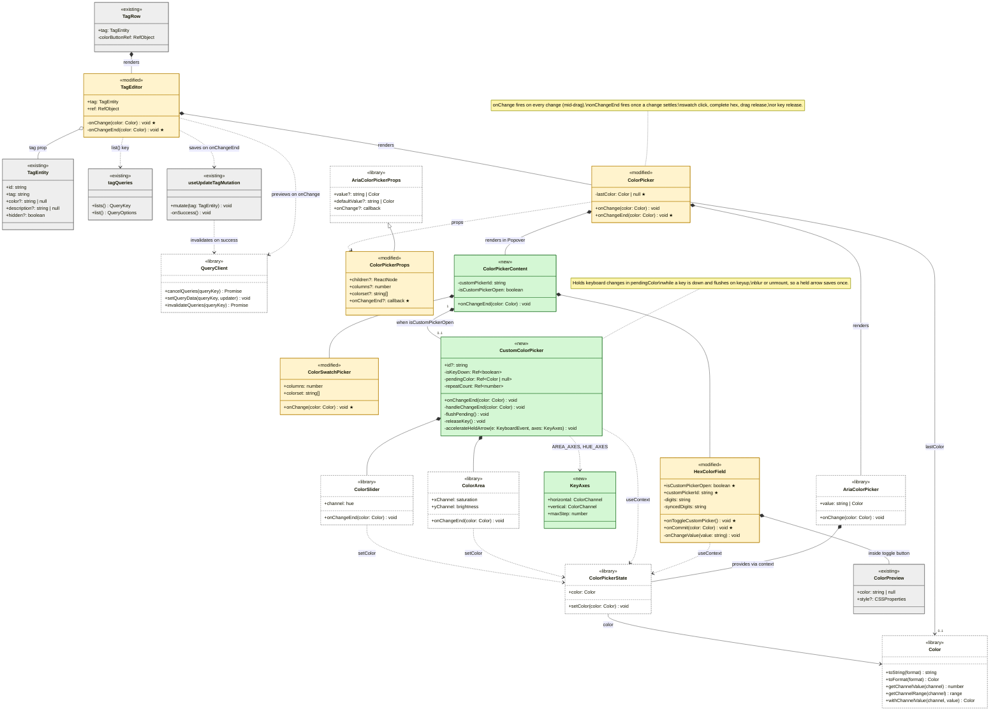
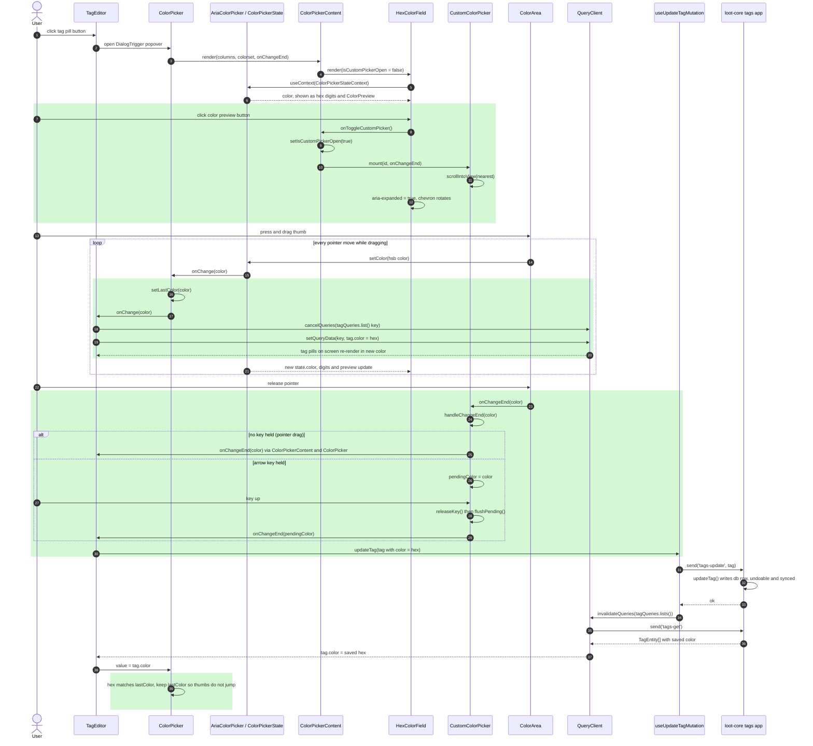

<!-- Generated by SpecStory, Markdown v2.1.0 -->

# 2026-10-29 19:50:00Z

<!-- Claude Code Session 2f9d5151-79de-4c84-9652-8449d55df9b6 (2026-10-29 19:50:00Z) -->

_**User (2026-10-29 19:50:00Z)**_

Please build a UML diagram based on PR #144, here are the guidelines: 

<pasted_content id="b899">
D6 - UML Diagrams and Q&A (new)¶
This is a new individual deliverable.

Before drawing your diagrams, review the tutorials linked below. They explain UML elements, their meaning, and when to use each type of relationship or notation. Familiarity with the basics will make your diagrams significantly more accurate.

What to create: One class diagram and one sequence diagram for one of your medium issues. The person who resolved the issue creates the diagrams. The diagrams should show code components and behavior relevant to your issue(s) --- more details below. Below we provide reference diagrams to guide this task.

If you resolved multiple small issues equivalent in scope to one medium issue

Create diagrams that cover all of those issues together.

The Gitea team (Go)

Both diagrams are required. Go uses structs and interfaces rather than classes; your class diagram should reflect Go's model (structs, interfaces, embedding). Include a brief note in your submission explaining the mapping from Go constructs to UML notation.

UML notation: Inheritance, composition, aggregation, dependency, and association are all valid and expected relationships for class diagrams (see the Glossary for definitions). For attributes and methods, show only those relevant to the issue; you do not need to show every member of every class.

Tutorials:

Class diagrams: Lucidchart -- How to Draw a UML Class Diagram
Sequence diagrams: Visual Paradigm -- Creating Sequence Diagrams · Gliffy -- UML Sequence Diagram Tutorial
Tools: To create the diagrams, you can use any tool of your preference. Examples: PlantUML, Mermaid (renders directly in GitHub Markdown), draw.io, Lucidchart, Visual Paradigm.
</pasted_content id="b899">


---

_**Agent (claude-opus-5-5 2026-10-29 19:50:18Z)**_

<tool-use data-tool-type="shell" data-tool-name="Bash"><details>
<summary>Tool use: **Bash**</summary>
View PR 144 details

`gh pr view 144 --json title,body,headRefName,files,author 2>&1 | head -80`

```text
/bin/bash: line 2: gh: command not found
```
</details></tool-use>

_**Agent (claude-opus-5-5 2026-10-29 19:50:23Z)**_

<tool-use data-tool-type="shell" data-tool-name="Bash"><details>
<summary>Tool use: **Bash**</summary>
Check remotes and branch commits

`git remote -v; git log --oneline -8 --all --grep="144"; git log master..HEAD --stat --oneline`

```text
origin	https://github.com/CSCI-435-SE/actual-budget.git (fetch)
origin	https://github.com/CSCI-435-SE/actual-budget.git (push)
b054e9a01 Bank Sync Provider per budget file [1/3] - Sync server - Add file-scoped bank sync secrets (#8316)
f6c387767 Restore budget table scroll position when navigating back from spent transactions (#8144)
7e0edd43e Sort theme catalog items alphabetically by name (#7144)
dbe6b27d9 :octocat:  Prevent nightly npm packages publishing on push (#5144)
61d41cc28 Update issue template with translation issue type (#4144)
0eb62a09b :wrench: improve unit test stability while using uuid (#3144)
d203def23 Fix when pressing Enter adds an extra split transaction when no split remains (#2144)
cd54a2093 Fix the mobile footer color (#1456)
04596e854 [AI] Add AI log for issue #67 implementation
 ...26-10-29_claude-code_issue-67-implementation.md | 30990 +++++++++++++++++++
 1 file changed, 30990 insertions(+)
4794d2a98 [AI] Add custom color picker to tag color editor
 packages/component-library/src/ColorPicker.tsx     | 155 +++++++++++++++++-
 .../component-library/src/ColorPicker.web.test.tsx | 145 ++++++++++++++++-
 .../component-library/src/CustomColorPicker.tsx    | 181 +++++++++++++++++++++
 .../src/components/tags/TagEditor.tsx              |  15 +-
 .../tag-color-picker-custom-color.md               |   6 +
 5 files changed, 493 insertions(+), 9 deletions(-)
a7bc7b1a6 Merge pull request #138 from CSCI-435-SE/ai-logs/raccoonswarm
5fa2cb608 Merge pull request #137 from CSCI-435-SE/docs/ai-log-bennettmatuszewski-pr-136-review
5928eee18 Remaining AI logs for Sprint2
 ...de-code_issue-15-personal-inflation-tracking.md | 20564 +++++++++++++++++++
 ...e_review-issue-100-subcategory-visualization.md |  1276 ++
 ...-10-28_claude-code_review-issue-65-bulk-edit.md |  3983 ++++
 3 files changed, 25823 insertions(+)
6c5bc2821 [AI] Add AI log for PR #136 review (bennettmatuszewski)
 .../2026-10-29_claude_code_review-pr-136.md        | 1528 ++++++++++++++++++++
 1 file changed, 1528 insertions(+)
4edaed903 Merge pull request #136 from CSCI-435-SE/feat/issue-66-color-editor
ce3c71327 [AI] Add live hex color preview and fixed "#" to tag color picker
 packages/component-library/src/ColorPicker.tsx     | 85 +++++++++++++++------
 .../component-library/src/ColorPicker.web.test.tsx | 87 ++++++++++++++++++++++
 .../component-library/src/ColorPreview.stories.tsx | 35 +++++++++
 packages/component-library/src/ColorPreview.tsx    | 30 ++++++++
 .../tag-color-picker-hex-preview.md                |  6 ++
 5 files changed, 222 insertions(+), 21 deletions(-)
```
</details></tool-use>

_**Agent (claude-opus-5-5 2026-10-29 19:51:01Z)**_

<tool-use data-tool-type="shell" data-tool-name="Bash"><details>
<summary>Tool use: **Bash**</summary>
Fetch PR 144 metadata from GitHub API

`curl -s https://api.github.com/repos/CSCI-435-SE/actual-budget/pulls/144 | python3 -c "import json,sys;d=json.load(sys.stdin);print(d.get('title'),d.get('head',{}).get('ref'),d.get('user',{}).get('login'),d.get('message'))"; curl -s https://api.github.com/repos/CSCI-435-SE/actual-budget/pulls/144/files | python3 -c "import json,sys;[print(f['filename']) for f in json.load(sys.stdin)]"`

```text
[AI] Add color picker to tag color editor feat/issue-67-color-wheel icsasso None
ai-logs/sprint2/icsasso/2026-10-29_claude-code_issue-67-implementation.md
packages/component-library/src/ColorPicker.tsx
packages/component-library/src/ColorPicker.web.test.tsx
packages/component-library/src/CustomColorPicker.tsx
packages/desktop-client/src/components/tags/TagEditor.tsx
upcoming-release-notes/tag-color-picker-custom-color.md
```
</details></tool-use>

_**Agent (claude-opus-5-5 2026-10-29 19:51:03Z)**_

Confirmed — PR #144 is the current branch. Reading the changed source files.

_**Agent (claude-opus-5-5 2026-10-29 19:51:03Z)**_

<tool-use data-tool-type="read" data-tool-name="Read"><details>
<summary>Tool use: **Read**</summary>
 `./packages/component-library/src/ColorPicker.tsx`

```text
1	import { useContext, useId, useState } from 'react';
2	import type { ReactNode } from 'react';
3	import {
4	  Button as AriaButton,
5	  ColorPicker as AriaColorPicker,
6	  ColorPickerStateContext,
7	  ColorSwatch as AriaColorSwatch,
8	  ColorSwatchPicker as AriaColorSwatchPicker,
9	  ColorSwatchPickerItem,
10	  Dialog,
11	  DialogTrigger,
12	  parseColor,
13	} from 'react-aria-components';
14	import type {
15	  ColorPickerProps as AriaColorPickerProps,
16	  Color,
17	  ColorSwatchProps,
18	} from 'react-aria-components';
19	
20	import { css } from '@emotion/css';
21	
22	import { ColorPreview } from './ColorPreview';
23	import { CustomColorPicker } from './CustomColorPicker';
24	import { SvgCheveronDown } from './icons/v1';
25	import { Input } from './Input';
26	import { Popover } from './Popover';
27	import { theme } from './theme';
28	import { Tooltip } from './Tooltip';
29	import { View } from './View';
30	
31	function ColorSwatch(props: ColorSwatchProps) {
32	  return (
33	    <AriaColorSwatch
34	      {...props}
35	      style={({ color }) => ({
36	        background: color.toString('hex'),
37	        width: '32px',
38	        height: '32px',
39	        borderRadius: '4px',
40	        boxShadow: 'inset 0 0 0 1px rgba(0, 0, 0, 0.1)',
41	      })}
42	    />
43	  );
44	}
45	
46	const DEFAULT_COLOR_SET = [
47	  '#690CB0',
48	  '#D32F2F',
49	  '#C2185B',
50	  '#7B1FA2',
51	  '#512DA8',
52	  '#303F9F',
53	  '#1976D2',
54	  '#0288D1',
55	  '#0097A7',
56	  '#00796B',
57	  '#388E3C',
58	  '#689F38',
59	  '#AFB42B',
60	  '#FBC02D',
61	  '#FFA000',
62	  '#F57C00',
63	  '#E64A19',
64	  '#5D4037',
65	  '#616161',
66	  '#455A64',
67	  '#FF6666', //red
68	  '#FF99FF', //magenta
69	  '#C39DDF', //purple
70	  '#6666FF', //blue
71	  '#B2FFFF', //cyan
72	  '#99cb99', //green
73	  '#FFFF7F', //yellow
74	  '#FFAB66', //orange
75	  '#D4B89C', //brown
76	  '#BFBFBF', //gray
77	  '#FFAEAE', //colors repeat from above with a lighter tint
78	  '#FFCCFF',
79	  '#E4D4FF', //this is now purple125
80	  '#B0B0FF',
81	  '#D8FFFF',
82	  '#CFE5CF',
83	  '#FFFFB2',
84	  '#FFD5B3',
85	  '#E4D3C3',
86	  '#DADADA',
87	];
88	
89	type ColorSwatchPickerProps = {
90	  columns?: number;
91	  colorset?: string[];
92	  onChange?: (color: Color) => void;
93	};
94	
95	function ColorSwatchPicker({
96	  columns = 5,
97	  colorset = DEFAULT_COLOR_SET,
98	  onChange,
99	}: ColorSwatchPickerProps) {
100	  const pickers = [];
101	
102	  for (let l = 0; l < colorset.length / columns; l++) {
103	    const pickerItems = [];
104	
105	    for (let c = 0; c < columns; c++) {
106	      const color = colorset[columns * l + c];
107	      if (!color) {
108	        break;
109	      }
110	
111	      pickerItems.push(
112	        <ColorSwatchPickerItem
113	          key={color}
114	          color={color}
115	          className={css({
116	            position: 'relative',
117	            outline: 'none',
118	            borderRadius: '4px',
119	            width: 'fit-content',
120	            forcedColorAdjust: 'none',
121	            cursor: 'pointer',
122	
123	            '&[data-selected]::after': {
124	              content: '""',
125	              position: 'absolute',
126	              inset: 0,
127	              border: '2px solid black',
128	              outline: '2px solid white',
129	              outlineOffset: '-4px',
130	              borderRadius: 'inherit',
131	            },
132	          })}
133	        >
134	          <ColorSwatch />
135	        </ColorSwatchPickerItem>,
136	      );
137	    }
138	
139	    pickers.push(
140	      <AriaColorSwatchPicker
141	        key={`colorset-${l}`}
142	        onChange={onChange}
143	        style={{
144	          display: 'flex',
145	          gap: '8px',
146	          flexWrap: 'wrap',
147	        }}
148	      >
149	        {pickerItems}
150	      </AriaColorSwatchPicker>,
151	    );
152	  }
153	
154	  return pickers;
155	}
156	const isHexDigits = (value: string) => /^[0-9a-fA-F]{6}$/.test(value);
157	
158	const CUSTOM_COLOR_LABEL = 'Pick a custom color';
159	
160	// Sized and bordered like the hex input beside it, so the preview reads as a
161	// control that opens something rather than a static swatch
162	const previewButtonClassName = css({
163	  display: 'flex',
164	  alignItems: 'center',
165	  gap: 4,
166	  padding: 3,
167	  paddingRight: 5,
168	  border: `1px solid ${theme.formInputBorder}`,
169	  borderRadius: 4,
170	  backgroundColor: theme.tableBackground,
171	  color: theme.formInputText,
172	  cursor: 'pointer',
173	  outline: 'none',
174	  '&[data-hovered]': {
175	    backgroundColor: theme.buttonBareBackgroundHover,
176	  },
177	  '&[aria-expanded="true"]': {
178	    borderColor: theme.formInputBorderSelected,
179	  },
180	  '&[data-focus-visible]': {
181	    outline: `2px solid ${theme.formInputBorderSelected}`,
182	    outlineOffset: 2,
183	  },
184	  '& svg': {
185	    transition: 'transform 150ms cubic-bezier(0.16, 1, 0.3, 1)',
186	  },
187	  '&[aria-expanded="true"] svg': {
188	    transform: 'rotate(180deg)',
189	  },
190	  '@media (prefers-reduced-motion: reduce)': {
191	    '& svg': { transition: 'none' },
192	  },
193	});
194	
195	type HexColorFieldProps = {
196	  isCustomPickerOpen: boolean;
197	  customPickerId: string;
198	  onToggleCustomPicker: () => void;
199	  onCommit?: (color: Color) => void;
200	};
201	
202	function HexColorField({
203	  isCustomPickerOpen,
204	  customPickerId,
205	  onToggleCustomPicker,
206	  onCommit,
207	}: HexColorFieldProps) {
208	  const state = useContext(ColorPickerStateContext);
209	  const currentDigits = state?.color.toString('hex').slice(1) ?? '';
210	  const [digits, setDigits] = useState(currentDigits);
211	  const [syncedDigits, setSyncedDigits] = useState(currentDigits);
212	
213	  // Pick up changes made outside this field, e.g. clicking a swatch
214	  if (currentDigits !== syncedDigits) {
215	    setSyncedDigits(currentDigits);
216	    if (currentDigits.toLowerCase() !== digits.toLowerCase()) {
217	      setDigits(currentDigits);
218	    }
219	  }
220	
221	  const onChangeValue = (value: string) => {
222	    const nextDigits = value.replace(/[^0-9a-fA-F]/g, '').slice(0, 6);
223	    setDigits(nextDigits);
224	
225	    if (isHexDigits(nextDigits)) {
226	      const color = parseColor(`#${nextDigits}`);
227	      if (color) {
228	        state?.setColor(color);
229	        onCommit?.(color);
230	      }
231	    }
232	  };
233	
234	  return (
235	    <View
236	      style={{
237	        flexDirection: 'row',
238	        alignItems: 'center',
239	        justifyContent: 'space-between',
240	        gap: 8,
241	        marginTop: 4,
242	      }}
243	    >
244	      <View style={{ position: 'relative' }}>
245	        <span
246	          aria-hidden="true"
247	          style={{
248	            position: 'absolute',
249	            left: 6,
250	            top: '50%',
251	            transform: 'translateY(-50%)',
252	            color: theme.formInputTextPlaceholder,
253	            pointerEvents: 'none',
254	          }}
255	        >
256	          #
257	        </span>
258	        <Input
259	          aria-label="Hex color"
260	          placeholder="RRGGBB"
261	          value={digits}
262	          onChangeValue={onChangeValue}
263	          onBlur={() => setDigits(currentDigits)}
264	          style={{ width: 100, paddingLeft: 16 }}
265	        />
266	      </View>
267	      <Tooltip content={CUSTOM_COLOR_LABEL} placement="bottom">
268	        <AriaButton
269	          aria-label={CUSTOM_COLOR_LABEL}
270	          aria-expanded={isCustomPickerOpen}
271	          aria-controls={isCustomPickerOpen ? customPickerId : undefined}
272	          className={previewButtonClassName}
273	          onPress={onToggleCustomPicker}
274	        >
275	          <ColorPreview
276	            color={isHexDigits(digits) ? `#${digits}` : null}
277	            style={{ width: 20, height: 20, borderRadius: 2 }}
278	          />
279	          <SvgCheveronDown aria-hidden="true" width={10} height={10} />
280	        </AriaButton>
281	      </Tooltip>
282	    </View>
283	  );
284	}
285	
286	type ColorPickerContentProps = {
287	  columns?: number;
288	  colorset?: string[];
289	  onChangeEnd?: (color: Color) => void;
290	};
291	
292	function ColorPickerContent({
293	  columns,
294	  colorset,
295	  onChangeEnd,
296	}: ColorPickerContentProps) {
297	  const customPickerId = useId();
298	  const [isCustomPickerOpen, setIsCustomPickerOpen] = useState(false);
299	
300	  return (
301	    <>
302	      <ColorSwatchPicker
303	        columns={columns}
304	        colorset={colorset}
305	        onChange={onChangeEnd}
306	      />
307	      <HexColorField
308	        isCustomPickerOpen={isCustomPickerOpen}
309	        customPickerId={customPickerId}
310	        onToggleCustomPicker={() => setIsCustomPickerOpen(open => !open)}
311	        onCommit={onChangeEnd}
312	      />
313	      {isCustomPickerOpen && (
314	        <CustomColorPicker id={customPickerId} onChangeEnd={onChangeEnd} />
315	      )}
316	    </>
317	  );
318	}
319	
320	type ColorPickerProps = {
321	  children?: ReactNode;
322	  columns?: number;
323	  colorset?: string[];
324	  // Fires once a change is settled (a swatch or complete hex value is picked,
325	  // or a drag or held key on the custom picker ends), while onChange also
326	  // fires mid-drag
327	  onChangeEnd?: (color: Color) => void;
328	} & AriaColorPickerProps;
329	
330	export function ColorPicker({
331	  children,
332	  columns,
333	  colorset,
334	  onChangeEnd,
335	  ...props
336	}: ColorPickerProps) {
337	  // A controlled value is usually stored as hex, which drops hue and
338	  // saturation for grays, so keep using the last emitted color while it
339	  // still matches that hex to stop the custom picker's thumbs jumping
340	  const [lastColor, setLastColor] = useState<Color | null>(null);
341	  const value =
342	    lastColor &&
343	    typeof props.value === 'string' &&
344	    props.value.toUpperCase() === lastColor.toString('hex')
345	      ? lastColor
346	      : props.value;
347	
348	  return (
349	    <AriaColorPicker
350	      defaultValue={props.defaultValue ?? '#690CB0'}
351	      {...props}
352	      value={value}
353	      onChange={color => {
354	        setLastColor(color);
355	        props.onChange?.(color);
356	      }}
357	    >
358	      <DialogTrigger>
359	        {children}
360	        <Popover>
361	          <Dialog
362	            style={{
363	              outline: 'none',
364	              padding: '15px',
365	              display: 'flex',
366	              flexDirection: 'column',
367	              gap: '8px',
368	              minWidth: '192px',
369	              maxHeight: 'inherit',
370	              boxSizing: 'border-box',
371	              overflow: 'auto',
372	            }}
373	          >
374	            <ColorPickerContent
375	              columns={columns}
376	              colorset={colorset}
377	              onChangeEnd={onChangeEnd}
378	            />
379	          </Dialog>
380	        </Popover>
381	      </DialogTrigger>
382	    </AriaColorPicker>
383	  );
384	}
385
```
</details></tool-use>

_**Agent (claude-opus-5-5 2026-10-29 19:51:04Z)**_

<tool-use data-tool-type="read" data-tool-name="Read"><details>
<summary>Tool use: **Read**</summary>
 `./packages/component-library/src/CustomColorPicker.tsx`

```text
1	import { useContext, useEffect, useEffectEvent, useRef } from 'react';
2	import type { FocusEvent, KeyboardEvent } from 'react';
3	import {
4	  ColorArea,
5	  ColorPickerStateContext,
6	  ColorSlider,
7	  ColorThumb,
8	  SliderTrack,
9	  useLocale,
10	} from 'react-aria-components';
11	import type { Color, ColorChannel } from 'react-aria-components';
12	
13	import { css } from '@emotion/css';
14	
15	import { View } from './View';
16	
17	// The thumb sits on arbitrary colors, so it pairs a white ring with a dark one
18	// instead of using theme tokens: one of the two always stands out
19	const thumbClassName = css({
20	  width: 20,
21	  height: 20,
22	  borderRadius: '50%',
23	  boxSizing: 'border-box',
24	  border: '2px solid white',
25	  boxShadow: '0 0 0 1px rgba(0, 0, 0, 0.6), inset 0 0 0 1px rgba(0, 0, 0, 0.6)',
26	  forcedColorAdjust: 'none',
27	  '&[data-focus-visible]': {
28	    width: 24,
29	    height: 24,
30	    border: '3px solid white',
31	    boxShadow:
32	      '0 0 0 2px rgba(0, 0, 0, 0.85), inset 0 0 0 1px rgba(0, 0, 0, 0.6)',
33	  },
34	});
35	
36	type KeyAxes = {
37	  horizontal: ColorChannel;
38	  vertical: ColorChannel;
39	  maxStep: number;
40	};
41	
42	const AREA_AXES: KeyAxes = {
43	  horizontal: 'saturation',
44	  vertical: 'brightness',
45	  maxStep: 4,
46	};
47	const HUE_AXES: KeyAxes = { horizontal: 'hue', vertical: 'hue', maxStep: 10 };
48	
49	type CustomColorPickerProps = {
50	  id?: string;
51	  onChangeEnd?: (color: Color) => void;
52	};
53	
54	// Reads and writes the surrounding ColorPicker's state, so it stays in sync
55	// with the swatches and the hex field without any wiring of its own
56	export function CustomColorPicker({ id, onChangeEnd }: CustomColorPickerProps) {
57	  const state = useContext(ColorPickerStateContext);
58	  const { direction } = useLocale();
59	
60	  // Every keyboard step counts as a finished change, so holding an arrow key
61	  // would settle (and save) on each repeat; hold those until the key is up
62	  const isKeyDown = useRef(false);
63	  const pendingColor = useRef<Color | null>(null);
64	  const repeatCount = useRef(0);
65	
66	  const flushPending = useEffectEvent(() => {
67	    const color = pendingColor.current;
68	    pendingColor.current = null;
69	    if (color) {
70	      onChangeEnd?.(color);
71	    }
72	  });
73	
74	  // Closing the popover mid-keypress unmounts this before the key is released
75	  useEffect(() => () => flushPending(), []);
76	
77	  // The popover caps its height to the viewport, so on short screens this
78	  // could open below the fold and look like the toggle did nothing
79	  const containerRef = useRef<HTMLDivElement>(null);
80	  useEffect(() => {
81	    containerRef.current?.scrollIntoView?.({ block: 'nearest' });
82	  }, []);
83	
84	  const handleChangeEnd = (color: Color) => {
85	    if (isKeyDown.current) {
86	      pendingColor.current = color;
87	    } else {
88	      onChangeEnd?.(color);
89	    }
90	  };
91	
92	  const releaseKey = () => {
93	    isKeyDown.current = false;
94	    repeatCount.current = 0;
95	    flushPending();
96	  };
97	
98	  // React Aria moves one unit per key repeat (1° of hue, 1% of saturation or
99	  // brightness), so a held arrow key crawls. A tap still moves one unit, but
100	  // repeats take over and grow the step the longer the key is held.
101	  const accelerateHeldArrow = (
102	    e: KeyboardEvent<HTMLDivElement>,
103	    { horizontal, vertical, maxStep }: KeyAxes,
104	  ) => {
105	    const isHorizontal = e.key === 'ArrowLeft' || e.key === 'ArrowRight';
106	    const isArrow =
107	      isHorizontal || e.key === 'ArrowUp' || e.key === 'ArrowDown';
108	    // Shift already makes React Aria take its larger page steps
109	    if (!state || !e.repeat || !isArrow || e.shiftKey) {
110	      return;
111	    }
112	    e.preventDefault();
113	    e.stopPropagation();
114	
115	    repeatCount.current += 1;
116	    const step = Math.min(1 + Math.floor(repeatCount.current / 3), maxStep);
117	    const forwardKey = direction === 'rtl' ? 'ArrowLeft' : 'ArrowRight';
118	    const sign = e.key === 'ArrowUp' || e.key === forwardKey ? 1 : -1;
119	
120	    const channel = isHorizontal ? horizontal : vertical;
121	    const color = state.color.toFormat('hsb');
122	    const { minValue, maxValue } = color.getChannelRange(channel);
123	    const value = Math.min(
124	      maxValue,
125	      Math.max(minValue, color.getChannelValue(channel) + sign * step),
126	    );
127	    const next = color.withChannelValue(channel, value);
128	
129	    state.setColor(next);
130	    pendingColor.current = next;
131	  };
132	
133	  return (
134	    <View
135	      id={id}
136	      innerRef={containerRef}
137	      style={{ gap: 8, marginTop: 4 }}
138	      onKeyDownCapture={() => {
139	        isKeyDown.current = true;
140	      }}
141	      onKeyUpCapture={releaseKey}
142	      onBlur={(e: FocusEvent<HTMLDivElement>) => {
143	        // The key may be released after focus has moved elsewhere
144	        if (!e.currentTarget.contains(e.relatedTarget)) {
145	          releaseKey();
146	        }
147	      }}
148	    >
149	      <View onKeyDownCapture={e => accelerateHeldArrow(e, AREA_AXES)}>
150	        <ColorArea
151	          colorSpace="hsb"
152	          xChannel="saturation"
153	          yChannel="brightness"
154	          onChangeEnd={handleChangeEnd}
155	          style={{
156	            width: '100%',
157	            height: 140,
158	            borderRadius: 4,
159	            flexShrink: 0,
160	            forcedColorAdjust: 'none',
161	          }}
162	        >
163	          <ColorThumb className={thumbClassName} />
164	        </ColorArea>
165	      </View>
166	      <View onKeyDownCapture={e => accelerateHeldArrow(e, HUE_AXES)}>
167	        <ColorSlider
168	          colorSpace="hsb"
169	          channel="hue"
170	          onChangeEnd={handleChangeEnd}
171	        >
172	          <SliderTrack
173	            style={{ height: 24, borderRadius: 4, forcedColorAdjust: 'none' }}
174	          >
175	            <ColorThumb className={thumbClassName} style={{ top: '50%' }} />
176	          </SliderTrack>
177	        </ColorSlider>
178	      </View>
179	    </View>
180	  );
181	}
182
```
</details></tool-use>

_**Agent (claude-opus-5-5 2026-10-29 19:51:05Z)**_

<tool-use data-tool-type="read" data-tool-name="Read"><details>
<summary>Tool use: **Read**</summary>
 `./packages/desktop-client/src/components/tags/TagEditor.tsx`

```text
1	import type { RefObject } from 'react';
2	
3	import { Button } from '@actual-app/components/button';
4	import { ColorPicker } from '@actual-app/components/color-picker';
5	import type { TagEntity } from '@actual-app/core/types/models';
6	import { useQueryClient } from '@tanstack/react-query';
7	
8	import { useTagCSS } from '#hooks/useTagCSS';
9	import { tagQueries, useUpdateTagMutation } from '#tags';
10	
11	type TagEditorProps = {
12	  tag: TagEntity;
13	  ref: RefObject<HTMLButtonElement | null>;
14	};
15	
16	export const TagEditor = ({ tag, ref }: TagEditorProps) => {
17	  const getTagCSS = useTagCSS({ ellipsis: true });
18	  const queryClient = useQueryClient();
19	  const { mutate: updateTag } = useUpdateTagMutation();
20	
21	  const formattedTag = <>#{tag.tag}</>;
22	
23	  return (
24	    <ColorPicker
25	      value={tag.color ?? undefined}
26	      onChange={color => {
27	        // Preview the color on every visible tag without saving it, since
28	        // dragging the custom picker fires this many times per second
29	        const { queryKey } = tagQueries.list();
30	        void queryClient.cancelQueries({ queryKey });
31	        queryClient.setQueryData(queryKey, tags =>
32	          tags?.map(t =>
33	            t.id === tag.id ? { ...t, color: color.toString('hex') } : t,
34	          ),
35	        );
36	      }}
37	      onChangeEnd={color => {
38	        updateTag({ tag: { ...tag, color: color.toString('hex') } });
39	      }}
40	    >
41	      <Button variant="bare" className={getTagCSS(tag.tag)} ref={ref}>
42	        {formattedTag}
43	      </Button>
44	    </ColorPicker>
45	  );
46	};
47
```
</details></tool-use>

_**Agent (claude-opus-5-5 2026-10-29 19:51:06Z)**_

<tool-use data-tool-type="shell" data-tool-name="Bash"><details>
<summary>Tool use: **Bash**</summary>
Show TagEditor diff and ColorPreview source

`git show 4794d2a98 -- packages/desktop-client/src/components/tags/TagEditor.tsx; cat packages/component-library/src/ColorPreview.tsx`

```text
commit 4794d2a98620cdb36013f3c565f16a051c3ab0df
Author: Isabella Sasso <icsasso@wm.edu>
Date:   Thu Oct 29 19:19:57 2026 +0000

    [AI] Add custom color picker to tag color editor
    
    Clicking the color preview next to the hex field now opens a
    saturation/brightness area and hue slider (react-aria-components), kept
    in sync with the swatches and hex input through the shared picker state.
    
    ColorPicker gains an onChangeEnd prop that fires once a change settles.
    TagEditor previews colors in the tags query cache on every change so all
    visible tags recolor live, and saves only on onChangeEnd. Held arrow keys
    accelerate and save once on release. Controlled hex values keep the last
    emitted color so grays don't lose their hue.
    
    Co-Authored-By: Claude Opus 5.5 <noreply@anthropic.com>

diff --git a/packages/desktop-client/src/components/tags/TagEditor.tsx b/packages/desktop-client/src/components/tags/TagEditor.tsx
index 92c32a18d..3e417e23d 100644
--- a/packages/desktop-client/src/components/tags/TagEditor.tsx
+++ b/packages/desktop-client/src/components/tags/TagEditor.tsx
@@ -3,9 +3,10 @@ import type { RefObject } from 'react';
 import { Button } from '@actual-app/components/button';
 import { ColorPicker } from '@actual-app/components/color-picker';
 import type { TagEntity } from '@actual-app/core/types/models';
+import { useQueryClient } from '@tanstack/react-query';
 
 import { useTagCSS } from '#hooks/useTagCSS';
-import { useUpdateTagMutation } from '#tags';
+import { tagQueries, useUpdateTagMutation } from '#tags';
 
 type TagEditorProps = {
   tag: TagEntity;
@@ -14,6 +15,7 @@ type TagEditorProps = {
 
 export const TagEditor = ({ tag, ref }: TagEditorProps) => {
   const getTagCSS = useTagCSS({ ellipsis: true });
+  const queryClient = useQueryClient();
   const { mutate: updateTag } = useUpdateTagMutation();
 
   const formattedTag = <>#{tag.tag}</>;
@@ -22,6 +24,17 @@ export const TagEditor = ({ tag, ref }: TagEditorProps) => {
     <ColorPicker
       value={tag.color ?? undefined}
       onChange={color => {
+        // Preview the color on every visible tag without saving it, since
+        // dragging the custom picker fires this many times per second
+        const { queryKey } = tagQueries.list();
+        void queryClient.cancelQueries({ queryKey });
+        queryClient.setQueryData(queryKey, tags =>
+          tags?.map(t =>
+            t.id === tag.id ? { ...t, color: color.toString('hex') } : t,
+          ),
+        );
+      }}
+      onChangeEnd={color => {
         updateTag({ tag: { ...tag, color: color.toString('hex') } });
       }}
     >
import type { CSSProperties } from 'react';

import { View } from './View';

const EMPTY_PATTERN =
  'repeating-conic-gradient(#d9d9d9 0% 25%, #ffffff 0% 50%) 50% / 8px 8px';

type ColorPreviewProps = {
  color: string | null;
  style?: CSSProperties;
};

export function ColorPreview({ color, style }: ColorPreviewProps) {
  return (
    <View
      role="img"
      aria-label={color ? `Color preview: ${color}` : 'No color preview'}
      data-testid="color-preview"
      style={{
        width: 32,
        height: 32,
        flexShrink: 0,
        borderRadius: 4,
        boxShadow: 'inset 0 0 0 1px rgba(0, 0, 0, 0.1)',
        background: color ?? EMPTY_PATTERN,
        ...style,
      }}
    />
  );
}
```
</details></tool-use>

_**Agent (claude-opus-5-5 2026-10-29 19:51:42Z)**_

<tool-use data-tool-type="shell" data-tool-name="Bash"><details>
<summary>Tool use: **Bash**</summary>
Inspect tag queries and mutation hooks

`cd /workspaces/actual-budget/packages/desktop-client/src && ls tags; grep -n "export\|send(\|queryKey\|mutationFn\|onSuccess\|invalidate" tags/*.ts | head -40; grep -n "TagEntity" -A8 ../../loot-core/src/types/models/tag.ts 2>/dev/null | head -12`

```text
index.ts
mutations.ts
queries.ts
tags/index.ts:1:export * from './queries';
tags/index.ts:2:export * from './mutations';
tags/mutations.ts:15:function invalidateQueries(queryClient: QueryClient, queryKey?: QueryKey) {
tags/mutations.ts:16:  void queryClient.invalidateQueries({
tags/mutations.ts:17:    queryKey: queryKey ?? tagQueries.lists(),
tags/mutations.ts:42:export function useCreateTagMutation() {
tags/mutations.ts:48:    mutationFn: async ({ tag }: CreateTagPayload) => {
tags/mutations.ts:49:      return await send('tags-create', tag);
tags/mutations.ts:51:    onSuccess: () => invalidateQueries(queryClient),
tags/mutations.ts:67:export function useUpdateTagMutation() {
tags/mutations.ts:73:    mutationFn: async ({ tag }: UpdateTagPayload) => {
tags/mutations.ts:74:      return await send('tags-update', tag);
tags/mutations.ts:76:    onSuccess: () => invalidateQueries(queryClient),
tags/mutations.ts:93:export function useRenameTagMutation() {
tags/mutations.ts:99:    mutationFn: async ({ id, tag }: RenameTagPayload) => {
tags/mutations.ts:100:      return await send('tags-rename', { id, tag });
tags/mutations.ts:102:    onSuccess: () => invalidateQueries(queryClient),
tags/mutations.ts:118:export function useDeleteTagMutation() {
tags/mutations.ts:124:    mutationFn: async ({ id }: DeleteTagPayload) => {
tags/mutations.ts:125:      return await send('tags-delete', { id });
tags/mutations.ts:127:    onSuccess: () => invalidateQueries(queryClient),
tags/mutations.ts:143:export function useDeleteTagsMutation() {
tags/mutations.ts:149:    mutationFn: async ({ ids }: DeleteTagsPayload) => {
tags/mutations.ts:150:      return await send('tags-delete-all', ids);
tags/mutations.ts:152:    onSuccess: () => invalidateQueries(queryClient),
tags/mutations.ts:168:export function useHideTagsMutation() {
tags/mutations.ts:174:    mutationFn: async ({ ids }: HideTagsPayload) => {
tags/mutations.ts:175:      return await send('tags-hide-all', ids);
tags/mutations.ts:177:    onSuccess: () => invalidateQueries(queryClient),
tags/mutations.ts:193:export function useUnhideTagsMutation() {
tags/mutations.ts:199:    mutationFn: async ({ ids }: UnhideTagsPayload) => {
tags/mutations.ts:200:      return await send('tags-unhide-all', ids);
tags/mutations.ts:202:    onSuccess: () => invalidateQueries(queryClient),
tags/mutations.ts:214:export function useDiscoverTagsMutation() {
tags/mutations.ts:220:    mutationFn: async () => {
tags/mutations.ts:221:      return await send('tags-discover');
tags/mutations.ts:223:    onSuccess: () => invalidateQueries(queryClient),
tags/queries.ts:5:export const tagQueries = {
tags/queries.ts:10:      queryKey: [...tagQueries.lists()],
tags/queries.ts:11:      queryFn: () => send('tags-get'),
```
</details></tool-use>

_**Agent (claude-opus-5-5 2026-10-29 19:51:48Z)**_

<tool-use data-tool-type="shell" data-tool-name="Bash"><details>
<summary>Tool use: **Bash**</summary>
Find TagEntity type and TagEditor usage

`cd /workspaces/actual-budget && grep -rn "type TagEntity" -A8 packages/loot-core/src/types/models/ | head -12; grep -rn "where TagEditor\|<TagEditor" packages/desktop-client/src | head`

```text
packages/loot-core/src/types/models/tags.ts:1:export type TagEntity = {
packages/loot-core/src/types/models/tags.ts-2-  id: string;
packages/loot-core/src/types/models/tags.ts-3-  tag: string;
packages/loot-core/src/types/models/tags.ts-4-  color?: string | null;
packages/loot-core/src/types/models/tags.ts-5-  description?: string | null;
packages/loot-core/src/types/models/tags.ts-6-  hidden?: boolean;
packages/loot-core/src/types/models/tags.ts-7-};
packages/desktop-client/src/components/tags/TagRow.tsx:176:            <TagEditor tag={tag} ref={colorButtonRef} />
```
</details></tool-use>

_**Agent (claude-opus-5-5 2026-10-29 19:51:53Z)**_

<tool-use data-tool-type="shell" data-tool-name="Bash"><details>
<summary>Tool use: **Bash**</summary>
Look for existing UML deliverables location

`ls; find . -path ./node_modules -prune -o -iname "*uml*" -print 2>/dev/null | grep -v node_modules | head`

```text
AGENTS.md
CLAUDE.md
CODEOWNERS
CODE_REVIEW_GUIDELINES.md
CONTRIBUTING.md
DESIGN.md
Dockerfile
LICENSE.txt
PRODUCT.md
README.md
STUDENTS.md
ai-logs
bin
data
demo.png
docker-compose.yml
docs
knip.json
lage.config.js
node_modules
package.json
packages
scripts
sync-server.Dockerfile
tsconfig.json
tsconfig.root.json
upcoming-release-notes
vitest.config.ts
yarn.config.cjs
yarn.lock
./.specstory/history/2026-10-29_19-50-00Z-please-build-a-uml.md
```
</details></tool-use>

_**Agent (claude-opus-5-5 2026-10-29 19:51:55Z)**_

<tool-use data-tool-type="shell" data-tool-name="Bash"><details>
<summary>Tool use: **Bash**</summary>
Check docs folder and student instructions

`ls docs; grep -n -i "uml\|D6\|deliverable" STUDENTS.md | head -20`

```text
showcase1
sprint0
sprint1
sprint2
sprint3
sprint4
```
</details></tool-use>

_**Agent (claude-opus-5-5 2026-10-29 19:51:56Z)**_

<tool-use data-tool-type="shell" data-tool-name="Bash"><details>
<summary>Tool use: **Bash**</summary>
List docs sprint folders

`find docs -maxdepth 3 | head -50`

```text
docs
docs/showcase1
docs/sprint0
docs/sprint1
docs/sprint2
docs/sprint3
docs/sprint4
docs/showcase1/handout.pdf
docs/sprint0/.gitkeep
docs/sprint0/images
docs/sprint0/report.md
docs/sprint0/standards.md
docs/sprint1/.gitkeep
docs/sprint1/report.md
docs/sprint2/.gitkeep
docs/sprint2/checkin
docs/sprint2/diagrams
docs/sprint3/.gitkeep
docs/sprint4/.gitkeep
docs/sprint0/images/sprint0-app-local.png
docs/sprint0/images/sprint0-tests-passing.png
docs/sprint2/checkin/bamatuszewski.md
docs/sprint2/checkin/icsasso.md
docs/sprint2/checkin/jamesleonard3rd.md
docs/sprint2/checkin/raccoonswarm.md
docs/sprint2/checkin/sgstrick.md
docs/sprint2/checkin/tigerk9.md
docs/sprint2/diagrams/118-tigerk9-class.png
docs/sprint2/diagrams/118-tigerk9-sequence.png
docs/sprint2/diagrams/118-tigerk9.md
docs/sprint2/diagrams/24-bennettmatuszewski-class.png
docs/sprint2/diagrams/24-bennettmatuszewski-sequence.png
docs/sprint2/diagrams/24-bennettmatuszewski.md
```
</details></tool-use>

_**Agent (claude-opus-5-5 2026-10-29 19:51:58Z)**_

Found the team's convention in `docs/sprint2/diagrams/`. Checking a teammate's file for format, then writing yours.

_**Agent (claude-opus-5-5 2026-10-29 19:51:59Z)**_

<tool-use data-tool-type="shell" data-tool-name="Bash"><details>
<summary>Tool use: **Bash**</summary>
Read teammates' diagram files and check render tools

`cat docs/sprint2/diagrams/24-bennettmatuszewski.md; echo ----; head -40 docs/sprint2/diagrams/118-tigerk9.md; ls docs/sprint2/diagrams; which plantuml mmdc java 2>&1 | head`

```text
# D6: UML Diagrams for Issue #24, Account Color and Description

**Author:** bennettmatuszewski
**Issue:** #24, account color customization
**Branch:** `feat/issue-24-account-color-description`

Both diagrams cover the code read during concept location and impact analysis
and the code added or changed to resolve the issue.

**Legend** (used in both diagrams)

| Marker | Color | Meaning |
| --- | --- | --- |
| `«new»` | green | Added in this PR |
| `«modified»` | amber | Existing code changed in this PR |
| `«existing»` | grey | Unchanged code studied during impact analysis |
| `[new]` after a member | | Attribute or method added in this PR |
| Note | yellow box | Annotation explaining a design decision |

## Mapping TypeScript and React to UML

Actual Budget is written in TypeScript with React function components and has
almost no classes. The diagrams map its constructs to UML like this:

| Code construct | UML notation |
| --- | --- |
| React function component (e.g. `AccountName`) | Class. Props are attributes, internal handlers are private (`-`) methods |
| Module of functions (e.g. `util/colorPill.ts`, `server/accounts/app.ts`) | Class whose methods are the exported functions |
| `type` with fields (e.g. `AccountEntity`) | Class with attributes only |
| A component that renders a child it controls | Composition |
| A prop passed in from a parent, not owned (e.g. `account`) | Aggregation |
| A component that calls a hook or helper function | Dependency |
| A component that keeps and reads a value of a type | Association |
| An intersection type `{...} & Base` | Generalization |
| A React hook (e.g. `useUpdateAccountMutation`) | Class |

## Class Diagram


## Sequence Diagram

Scenario: on an account page, the user picks a color for the account. The
color is saved, the All Accounts table redraws with the account as a pill, and
clicking the pill still opens the account dropdown. Green boxes mark
interactions that are new in this PR.


The description is saved the same way, starting in `AccountDescriptionInput`.
It calls `useUpdateAccountMutation` with `{ id, description }`, and the rest of
the save path is the same as steps 9 to 18 above. It isn't shown in tables.

## Q&A

### Class Diagram

#### 1. Which 1–2 classes are most central to understanding the codebase and solving the issue?

- **`server/accounts/app.ts`, specifically `updateAccount` and `getAccounts` (modified).** This is the only way account data moves between the database and the UI.
  - `updateAccount` is what the `account-update` message runs, and it saves only the fields it names. Anything else the UI sends is silently dropped.
  - `getAccounts` builds every account the UI receives, field by field.
  - Understanding this class showed me that adding columns to the table wasn't enough. Until `color` and `description` were added to both functions, nothing in the UI could save or see them. It also shows why sync and undo needed no new code: `updateAccount` is registered as `mutator(undoable(...))` and writes through the generic `db.update`.
- **`AccountName` (new).** This is the one component that turns an account into what the user sees.
  - If the account has a valid color, it renders a colored pill. Otherwise it returns the plain name, exactly as before.
  - Six places that show account names use it: the transactions table, schedules, rules, both sidebars and the account dropdown. So "show the color wherever the account name appears in a table" was solved in one place rather than six.

#### 2. What is the most significant relationship in the diagram?

The dependency **`TransactionsTable ..> AccountName` ("formatter returns")**, read together with the composition **`CustomCell *-- AccountAutocomplete` ("editor on expose")**.

- The Account column's cell formatter now returns an `AccountName` element instead of a plain string. `CustomCell` draws whatever the formatter returns, and when clicked it opens `AccountAutocomplete`.
- This relationship carries two acceptance criteria at once. The color must show in the table, and clicking an account on the All Accounts page must still open the dropdown "same as before".
- Both work because `AccountName` renders a plain `<span>` with no click handler, so the click reaches `CustomCell`. Had I copied the tag pattern, where the pill is a `Button`, this relationship would have broken the existing dropdown.

#### 3. Is there anything in the design you would change?

Yes, two things:

- **Validate colors on the server.** Right now `updateAccount` stores any string as a color, and only the UI checks the format with `isHexColor`. That works because a bad value just shows as plain text, but the database can still hold invalid data written through the public API.
  - I'd add a small check in `updateAccount`.
  - I'd also make the account page's rename send only `{ id, name }`. Today it sends the whole account, which can overwrite a color set on another device at the same moment.
- **Support transfer pills in split transactions.** I put the transfer-payee pill in `PayeeCell` using the transfer-account lookup that component already had, which was the smallest change. As a result, parent rows of split transactions don't show it. If I did this again, I'd change the shared `useDisplayPayee` hook to return the transfer account along with the display text, so every screen that shows payees could draw the pill consistently.

### Sequence Diagram

#### 1. What starts the sequence, and what is the expected outcome?

It starts when the user, on an individual account page, hovers over the account name, clicks the palette button and picks a color (steps 1–4). If it succeeds:

- The color is saved in the account's database row, synced to other devices, and can be undone with Ctrl+Z.
- The account list is refetched.
- The All Accounts transactions table redraws with that account's name as a colored pill.
- Clicking the pill still opens the account dropdown, and the dropdown's list items show colored pills too (steps 26–29).

#### 2. The 2–3 most important steps

- **Steps 9–11: saving the color (mostly existing code, one modified function).** `AccountColorButton` (new) calls the existing `useUpdateAccountMutation` with only `{ id, color }`. That sends `account-update` to the backend, where `updateAccount` (modified) passes the field to the existing `db.update`. `db.update` writes the row and sends one CRDT sync message per changed column. Sending a single field is a deliberate choice: it can't overwrite a rename made on another device at the same time.
- **Steps 14–17: reloading the accounts (existing caching, modified mapping).** When the save succeeds, the existing React Query cache marks the account list stale and requests `accounts-get` again. `getAccounts` (modified) copies `color` and `description` into each `AccountEntity`. Without that change, the color would be saved in the database but never reach the screen.
- **Steps 19–24: drawing the pill (new code).** The table cell's formatter returns `AccountName(acct)`. `AccountName` checks the color with `isHexColor` and gets black or white text from `getColorPillColors`, both in the new `util/colorPill.ts`, then renders a `<span>` pill. If the color is missing or invalid, it returns the plain name (step 25), so accounts without a color look exactly as before.

#### 3. Which error cases and alternative paths are left out, and why?

- **The save failing.** If `account-update` fails, `useUpdateAccountMutation` runs its existing `onError` handler, which shows the notification "There was an error updating the account". The color isn't saved and the table doesn't change. I left this out because it's existing, generic error handling that this PR didn't change.
- **An invalid typed color.** `ColorPicker` ignores typed text until it matches `#RRGGBB`, so `onChange` never fires with a bad value. That filtering happens inside an existing component.
- **Undo, sync to other devices, and older clients.** Ctrl+Z runs the existing undo system. Other devices apply the existing CRDT messages. Older clients that don't have the new columns yet hold those messages in `messages_pending` until they upgrade. All of this is built into `db.update` and `undoable()`, and none of it is new code.
- **Editing the description.** It goes through the same save path (steps 9–18), starting in `AccountDescriptionInput` with `{ id, description }`. I mention it under the diagram instead of drawing it, to avoid repeating the same steps.

I left these out to keep the diagram focused on the one complete success scenario that exercises the new and modified code. Drawing every path would have roughly doubled its size without showing any additional code from this PR.

**Cross-cutting:**

4. If you used AI to create or check any part of the diagrams, describe what it produced, what you verified against the actual code, and what you had to correct or add. If AI was not used, write "N/A."

I used AI to generate the UML diagrams and help me understand how they worked. I verified the accuracy by lining up the changes myself with the files changes in the PR.----
# Issue #118 -- Context menus close ~350 ms after leaving a popover when sidebar is pinned

## Class Diagram


## Sequence Diagram


## Q&A

**Class diagram:**

1. Among all the classes shown in the diagram, which 1--2 are most central to understanding the codebase and solving the issue? Explain what role each one plays.

   `SidebarProvider` and `contextMenuSlice`. `SidebarProvider` is mounted once near the top of `App` and owns the sidebar's show/hide state for the whole app. Every sidebar-related component reads that state through `useSidebar()`. Both the bug and the fix live in two of its effects: the `pointerover` listener and the effect that closes the context menu once the sidebar is hidden. `contextMenuSlice` is the single piece of Redux state behind _every_ right-click and "…" menu in the app. It explains how a sidebar timer could close a schedule's menu at all: `closeContextMenu()` isn't scoped to any particular menu, so whoever calls it closes whatever happens to be open.

2. What is the most significant relationship shown in the diagram? Explain what it represents in the system and why it matters for understanding the solution.

   The dependency from `SidebarProvider` to `Popover`, labeled «observes [data-popover]». It doesn't show up in any `import`. The provider never references `Popover` in code. It detects it at runtime by checking whether the element under the pointer has a `data-popover` attribute, using a listener on the whole `document`. Because that check matches every popover in the app, the provider reacted to menus it never opened, which is the root cause. The fix makes this relationship conditional (it only exists while the sidebar is floating) instead of removing it, because a floating sidebar still needs it to stay open while its own budget-name menu is hovered. Combined with the «dispatch» `closeContextMenu()` dependency, it's what let a sidebar timer close an unrelated menu.

3. Looking back at your implementation, is there anything in this design you would change, and why?

   The deeper problem is that the sidebar can't tell which menus it owns. Every menu goes through the same slice and the same `<ContextMenu>`, so the fix only removes the problem for pinned mode. A floating sidebar can still close a schedule's menu. I'd make ownership explicit, for example by recording whether the `contextmenu` event came from inside the sidebar (a `data-sidebar` attribute) and only tracking hover or closing menus while the sidebar owns the open one. I'd also pull the hover tracking out of `SidebarProvider` into a small hook such as `usePopoverHover(enabled)`, so the "only while floating" rule could be tested on its own instead of through the whole provider. That file is also still `@ts-strict-ignore`. This was a small issue, and doing much more would have taken it out of its original scope.

**Sequence diagram:**

1. What user action or system event starts the sequence, and what is the expected outcome when it completes successfully?

   It starts when the user (or the E2E test) clicks the "…" button on a schedule row while the sidebar is pinned, then moves the pointer onto the menu and back off it. On success, the menu stays open until the user picks an item. Clicking "Post transaction today" runs that item's action, then closes the menu the normal way through `ContextMenu.handleOpenChange(false)`, not because a sidebar timer fired.

2. Identify the 2--3 most important steps in the sequence. For each one, describe what is happening and note whether it involves existing code or new/modified code from your solution.

   - **`ScheduleRow` fires `contextmenu`, which leads to `addItems(items)` (existing).** The "…" button doesn't call the menu directly. It dispatches a synthetic `contextmenu` event on the row, and `useContextMenu` turns that into a Redux update. That's why this menu shares global state with every other menu, including the sidebar's.
   - **`document` sends `pointerover` to `SidebarProvider` (modified).** In the `[floating]` branch, `handlePointerOver` runs and starts the 350 ms hide timer. In the `[pinned]` branch this is now a lost message: the effect returns before adding the listener, so the event has no receiver and `hidden` never changes.
   - **`SidebarProvider` calls `dispatch(closeContextMenu())` (existing call, modified condition).** This is the step that broke CI. It now also requires `floating`, as a backstop in case the sidebar is switched to pinned while a popover is hovered.

3. What error cases or alternative paths are not shown in the diagram, and why did you leave them out?

118-tigerk9-class.png
118-tigerk9-sequence.png
118-tigerk9.md
24-bennettmatuszewski-class.png
24-bennettmatuszewski-sequence.png
24-bennettmatuszewski.md
```
</details></tool-use>

_**Agent (claude-opus-5-5 2026-10-29 19:52:25Z)**_

<tool-use data-tool-type="shell" data-tool-name="Bash"><details>
<summary>Tool use: **Bash**</summary>
Check available renderers for diagrams

`ls ~/.cache/ms-playwright 2>&1; node -v; ls /workspaces/actual-budget/node_modules/.bin | grep -i -E "playwright|mmdc|plantuml"`

```text
ls: cannot access '/root/.cache/ms-playwright': No such file or directory
v24.22.1
playwright
playwright-core
playwright-core.cmd
playwright.cmd
```
</details></tool-use>

_**Agent (claude-opus-5-5 2026-10-29 19:52:42Z)**_

<tool-use data-tool-type="shell" data-tool-name="Bash"><details>
<summary>Tool use: **Bash**</summary>
Show ColorPicker diff for this PR

`git show 4794d2a98 -- packages/component-library/src/ColorPicker.tsx | head -250`

```text
commit 4794d2a98620cdb36013f3c565f16a051c3ab0df
Author: Isabella Sasso <icsasso@wm.edu>
Date:   Thu Oct 29 19:19:57 2026 +0000

    [AI] Add custom color picker to tag color editor
    
    Clicking the color preview next to the hex field now opens a
    saturation/brightness area and hue slider (react-aria-components), kept
    in sync with the swatches and hex input through the shared picker state.
    
    ColorPicker gains an onChangeEnd prop that fires once a change settles.
    TagEditor previews colors in the tags query cache on every change so all
    visible tags recolor live, and saves only on onChangeEnd. Held arrow keys
    accelerate and save once on release. Controlled hex values keep the last
    emitted color so grays don't lose their hue.
    
    Co-Authored-By: Claude Opus 5.5 <noreply@anthropic.com>

diff --git a/packages/component-library/src/ColorPicker.tsx b/packages/component-library/src/ColorPicker.tsx
index 697774809..f160a9b98 100644
--- a/packages/component-library/src/ColorPicker.tsx
+++ b/packages/component-library/src/ColorPicker.tsx
@@ -1,6 +1,7 @@
-import { useContext, useState } from 'react';
+import { useContext, useId, useState } from 'react';
 import type { ReactNode } from 'react';
 import {
+  Button as AriaButton,
   ColorPicker as AriaColorPicker,
   ColorPickerStateContext,
   ColorSwatch as AriaColorSwatch,
@@ -12,15 +13,19 @@ import {
 } from 'react-aria-components';
 import type {
   ColorPickerProps as AriaColorPickerProps,
+  Color,
   ColorSwatchProps,
 } from 'react-aria-components';
 
 import { css } from '@emotion/css';
 
 import { ColorPreview } from './ColorPreview';
+import { CustomColorPicker } from './CustomColorPicker';
+import { SvgCheveronDown } from './icons/v1';
 import { Input } from './Input';
 import { Popover } from './Popover';
 import { theme } from './theme';
+import { Tooltip } from './Tooltip';
 import { View } from './View';
 
 function ColorSwatch(props: ColorSwatchProps) {
@@ -84,11 +89,13 @@ const DEFAULT_COLOR_SET = [
 type ColorSwatchPickerProps = {
   columns?: number;
   colorset?: string[];
+  onChange?: (color: Color) => void;
 };
 
 function ColorSwatchPicker({
   columns = 5,
   colorset = DEFAULT_COLOR_SET,
+  onChange,
 }: ColorSwatchPickerProps) {
   const pickers = [];
 
@@ -132,6 +139,7 @@ function ColorSwatchPicker({
     pickers.push(
       <AriaColorSwatchPicker
         key={`colorset-${l}`}
+        onChange={onChange}
         style={{
           display: 'flex',
           gap: '8px',
@@ -147,7 +155,56 @@ function ColorSwatchPicker({
 }
 const isHexDigits = (value: string) => /^[0-9a-fA-F]{6}$/.test(value);
 
-function HexColorField() {
+const CUSTOM_COLOR_LABEL = 'Pick a custom color';
+
+// Sized and bordered like the hex input beside it, so the preview reads as a
+// control that opens something rather than a static swatch
+const previewButtonClassName = css({
+  display: 'flex',
+  alignItems: 'center',
+  gap: 4,
+  padding: 3,
+  paddingRight: 5,
+  border: `1px solid ${theme.formInputBorder}`,
+  borderRadius: 4,
+  backgroundColor: theme.tableBackground,
+  color: theme.formInputText,
+  cursor: 'pointer',
+  outline: 'none',
+  '&[data-hovered]': {
+    backgroundColor: theme.buttonBareBackgroundHover,
+  },
+  '&[aria-expanded="true"]': {
+    borderColor: theme.formInputBorderSelected,
+  },
+  '&[data-focus-visible]': {
+    outline: `2px solid ${theme.formInputBorderSelected}`,
+    outlineOffset: 2,
+  },
+  '& svg': {
+    transition: 'transform 150ms cubic-bezier(0.16, 1, 0.3, 1)',
+  },
+  '&[aria-expanded="true"] svg': {
+    transform: 'rotate(180deg)',
+  },
+  '@media (prefers-reduced-motion: reduce)': {
+    '& svg': { transition: 'none' },
+  },
+});
+
+type HexColorFieldProps = {
+  isCustomPickerOpen: boolean;
+  customPickerId: string;
+  onToggleCustomPicker: () => void;
+  onCommit?: (color: Color) => void;
+};
+
+function HexColorField({
+  isCustomPickerOpen,
+  customPickerId,
+  onToggleCustomPicker,
+  onCommit,
+}: HexColorFieldProps) {
   const state = useContext(ColorPickerStateContext);
   const currentDigits = state?.color.toString('hex').slice(1) ?? '';
   const [digits, setDigits] = useState(currentDigits);
@@ -169,12 +226,21 @@ function HexColorField() {
       const color = parseColor(`#${nextDigits}`);
       if (color) {
         state?.setColor(color);
+        onCommit?.(color);
       }
     }
   };
 
   return (
-    <View style={{ flexDirection: 'row', alignItems: 'center', gap: 8 }}>
+    <View
+      style={{
+        flexDirection: 'row',
+        alignItems: 'center',
+        justifyContent: 'space-between',
+        gap: 8,
+        marginTop: 4,
+      }}
+    >
       <View style={{ position: 'relative' }}>
         <span
           aria-hidden="true"
@@ -198,25 +264,97 @@ function HexColorField() {
           style={{ width: 100, paddingLeft: 16 }}
         />
       </View>
-      <ColorPreview color={isHexDigits(digits) ? `#${digits}` : null} />
+      <Tooltip content={CUSTOM_COLOR_LABEL} placement="bottom">
+        <AriaButton
+          aria-label={CUSTOM_COLOR_LABEL}
+          aria-expanded={isCustomPickerOpen}
+          aria-controls={isCustomPickerOpen ? customPickerId : undefined}
+          className={previewButtonClassName}
+          onPress={onToggleCustomPicker}
+        >
+          <ColorPreview
+            color={isHexDigits(digits) ? `#${digits}` : null}
+            style={{ width: 20, height: 20, borderRadius: 2 }}
+          />
+          <SvgCheveronDown aria-hidden="true" width={10} height={10} />
+        </AriaButton>
+      </Tooltip>
     </View>
   );
 }
 
+type ColorPickerContentProps = {
+  columns?: number;
+  colorset?: string[];
+  onChangeEnd?: (color: Color) => void;
+};
+
+function ColorPickerContent({
+  columns,
+  colorset,
+  onChangeEnd,
+}: ColorPickerContentProps) {
+  const customPickerId = useId();
+  const [isCustomPickerOpen, setIsCustomPickerOpen] = useState(false);
+
+  return (
+    <>
+      <ColorSwatchPicker
+        columns={columns}
+        colorset={colorset}
+        onChange={onChangeEnd}
+      />
+      <HexColorField
+        isCustomPickerOpen={isCustomPickerOpen}
+        customPickerId={customPickerId}
+        onToggleCustomPicker={() => setIsCustomPickerOpen(open => !open)}
+        onCommit={onChangeEnd}
+      />
+      {isCustomPickerOpen && (
+        <CustomColorPicker id={customPickerId} onChangeEnd={onChangeEnd} />
+      )}
+    </>
+  );
+}
+
 type ColorPickerProps = {
   children?: ReactNode;
   columns?: number;
   colorset?: string[];
+  // Fires once a change is settled (a swatch or complete hex value is picked,
+  // or a drag or held key on the custom picker ends), while onChange also
+  // fires mid-drag
+  onChangeEnd?: (color: Color) => void;
 } & AriaColorPickerProps;
 
 export function ColorPicker({
   children,
   columns,
   colorset,
+  onChangeEnd,
   ...props
 }: ColorPickerProps) {
+  // A controlled value is usually stored as hex, which drops hue and
+  // saturation for grays, so keep using the last emitted color while it
+  // still matches that hex to stop the custom picker's thumbs jumping
+  const [lastColor, setLastColor] = useState<Color | null>(null);
+  const value =
+    lastColor &&
+    typeof props.value === 'string' &&
+    props.value.toUpperCase() === lastColor.toString('hex')
+      ? lastColor
+      : props.value;
+
   return (
-    <AriaColorPicker defaultValue={props.defaultValue ?? '#690CB0'} {...props}>
+    <AriaColorPicker
+      defaultValue={props.defaultValue ?? '#690CB0'}
+      {...props}
+      value={value}
+      onChange={color => {
+        setLastColor(color);
+        props.onChange?.(color);
+      }}
```
</details></tool-use>

_**Agent (claude-opus-5-5 2026-10-29 19:52:53Z)**_

<tool-use data-tool-type="shell" data-tool-name="Bash"><details>
<summary>Tool use: **Bash**</summary>
Locate backend tags-update handler

`grep -rn "'tags-update'\|'tags-get'" packages/loot-core/src/server | head; grep -n "async function updateTag\|async function getTags" -A6 packages/loot-core/src/server/tags/app.ts | head -20`

```text
packages/loot-core/src/server/api.ts:836:  const tags = await handlers['tags-get']();
packages/loot-core/src/server/api.ts:852:  await handlers['tags-update']({ id, ...tagModel.fromExternal(fields) });
packages/loot-core/src/server/tags/app.ts:10:  'tags-get': typeof getTags;
packages/loot-core/src/server/tags/app.ts:16:  'tags-update': typeof updateTag;
packages/loot-core/src/server/tags/app.ts:22:app.method('tags-get', getTags);
packages/loot-core/src/server/tags/app.ts:28:app.method('tags-update', mutator(undoable(updateTag)));
36:async function getTags(): Promise<TagEntity[]> {
37-  const tags = await db.getTags();
38-  tags.sort((a, b) => collator.compare(a.tag, b.tag));
39-  return tags.map(tag => ({ ...tag, hidden: !!tag.hidden }));
40-}
41-
42-async function createTag({
--
104:async function updateTag(
105-  tag: Partial<TagEntity> & Pick<TagEntity, 'id'>,
106-): Promise<Partial<TagEntity>> {
107-  const { hidden, ...rest } = tag;
108-  await db.updateTag({
109-    ...rest,
110-    ...(hidden !== undefined ? { hidden: hidden ? 1 : 0 } : {}),
```
</details></tool-use>

_**Agent (claude-opus-5-5 2026-10-29 19:53:12Z)**_

Writing the diagram file to match the team's `docs/sprint2/diagrams/<issue>-<user>.md` convention, using Mermaid so it renders on GitHub.

_**Agent (claude-opus-5-5 2026-10-29 19:54:42Z)**_

<tool-use data-tool-type="write" data-tool-name="Write"><details>
<summary>Tool use: **Write**</summary>

````markdown
# D6: UML Diagrams for Issue #67, Custom Color Picker for Tags

**Author:** icsasso
**Issue:** #67, pick any tag color with a color wheel
**PR:** #144, `[AI] Add color picker to tag color editor`
**Branch:** `feat/issue-67-color-wheel`

Both diagrams cover the code read during concept location and impact analysis
and the code added or changed to resolve the issue. They are written in
[Mermaid](https://mermaid.js.org/), so GitHub renders them directly.

**Legend** (used in both diagrams)

| Marker | Color | Meaning |
| --- | --- | --- |
| `«new»` | green | Added in this PR |
| `«modified»` | amber | Existing code changed in this PR |
| `«existing»` | grey | Unchanged project code studied during impact analysis |
| `«library»` | white, dashed | Third-party code (`react-aria-components`, TanStack Query) |
| `★` after a member | | Attribute or method added in this PR |
| Green background | sequence diagram | Interactions that are new in this PR |

## Mapping TypeScript and React to UML

Actual Budget is written in TypeScript with React function components and has
almost no classes. The diagrams map its constructs to UML like this:

| Code construct | UML notation |
| --- | --- |
| React function component (e.g. `CustomColorPicker`) | Class. Props are public (`+`) attributes or methods, `useState`/`useRef` values and inner handlers are private (`-`) |
| `type` with fields (e.g. `TagEntity`, `KeyAxes`) | Class with attributes only |
| Callback prop (e.g. `onChangeEnd`) | Public method, since the parent supplies its behavior |
| A component that renders a child and controls its lifetime | Composition |
| A prop object passed in from a parent, not owned (e.g. `tag`) | Aggregation |
| A component that calls a hook, helper or context (e.g. `useContext(ColorPickerStateContext)`) | Dependency |
| An intersection type `{...} & AriaColorPickerProps` | Generalization |
| A React hook (e.g. `useUpdateTagMutation`) or query-key module (`tagQueries`) | Class |

## Class Diagram



## Sequence Diagram

Scenario: on the Tags page, the user opens a tag's color popover, opens the
custom picker from the color preview button, and drags the
saturation/brightness thumb to a new color. Every tag on screen recolors live
during the drag, and the color is saved once when the pointer is released.
Green boxes mark interactions that are new in this PR.



A swatch click or a complete hex value takes a shorter path to the same save:
`ColorSwatchPicker.onChange` or `HexColorField.onCommit` calls `onChangeEnd`
directly, then steps from `updateTag` onward are the same as above.

## Q&A

### Class Diagram

#### 1. Which 1–2 classes are most central to understanding the codebase and solving the issue?

<!-- TODO: draft, review and rewrite in your own words -->

- **`ColorPicker` (modified).** It is the shared component every color
  control in the app uses, and it wraps `react-aria-components`'
  `ColorPicker`, which owns the one `ColorPickerState` that the swatches, the
  hex field and the new custom picker all read and write. Understanding that
  shared state is what let the custom picker stay in sync with the other two
  controls without any wiring of its own. This PR also gave it the new
  `onChangeEnd` prop, which splits "the color changed" (`onChange`, many times
  per second while dragging) from "the user settled on a color"
  (`onChangeEnd`).
- **`CustomColorPicker` (new).** It renders the saturation/brightness
  `ColorArea` and the hue `ColorSlider` that the issue asked for. It also
  handles the keyboard: held arrow keys accelerate through
  `accelerateHeldArrow`, and changes made while a key is down are held in
  `pendingColor` so they save once on release instead of once per key repeat.

#### 2. What is the most significant relationship in the diagram?

<!-- TODO: draft, review and rewrite in your own words -->

The two dependencies from **`TagEditor`**: **`..> QueryClient` ("previews on
onChange")** and **`..> useUpdateTagMutation` ("saves on onChangeEnd")**.

- Before this PR, `TagEditor` saved on every `onChange`. That was fine for
  swatches, but a drag on the new color area fires dozens of changes per
  second, each of which would have been a database write, an undo entry and a
  sync message.
- Splitting the two callbacks fixes that: `onChange` only writes the new color
  into the React Query cache with `setQueryData`, so every tag pill on screen
  recolors live, and `onChangeEnd` saves once through the existing mutation.

#### 3. Is there anything in the design you would change?

<!-- TODO: draft, review and rewrite in your own words -->

- **Move the live preview into a hook.** The cache-preview logic in
  `TagEditor` (`cancelQueries` plus `setQueryData`) is specific to tags. If
  accounts or categories use the custom picker later, each would copy it. A
  small `useOptimisticTagColor` hook, or a generic helper in `#tags`, would keep
  it in one place and make it testable on its own.
- **Revert the preview if the save fails.** If `tags-update` fails, the cache
  keeps the previewed color until the next refetch. Saving the previous list in
  `onMutate` and restoring it in `onError` would close that gap.
- **`lastColor` in `ColorPicker`.** It exists only because tags store colors
  as hex, which loses hue for grays. Storing the color as HSB, or letting the
  caller pass a `Color`, would remove the workaround.

### Sequence Diagram

#### 1. What starts the sequence, and what is the expected outcome?

<!-- TODO: draft, review and rewrite in your own words -->

It starts when the user clicks a tag's pill on the Tags page, then clicks the
color preview button next to the hex field (steps 1–12). Dragging the thumb
on the color area recolors every visible tag live without saving (steps
13–21). When the pointer is released, the color is saved once, can be undone,
is synced to other devices, and the tags list is refetched with the saved
color (steps 22 onward).

#### 2. The 2–3 most important steps

<!-- TODO: draft, review and rewrite in your own words -->

- **Opening the custom picker (new).** `HexColorField` calls
  `onToggleCustomPicker`, and `ColorPickerContent` flips
  `isCustomPickerOpen` and mounts `CustomColorPicker`. The preview button
  reports `aria-expanded` and `aria-controls` so screen readers announce it as
  a disclosure.
- **The drag loop (new handling of an existing callback).** `ColorArea` calls
  `setColor` on the shared state, which fires `onChange`. `TagEditor` writes
  the color into the cached tags list instead of saving, which is what makes
  the preview live and cheap.
- **Settling the change (new).** `ColorArea.onChangeEnd` goes through
  `CustomColorPicker.handleChangeEnd`. For a pointer drag it passes straight
  to `TagEditor.onChangeEnd`. For a held key it waits for key up. Either way
  `updateTag` runs once, and the rest of the save path (`tags-update`,
  `invalidateQueries`, `tags-get`) is existing code.

#### 3. Which error cases and alternative paths are left out, and why?

<!-- TODO: draft, review and rewrite in your own words -->

- **The save failing.** `useUpdateTagMutation`'s existing `onError` shows a
  notification. It is unchanged by this PR.
- **The hue slider.** It follows exactly the same steps as the color area,
  through the same `handleChangeEnd`, so drawing it would repeat the diagram.
- **Closing the popover mid-keypress or moving focus away.** The unmount
  cleanup and `onBlur` both call `flushPending`, so the pending color is still
  saved. This is a guard for an edge case rather than part of the main flow.
- **Swatch clicks and typed hex values.** Described under the diagram. They
  call `onChangeEnd` directly and join the same save path.

**Cross-cutting:**

4. If you used AI to create or check any part of the diagrams, describe what it produced, what you verified against the actual code, and what you had to correct or add. If AI was not used, write "N/A."

<!-- TODO: fill in yourself -->

````

```text
File created successfully at: /workspaces/actual-budget/docs/sprint2/diagrams/67-icsasso.md (file state is current in your context — no need to Read it back)
```
</details></tool-use>

_**Agent (claude-opus-5-5 2026-10-29 19:54:44Z)**_

Now validating that both Mermaid blocks parse, by trying to render them with mermaid-cli.

_**Agent (claude-opus-5-5 2026-10-29 19:55:47Z)**_

<tool-use data-tool-type="shell" data-tool-name="Bash"><details>
<summary>Tool use: **Bash**</summary>
Install mermaid-cli in scratchpad

`S=/tmp/claude-0/-workspaces-actual-budget/2f9d5151-79de-4c84-9652-8449d55df9b6/scratchpad/mmd && mkdir -p $S && cd $S && npm init -y >/dev/null && npm i @mermaid-js/mermaid-cli 2>&1 | tail -3`

```text
npm warn install-scripts   puppeteer@25.16.0 (postinstall: node install.mjs)
npm warn install-scripts
npm warn install-scripts Run `npm install-scripts ls` to review, or `npm install-scripts approve <pkg>` to allow.
Shell cwd was reset to /workspaces/actual-budget
```
</details></tool-use>

_**Agent (claude-opus-5-5 2026-10-29 19:56:06Z)**_

<tool-use data-tool-type="shell" data-tool-name="Bash"><details>
<summary>Tool use: **Bash**</summary>
Install headless Chrome and render diagrams

`S=/tmp/claude-0/-workspaces-actual-budget/2f9d5151-79de-4c84-9652-8449d55df9b6/scratchpad/mmd && cd $S && npx puppeteer browsers install chrome-headless-shell 2>&1 | tail -2 && echo '{"args":["--no-sandbox"]}' > pp.json && node_modules/.bin/mmdc -p pp.json -i /workspaces/actual-budget/docs/sprint2/diagrams/67-icsasso.md -o out.md -b white -s 2 2>&1 | tail -5; ls`

```text
The user doesn't want to proceed with this tool use. The tool use was rejected (eg. if it was a file edit, the new_string was NOT written to the file). The user provided the following reason for the rejection:  Don't install headless Chrome; use Edge if possible
```
</details></tool-use>

_**Agent (claude-opus-5-5 2026-10-29 19:56:14Z)**_

<tool-use data-tool-type="shell" data-tool-name="Bash"><details>
<summary>Tool use: **Bash**</summary>
Look for an installed Edge browser

`ls /mnt/c/Program\ Files\ \(x86\)/Microsoft/Edge/Application/msedge.exe /mnt/c/Program\ Files/Microsoft/Edge/Application/msedge.exe /usr/bin/microsoft-edge* /opt/microsoft/msedge/msedge 2>&1`

```text
Exit code 2
ls: cannot access '/mnt/c/Program Files (x86)/Microsoft/Edge/Application/msedge.exe': No such file or directory
ls: cannot access '/mnt/c/Program Files/Microsoft/Edge/Application/msedge.exe': No such file or directory
ls: cannot access '/usr/bin/microsoft-edge*': No such file or directory
ls: cannot access '/opt/microsoft/msedge/msedge': No such file or directory
```
</details></tool-use>

_**Agent (claude-opus-5-5 2026-10-29 19:56:18Z)**_

<think><details><summary>Thought Process</summary>
Edge isn't reachable in this dev container, so I can't render PNGs here. I'll run a browserless syntax check using the Mermaid parser instead.

</details></think>

_**Agent (claude-opus-5-5 2026-10-29 19:56:33Z)**_

<tool-use data-tool-type="shell" data-tool-name="Bash"><details>
<summary>Tool use: **Bash**</summary>
Parse Mermaid blocks with the mermaid library

````bash
S=/tmp/claude-0/-workspaces-actual-budget/2f9d5151-79de-4c84-9652-8449d55df9b6/scratchpad/mmd && cd $S && ls node_modules | grep -E "^(mermaid|jsdom|dompurify)$"; cat > check.mjs <<'EOF'
import fs from 'node:fs';
const md = fs.readFileSync(process.argv[2], 'utf8');
const blocks = [...md.matchAll(/```mermaid\n([\s\S]*?)```/g)].map(m => m[1]);
const { JSDOM } = await import('jsdom').catch(() => ({}));
if (JSDOM) { const w = new JSDOM('').window; globalThis.window = w; globalThis.document = w.document; }
const mermaid = (await import('mermaid')).default;
for (const [i, b] of blocks.entries()) {
  try { await mermaid.parse(b); console.log(`block ${i}: OK`); }
  catch (e) { console.log(`block ${i}: ERROR`, e.message); }
}
EOF
node check.mjs /workspaces/actual-budget/docs/sprint2/diagrams/67-icsasso.md 2>&1 | tail -20
````

```text
dompurify
mermaid
block 0: ERROR DOMPurify.addHook is not a function
block 1: OK
Shell cwd was reset to /workspaces/actual-budget
```
</details></tool-use>

_**Agent (claude-opus-5-5 2026-10-29 19:56:36Z)**_

The sequence diagram parses. The class diagram check needs a DOM, so I'm adding jsdom (pure JS, no browser) to the scratchpad.

_**Agent (claude-opus-5-5 2026-10-29 19:56:45Z)**_

<tool-use data-tool-type="shell" data-tool-name="Bash"><details>
<summary>Tool use: **Bash**</summary>
Install jsdom and re-run Mermaid parse check

`S=/tmp/claude-0/-workspaces-actual-budget/2f9d5151-79de-4c84-9652-8449d55df9b6/scratchpad/mmd && cd $S && npm i jsdom 2>&1 | tail -1 && node check.mjs /workspaces/actual-budget/docs/sprint2/diagrams/67-icsasso.md 2>&1 | tail -20`

```text
npm warn install-scripts Run `npm install-scripts ls` to review, or `npm install-scripts approve <pkg>` to allow.
block 0: OK
block 1: OK
Shell cwd was reset to /workspaces/actual-budget
```
</details></tool-use>

_**Agent (claude-opus-5-5 2026-10-29 19:56:54Z)**_

I've written the D6 diagrams for PR #144 in [docs/sprint2/diagrams/67-icsasso.md](docs/sprint2/diagrams/67-icsasso.md), named and laid out like your teammates' files for issues #24 and #118. It has the legend, a table mapping TypeScript/React to UML, both diagrams and the Q&A. Both diagrams pass Mermaid's parser, but I couldn't render them to see how they look. Nothing is committed yet.

**Class diagram.** It covers the components from the PR and the code around them that it touches:
- **New:** `ColorPickerContent`, `CustomColorPicker` and `KeyAxes`.
- **Modified:** `TagEditor`, `ColorPicker`, `ColorPickerProps`, `ColorSwatchPicker` and `HexColorField`.
- **Existing project code:** `TagRow`, `TagEntity`, `tagQueries`, `useUpdateTagMutation` and `ColorPreview`.
- **Library code:** the parts of `react-aria-components` and TanStack Query it uses, such as the shared `ColorPickerState`, `ColorArea`, `ColorSlider` and `QueryClient`.

All five relationship types appear. Members added in this PR are marked with ★, and two notes explain the `onChange`/`onChangeEnd` split and how held arrow keys save once.

**Sequence diagram.** The user opens a tag's color popover, opens the custom picker and drags the color area:
- During the drag, every tag on screen recolors live through the cached tag list, without saving.
- On release, `onChangeEnd` calls `updateTag`, which sends `tags-update`, then the tags list is reloaded with `tags-get`.
- An `alt` branch shows the held-arrow-key path.

Green boxes mark interactions new in this PR, and a short paragraph under the diagram covers swatch clicks and typed hex values.

**Things you need to do:**
- **Q&A:** Questions 1–3 for each diagram are drafts I wrote from the code. Each has a `<!-- TODO -->` marker so you can rewrite it in your own words. I left question 4, about AI use, blank because only you can say what you checked.
- **Images:** Your teammates submitted PNG images. I used Mermaid, which GitHub draws directly in the Markdown file and which the assignment lists as an allowed tool. I couldn't make PNGs because the dev container can't reach Edge and you asked me not to install headless Chrome. If you want images, paste each Mermaid block into mermaid.live in Edge and export it.
- **Check it on GitHub:** The class diagram is large, so look at how GitHub draws it after you push.

---

_**User (2026-10-30 00:32:48Z)**_

<ide_opened_file>The user opened the file /workspaces/actual-budget/docs/sprint2/diagrams/67-icsasso.md in the IDE. This may or may not be related to the current task.</ide_opened_file>

the text in the diagrams is really difficult to read, please increase contrast

---

_**Agent (claude-opus-5-5 2026-10-30 00:33:08Z)**_

The likely cause is that your viewer uses a dark theme. In dark mode Mermaid draws light text, which washes out on the pale fills I chose. I'll pin both diagrams to a light theme with black text and a solid white background, and darken the box borders.

_**Agent (claude-opus-5-5 2026-10-30 00:33:30Z)**_

<tool-use data-tool-type="write" data-tool-name="Edit"><details>
<summary>Tool use: **Edit**</summary>

```text
The file /workspaces/actual-budget/docs/sprint2/diagrams/67-icsasso.md has been updated successfully. (file state is current in your context — no need to Read it back)
```
</details></tool-use>

_**Agent (claude-opus-5-5 2026-10-30 00:33:34Z)**_

<tool-use data-tool-type="write" data-tool-name="Edit"><details>
<summary>Tool use: **Edit**</summary>

```text
The file /workspaces/actual-budget/docs/sprint2/diagrams/67-icsasso.md has been updated successfully. (file state is current in your context — no need to Read it back)
```
</details></tool-use>

_**Agent (claude-opus-5-5 2026-10-30 00:33:37Z)**_

<tool-use data-tool-type="write" data-tool-name="Edit"><details>
<summary>Tool use: **Edit**</summary>

```text
The file /workspaces/actual-budget/docs/sprint2/diagrams/67-icsasso.md has been updated. All occurrences were successfully replaced. (file state is current in your context — no need to Read it back)
```
</details></tool-use>

_**Agent (claude-opus-5-5 2026-10-30 00:33:41Z)**_

<tool-use data-tool-type="write" data-tool-name="Edit"><details>
<summary>Tool use: **Edit**</summary>

```text
The file /workspaces/actual-budget/docs/sprint2/diagrams/67-icsasso.md has been updated. All occurrences were successfully replaced. (file state is current in your context — no need to Read it back)
```
</details></tool-use>

_**Agent (claude-opus-5-5 2026-10-30 00:33:44Z)**_

<tool-use data-tool-type="write" data-tool-name="Edit"><details>
<summary>Tool use: **Edit**</summary>

```text
The file /workspaces/actual-budget/docs/sprint2/diagrams/67-icsasso.md has been updated. All occurrences were successfully replaced. (file state is current in your context — no need to Read it back)
```
</details></tool-use>

_**Agent (claude-opus-5-5 2026-10-30 00:33:48Z)**_

<tool-use data-tool-type="write" data-tool-name="Edit"><details>
<summary>Tool use: **Edit**</summary>

```text
The file /workspaces/actual-budget/docs/sprint2/diagrams/67-icsasso.md has been updated. All occurrences were successfully replaced. (file state is current in your context — no need to Read it back)
```
</details></tool-use>

_**Agent (claude-opus-5-5 2026-10-30 00:33:50Z)**_

Also deepening the green highlight boxes in the sequence diagram so they stand out against the white background:

_**Agent (claude-opus-5-5 2026-10-30 00:33:56Z)**_

<tool-use data-tool-type="shell" data-tool-name="Bash"><details>
<summary>Tool use: **Bash**</summary>
Darken highlight boxes and re-check Mermaid syntax

`sed -i 's/rect rgb(212, 247, 212)/rect rgb(190, 235, 190)/' docs/sprint2/diagrams/67-icsasso.md && grep -c "rect rgb(190, 235, 190)" docs/sprint2/diagrams/67-icsasso.md && node -I /tmp/claude-0/-workspaces-actual-budget/2f9d5151-79de-4c84-9652-8449d55df9b6/scratchpad/mmd/check.mjs docs/sprint2/diagrams/67-icsasso.md 2>&1 | tail -3`

```text
4
node: bad option: -I
[This command modified 1 file you've previously read: docs/sprint2/diagrams/67-icsasso.md. Call Read before editing.]
```
</details></tool-use>

_**Agent (claude-opus-5-5 2026-10-30 00:34:06Z)**_

<tool-use data-tool-type="shell" data-tool-name="Bash"><details>
<summary>Tool use: **Bash**</summary>
Re-run Mermaid parse check

`cd /tmp/claude-0/-workspaces-actual-budget/2f9d5151-79de-4c84-9652-8449d55df9b6/scratchpad/mmd && node check.mjs /workspaces/actual-budget/docs/sprint2/diagrams/67-icsasso.md 2>&1 | tail -3`

```text
block 0: OK
block 1: OK
Shell cwd was reset to /workspaces/actual-budget
```
</details></tool-use>

_**Agent (claude-opus-5-5 2026-10-30 00:34:11Z)**_

I raised the contrast in both diagrams in [67-icsasso.md](docs/sprint2/diagrams/67-icsasso.md). Both still pass Mermaid's syntax check, but I couldn't see them drawn, so please check the preview.

- **Both diagrams:** Each one now forces a light theme with black text on a white background. A dark editor or GitHub theme can no longer turn the labels pale on the light fills. I also raised the font to 16px.
- **Class diagram:** Each colored box has explicit black text, slightly stronger fills and thicker, darker borders. The library boxes keep their dashed border, but it's dark grey now instead of light grey.
- **Sequence diagram:** Arrows, labels, participant boxes, notes and step numbers are all set to dark-on-light colors. The green "new in this PR" boxes are a bit deeper so they stand out on the white background.

If the VS Code preview still looks washed out, that preview may be ignoring Mermaid's theme settings, which some extensions do. Check it on GitHub too.
