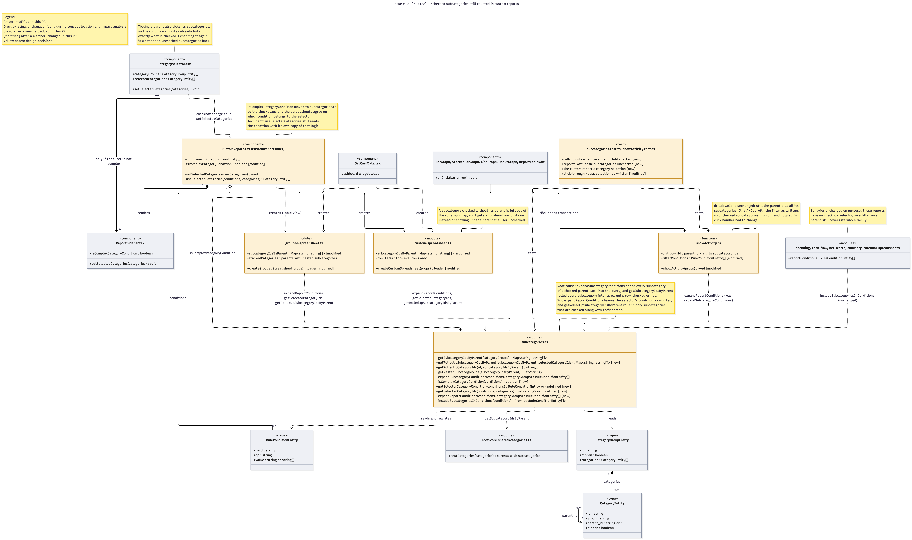
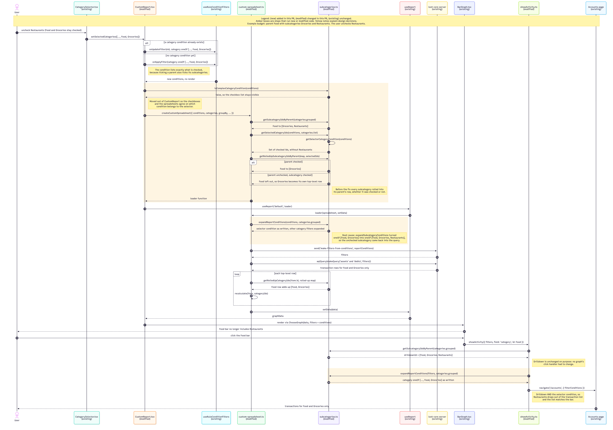

# Issue #100: Fix subcategory visualization in report graphs

**Author:** jamesleonard3rd
**Issue:** #100, unchecked subcategories still counted in custom reports
**Pull request:** #128
**Branch:** `fix/subcategory_graph_display`

Both diagrams cover the code read during concept location and impact analysis
and the code added or changed to resolve the issue.

**Legend** (used in both diagrams)

| Marker | Color | Meaning |
| --- | --- | --- |
| `(modified)` | amber | Existing code changed in this PR |
| `(existing)` | grey | Unchanged code studied during impact analysis |
| `[new]` after a member | | Function or member added in this PR |
| `[modified]` after a member | | Function or member changed in this PR |
| Amber box (sequence diagram) | amber | Steps that run new or modified code |
| Note | yellow box | Annotation explaining a design decision |

Every new function went into an existing file, so there are no all-new classes.
New code is marked with `[new]` on the member.

## Mapping TypeScript and React to UML

Actual Budget is written in TypeScript with React function components and has
almost no classes. The diagrams map its constructs to UML like this:

| Code construct | UML notation |
| --- | --- |
| React function component (e.g. `CustomReport`) | Class marked `«component»`. Props and state are attributes, internal handlers are private (`-`) methods |
| Module of functions (e.g. `subcategories.ts`) | Class marked `«module»` whose methods are the exported functions |
| `type` with fields (e.g. `RuleConditionEntity`) | Class marked `«type»` with attributes only |
| Several files that use the code the same way (e.g. the graph components) | One class listing every file |
| A component that renders a child it controls | Composition |
| A list of values a component holds but doesn't own (`conditions`) | Aggregation |
| A component or module that calls a function in another | Dependency, labeled with the functions called |
| A field that points to another row of the same type (`parent_id`) | Association |

## Class Diagram

## Sequence Diagram

Scenario: a custom report grouped by category shows the parent category Food,
which has the subcategories Groceries and Restaurants. The user unchecks
Restaurants in the category list. The report recalculates and the Food bar no
longer includes Restaurants. The user then clicks the Food bar, and the
transaction list it opens leaves Restaurants out too. Amber boxes mark steps
that run new or modified code.

The Table view runs the same steps through `grouped-spreadsheet.ts`, which
calls the same three functions in `subcategories.ts` as steps 8 to 21.

## Q&A

### Class Diagram

#### 1. Which 1–2 classes are most central to understanding the codebase and solving the issue?

- **`subcategories.ts` (modified).** Every report that handles subcategories goes through this module, and both halves of the bug were here.
  - `expandSubcategoryConditions` turned a filter on a parent into a filter on the parent and all of its subcategories. The category checkboxes already list each checked subcategory, so this added the unchecked ones back into the query.
  - `getSubcategoryIdsByParent` rolled every subcategory into its parent's row, whether it was checked or not.
  - The fix adds `expandReportConditions`, which leaves the checkbox condition as written, and `getRolledUpSubcategoryIdsByParent`, which rolls in only subcategories checked along with their parent. `isComplexCategoryCondition`, `getSelectorCategoryCondition` and `getSelectedCategoryIds` decide which condition belongs to the checkboxes.
- **`custom-spreadsheet.ts` (modified).** This builds the rows and totals that every custom report graph draws. It decides which rows exist and which categories each row adds up. Before the fix, the amounts were already wrong by the time they left this module, so no graph could show the right total. Fixing it here fixed Bar, Stacked Bar, Line, Area, Donut and Budgeted mode at once, along with dashboard widgets, which call it through `GetCardData`.

#### 2. What is the most significant relationship in the diagram?

The dependencies from **`custom-spreadsheet.ts`, `grouped-spreadsheet.ts` and `showActivity.ts` to `subcategories.ts`**, labeled `expandReportConditions`, `getSelectedCategoryIds` and `getRolledUpSubcategoryIdsByParent`.

- They mean that the graphs, the table and the click-through all read the user's checkbox selection through the same functions. Before this PR they each called `expandSubcategoryConditions`, which ignored what was unchecked.
- They also explain why the click-through needed only a one-line change. `showActivity` still asks for the parent and all of its subcategories, but it now combines that with the selection as written. Unchecked subcategories drop out of the transaction list without changing the click handler in any of the five graph components.
- The dependency from the other reports (Spending, Cash Flow and so on) to `includeSubcategoriesInConditions` is labeled unchanged on purpose. Those reports have no checkboxes, so a filter on a parent still covers its whole family there.

#### 3. Is there anything in the design you would change?

Yes, three things:

- **Merge the two ways of reading the checkboxes.** `useSelectedCategories` in `CustomReport.tsx` still reads the checkbox condition with its own copy of the logic, separate from the new `getSelectedCategoryIds`. I didn't merge them because they behave differently when the filter is too complex for the checkboxes, but two copies can drift apart.
- **Keep the checkbox selection apart from typed filters.** The checkboxes and the filter bar share one `RuleConditionEntity`, so a filter typed by hand, like `Category is Food`, can't be told apart from a checkbox selection. In custom reports it now covers Food only, while other reports include Food's subcategories. Saving the selection as its own report field would remove that difference.
- **Show each subcategory on its own.** The issue also asks to see how much each subcategory contributes. The Table view nests subcategory rows under their parent, but the graphs still show one bar per parent. I left a separate bar per subcategory as a follow-up because it needs a new saved report option, a database migration and changes to five graph components.

### Sequence Diagram

#### 1. What starts the sequence, and what is the expected outcome?

It starts when the user unchecks a subcategory, Restaurants, in a custom report's category list while its parent Food stays checked (step 1). If it succeeds:

- The report's category condition lists exactly the checked categories (steps 2–5).
- The report queries only the checked categories (steps 20–25).
- The Food row adds up only Food and Groceries (steps 26–28), so the Food bar no longer includes Restaurants (step 32).
- Clicking the Food bar opens a transaction list that also leaves out Restaurants, so the list matches the bar (steps 33–40).

#### 2. The 2–3 most important steps

- **Steps 20–21: building the query filter (new code).** The spreadsheet calls the new `expandReportConditions`, which leaves the checkbox condition as written and expands only other category filters. This is the root-cause fix. Before, `expandSubcategoryConditions` turned `oneOf [Food, Groceries]` into `oneOf [Food, Groceries, Restaurants]`, so the unchecked subcategory came back into the query.
- **Steps 11–16: deciding which rows exist (new code).** `getSelectedCategoryIds` finds the checked categories, and `getRolledUpSubcategoryIdsByParent` narrows the existing parent-to-subcategory map to them. A subcategory checked without its parent is left out of the map (step 16), so it gets its own row instead of showing under a parent the user unchecked.
- **Steps 34–39: clicking through to transactions (existing drilldown, modified filter).** `showActivity` still builds the drilldown from the parent and all its subcategories with the existing `getSubcategoryIdsByParent` (steps 35–36). It now combines that with `expandReportConditions` instead of `expandSubcategoryConditions` (steps 37–38). Both conditions must match, so Restaurants drops out of the list.

#### 3. Which error cases and alternative paths are left out, and why?

- **Checking every category, or a `notOneOf` condition.** When every category is checked, `setSelectedCategories` deletes the category condition instead of updating it. If the condition is already `notOneOf`, it's updated with the unchecked ids instead. Both are existing branches this PR didn't change, and `getSelectedCategoryIds` handles all of them the same way.
- **A filter too complex for the checkboxes.** With two category conditions, a category group condition, or a match on names or tags, the checkbox list is hidden and `expandReportConditions` falls back to `expandSubcategoryConditions`. That's the behavior from before this PR, and it's covered by a unit test.
- **The Table view and Budgeted mode.** The Table view runs the same steps through `grouped-spreadsheet.ts`. Budgeted mode loads budget amounts with `fetchBudgetData` instead of transaction queries, and the click-through opens the budget page instead of the transaction list. Both use the same helpers in `subcategories.ts`.
- **Changing the selection again before the report finishes loading.** `useReport` cancels the old load, so stale results are never shown. This is existing code.
- **Dashboard widgets.** They build the same spreadsheet through `GetCardData`, but they don't pass the report's filters to the graph's click handler. That's an existing problem, which I noted as tech debt in the PR.

I left these out to keep the diagram on the one path the issue describes and that exercises all of the new code. Drawing every branch would repeat steps 8–32 several times without showing any additional code from this PR.

**Cross-cutting:**

4. If you used AI to create or check any part of the diagrams, describe what it produced, what you verified against the actual code, and what you had to correct or add. If AI was not used, write "N/A."

I used Claude Code (Claude Opus 5.5) to write both diagrams as Mermaid code. It read the branch's diff against `master`, then traced the callers of the changed functions (`CustomReport.tsx`, `ReportSidebar.tsx`, `useReport.ts`, `fetchSpreadsheetQueryData.ts`, the graph components and `showActivity.ts`) so the existing classes and each sequence step match real calls. It rendered both diagrams with the Mermaid CLI to check that they parse and lay out cleanly. Corrections made along the way:

- **The note line breaks and colors** didn't render at first, so it switched to ` ` and per-class `style` lines.
- **The test class's members** were shortened after the first render, because full test names wrapped badly.
- **The issue number:** I first asked for issue #128, which is the pull request. The issue it closes is #100, so the files are named for #100.

I exported the final PNGs from the Mermaid editor. It also drafted these Q&A answers.
