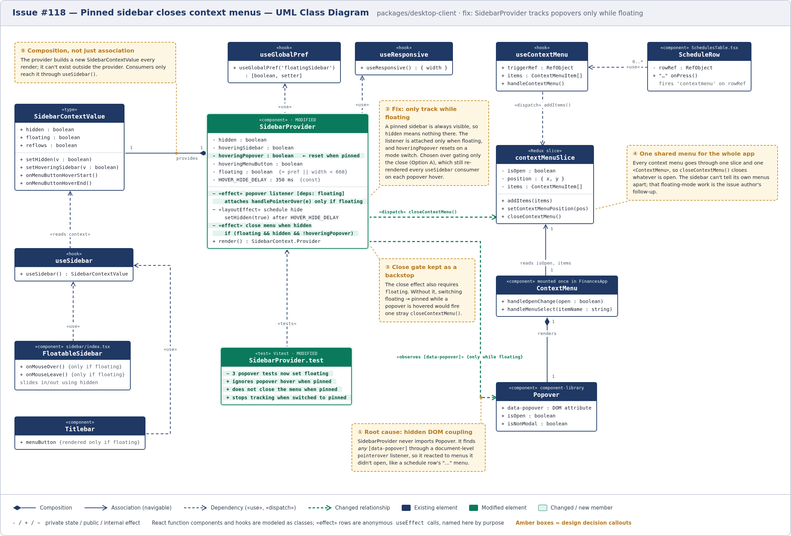
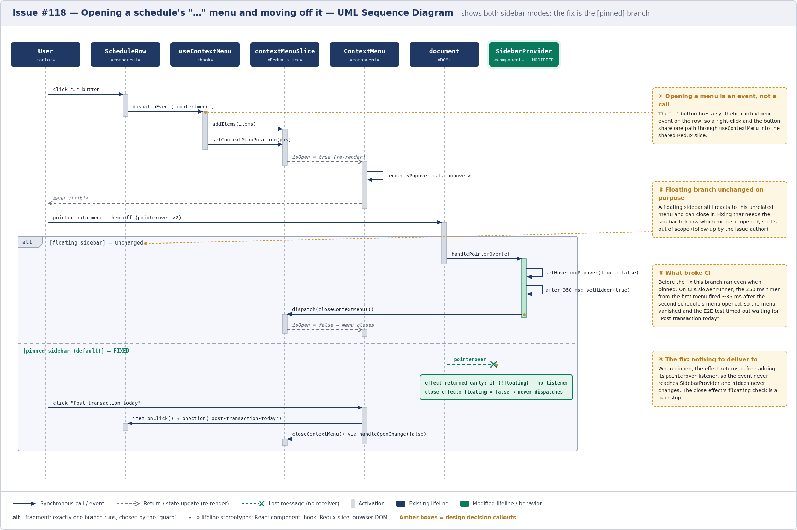

# Issue #118 -- Context menus close ~350 ms after leaving a popover when sidebar is pinned

## Class Diagram

## Sequence Diagram

_Diagram sources (HTML rendered to PNG with Playwright) are in [`src/`](src/); regenerate with `node docs/sprint2/diagrams/src/render.cjs` from the repo root._

## Q&A

**Class diagram:**

1. Among all the classes shown in the diagram, which 1--2 are most central to understanding the codebase and solving the issue? Explain what role each one plays.

   `SidebarProvider` and `contextMenuSlice`. `SidebarProvider` is mounted once near the top of `App` and owns the sidebar's show/hide state for the whole app. Every sidebar-related component reads that state through `useSidebar()`. Both the bug and the fix live in two of its effects: the `pointerover` listener and the effect that closes the context menu once the sidebar is hidden. `contextMenuSlice` is the single piece of Redux state behind _every_ right-click and "…" menu in the app. It explains how a sidebar timer could close a schedule's menu at all: `closeContextMenu()` isn't scoped to any particular menu, so whoever calls it closes whatever happens to be open.

2. What is the most significant relationship shown in the diagram? Explain what it represents in the system and why it matters for understanding the solution.

   The dependency from `SidebarProvider` to `Popover`, labeled «observes [data-popover]». It doesn't show up in any `import`. The provider never references `Popover` in code. It detects it at runtime by checking whether the element under the pointer has a `data-popover` attribute, using a listener on the whole `document`. Because that check matches every popover in the app, the provider reacted to menus it never opened, which is the root cause. The fix makes this relationship conditional (it only exists while the sidebar is floating) instead of removing it, because a floating sidebar still needs it to stay open while its own budget-name menu is hovered. Combined with the «dispatch» `closeContextMenu()` dependency, it's what let a sidebar timer close an unrelated menu.

3. Looking back at your implementation, is there anything in this design you would change, and why?

   The deeper problem is that the sidebar can't tell which menus it owns. Every menu goes through the same slice and the same `<ContextMenu>`, so the fix only removes the problem for pinned mode. A floating sidebar can still close a schedule's menu. I'd make ownership explicit, for example by recording whether the `contextmenu` event came from inside the sidebar (a `data-sidebar` attribute) and only tracking hover or closing menus while the sidebar owns the open one. I'd also pull the hover tracking out of `SidebarProvider` into a small hook such as `usePopoverHover(enabled)`, so the "only while floating" rule could be tested on its own instead of through the whole provider. That file is also still `@ts-strict-ignore`. This was a small issue, and doing much more would have taken it out of its original scope.

**Sequence diagram:**

1. What user action or system event starts the sequence, and what is the expected outcome when it completes successfully?

   It starts when the user (or the E2E test) clicks the "…" button on a schedule row while the sidebar is pinned, then moves the pointer onto the menu and back off it. On success, the menu stays open until the user picks an item. Clicking "Post transaction today" runs that item's action, then closes the menu the normal way through `ContextMenu.handleOpenChange(false)`, not because a sidebar timer fired.

2. Identify the 2--3 most important steps in the sequence. For each one, describe what is happening and note whether it involves existing code or new/modified code from your solution.

   - **`ScheduleRow` fires `contextmenu`, which leads to `addItems(items)` (existing).** The "…" button doesn't call the menu directly. It dispatches a synthetic `contextmenu` event on the row, and `useContextMenu` turns that into a Redux update. That's why this menu shares global state with every other menu, including the sidebar's.
   - **`document` sends `pointerover` to `SidebarProvider` (modified).** In the `[floating]` branch, `handlePointerOver` runs and starts the 350 ms hide timer. In the `[pinned]` branch this is now a lost message: the effect returns before adding the listener, so the event has no receiver and `hidden` never changes.
   - **`SidebarProvider` calls `dispatch(closeContextMenu())` (existing call, modified condition).** This is the step that broke CI. It now also requires `floating`, as a backstop in case the sidebar is switched to pinned while a popover is hovered.

3. What error cases or alternative paths are not shown in the diagram, and why did you leave them out?

   - Closing the menu with Escape, or by clicking outside it. These use `ContextMenu`'s `pointerdown` listener and `Popover`'s `focusout` handling, which this change doesn't touch.
   - Opening the menu with a right-click. After the event fires, it follows exactly the same path as the "…" button.
   - The floating sidebar's own budget-name menu. It behaves as before and is covered by the existing unit tests.
   - Switching from floating to pinned while a popover is hovered. That's a unit-test case, not a user flow.

   One timing detail is also left out: the close effect keeps its `!hoveringPopover` check because React can run the close effect with the old `hidden = true` value before the layout effect's `setHidden(false)` has taken effect. I left these out to keep the diagram on the path that actually failed. Each one is either unaffected by the change or covered by `SidebarProvider.test.ts`.

**Cross-cutting:**

4. If you used AI to create or check any part of the diagrams, describe what it produced, what you verified against the actual code, and what you had to correct or add. If AI was not used, write "N/A."

   I used Claude Code (Claude Opus 5.5), in the same session that implemented the fix. It read the source files, then generated both diagrams as HTML/SVG and rendered them to PNG with Playwright. It also drafted these Q&A answers. Before drawing, it checked each element against the code: how `ScheduleRow`'s "…" button opens the menu (it dispatches a `contextmenu` event rather than calling anything directly), where `<ContextMenu>` is mounted (`FinancesApp`), the slice's fields and actions, and the E2E page model's `postNthSchedule` clicks. Corrections made along the way:
   - **Layout fixes after reviewing each render:** overlapping labels, crossing connectors, and callouts too far from what they point at.
   - **A clearer label:** `setContextMenuPosition({x, y})` was shortened to `setContextMenuPosition(pos)` to match the class diagram.
   - **More accurate wording:** a callout that said "row 3" now says "the second schedule's menu", matching the issue, because the test's index is 0-based.

   After the fix was implemented by AI, I manually checked the code change to make sure the bug was fixed as expected. I ran the app locally and checked the web implementation was fixed, and had Claude tell me what specifically I should test and what behavior to look for. As for the diagram itself, I looked over the entire thing after Claude generated it and it matched how the code works and in fact helped explain how everything worked more clearly to me. 
