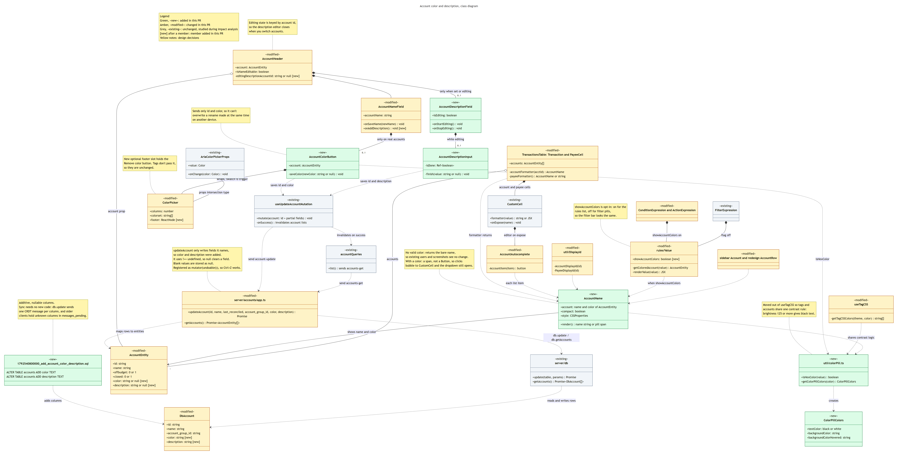
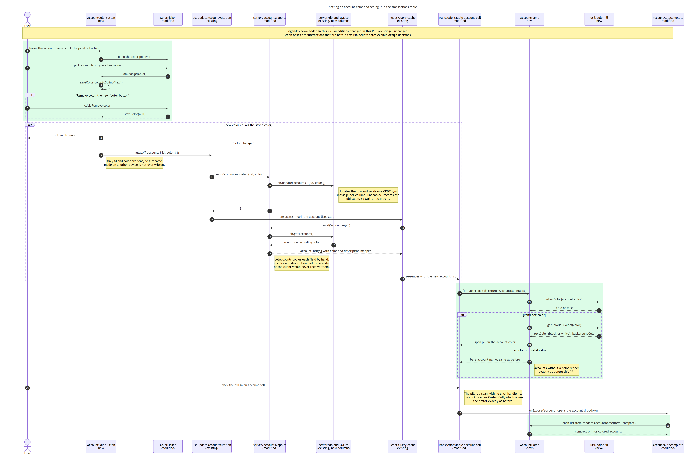
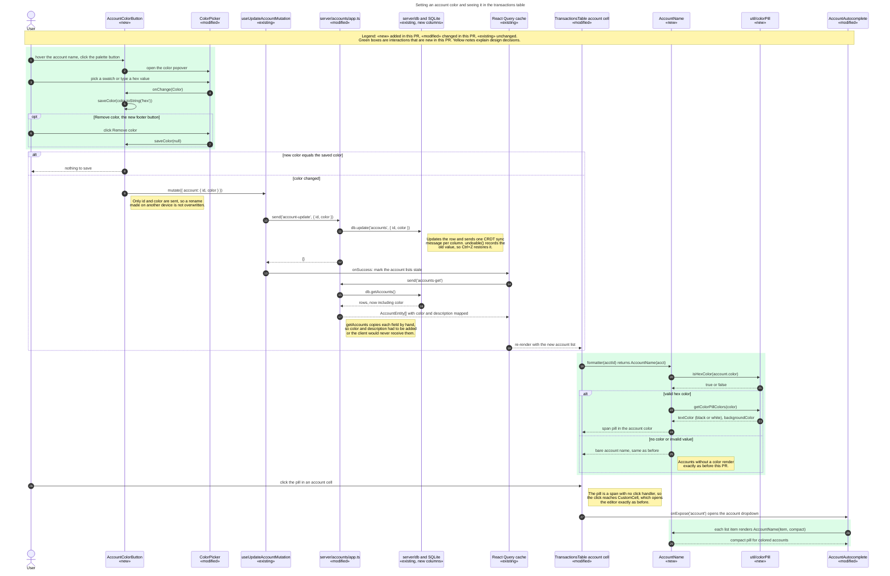

# D6: UML Diagrams for Issue #24, Account Color and Description

**Author:** bennettmatuszewski
**Issue:** #24, account color customization
**Branch:** `feat/issue-24-account-color-description`

Both diagrams cover the code read during concept location and impact analysis
and the code added or changed to resolve the issue.

**Legend** (used in both diagrams)

| Marker | Color | Meaning |
| --- | --- | --- |
| `«new»` | green | Added in this PR |
| `«modified»` | amber | Existing code changed in this PR |
| `«existing»` | grey | Unchanged code studied during impact analysis |
| `[new]` after a member | | Attribute or method added in this PR |
| Note | yellow box | Annotation explaining a design decision |

## Mapping TypeScript and React to UML

Actual Budget is written in TypeScript with React function components and has
almost no classes. The diagrams map its constructs to UML like this:

| Code construct | UML notation |
| --- | --- |
| React function component (e.g. `AccountName`) | Class. Props are attributes, internal handlers are private (`-`) methods |
| Module of functions (e.g. `util/colorPill.ts`, `server/accounts/app.ts`) | Class whose methods are the exported functions |
| `type` with fields (e.g. `AccountEntity`) | Class with attributes only |
| A component that renders a child it controls | Composition |
| A prop passed in from a parent, not owned (e.g. `account`) | Aggregation |
| A component that calls a hook or helper function | Dependency |
| A component that keeps and reads a value of a type | Association |
| An intersection type `{...} & Base` | Generalization |
| A React hook (e.g. `useUpdateAccountMutation`) | Class |

## Class Diagram

## Sequence Diagram

Scenario: on an account page, the user picks a color for the account. The
color is saved, the All Accounts table redraws with the account as a pill, and
clicking the pill still opens the account dropdown. Green boxes mark
interactions that are new in this PR.

The description is saved the same way, starting in `AccountDescriptionInput`.
It calls `useUpdateAccountMutation` with `{ id, description }`, and the rest of
the save path is the same as steps 9 to 18 above. It isn't shown in tables.

## Q&A

### Class Diagram

#### 1. Which 1–2 classes are most central to understanding the codebase and solving the issue?

- **`server/accounts/app.ts`, specifically `updateAccount` and `getAccounts` (modified).** This is the only way account data moves between the database and the UI.
  - `updateAccount` is what the `account-update` message runs, and it saves only the fields it names. Anything else the UI sends is silently dropped.
  - `getAccounts` builds every account the UI receives, field by field.
  - Understanding this class showed me that adding columns to the table wasn't enough. Until `color` and `description` were added to both functions, nothing in the UI could save or see them. It also shows why sync and undo needed no new code: `updateAccount` is registered as `mutator(undoable(...))` and writes through the generic `db.update`.
- **`AccountName` (new).** This is the one component that turns an account into what the user sees.
  - If the account has a valid color, it renders a colored pill. Otherwise it returns the plain name, exactly as before.
  - Six places that show account names use it: the transactions table, schedules, rules, both sidebars and the account dropdown. So "show the color wherever the account name appears in a table" was solved in one place rather than six.

#### 2. What is the most significant relationship in the diagram?

The dependency **`TransactionsTable ..> AccountName` ("formatter returns")**, read together with the composition **`CustomCell *-- AccountAutocomplete` ("editor on expose")**.

- The Account column's cell formatter now returns an `AccountName` element instead of a plain string. `CustomCell` draws whatever the formatter returns, and when clicked it opens `AccountAutocomplete`.
- This relationship carries two acceptance criteria at once. The color must show in the table, and clicking an account on the All Accounts page must still open the dropdown "same as before".
- Both work because `AccountName` renders a plain `` with no click handler, so the click reaches `CustomCell`. Had I copied the tag pattern, where the pill is a `Button`, this relationship would have broken the existing dropdown.

#### 3. Is there anything in the design you would change?

Yes, two things:

- **Validate colors on the server.** Right now `updateAccount` stores any string as a color, and only the UI checks the format with `isHexColor`. That works because a bad value just shows as plain text, but the database can still hold invalid data written through the public API.
  - I'd add a small check in `updateAccount`.
  - I'd also make the account page's rename send only `{ id, name }`. Today it sends the whole account, which can overwrite a color set on another device at the same moment.
- **Support transfer pills in split transactions.** I put the transfer-payee pill in `PayeeCell` using the transfer-account lookup that component already had, which was the smallest change. As a result, parent rows of split transactions don't show it. If I did this again, I'd change the shared `useDisplayPayee` hook to return the transfer account along with the display text, so every screen that shows payees could draw the pill consistently.

### Sequence Diagram

#### 1. What starts the sequence, and what is the expected outcome?

It starts when the user, on an individual account page, hovers over the account name, clicks the palette button and picks a color (steps 1–4). If it succeeds:

- The color is saved in the account's database row, synced to other devices, and can be undone with Ctrl+Z.
- The account list is refetched.
- The All Accounts transactions table redraws with that account's name as a colored pill.
- Clicking the pill still opens the account dropdown, and the dropdown's list items show colored pills too (steps 26–29).

#### 2. The 2–3 most important steps

- **Steps 9–11: saving the color (mostly existing code, one modified function).** `AccountColorButton` (new) calls the existing `useUpdateAccountMutation` with only `{ id, color }`. That sends `account-update` to the backend, where `updateAccount` (modified) passes the field to the existing `db.update`. `db.update` writes the row and sends one CRDT sync message per changed column. Sending a single field is a deliberate choice: it can't overwrite a rename made on another device at the same time.
- **Steps 14–17: reloading the accounts (existing caching, modified mapping).** When the save succeeds, the existing React Query cache marks the account list stale and requests `accounts-get` again. `getAccounts` (modified) copies `color` and `description` into each `AccountEntity`. Without that change, the color would be saved in the database but never reach the screen.
- **Steps 19–24: drawing the pill (new code).** The table cell's formatter returns `AccountName(acct)`. `AccountName` checks the color with `isHexColor` and gets black or white text from `getColorPillColors`, both in the new `util/colorPill.ts`, then renders a `` pill. If the color is missing or invalid, it returns the plain name (step 25), so accounts without a color look exactly as before.

#### 3. Which error cases and alternative paths are left out, and why?

- **The save failing.** If `account-update` fails, `useUpdateAccountMutation` runs its existing `onError` handler, which shows the notification "There was an error updating the account". The color isn't saved and the table doesn't change. I left this out because it's existing, generic error handling that this PR didn't change.
- **An invalid typed color.** `ColorPicker` ignores typed text until it matches `#RRGGBB`, so `onChange` never fires with a bad value. That filtering happens inside an existing component.
- **Undo, sync to other devices, and older clients.** Ctrl+Z runs the existing undo system. Other devices apply the existing CRDT messages. Older clients that don't have the new columns yet hold those messages in `messages_pending` until they upgrade. All of this is built into `db.update` and `undoable()`, and none of it is new code.
- **Editing the description.** It goes through the same save path (steps 9–18), starting in `AccountDescriptionInput` with `{ id, description }`. I mention it under the diagram instead of drawing it, to avoid repeating the same steps.

I left these out to keep the diagram focused on the one complete success scenario that exercises the new and modified code. Drawing every path would have roughly doubled its size without showing any additional code from this PR.

## Diagram Source

The images above were rendered from this Mermaid source with Mermaid 11.16.1.
GitHub also renders it directly when a section is expanded.

```mermaid
---
title: Account color and description, class diagram
---
classDiagram
    direction TB

    %% ---------- loot-core: data and server ----------
    class Migration["1792540800000_add_account_color_description.sql"] {
        <<new>>
        ALTER TABLE accounts ADD color TEXT
        ALTER TABLE accounts ADD description TEXT
    }
    class DbAccount {
        <<modified>>
        +id: string
        +name: string
        +account_group_id: string
        +color: string [new]
        +description: string [new]
    }
    class AccountEntity {
        <<modified>>
        +id: string
        +name: string
        +offbudget: 0 or 1
        +closed: 0 or 1
        +color: string or null [new]
        +description: string or null [new]
    }
    class AccountsApp["server/accounts/app.ts"] {
        <<modified>>
        +updateAccount(id, name, last_reconciled, account_group_id, color, description) Promise
        +getAccounts() Promise~AccountEntity[]~
    }
    class Db["server/db"] {
        <<existing>>
        +update(table, params) Promise
        +getAccounts() Promise~DbAccount[]~
    }

    %% ---------- desktop-client: data hooks ----------
    class useUpdateAccountMutation {
        <<existing>>
        +mutate(account: id + partial fields) void
        -onSuccess() invalidates account lists
    }
    class accountQueries {
        <<existing>>
        +list() sends accounts-get
    }

    %% ---------- desktop-client: account page editing ----------
    class AccountHeader {
        <<modified>>
        +account: AccountEntity
        +isNameEditable: boolean
        -editingDescriptionAccountId: string or null [new]
    }
    class AccountNameField {
        <<modified>>
        +accountName: string
        +onSaveName(newName) void
        +onAddDescription() void [new]
    }
    class AccountColorButton {
        <<new>>
        +account: AccountEntity
        -saveColor(newColor: string or null) void
    }
    class AccountDescriptionField {
        <<new>>
        +isEditing: boolean
        +onStartEditing() void
        +onStopEditing() void
    }
    class AccountDescriptionInput {
        <<new>>
        -isDone: Ref~boolean~
        -finish(value: string or null) void
    }
    class ColorPicker {
        <<modified>>
        +columns: number
        +colorset: string[]
        +footer: ReactNode [new]
    }
    class AriaColorPickerProps {
        <<existing>>
        +value: Color
        +onChange(color: Color) void
    }

    %% ---------- desktop-client: display ----------
    class colorPill["util/colorPill.ts"] {
        <<new>>
        +isHexColor(value) boolean
        +getColorPillColors(color) ColorPillColors
    }
    class ColorPillColors {
        <<new>>
        +textColor: black or white
        +backgroundColor: string
        +backgroundColorHovered: string
    }
    class useTagCSS {
        <<modified>>
        -getTagCSSColors(theme, color) string[]
    }
    class AccountName {
        <<new>>
        +account: name and color of AccountEntity
        +compact: boolean
        +style: CSSProperties
        +render() name string or pill span
    }
    class TransactionsTable["TransactionsTable: Transaction and PayeeCell"] {
        <<modified>>
        +accounts: AccountEntity[]
        -accountFormatter(acctId) AccountName
        -payeeFormatter() AccountName or string
    }
    class CustomCell {
        <<existing>>
        +formatter(value) string or JSX
        +onExpose(name) void
    }
    class AccountAutocomplete {
        <<modified>>
        -AccountItem(item) button
    }
    class DisplayId["util/DisplayId"] {
        <<modified>>
        -AccountDisplayId(id)
        -PayeeDisplayId(id)
    }
    class RulesValue["rules/Value"] {
        <<modified>>
        +showAccountColors: boolean [new]
        -getColoredAccount(value) AccountEntity
        -renderValue(value) JSX
    }
    class RuleExpressions["ConditionExpression and ActionExpression"] {
        <<modified>>
    }
    class FilterExpression {
        <<existing>>
    }
    class SidebarRows["sidebar Account and redesign AccountRow"] {
        <<modified>>
    }

    %% ---------- relationships: data ----------
    Migration ..> DbAccount : adds columns
    Db ..> DbAccount : reads and writes rows
    AccountsApp ..> Db : db.update / db.getAccounts
    AccountsApp ..> AccountEntity : maps rows to entities
    useUpdateAccountMutation ..> AccountsApp : send account-update
    accountQueries ..> AccountsApp : send accounts-get
    useUpdateAccountMutation ..> accountQueries : invalidates on success

    %% ---------- relationships: editing ----------
    AccountHeader o-- AccountEntity : account prop
    AccountHeader *-- AccountNameField
    AccountHeader *-- "0..1" AccountDescriptionField : only when set or editing
    AccountNameField *-- "0..1" AccountColorButton : only on real accounts
    AccountDescriptionField *-- "0..1" AccountDescriptionInput : while editing
    AccountColorButton *-- ColorPicker : wraps, swatch is trigger
    AriaColorPickerProps <|-- ColorPicker : props intersection type
    AccountColorButton ..> useUpdateAccountMutation : saves id and color
    AccountDescriptionInput ..> useUpdateAccountMutation : saves id and description
    AccountColorButton ..> colorPill : isHexColor

    %% ---------- relationships: display ----------
    colorPill ..> ColorPillColors : creates
    useTagCSS ..> colorPill : shares contrast logic
    AccountName ..> colorPill
    AccountName --> AccountEntity : shows name and color
    TransactionsTable o-- "*" AccountEntity : accounts
    TransactionsTable *-- CustomCell : account and payee cells
    TransactionsTable ..> AccountName : formatter returns
    CustomCell *-- AccountAutocomplete : editor on expose
    AccountAutocomplete ..> AccountName : each list item
    DisplayId ..> AccountName
    RulesValue ..> AccountName : when showAccountColors
    RuleExpressions *-- RulesValue : showAccountColors on
    FilterExpression *-- RulesValue : flag off
    SidebarRows ..> AccountName

    %% ---------- annotations ----------
    note "Legend<br>Green, «new»: added in this PR<br>Amber, «modified»: changed in this PR<br>Grey, «existing»: unchanged, studied during impact analysis<br>[new] after a member: member added in this PR<br>Yellow notes: design decisions"
    note for Migration "Additive, nullable columns.<br>Sync needs no new code: db.update sends<br>one CRDT message per column, and older<br>clients hold unknown columns in messages_pending."
    note for AccountsApp "updateAccount only writes fields it names,<br>so color and description were added.<br>It uses !== undefined, so null clears a field.<br>Blank values are stored as null.<br>Registered as mutator(undoable()), so Ctrl+Z works."
    note for AccountName "No valid color: returns the bare name,<br>so existing users and screenshots see no change.<br>With a color: a span, not a Button, so clicks<br>bubble to CustomCell and the dropdown still opens."
    note for colorPill "Moved out of useTagCSS so tags and<br>accounts share one contrast rule:<br>brightness 125 or more gives black text."
    note for AccountColorButton "Sends only id and color, so it can't<br>overwrite a rename made at the same time<br>on another device."
    note for ColorPicker "New optional footer slot holds the<br>Remove color button. Tags don't pass it,<br>so they are unchanged."
    note for RulesValue "showAccountColors is opt-in: on for the<br>rules list, off for filter pills,<br>so the filter bar looks the same."
    note for AccountHeader "Editing state is keyed by account id,<br>so the description editor closes<br>when you switch accounts."

    %% ---------- legend colors ----------
    style Migration fill:#dcfce7,stroke:#15803d
    style AccountColorButton fill:#dcfce7,stroke:#15803d
    style AccountDescriptionField fill:#dcfce7,stroke:#15803d
    style AccountDescriptionInput fill:#dcfce7,stroke:#15803d
    style colorPill fill:#dcfce7,stroke:#15803d
    style ColorPillColors fill:#dcfce7,stroke:#15803d
    style AccountName fill:#dcfce7,stroke:#15803d

    style DbAccount fill:#fef3c7,stroke:#b45309
    style AccountEntity fill:#fef3c7,stroke:#b45309
    style AccountsApp fill:#fef3c7,stroke:#b45309
    style AccountHeader fill:#fef3c7,stroke:#b45309
    style AccountNameField fill:#fef3c7,stroke:#b45309
    style ColorPicker fill:#fef3c7,stroke:#b45309
    style useTagCSS fill:#fef3c7,stroke:#b45309
    style TransactionsTable fill:#fef3c7,stroke:#b45309
    style AccountAutocomplete fill:#fef3c7,stroke:#b45309
    style DisplayId fill:#fef3c7,stroke:#b45309
    style RulesValue fill:#fef3c7,stroke:#b45309
    style RuleExpressions fill:#fef3c7,stroke:#b45309
    style SidebarRows fill:#fef3c7,stroke:#b45309

    style Db fill:#f1f5f9,stroke:#64748b
    style useUpdateAccountMutation fill:#f1f5f9,stroke:#64748b
    style accountQueries fill:#f1f5f9,stroke:#64748b
    style AriaColorPickerProps fill:#f1f5f9,stroke:#64748b
    style CustomCell fill:#f1f5f9,stroke:#64748b
    style FilterExpression fill:#f1f5f9,stroke:#64748b
```

Class diagram source (Mermaid)

Sequence diagram source (Mermaid)

