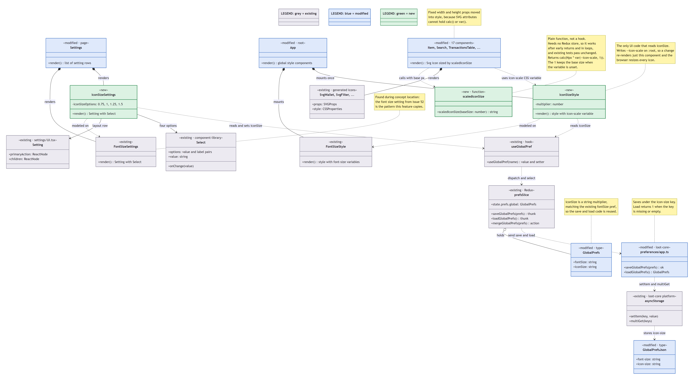
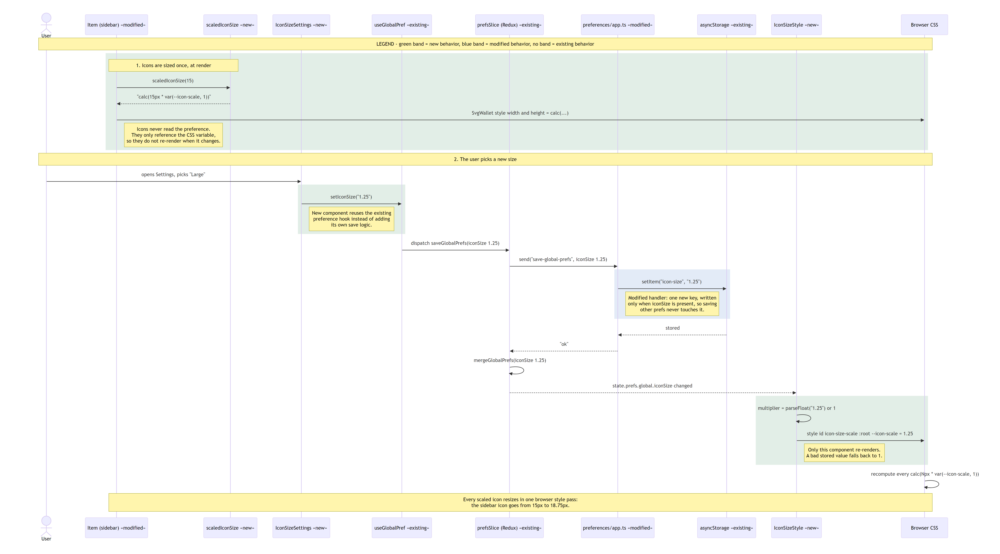

# Issue #53 -- Add the ability to increase icon sizes

## Class Diagram

## Sequence Diagram

## Q&A

**Class diagram:**

1. Among all the classes shown in the diagram, which 1--2 are most central to understanding the codebase and solving the issue? Explain what role each one plays.
IconSizeStyle and scaledIconSize are most central to understanding the codebase and solving the issue. This is because IconSizeStyle not only links the saved setting and what appears on screen, but also reads the iconSize preference. scaledIconSize is important because it contains the helper function that all 17 icon components call to get their size.

2. What is the most significant relationship shown in the diagram? Explain what it represents in the system and why it matters for understanding the solution.
The relationship between IconSizeStyle and the icon components is the most significant. This is because it explains how a single setting resizes icons across the whole app (i.e. how no icon component subscribes to the preference, changing the setting doesn't re-render every icon, and why the change doesn't break tests that render icons without the store).

3. Looking back at your implementation, is there anything in this design you would change, and why?
I would both mainly want to scale icons in one shared place. This solution required editing 17 hard-coded components, so any icon I didn't touch stays the same size. A better design would apply scaledIconSize once, in the shared SVG icon component in the component library, so every icon scales automatically. I would also want to round to whole pixels and let containers grow with icon rather than letting them stay blurry or too cramped.

**Sequence diagram:**

1. What user action or system event starts the sequence, and what is the expected outcome when it completes successfully?
The user opening settings and selecting a size from the icon size dropdown menu starts the sequence. It completes successfully when the icon sizes visually change to match the size selected (i.e. for "Large," the icons are scaled by 1.5 and the user can see this).

2. Identify the 2--3 most important steps in the sequence. For each one, describe what is happening and note whether it involves existing code or new/modified code from your solution.
1. Saving the choice: setIconSize → saveGlobalPrefs → send('save-global-prefs') → asyncStorage.setItem('icon-size', …). This is mostly existing code from the font size save path. The modified part is the new icon size branch in preferences/app.ts.
2. Updating the CSS variable: mergeGlobalPrefs updates the Redux store, IconSizeStyle re-renders, and it writes :root { --icon-scale: 1.25 }. This is new code.
3. Browser resize: the browser recalculates every calc(<base>px * var(--icon-scale, 1)) and the icons grow. The recalculation is plain browser behavior, but the calc() values come from the modified icon components.

3. What error cases or alternative paths are not shown in the diagram, and why did you leave them out?
Save failures, like invalid stored values, are not shown in the diagram. Any failure would load the default size ("Medium," or a scale of 1) on startup. I left it out of the diagram to avoid clutter as that was the status quo before the solution anyhow.

**Cross-cutting:**

4. I used AI to draw the diagrams, as I used AI to write the code. I went through and read the diagrams to understand them, and then answered the questions the best I could myself.