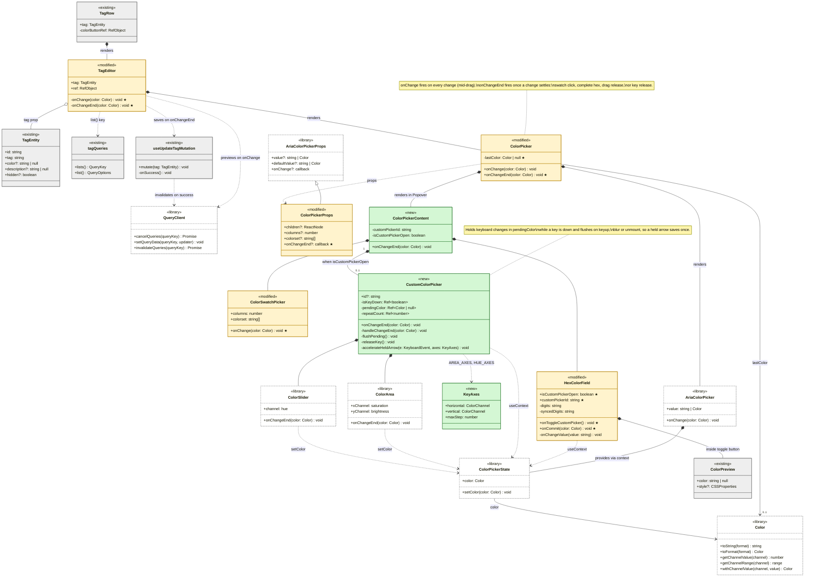
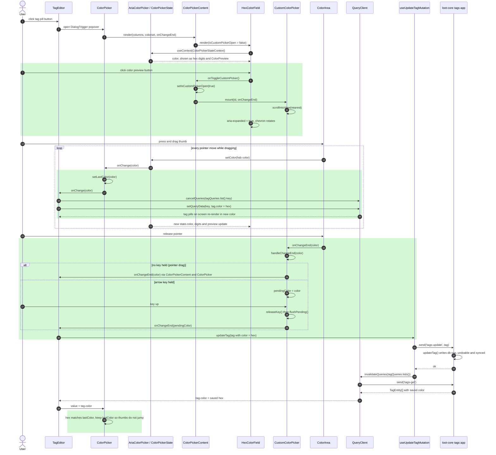

# D6: UML Diagrams for Issue #67, Custom Color Picker for Tags

**Author:** icsasso
**Issue:** #67, pick any tag color with a color wheel
**PR:** #144, `[AI] Add color picker to tag color editor`
**Branch:** `feat/issue-67-color-wheel`

Both diagrams cover the code read during concept location and impact analysis
and the code added or changed to resolve the issue. They are written in
[Mermaid](https://mermaid.js.org/), so GitHub renders them directly.

**Legend** (used in both diagrams)

| Marker | Color | Meaning |
| --- | --- | --- |
| `«new»` | green | Added in this PR |
| `«modified»` | amber | Existing code changed in this PR |
| `«existing»` | grey | Unchanged project code studied during impact analysis |
| `«library»` | white, dashed | Third-party code (`react-aria-components`, TanStack Query) |
| `★` after a member | | Attribute or method added in this PR |
| Green background | sequence diagram | Interactions that are new in this PR |

## Mapping TypeScript and React to UML

Actual Budget is written in TypeScript with React function components and has
almost no classes. The diagrams map its constructs to UML like this:

| Code construct | UML notation |
| --- | --- |
| React function component (e.g. `CustomColorPicker`) | Class. Props are public (`+`) attributes or methods, `useState`/`useRef` values and inner handlers are private (`-`) |
| `type` with fields (e.g. `TagEntity`, `KeyAxes`) | Class with attributes only |
| Callback prop (e.g. `onChangeEnd`) | Public method, since the parent supplies its behavior |
| A component that renders a child and controls its lifetime | Composition |
| A prop object passed in from a parent, not owned (e.g. `tag`) | Aggregation |
| A component that calls a hook, helper or context (e.g. `useContext(ColorPickerStateContext)`) | Dependency |
| An intersection type `{...} & AriaColorPickerProps` | Generalization |
| A React hook (e.g. `useUpdateTagMutation`) or query-key module (`tagQueries`) | Class |

## Class Diagram

## Sequence Diagram

Scenario: on the Tags page, the user opens a tag's color popover, opens the
custom picker from the color preview button, and drags the
saturation/brightness thumb to a new color. Every tag on screen recolors live
during the drag, and the color is saved once when the pointer is released.
Green boxes mark interactions that are new in this PR.

A swatch click or a complete hex value takes a shorter path to the same save:
`ColorSwatchPicker.onChange` or `HexColorField.onCommit` calls `onChangeEnd`
directly, then steps from `updateTag` onward are the same as above.

## Q&A

### Class Diagram

#### 1. Which 1–2 classes are most central to understanding the codebase and solving the issue?

- **`ColorPicker` (modified).** It is the shared component every color
  control in the app uses, and it wraps `react-aria-components`'
  `ColorPicker`, which owns the one `ColorPickerState` that the swatches, the
  hex field and the new custom picker all read and write. Understanding that
  shared state is what let the custom picker stay in sync with the other two
  controls without any wiring of its own. This PR also gave it the new
  `onChangeEnd` prop, which splits "the color changed" (`onChange`, many times
  per second while dragging) from "the user settled on a color"
  (`onChangeEnd`).
- **`CustomColorPicker` (new).** It renders the saturation/brightness
  `ColorArea` and the hue `ColorSlider` that the issue asked for. It also
  handles the keyboard: held arrow keys accelerate through
  `accelerateHeldArrow`, and changes made while a key is down are held in
  `pendingColor` so they save once on release instead of once per key repeat.

#### 2. What is the most significant relationship in the diagram?

The two dependencies from **`TagEditor`**: **`..> QueryClient` ("previews on
onChange")** and **`..> useUpdateTagMutation` ("saves on onChangeEnd")**.

- Before this PR, `TagEditor` saved on every `onChange`. That was fine for
  swatches, but a drag on the new color area fires dozens of changes per
  second, each of which would have been a database write, an undo entry and a
  sync message.
- Splitting the two callbacks fixes that: `onChange` only writes the new color
  into the React Query cache with `setQueryData`, so every tag pill on screen
  recolors live, and `onChangeEnd` saves once through the existing mutation.

#### 3. Is there anything in the design you would change?

- **Move the live preview into a hook.** The cache-preview logic in
  `TagEditor` (`cancelQueries` plus `setQueryData`) is specific to tags. If
  accounts or categories use the custom picker later, each would copy it. A
  small `useOptimisticTagColor` hook, or a generic helper in `#tags`, would keep
  it in one place and make it testable on its own.
- **Revert the preview if the save fails.** If `tags-update` fails, the cache
  keeps the previewed color until the next refetch. Saving the previous list in
  `onMutate` and restoring it in `onError` would close that gap.
- **`lastColor` in `ColorPicker`.** It exists only because tags store colors
  as hex, which loses hue for grays. Storing the color as HSB, or letting the
  caller pass a `Color`, would remove the workaround.

### Sequence Diagram

#### 1. What starts the sequence, and what is the expected outcome?

It starts when the user clicks a tag's pill on the Tags page, then clicks the
color preview button next to the hex field (steps 1–12). Dragging the thumb
on the color area recolors every visible tag live without saving (steps
13–21). When the pointer is released, the color is saved once, can be undone,
is synced to other devices, and the tags list is refetched with the saved
color (steps 22 onward).

#### 2. The 2–3 most important steps

- **Opening the custom picker (new).** `HexColorField` calls
  `onToggleCustomPicker`, and `ColorPickerContent` flips
  `isCustomPickerOpen` and mounts `CustomColorPicker`. The preview button
  reports `aria-expanded` and `aria-controls` so screen readers announce it as
  a disclosure.
- **The drag loop (new handling of an existing callback).** `ColorArea` calls
  `setColor` on the shared state, which fires `onChange`. `TagEditor` writes
  the color into the cached tags list instead of saving, which is what makes
  the preview live and cheap.
- **Settling the change (new).** `ColorArea.onChangeEnd` goes through
  `CustomColorPicker.handleChangeEnd`. For a pointer drag it passes straight
  to `TagEditor.onChangeEnd`. For a held key it waits for key up. Either way
  `updateTag` runs once, and the rest of the save path (`tags-update`,
  `invalidateQueries`, `tags-get`) is existing code.

#### 3. Which error cases and alternative paths are left out, and why?

- **The save failing.** `useUpdateTagMutation`'s existing `onError` shows a
  notification. It is unchanged by this PR.
- **The hue slider.** It follows exactly the same steps as the color area,
  through the same `handleChangeEnd`, so drawing it would repeat the diagram.
- **Closing the popover mid-keypress or moving focus away.** The unmount
  cleanup and `onBlur` both call `flushPending`, so the pending color is still
  saved. This is a guard for an edge case rather than part of the main flow.
- **Swatch clicks and typed hex values.** Described under the diagram. They
  call `onChangeEnd` directly and join the same save path.

**Cross-cutting:**

4. If you used AI to create or check any part of the diagrams, describe what it produced, what you verified against the actual code, and what you had to correct or add. If AI was not used, write "N/A."

I used Claude to produce the diagrams, but I looked over them and verified against the actual code. From what I could see, everything produced by the AI was accurate to the real code, so I didn't need to correct or add anything, which was very helpful.